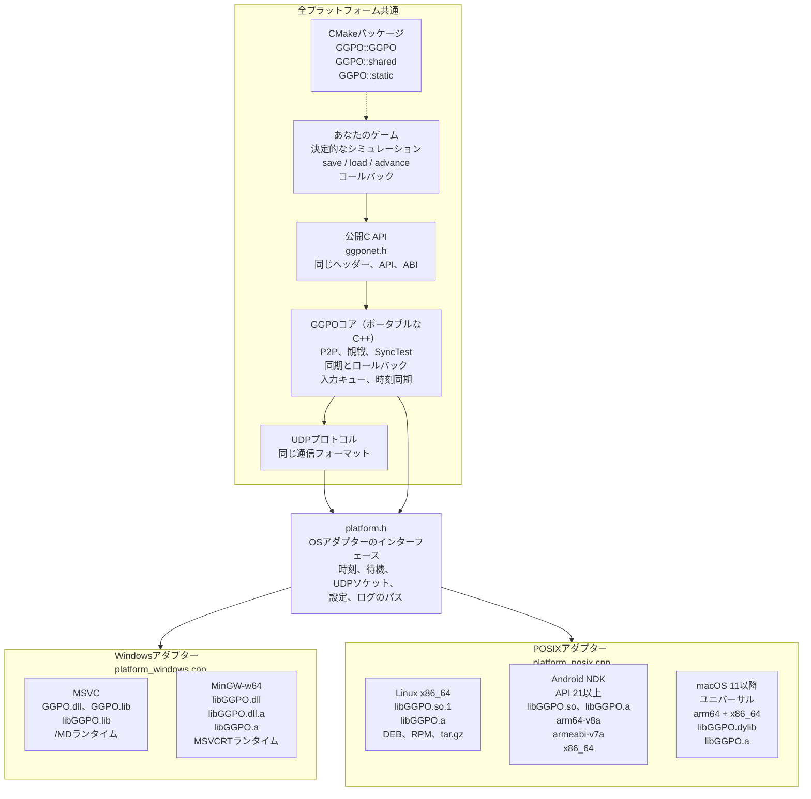

# GGPO開発者ガイド

([English](DeveloperGuide.md))

> **注:** この日本語版はAIで翻訳したもので、日本語ネイティブによるレビューは受けていません。英語版と内容が異なる場合は、[英語版](DeveloperGuide.md)が正となります。リンク先のアーキテクチャ文書とAPIリファレンスは英語のみです。

GGPOネットワークライブラリ開発者ガイドは、アプリケーションにGGPOネットワークライブラリを組み込む開発者向けのドキュメントです。

## 目次

- [プラットフォームの概要](#platform-overview)
- [SDKのインストール](#install-the-sdk)
  - [Windows（MSVC）](#windows-with-msvc)
    - [MSVC: リリースSDK](#msvc-release-sdk)
    - [MSVC: ソースからのビルド](#msvc-build-from-source)
    - [MSVC: 動的リンク](#msvc-dynamic-linking)
    - [MSVC: 静的リンク](#msvc-static-linking)
    - [MSVC: 配布](#msvc-deploy)
  - [Windows（MinGW-w64）](#windows-with-mingw-w64)
    - [MinGW: リリースSDK](#mingw-release-sdk)
    - [MinGW: ソースからのビルド](#mingw-build-from-source)
    - [MinGW: 動的リンク](#mingw-dynamic-linking)
    - [MinGW: 静的リンク](#mingw-static-linking)
    - [MinGW: Linuxからのクロスコンパイル](#mingw-cross-compile-from-linux)
    - [MinGW: 配布](#mingw-deploy)
  - [Linux](#linux)
    - [Linux: DEBまたはRPMパッケージ](#linux-deb-or-rpm-package)
    - [Linux: 素のSDK（`tar.gz`）](#linux-raw-sdk-targz)
    - [Linux: ソースからのビルド](#linux-build-from-source)
    - [Linux: 動的リンク](#linux-dynamic-linking)
    - [Linux: 静的リンク](#linux-static-linking)
    - [Linux: 配布](#linux-deploy)
  - [Android](#android)
    - [Android: リリースSDK](#android-release-sdk)
    - [Android: ソースからのビルド](#android-build-from-source)
    - [Android: 動的リンク](#android-dynamic-linking)
    - [Android: 静的リンク](#android-static-linking)
    - [Android: 配布](#android-deploy)
  - [macOS](#macos)
    - [macOS: リリースSDK](#macos-release-sdk)
    - [macOS: ソースからのビルド](#macos-build-from-source)
    - [macOS: 動的リンク](#macos-dynamic-linking)
    - [macOS: 静的リンク](#macos-static-linking)
    - [macOS: 配布](#macos-deploy)
- [全プラットフォーム共通](#common-to-all-platforms)
  - [SDKの内容](#sdk-contents)
  - [アプリケーションへのGGPOのリンク](#link-ggpo-into-an-application)
    - [プラットフォームごとの静的リンクと動的リンク](#static-versus-dynamic-on-each-platform)
  - [CMakeを使わないリンク](#linking-without-cmake)
  - [ビルドオプション](#build-options)
  - [浮動小数点の決定性](#floating-point-determinism)
  - [配布とライセンス](#deployment-and-license)
  - [単体のVector Warサンプルを実行する](#run-the-standalone-vector-war-sample)
  - [インターネット経由でVector Warを遊ぶ](#play-vector-war-over-the-internet)
  - [0.3.0からのアップグレード](#upgrading-from-030)
- [ゲームステートと入力](#game-state-and-inputs)
- [同期にステートと入力を使用する](#using-state-and-inputs-for-synchronization)
- [プログラミングガイド](#programming-guide)
  - [セッションの作成](#create-a-session)
  - [プレイヤーの登録](#register-players)
  - [ステートコールバックの実装](#implement-state-callbacks)
  - [1フレームの実行](#run-one-frame)
- [アプリケーションのチューニング: フレーム遅延 vs 投機的実行](#tuning-your-application-frame-delay-vs-speculative-execution)
- [サンプルアプリケーション](#sample-application)
- [ベストプラクティスとトラブルシューティング](#best-practices-and-troubleshooting)
  - [ゲームステートを非ゲームステートから分離する](#isolate-game-state-from-non-game-state)
  - [ゲームステートを進める際の固定時間を定義する](#define-a-fixed-time-quanta-for-advancing-your-game-state)
  - [ゲームループ内のレンダリングからゲームステートの更新を分離する](#separate-updating-game-state-from-rendering-in-your-game-loop)
  - [ゲームステートの進行が決定的であることを確認する](#make-sure-your-game-state-advances-deterministically)
    - [乱数ジェネレーターに気を付ける](#beware-of-random-number-generators)
    - [外部の時刻情報(壁時計時間)に気を付ける](#beware-of-external-time-sources-aka-wall-clock-time)
  - [ダングリングポインターに気を付ける](#beware-of-dangling-references)
  - [静的変数や隠れたステートに気を付ける](#beware-of-static-variables-or-other-hidden-state)
  - [GGPOの同期テスト機能をたくさん使いましょう](#use-the-ggpo-synctest-feature--a-lot)
- [さらに詳しく知りたい方は](#where-to-go-from-here)

<a id="platform-overview"></a>
## プラットフォームの概要

プラットフォーム層より上は、どのプラットフォームでも同じコード、API、通信フォーマットです。異なるのは`platform.h`の背後にある小さなOSアダプター、ツールチェーン、パッケージされるファイルだけです。どの2つのプラットフォームのピア同士でも対戦できます。



下部の各ボックスは[プラットフォーム別のセクション](#install-the-sdk)で、上部のボックスは[共通のセクション](#common-to-all-platforms)で説明します。内部構造は[アーキテクチャ文書](architecture/README.md)に記載されています。

<a id="install-the-sdk"></a>
## SDKのインストール

GGPOは5つのプラットフォームをサポートしています。以下にプラットフォームごとのセクションがあり、それぞれリリースSDKの利用、ソースからのビルド、動的リンク、静的リンク、配布の小節に分かれています。すべてのプラットフォームに共通する内容（CMakeの使い方、ビルドオプション、浮動小数点、Vector War）は[全プラットフォーム共通](#common-to-all-platforms)にまとめています。

| プラットフォーム | リリースのダウンロード |
| --- | --- |
| [Windows（MSVC）](#windows-with-msvc)（Visual Studio、clang-cl） | `ggpo-1.0.0-windows-x64.zip`、`ggpo-1.0.0-windows-x86.zip` |
| [Windows（MinGW-w64）](#windows-with-mingw-w64)（MSYS2、クロスコンパイラー） | `ggpo-1.0.0-windows-x64-mingw.zip`、`ggpo-1.0.0-windows-x86-mingw.zip` |
| [Linux](#linux)（x86_64、GCCまたはClang） | `ggpo-1.0.0-linux-x86_64.deb` / `.rpm` / `.tar.gz` |
| [Android](#android)（arm64-v8a、armeabi-v7a、x86_64、API 21以上） | `ggpo-1.0.0-android.tar.gz` |
| [macOS](#macos)（arm64 + x86_64のユニバーサル、macOS 11以降） | `ggpo-1.0.0-macos-universal.tar.gz` |

ダウンロードは[GGPO Next Releases](https://github.com/irregularthanis/ggpo-next/releases)にあります。Windowsは64ビット（`x64`/x86-64）と32ビット（`x86`/Win32）の両方をサポートし、MSVC用とMinGW-w64用のSDKが別々にあります。

<a id="windows-with-msvc"></a>
### Windows（MSVC）

Visual Studioおよびclang-clのアプリケーション向けです。

<a id="msvc-release-sdk"></a>
#### MSVC: リリースSDK

`windows-x64.zip`（64ビット）または`windows-x86.zip`（32ビット）をダウンロードし、`Get-FileHash -Algorithm SHA256`で`SHA256SUMS`と照合してから、`C:/ggpo-sdk`のような専用のフォルダーに展開します。

```text
C:/ggpo-sdk/
├── include/ggponet.h
├── bin/GGPO.dll                  # shared library (runtime)
├── lib/GGPO.lib                  # import library for GGPO.dll
├── lib/libGGPO.lib               # static library
├── lib/*.pdb                     # debug symbols
├── lib/cmake/GGPO/
└── share/GGPO/
```

リリースSDKは、動的Cランタイム（`/MD`）を使うReleaseビルドです。MinGW SDKと同じフォルダーには決して展開しないでください。どちらも`lib/cmake/GGPO/`を含みます。MSVCプロジェクトでMinGW SDKを指定すると、`find_package(GGPO)`は正しいダウンロードを示すメッセージとともにエラーにします。

<a id="msvc-build-from-source"></a>
#### MSVC: ソースからのビルド

Visual Studio 2022（「C++によるデスクトップ開発」ワークロード）、CMake、Python 3をインストールします。ソースのチェックアウトで、Developer PowerShellから次を実行します。

```powershell
cmake -S . -B build -G "Visual Studio 17 2022" -A x64 `
  -DGGPO_BUILD_SDK=ON `
  -DGGPO_BUILD_VECTORWAR=ON
cmake --build build --config Release --parallel
cmake --install build --config Release --prefix C:/ggpo-sdk
```

32ビットSDKの場合は`-A x64`を`-A Win32`に変更します。インストール先には`GGPO.dll`（とインポートライブラリ`GGPO.lib`）と`libGGPO.lib`の両方が含まれます。Debug SDKには`--config Debug`を使います。片方の形式だけ、またはテストなしでビルドする方法は[ビルドオプション](#build-options)を参照してください。

<a id="msvc-dynamic-linking"></a>
#### MSVC: 動的リンク

`lib/GGPO.lib`をリンクし、`GGPO_SHARED_LIB`を定義します。`GGPO.dll`はDebugとReleaseのどちらのアプリケーションでも使えます。

```powershell
# CMake
cmake -S . -B build -DCMAKE_PREFIX_PATH=C:/ggpo-sdk
cmake --build build --config Release --parallel
```

```bat
:: Without CMake
cl /MD /I C:\ggpo-sdk\include /DGGPO_SHARED_LIB main.cpp /link /LIBPATH:C:\ggpo-sdk\lib GGPO.lib
```

<a id="msvc-static-linking"></a>
#### MSVC: 静的リンク

`lib/libGGPO.lib`と`ws2_32.lib`、`winmm.lib`をリンクし、`GGPO_SHARED_LIB`は**定義しません**。

```powershell
# CMake
cmake -S . -B build -DCMAKE_PREFIX_PATH=C:/ggpo-sdk -DGGPO_USE_STATIC=ON
cmake --build build --config Release --parallel
```

```bat
:: Without CMake
cl /MD /I C:\ggpo-sdk\include main.cpp /link /LIBPATH:C:\ggpo-sdk\lib libGGPO.lib ws2_32.lib winmm.lib
```

リリース版の`libGGPO.lib`は`/MD`のアプリケーション（Release、RelWithDebInfo）にのみリンクできます。Debug（`/MDd`）や`/MT`のビルドでは、MSVCがランタイムライブラリの不一致（`LNK2038`）としてエラーにします。Debugで静的にビルドしたい場合は、Debug構成ではDLLをリンクするか、`--config Debug`で[GGPOをソースからビルド](#msvc-build-from-source)してください。

<a id="msvc-deploy"></a>
#### MSVC: 配布

- **動的:** `bin/GGPO.dll`を`application_x.exe`と同じ場所にコピーします。開発中は、SDKの`bin`ディレクトリを`PATH`に追加するだけで十分です。
- **静的:** GGPOのファイルは不要です。`/MD`用の通常のVC++再頒布可能パッケージを同梱してください。

<a id="windows-with-mingw-w64"></a>
### Windows（MinGW-w64）

GCCベースのMinGW-w64アプリケーション向けです。MSYS2のシェル、単体のツールチェーン、Linux上の`x86_64-w64-mingw32` / `i686-w64-mingw32`クロスコンパイラーが対象です。

<a id="mingw-release-sdk"></a>
#### MinGW: リリースSDK

`windows-x64-mingw.zip`（64ビット）または`windows-x86-mingw.zip`（32ビット）をダウンロードし、`C:/ggpo-sdk-mingw`（MSYS2では`/c/ggpo-sdk-mingw`）のような専用のフォルダーに展開します。`bin/libGGPO.dll`、インポートライブラリ`lib/libGGPO.dll.a`、静的ライブラリ`lib/libGGPO.a`、そしてビルドに使ったツールチェーンを記した`share/GGPO/TOOLCHAIN.txt`が含まれます。MSVC SDKとは決して混在させないでください。MinGWのリンカーは`.lib`の名前も検索し、MinGWプロジェクトでMSVC SDKを指定すると`find_package(GGPO)`がエラーにします。

どちらのSDKもMSVCRTのCランタイムを使います。x64はMSYS2の`MINGW64`、x86は`MINGW32`でビルドされており、FBNeoなど既存のMinGWプロジェクトと一致します。お使いのツールチェーンで利用できるかどうかは次のとおりです。

| ツールチェーン | 動的 `libGGPO.dll` | 静的 x64 `libGGPO.a` | 静的 x86 `libGGPO.a` |
| --- | --- | --- | --- |
| MSYS2 `MINGW64` / `MINGW32`、最新のGCC | 可 | **テスト済み** | **テスト済み** |
| ランタイムと例外モデルが同じ他のGCCビルド（対応するWinLibsやMinGW-buildsの種類、ディストリビューションのクロスコンパイラー）、同じかより新しいGCC | 可 | 動作する見込み、未テスト | 動作する見込み、未テスト |
| SJLJ例外を使うx86ツールチェーン（一部の古いMinGW-builds） | 可 | — | **非対応:** リンクエラー |
| UCRTツールチェーン（MSYS2 `UCRT64`、llvm-mingw `*-ucrt`） | 可 | **非対応** | **非対応** |
| ClangベースのMinGW（llvm-mingw、MSYS2 `CLANG64`）、libc++ | 可 | **非対応** | **非対応** |
| SDKより古いGCC | 可 | リンクに失敗する可能性あり | リンクに失敗する可能性あり |

理由は[静的リンク](#mingw-static-linking)で説明します。お使いのツールチェーンで静的ライブラリを使えない場合は、DLLをリンクするか[ソースからビルド](#mingw-build-from-source)してください。

<a id="mingw-build-from-source"></a>
#### MinGW: ソースからのビルド

リリースSDKに合わせて、MSYS2の`MINGW64`シェル（x64）または`MINGW32`シェル（x86）から実行します。自分のプロジェクトでリンクするためのビルドであれば、`UCRT64`を含むどのMSYS2環境でも構いません。その場合、静的ライブラリは構造上ツールチェーンと一致します。

```bash
pacman -S --needed mingw-w64-x86_64-{gcc,cmake,ninja,python}   # MINGW32: mingw-w64-i686-*, UCRT64: mingw-w64-ucrt-x86_64-*
cmake -S . -B build/mingw -G Ninja -DCMAKE_BUILD_TYPE=Release \
  -DCMAKE_INSTALL_PREFIX="$PWD/build/ggpo-sdk-mingw"
cmake --build build/mingw --parallel
cmake --install build/mingw
```

Linuxからビルドする場合は、[クロスコンパイル](#mingw-cross-compile-from-linux)の`-DCMAKE_TOOLCHAIN_FILE=mingw-w64-x86_64.cmake`を追加します。テストの実行にはWindows（またはWine）が必要なので、SDKを作るだけなら`-DBUILD_TESTING=OFF`を追加してください。Vector WarはMinGWではビルドされません。

<a id="mingw-dynamic-linking"></a>
#### MinGW: 動的リンク

`lib/libGGPO.dll.a`をリンクし、`GGPO_SHARED_LIB`を定義します。`libGGPO.dll`は、`UCRT64`、`CLANG64`、llvm-mingwを含む、同じアーキテクチャの**すべての**MinGWツールチェーンで使えます。MinGWのC/C++ランタイムを内包し、Cのインターフェースだけを公開しているためです。

```bash
# CMake (MSYS2)
cmake -S . -B build -G Ninja -DCMAKE_BUILD_TYPE=Release -DCMAKE_PREFIX_PATH=/c/ggpo-sdk-mingw
cmake --build build --parallel

# Without CMake
g++ -DGGPO_SHARED_LIB -I/c/ggpo-sdk-mingw/include main.cpp -L/c/ggpo-sdk-mingw/lib -lGGPO
```

GGPOのインターフェースは純粋なCなので、MinGWのプログラムから**MSVC** SDKの`GGPO.dll`を、CMakeを使わずに直接リンクして使うこともできます。

```bash
gcc -DGGPO_SHARED_LIB -I/c/ggpo-sdk/include main.c /c/ggpo-sdk/bin/GGPO.dll
```

<a id="mingw-static-linking"></a>
#### MinGW: 静的リンク

`lib/libGGPO.a`と`-lws2_32 -lwinmm`をリンクし、`GGPO_SHARED_LIB`は**定義しません**。

```bash
# CMake (MSYS2)
cmake -S . -B build -G Ninja -DCMAKE_BUILD_TYPE=Release -DCMAKE_PREFIX_PATH=/c/ggpo-sdk-mingw \
  -DGGPO_USE_STATIC=ON
cmake --build build --parallel

# Without CMake
g++ -I/c/ggpo-sdk-mingw/include main.cpp /c/ggpo-sdk-mingw/lib/libGGPO.a -lws2_32 -lwinmm -static
```

`libGGPO.a`はアプリケーション自身のランタイムとリンクされるC++コードです。そのため、アプリケーションのツールチェーンは次の3点でSDKと一致している必要があります（[互換性の表](#mingw-release-sdk)）。

1. **Cランタイム:** MSVCRT。
2. **例外モデル:** x64はSEH、x86はDWARF-2（MSYS2のデフォルト）。`g++ -v`で確認できます。`--enable-sjlj-exceptions`、またはi686での`--disable-dw2-exceptions`があれば対象外です。
3. **GCCのバージョン:** `TOOLCHAIN.txt`に記載されたGCCと同じか、より新しいもの。古いGCCでは`libstdc++`のシンボル不足で失敗することがあります。

MSVC SDKの静的ライブラリ`libGGPO.lib`はMinGWからは使えません。

**完全に静的な実行ファイル。** `libGGPO.a`をリンクするとGGPOは実行ファイルに含まれますが、GCCはデフォルトで自身のランタイムを動的にリンクします。その場合、`.exe`の実行時には`libstdc++-6.dll`、`libgcc_s_seh-1.dll`（x64）または`libgcc_s_dw2-1.dll`（x86）、`libwinpthread-1.dll`が必要になります。上のコマンドの`-static`フラグはこれらも静的にリンクします。CMakeでは次を追加します。

```cmake
if(MINGW)
    target_link_options(application_x PRIVATE -static)
endif()
```

ツールチェーンで`libwinpthread`がDLLの場合、`-static-libgcc -static-libstdc++`だけでは不十分です。結果は`objdump -p application_x.exe | grep "DLL Name"`で確認できます。Windowsのシステム DLL（`KERNEL32.dll`、`msvcrt.dll`、`WS2_32.dll`、`WINMM.dll`など）だけが残っていれば正しく静的になっています。

<a id="mingw-cross-compile-from-linux"></a>
#### MinGW: Linuxからのクロスコンパイル

Linuxホスト上にMinGW SDKを展開し、次のようなツールチェーンファイルを使います。

```cmake
# mingw-w64-x86_64.cmake  (use i686-w64-mingw32 for 32-bit)
set(CMAKE_SYSTEM_NAME Windows)
set(CMAKE_SYSTEM_PROCESSOR x86_64)
set(CMAKE_C_COMPILER   x86_64-w64-mingw32-gcc)
set(CMAKE_CXX_COMPILER x86_64-w64-mingw32-g++)
set(CMAKE_RC_COMPILER  x86_64-w64-mingw32-windres)
set(CMAKE_FIND_ROOT_PATH /usr/x86_64-w64-mingw32 $ENV{HOME}/ggpo-sdk-mingw)
set(CMAKE_FIND_ROOT_PATH_MODE_PROGRAM NEVER)
set(CMAKE_FIND_ROOT_PATH_MODE_LIBRARY ONLY)
set(CMAKE_FIND_ROOT_PATH_MODE_INCLUDE ONLY)
set(CMAKE_FIND_ROOT_PATH_MODE_PACKAGE ONLY)
```

```bash
# Dynamic; add -DGGPO_USE_STATIC=ON for static
cmake -S . -B build -G Ninja -DCMAKE_TOOLCHAIN_FILE=mingw-w64-x86_64.cmake \
  -DCMAKE_BUILD_TYPE=Release -DCMAKE_PREFIX_PATH=$HOME/ggpo-sdk-mingw

# Without CMake: dynamic, then static
x86_64-w64-mingw32-g++ -DGGPO_SHARED_LIB -I$HOME/ggpo-sdk-mingw/include main.cpp -L$HOME/ggpo-sdk-mingw/lib -lGGPO
x86_64-w64-mingw32-g++ -I$HOME/ggpo-sdk-mingw/include main.cpp $HOME/ggpo-sdk-mingw/lib/libGGPO.a -lws2_32 -lwinmm -static
```

多くのクロスツールチェーンファイルが設定する`CMAKE_FIND_ROOT_PATH_MODE_PACKAGE ONLY`では、`find_package`は`CMAKE_FIND_ROOT_PATH`の下だけを検索します。上の例のようにSDKのディレクトリをそこに追加しないと、`find_package(GGPO)`はSDKを見つけられません。

ディストリビューションのクロスコンパイラー（Debian/Ubuntuの`g++-mingw-w64`、Fedoraの`mingw64-gcc-c++`）はMSVCRTを使い、動的SDKで動作します。静的SDKを使う場合は[静的リンク](#mingw-static-linking)の説明に従って確認するか、同じクロスコンパイラーでGGPOをソースからビルドしてください。

<a id="mingw-deploy"></a>
#### MinGW: 配布

- **動的:** `bin/libGGPO.dll`（MSVCのDLLを使う場合は`GGPO.dll`）を`application_x.exe`と同じ場所にコピーします。MinGWのランタイムDLLは不要です。
- **静的:** GGPOのファイルは不要です。実行ファイルが完全に静的でない限り、ツールチェーンのランタイムDLLを同梱してください（[静的リンク](#mingw-static-linking)を参照）。

<a id="linux"></a>
### Linux

GCCまたはClangでビルドするx86_64アプリケーション向けです。`GGPO_SHARED_LIB`は使いません。

<a id="linux-deb-or-rpm-package"></a>
#### Linux: DEBまたはRPMパッケージ

```bash
# Debian or Ubuntu
sudo apt install ./ggpo-1.0.0-linux-x86_64.deb
# Fedora or another RPM-family system
sudo dnf install ./ggpo-1.0.0-linux-x86_64.rpm
```

パッケージ名は`ggpo-sdk`で、`/usr`以下にインストールされます。公開ヘッダーは`/usr/include`、`libGGPO.so*`、`libGGPO.a`、CMakeのメタデータは`/usr/lib`、ライセンスとreadmeは`/usr/share/GGPO`に置かれます。通常の`find_package(GGPO CONFIG REQUIRED)`で、追加のプレフィックスなしに見つかります。0.3.0からアップグレードすると、インストール済みの`ggpo-sdk-shared`または`ggpo-sdk-static`が置き換えられます。

<a id="linux-raw-sdk-targz"></a>
#### Linux: 素のSDK（`tar.gz`）

特権なしのインストール、アプリケーション専用のインストール、CIでのインストールには素のアーカイブを使います。

```bash
sha256sum --check SHA256SUMS --ignore-missing
tar -xzf ggpo-1.0.0-linux-x86_64.tar.gz
```

```text
ggpo-1.0.0-linux-x86_64/
├── include/ggponet.h
├── lib/libGGPO.so -> libGGPO.so.1
├── lib/libGGPO.so.1 -> libGGPO.so.1.0.0
├── lib/libGGPO.so.1.0.0
├── lib/libGGPO.a
├── lib/cmake/GGPO/
└── share/GGPO/
    ├── LICENSE
    └── README.md
```

Linuxのどの形式にも同じファイルが含まれています。形式によって違うのはSDKのインストール方法だけです。

<a id="linux-build-from-source"></a>
#### Linux: ソースからのビルド

Dockerをインストールし、Linux CIと同じUbuntu 24.04イメージで実行します。

```bash
python3 scripts/linux/build_in_container.py \
  --compiler gcc --packages --out build/linux-gcc
```

両方のライブラリがビルド、テストされ、`build/linux-gcc/install`にインストールされます。検証済みのDEB、RPM、素のアーカイブは`build/linux-gcc/packages`に出力されます。`--compiler clang`でclangを選べます。`--library shared`または`--library static`を指定すると、片方の形式だけをビルドします。

同じイメージで拡張サニタイザー検証を実行するには次のようにします。

```bash
python3 scripts/linux/build_in_container.py \
  --compiler clang --library static --sanitizers \
  --out build/linux-sanitizers
```

本番のGGPOオブジェクト、登録されたすべてのテスト、インストールされたC11/C++98のコンシューマーがASanとUBSanで計装されます。サニタイザー実行では静的ライブラリだけを使います。

<a id="linux-dynamic-linking"></a>
#### Linux: 動的リンク

`lib/libGGPO.so`をリンクします。DEB/RPMでインストールした場合は、`CMAKE_PREFIX_PATH`と`-I`/`-L`のパスを省略します。

```bash
# CMake
cmake -S . -B build -DCMAKE_BUILD_TYPE=Release -DCMAKE_PREFIX_PATH=$HOME/ggpo-1.0.0-linux-x86_64
cmake --build build --parallel

# Without CMake
g++ -I$HOME/ggpo-1.0.0-linux-x86_64/include main.cpp \
  -L$HOME/ggpo-1.0.0-linux-x86_64/lib -lGGPO -Wl,-rpath,'$ORIGIN'
```

<a id="linux-static-linking"></a>
#### Linux: 静的リンク

`lib/libGGPO.a`をリンクします。

```bash
# CMake
cmake -S . -B build -DCMAKE_BUILD_TYPE=Release -DCMAKE_PREFIX_PATH=$HOME/ggpo-1.0.0-linux-x86_64 \
  -DGGPO_USE_STATIC=ON
cmake --build build --parallel

# Without CMake
g++ -I$HOME/ggpo-1.0.0-linux-x86_64/include main.cpp $HOME/ggpo-1.0.0-linux-x86_64/lib/libGGPO.a
```

<a id="linux-deploy"></a>
#### Linux: 配布

- **動的:** DEBとRPMでのインストールでは追加作業は不要です。それ以外の場合は、`libGGPO.so.1`をアプリケーションと一緒に同梱し、アプリケーションからの相対RPATHを設定します。

  ```cmake
  set_target_properties(application_x PROPERTIES
      INSTALL_RPATH "$ORIGIN/../lib")
  ```

  開発中は`LD_LIBRARY_PATH=$HOME/ggpo-1.0.0-linux-x86_64/lib ./application_x`でも動作します。
- **静的:** GGPOのファイルは不要です。

<a id="android"></a>
### Android

arm64-v8a、armeabi-v7a、x86_64のNDKアプリケーション向けで、API 21以上が対象です。`GGPO_SHARED_LIB`は使いません。

| 項目 | サポートされる種類 | 検証内容 |
| --- | --- | --- |
| CPU ABI | `arm64-v8a`（64ビットARM）、`armeabi-v7a`（32ビットARM）、`x86_64`（64ビットx86） | 3つともビルドされ、共通テストスイートを実行し、SDK監査に合格し、Android SDKとVector WarのAPKに含まれます |
| Androidのバージョン | API 21以上（Android 5.0以降） | API 21がバイナリとAPIの下限です。エミュレーターとAPKの完全なスモークテストはAPI 21とAPI 35で実行します |
| ビルドタイプ | Release、`arm64-v8a`でのDebug検証 | Releaseは全ABIでパッケージされます。CIではDebugビルドも1つ実行します |
| NDK | `ANDROID_NDK_LATEST_HOME`が示す最新のNDK | CIは`source.properties`を記録します。古いNDKリビジョンでの互換性は保証しません |

APIレベルとNDKリビジョンは別の軸です。API 21とは、生成されるライブラリが古いAndroidシステムを対象にできるという意味で、CIが古いNDKでビルドするという意味では**ありません**。GradleのAPKビルドは、選択したNDKの正確なリビジョンを[`source.properties`](../src/apps/vectorwar/android/app/build.gradle)から読み取り、同じインストールをネイティブコンパイルに使います。現在のAPKは`minSdk 21`を維持したまま、API 35でコンパイルし、API 35を対象にしています。

<a id="android-release-sdk"></a>
#### Android: リリースSDK

`ggpo-1.0.0-android.tar.gz`には、ABIごとに完全なCMakeプレフィックスが1つずつ含まれます。

```text
ggpo-1.0.0-android/
├── arm64-v8a/{include,lib,share}/
├── armeabi-v7a/{include,lib,share}/
└── x86_64/{include,lib,share}/
```

必ずアプリケーションの`ANDROID_ABI`に一致するディレクトリを選んでください。Gradleの`externalNativeBuild`では`-DCMAKE_PREFIX_PATH=/path/to/ggpo-1.0.0-android/${ANDROID_ABI}`を渡すと、各ABIが自分のプレフィックスを見つけます。

<a id="android-build-from-source"></a>
#### Android: ソースからのビルド

Android Studioまたはコマンドライン版SDKを、NDK、CMake、Ninjaとともにインストールします。ABIは1つずつビルドします。サポートされる下限はAPI 21です。

```bash
cmake -S . -B build/android -G Ninja \
  -DCMAKE_TOOLCHAIN_FILE="$ANDROID_NDK_HOME/build/cmake/android.toolchain.cmake" \
  -DANDROID_ABI=arm64-v8a -DANDROID_PLATFORM=21 \
  -DCMAKE_BUILD_TYPE=Release -DGGPO_BUILD_VECTORWAR=OFF \
  -DBUILD_TESTING=OFF -DCMAKE_INSTALL_PREFIX="$PWD/build/android-install"
cmake --build build/android --parallel
cmake --install build/android
```

他のリリースABIには`armeabi-v7a`または`x86_64`を使います。通常のリポジトリのCIはAndroidのテストスイートもビルドして実行します。上の`BUILD_TESTING=OFF`は、接続されたデバイスなしでアプリケーション用SDKをビルドする場合のためのものです。

<a id="android-dynamic-linking"></a>
#### Android: 動的リンク

ABIのプレフィックスから`lib/libGGPO.so`をリンクします。

```bash
# CMake
cmake -S . -B build -G Ninja \
  -DCMAKE_TOOLCHAIN_FILE=$ANDROID_NDK_HOME/build/cmake/android.toolchain.cmake \
  -DANDROID_ABI=arm64-v8a -DANDROID_PLATFORM=21 \
  -DCMAKE_PREFIX_PATH=$HOME/ggpo-1.0.0-android/arm64-v8a

# Without CMake ($triple = aarch64-linux-android21, etc.; $abi = arm64-v8a, etc.)
$triple-clang++ -I$HOME/ggpo-1.0.0-android/$abi/include main.cpp \
  -L$HOME/ggpo-1.0.0-android/$abi/lib -lGGPO
```

<a id="android-static-linking"></a>
#### Android: 静的リンク

ABIのプレフィックスから`lib/libGGPO.a`をリンクします。

```bash
# CMake: the dynamic command plus
  -DGGPO_USE_STATIC=ON

# Without CMake
$triple-clang++ -I$HOME/ggpo-1.0.0-android/$abi/include main.cpp \
  $HOME/ggpo-1.0.0-android/$abi/lib/libGGPO.a
```

<a id="android-deploy"></a>
#### Android: 配布

- **動的:** 対応するABIのバージョン番号なしの`libGGPO.so`を、APKの`lib/<abi>/`ディレクトリにパッケージします。リンクされたネイティブライブラリについては、Gradleがこれを行います。
- **静的:** GGPO用の別ファイルは不要です。GGPOはアプリケーションのネイティブライブラリにリンクされます。

<a id="macos"></a>
### macOS

Apple SiliconとIntel上のmacOSアプリケーション向けで、macOS 11 Big Sur以降が対象です。`GGPO_SHARED_LIB`は使いません。

| 項目 | サポートされる種類 | 検証内容 |
| --- | --- | --- |
| アーキテクチャ | 1つのユニバーサルバイナリ: `arm64`と`x86_64` | すべてのライブラリに両方のスライスが含まれます。CIは両方でネイティブにテストを実行します |
| macOSのバージョン | macOS 11以降 | 11.0向けにビルドされます。可用性チェックなしで新しいAPIを呼ぶとビルドが失敗し、すべてのスライスが最小macOS 11.0であることを監査します。テストはmacOS 15と26で実行します。GitHubには古いランナーがないため、11～14では実行していません |
| ツールチェーン | Xcode 16.4（Apple Clang）、CIで固定 | 11.0のデプロイメントターゲットを受け付けるXcodeであれば、ソースからビルドできます |

SDKは署名されていません。ライブラリには公証は不要です。ライブラリを組み込むアプリケーションが、バンドル内の他のすべてとあわせて署名します。

<a id="macos-release-sdk"></a>
#### macOS: リリースSDK

`ggpo-1.0.0-macos-universal.tar.gz`は1つのCMakeプレフィックスです。

```text
ggpo-1.0.0-macos-universal/
├── include/ggponet.h
├── lib/libGGPO.a, libGGPO.1.0.0.dylib (+ libGGPO.1.dylib, libGGPO.dylib links)
├── lib/cmake/GGPO/
└── LICENSE
```

アプリケーションの構成時に`-DCMAKE_PREFIX_PATH=/path/to/ggpo-1.0.0-macos-universal`を渡します。アーカイブのライブラリはユニバーサルなので、アプリケーションはどちらのアーキテクチャ向けにも、両方向けにもビルドできます。

<a id="macos-build-from-source"></a>
#### macOS: ソースからのビルド

XcodeまたはCommand Line Tools、そしてCMakeをインストールします。

```bash
cmake -S . -B build/macos -DCMAKE_BUILD_TYPE=Release \
  -DCMAKE_OSX_ARCHITECTURES="arm64;x86_64" \
  -DGGPO_BUILD_VECTORWAR=OFF -DCMAKE_INSTALL_PREFIX="$PWD/build/macos-install"
cmake --build build/macos --parallel
cmake --install build/macos
```

デプロイメントターゲットのデフォルトは11.0です。デフォルトのビルドではテストスイートも実行されます。スキップするには`-DGGPO_RUN_TESTS_ON_BUILD=OFF`を追加します。

<a id="macos-dynamic-linking"></a>
#### macOS: 動的リンク

`lib/libGGPO.dylib`をリンクします。インストール名は`@rpath/libGGPO.1.dylib`なので、アプリケーションには、ライブラリを同梱する場所を指すrpathのエントリが必要です。

```bash
# CMake
cmake -S . -B build -DCMAKE_OSX_ARCHITECTURES="arm64;x86_64" \
  -DCMAKE_OSX_DEPLOYMENT_TARGET=11.0 \
  -DCMAKE_PREFIX_PATH=$HOME/ggpo-1.0.0-macos-universal

# Without CMake
clang++ -arch arm64 -arch x86_64 -mmacosx-version-min=11.0 \
  -I$SDK/include main.cpp -L$SDK/lib -lGGPO -Wl,-rpath,@executable_path
```

<a id="macos-static-linking"></a>
#### macOS: 静的リンク

`lib/libGGPO.a`をリンクします。

```bash
# CMake: the dynamic command plus
  -DGGPO_USE_STATIC=ON

# Without CMake
clang++ -arch arm64 -arch x86_64 -mmacosx-version-min=11.0 \
  -I$SDK/include main.cpp $SDK/lib/libGGPO.a
```

<a id="macos-deploy"></a>
#### macOS: 配布

- **動的:** `libGGPO.1.dylib`をアプリバンドルの`Contents/Frameworks/`にコピーし、`-Wl,-rpath,@executable_path/../Frameworks`（CMakeでは`INSTALL_RPATH`）でリンクします。単純なコマンドラインツールの場合は、実行ファイルと同じ場所に置き、`@executable_path`を使います。
- **静的:** GGPO用の別ファイルは不要です。GGPOは実行ファイルにリンクされます。

<a id="common-to-all-platforms"></a>
## 全プラットフォーム共通

このセクションの内容は、上記のすべてのプラットフォームに当てはまります。

<a id="sdk-contents"></a>
### SDKの内容

- どのSDKもインストール済みのCMakeパッケージです。`include/ggponet.h`、`lib/cmake/GGPO/`、`share/GGPO/`（ライセンスとreadme）、そして共有ライブラリと静的ライブラリの**両方**が含まれます。
- 公開ヘッダー、API、ABI、通信フォーマットはどのプラットフォームでも同じです。そのため、ゲーム自体がプラットフォーム間で決定的であれば、異なるプラットフォームのピア同士で対戦できます（[浮動小数点の決定性](#floating-point-determinism)を参照）。
- どのリリースにも`SHA256SUMS`にチェックサムが記載されています。展開する前にダウンロードを検証してください。
- 各SDKはそれぞれ専用のディレクトリにインストールしてください。2つのSDK（例えばMSVCとMinGW、あるいは2つのAndroid ABI）を1つのプレフィックスに混在させないでください。

<a id="link-ggpo-into-an-application"></a>
### アプリケーションへのGGPOのリンク

アプリケーションは実行ファイルごとに形式を1つ選び、その形式だけをリンクします。

| | 動的（共有） | 静的 |
| --- | --- | --- |
| 配布するもの | アプリケーション**と**GGPOのランタイムライブラリ | アプリケーションのみ（MinGW: [静的リンク](#mingw-static-linking)を参照） |
| GGPOの更新 | ランタイムライブラリを置き換える（同じメジャーバージョン） | アプリケーションを再リンクする |
| 向いている用途 | 複数のプログラムで1つのGGPOを共有する場合、任意のMinGW環境 | 自己完結した単一のバイナリ、ランタイムのバージョン不一致がない |

`application_x`という名前のアプリケーションの場合：

```cpp
#include <ggponet.h>

int main()
{
    GGPOSession *session = 0;
    (void)session;
    return 0;
}
```

アプリケーションの`CMakeLists.txt`はどのプラットフォームでも同じです。

```cmake
cmake_minimum_required(VERSION 3.10)
project(application_x LANGUAGES CXX)

find_package(GGPO CONFIG REQUIRED)
add_executable(application_x main.cpp)
target_link_libraries(application_x PRIVATE GGPO::GGPO)
```

- `-DCMAKE_PREFIX_PATH=<sdk directory>`でCMakeにSDKの場所を指定します（LinuxのDEB/RPMインストールでは不要）。
- `GGPO::GGPO`はデフォルトで**共有**ライブラリです。代わりに静的ライブラリをリンクするには`-DGGPO_USE_STATIC=ON`で構成するか、プロジェクト内で形式を指定します。

  ```cmake
  find_package(GGPO CONFIG REQUIRED COMPONENTS static)
  target_link_libraries(application_x PRIVATE GGPO::static)   # or GGPO::shared
  ```

- ターゲットには、インクルードディレクトリ、必要なシステムライブラリ、必要な場合の`GGPO_SHARED_LIB`が含まれています。実行ファイルごとにリンクする形式は1つだけにし、両方をリンクしないでください。

<a id="static-versus-dynamic-on-each-platform"></a>
#### プラットフォームごとの静的リンクと動的リンク

サポートされる各プラットフォームで、CMakeを使わずに`main.cpp`をビルドする例です。CMakeでは、静的の列は動的の構成コマンドに`-DGGPO_USE_STATIC=ON`を加えたものになります。各プラットフォームのリンクの小節に両方の例があります。

| プラットフォーム | 動的 | 静的 |
| --- | --- | --- |
| [Windows、MSVC](#msvc-dynamic-linking) | `cl /MD /I C:\ggpo-sdk\include /DGGPO_SHARED_LIB main.cpp /link /LIBPATH:C:\ggpo-sdk\lib GGPO.lib` | `cl /MD /I C:\ggpo-sdk\include main.cpp /link /LIBPATH:C:\ggpo-sdk\lib libGGPO.lib ws2_32.lib winmm.lib` |
| [Windows、MinGW-w64](#mingw-dynamic-linking) | `g++ -DGGPO_SHARED_LIB -I/c/ggpo-sdk-mingw/include main.cpp -L/c/ggpo-sdk-mingw/lib -lGGPO` | `g++ -I/c/ggpo-sdk-mingw/include main.cpp /c/ggpo-sdk-mingw/lib/libGGPO.a -lws2_32 -lwinmm -static` |
| [Linux](#linux-dynamic-linking) | `g++ -I$SDK/include main.cpp -L$SDK/lib -lGGPO -Wl,-rpath,'$ORIGIN'` | `g++ -I$SDK/include main.cpp $SDK/lib/libGGPO.a` |
| [macOS](#macos-dynamic-linking)（ユニバーサル） | `clang++ -arch arm64 -arch x86_64 -I$SDK/include main.cpp -L$SDK/lib -lGGPO -Wl,-rpath,@executable_path` | `clang++ -arch arm64 -arch x86_64 -I$SDK/include main.cpp $SDK/lib/libGGPO.a` |
| [Android](#android-dynamic-linking)（arm64-v8a） | `aarch64-linux-android21-clang++ -I$SDK/arm64-v8a/include main.cpp -L$SDK/arm64-v8a/lib -lGGPO` | `aarch64-linux-android21-clang++ -I$SDK/arm64-v8a/include main.cpp $SDK/arm64-v8a/lib/libGGPO.a` |

`$SDK`は展開したSDKのディレクトリです。列の間で変わる点はどこでも同じです。ライブラリファイルと、Windowsでは`GGPO_SHARED_LIB`、そして静的ライブラリが必要とするシステムライブラリ（`ws2_32`、`winmm`）です。

<a id="linking-without-cmake"></a>
### CMakeを使わないリンク

各プラットフォームのセクションに正確なコンパイラーコマンドがあります。いずれも同じ規則に従います。

- `<sdk>/include`をインクルードパスに追加し、共有ライブラリか静的ライブラリのどちらか一方のファイルをリンクします。両方はリンクしません。
- Windowsでは、共有ライブラリの場合だけ`GGPO_SHARED_LIB`を定義します。静的ライブラリでは定義しては**いけません**。他のプラットフォームでは無視されます。
- GNU形式のリンカーでは、ライブラリはソースの**後**に並べます。左から右へ解決されるためです。
- GGPOはC++です。静的ライブラリをリンクするCアプリケーションは、最終リンクをC++ドライバー（`g++`、`clang++`）で行うか、`-lstdc++`を追加する必要があります。CMakeはこれを自動で行います。

<a id="build-options"></a>
### ビルドオプション

どのプラットフォームでも、ソースからのビルドすべてに適用されます。

| オプション | 効果 |
| --- | --- |
| *（デフォルト）* | 共有ライブラリと静的ライブラリの両方をビルド |
| `-DBUILD_SHARED_LIBS=ON` / `OFF` | 共有ライブラリのみ / 静的ライブラリのみをビルド |
| `-DGGPO_BUILD_SHARED=OFF`、`-DGGPO_BUILD_STATIC=OFF` | 片方の形式を個別に無効化 |
| `-DGGPO_BUILD_VECTORWAR=OFF` | Vector Warをスキップ（MinGWでは常にOFF） |
| `-DGGPO_BUILD_VECTORWAR_GUI=OFF` | SDLやWin32のフロントエンドなしで、ポータブルなVector Warのコアとヘッドレスのフィクスチャーだけをビルド |
| `-DGGPO_RUN_TESTS_ON_BUILD=OFF` | テストはビルドするが、実行は`ctest`で明示的に行う |
| `-DBUILD_TESTING=OFF` | コンシューマー用またはパッケージ専用のビルド、テストなし |

<a id="floating-point-determinism"></a>
### 浮動小数点の決定性

GGPOがピアの同期を保てるのは、すべてのピアのゲームシミュレーションがビット単位で同一の結果を計算する場合だけです。GGPO自身のビルドでは、プラットフォームのデフォルトが異なる箇所で一貫した浮動小数点を強制しています。プラットフォームをまたいで遊ぶゲームは、シミュレーションのコードに同じフラグを使うべきです。

| プラットフォーム | GGPOが使うフラグ | 理由 |
| --- | --- | --- |
| 32ビットMinGW | `-msse2 -mfpmath=sse` | GCCのデフォルトのx87は、MSVC、x64、Linuxと丸め方が異なる |
| Android | `-ffp-contract=off` | ARMではClangが乗算と加算を融合（FMA）し、結果が変わる |
| macOS | `-ffp-contract=off` | Androidと同様に、Apple SiliconではApple Clangが乗算と加算を融合する |

<a id="deployment-and-license"></a>
### 配布とライセンス

- **動的:** GGPOのランタイムライブラリを、プラットフォームのローダーが見つけられる場所に同梱します（各プラットフォームの配布の小節を参照）。
- **静的:** 実行時にGGPOのファイルは不要です。
- GGPOはMITライセンスなので、どちらの形式もクローズドソースのアプリケーションで配布できます。いずれの場合も`share/GGPO/LICENSE`のライセンス文を含めてください。

<a id="run-the-standalone-vector-war-sample"></a>
### 単体のVector Warサンプルを実行する

リリースページには、SDKのリンク方法とは独立したVector Warのビルドも添付されています。

| プラットフォーム | アーカイブ | 実行方法 |
| --- | --- | --- |
| Windows x64 / x86 | `vectorwar-windows-x64.zip`、`vectorwar-windows-x86.zip`（Win32/GDI） | `VectorWar.exe`、引数はLinuxと同じ |
| Linux x86_64 | `vectorwar-linux-x86_64.tar.gz`（SDL2） | 下記を参照 |
| Android、全ABI | `vectorwar-android.apk`（SDL2） | `adb install ggpo-1.0.0-vectorwar-android.apk` |
| macOS 11以降、Apple SiliconとIntel | `vectorwar-macos.dmg`（SDL2） | 下記を参照 |

Linuxでは、SDL2のランタイムをインストールしてアーカイブを展開し、2人のローカルプレイヤーを別々のターミナルで起動します。

```bash
sudo apt install libsdl2-2.0-0
./vectorwar 7000 2 local 127.0.0.1:7001
./vectorwar 7001 2 127.0.0.1:7000 local
```

macOSでは、`.dmg`を開いてVector Warをアプリケーションフォルダーにドラッグします。アプリは署名されていないため、初回起動はmacOSにブロックされます。macOS 15以降では、ダブルクリックして警告を閉じてから、システム設定 → プライバシーとセキュリティで、Vector Warの横にある**このまま開く**をクリックします。macOS 11～14では、右クリックして「開く」を選び、ダイアログでもう一度「開く」を選びます。2回目以降は通常どおり起動します。Vector Warが受信ネットワーク接続を受け付けてよいかmacOSに尋ねられたら、直接対戦やホールパンチングでの対戦のために許可してください。リレー経由の対戦はどちらでも動作します。Finderから起動するとスタート画面が表示されます。コマンドラインから使う場合は、バンドル内の実行ファイルを実行します。

```bash
"/Applications/Vector War.app/Contents/MacOS/VectorWar" 7000 2 local 127.0.0.1:7001
```

矢印キーで操縦、`D`で射撃、`S`で爆弾、ファンクションキーでプレイヤーの切断、Escapeで終了します。Androidのランチャーも同じローカルポート、プレイヤー数、ピアのエンドポイントを受け付けます。タッチ操作は同じ操縦、射撃、爆弾の入力に対応しています。Vector WarはMinGWではビルドされません。サンプルのアーカイブには、ライセンスと詳細な[Vector Warアーキテクチャガイド](architecture/VectorWar.md)が含まれます。

<a id="play-vector-war-over-the-internet"></a>
### インターネット経由でVector Warを遊ぶ

Vector Warは、`IP:PORT`を指定した直接対戦と、マッチメイキングによるインターネット対戦をサポートしています。GUIを引数なしで起動して**Matchmaking**を選び、すべてのデバイスで同じサーバー、プレイヤー数（2～4）、任意のロビーコードを入力します。リリース版のダウンロードには公開サーバーが入力済みです。ソースからのビルドでは、`GGPO_VECTORWAR_MATCHMAKING_HOST`を指定してビルドしない限り空欄です。サーバーはプレイヤーをロビーに入れ、すべてのピアの組をサーバーのリレー上で開始します。その後クライアントは、リレーを使える状態に保ったまま、認証された直接のUDP経路を試みます。

同等のデスクトップ用コマンドは次のとおりです。

```text
VectorWar --matchmaking HOST[:PORT] PLAYERS [LOBBY] LOCAL_PORT [--relay-only]
```

- `HOST`はマッチメイキングサーバーです。デフォルトのUDPポートは`7100`です。
- `PLAYERS`は`2`、`3`、`4`のいずれかです。
- `LOBBY`は任意の共有コードで、最大8文字の英数字です。
- `LOCAL_PORT`は公開するUDPポートです。`0`を指定すると自動で選びます。
- `--relay-only`は、診断や比較のために直接経路のネゴシエーションを無効にします。

ゲーム内の凡例には、各ピアのプラットフォームと現在の経路が表示されます。Windowsでは`P`キーでパフォーマンスモニターが開き、リモートプレイヤーごとに現在の経路、現在のRTT、リレーのRTTも表示されます。1つの対戦の中に直接の組とリレー経由の組が混在することもあり、直接経路が失敗すると、GGPOのセッションを変えずにリレーにフォールバックします。

運用者は、手動の[`Deploy matchmaking server`](../.github/workflows/deploy-matchmaking.yml)ワークフローでリファレンスサーバーをデプロイまたは削除するか、[Terraformの手順](../infra/terraform/README.md)に従うことができます。`master`への自動デプロイの後、CIはDuckDNSの名前を解決し、OCIのリレーを経由してLinux、Windows/MSVC、Android、macOSで4人対戦を1回実行します（必須）。単体の[`Public multi-platform game`](../.github/workflows/public-multiplatform-game.yml)ワークフローはデフォルトで任意モードで動作し、サーバーがデプロイされていない場合はビルド前に中立のスキップを報告します。サーバーがないことを失敗として扱う必要がある場合は必須モードを選んでください。GGPOを組み込むアプリケーションがこのサービスを自動的に受け継ぐわけではありません。これはVector Warサンプル用のインフラで、GGPOのAPIとプロトコルの外で実装されています。パケットの流れ、互換性の規則、セキュリティの境界、テストについては[マッチメイキング、リレー、ホールパンチング](architecture/Matchmaking.md)を参照してください。

<a id="upgrading-from-030"></a>
### 0.3.0からのアップグレード

| 0.3.0のダウンロード | 0.4.0のダウンロード |
| --- | --- |
| `windows-x64-shared.zip` / `windows-x64-static.zip` | `windows-x64.zip` |
| `windows-x86-shared.zip` / `windows-x86-static.zip` | `windows-x86.zip` |
| `linux-x86_64-shared.{deb,rpm,tar.gz}` / `linux-x86_64-static.{deb,rpm,tar.gz}` | `linux-x86_64.{deb,rpm,tar.gz}` |

0.3.0の**静的**SDKに対して`GGPO::GGPO`をリンクしていたプロジェクトは、統合されたSDKのデフォルトが共有なので、`-DGGPO_USE_STATIC=ON`を追加してください。`GGPOTargets.cmake`は`GGPOSharedTargets.cmake`と`GGPOStaticTargets.cmake`に分割されました。どちらかを直接インクルードするのではなく、（`find_package`を通じて）`GGPOConfig.cmake`をインクルードしてください。

正式なレイアウトについては[ビルドアーキテクチャ](architecture/Build.md#install-layout)を、検証と公開の仕組みについては[リリースワークフロー](architecture/Build.md#release-packages)を参照してください。

<a id="game-state-and-inputs"></a>
## ゲームステートと入力

ゲームには数多くの変化するパートがあるかと思います。GGPOは次の2つだけに依存します。

- **ゲームステート**はゲームでの全ての状態を表します。シューティングゲームの場合、画面上にある自機と敵機の位置、ショットや敵弾の位置、敵機の体力、現在のスコアなどになります。

- **ゲーム入力**はゲームステートを変更する一連のものを指します。言うまでもなく、プレイヤーが操作したジョイスティックやボタンの押下が含まれますが、入力以外のものも含みます。例えば、現在時刻を使って何かを計算した場合、フレームを開始した時の時刻も入力になります。

ゲームエンジンにはゲームステートでも入力でもないものが他にもたくさんあります。例えばオーディオやビデオレンダラーはゲームの結果に影響を与えないため、ゲームステートではありません。ゲームに影響を与えない特殊効果を生成する特殊効果エンジンがあったとしたら、それもゲームステートから除外できます。

<a id="using-state-and-inputs-for-synchronization"></a>
## 同期にステートと入力を使用する

GGPOを使ったゲームで遊ぶ各プレイヤーは、プレイしているゲームの完全なコピーを持っています。両プレイヤーが同じゲーム内容で遊べるよう、保持しているゲームステートのコピーを同期し続ける必要があります。フレームが進む度にプレイヤー間でゲームステートの全コピーを送信するのは大きな負荷になります。代わりにGGPOはお互いの入力を送信し、各プレイヤーのゲームを進めます。これが機能するには、ゲームエンジンが3つの条件を満たしている必要があります。

- ゲームのシミュレーションは完全に決定的でなければなりません。つまり、特定のゲームステートと入力があった時に、ゲームステートを1フレーム進めると全プレイヤーのゲームステートが同じにならなければいけません。
- ゲームステートが完全にカプセル化され、シリアライズが可能であること。
- ゲームエンジンはそのフレームのゲーム内容をレンダリングすることなく、復元、保存、フレームのシミュレーションができなくてはなりません。これはロールバックを実装するために使用されます。

<a id="programming-guide"></a>
## プログラミングガイド

GGPOは`GGPOSessionCallbacks`を通じてアプリケーションを呼び出すことで、ロールバックを調整します。公開宣言は[`ggponet.h`](../src/include/ggponet.h)にあり、[Vector War](architecture/VectorWar.md)が完全なリファレンス実装です。

<a id="create-a-session"></a>
### セッションの作成

`GGPOSession`は不透明な型なので、アプリケーションはポインターを保持します。セッションを開始する前に、すべてのコールバックを設定してください。

```cpp
GGPOSession *ggpo = 0;
GGPOSessionCallbacks cb = { 0 };

cb.begin_game      = game_begin;
cb.save_game_state = game_save;
cb.load_game_state = game_load;
cb.log_game_state  = game_log;
cb.free_buffer     = game_free;
cb.advance_frame   = game_advance_rollback_frame;
cb.on_event        = game_on_event;

GGPOErrorCode result = ggpo_start_session(
    &ggpo, &cb, "my_game", 2, sizeof(GameInput), 7000);
if (!GGPO_SUCCEEDED(result)) {
    /* Report the error and do not use ggpo. */
}
```

アプリケーション名は診断用のメタデータです。最後の引数はローカルのUDPポートで、リモートのエンドポイントは別途登録します。1つのセッションは1つの対戦を表します。置き換える前に`ggpo_close_session(ggpo)`で閉じてください。

<a id="register-players"></a>
### プレイヤーの登録

`ggpo_add_player()`はプレイヤーごとにちょうど1回呼び出します。`player_num`は1から始まり、セッションで宣言したプレイヤー数の範囲内でなければなりません。

```cpp
GGPOPlayer local = { 0 };
local.size = sizeof(local);
local.type = GGPO_PLAYERTYPE_LOCAL;
local.player_num = 1;

GGPOPlayer remote = { 0 };
remote.size = sizeof(remote);
remote.type = GGPO_PLAYERTYPE_REMOTE;
remote.player_num = 2;
strcpy(remote.u.remote.ip_address, "192.168.0.100");
remote.u.remote.port = 7001;

GGPOPlayerHandle local_handle;
GGPOPlayerHandle remote_handle;
result = ggpo_add_player(ggpo, &local, &local_handle);
if (GGPO_SUCCEEDED(result)) {
    result = ggpo_add_player(ggpo, &remote, &remote_handle);
}
```

ローカルのハンドルは保持しておいてください。`ggpo_add_local_input()`で必要になります。イベントのコールバックは、返されたハンドルでピアを識別します。

<a id="implement-state-callbacks"></a>
### ステートコールバックの実装

保存するバッファーには、決定的なシミュレーションのステートをすべて含め、表示専用のステートは含めないでください。GGPOが`free_buffer`を呼ぶまで、割り当てたメモリはsaveコールバックの側が所有します。

```cpp
GameState game_state;

bool GGPO_CALL game_save(unsigned char **buffer, int *len,
                         int *checksum, int)
{
    *len = sizeof(game_state);
    *buffer = (unsigned char *)malloc(*len);
    if (!*buffer) return false;
    memcpy(*buffer, &game_state, *len);
    *checksum = calculate_checksum(*buffer, *len);
    return true;
}

bool GGPO_CALL game_load(unsigned char *buffer, int len)
{
    if (len != sizeof(game_state)) return false;
    memcpy(&game_state, buffer, len);
    return true;
}

void GGPO_CALL game_free(void *buffer)
{
    free(buffer);
}
```

SyncTestの診断用に`log_game_state`を、接続状態のために`on_event`を実装し、非推奨の`begin_game`コールバックは何もせず成功を返すように実装してください。7つのコールバックの仕様はすべて[APIリファレンス](architecture/API.md#required-callbacks)に記載されています。

<a id="run-one-frame"></a>
### 1フレームの実行

各ローカルプレイヤーの現在の入力を送り、同期された入力の配列を要求し、成功した場合にだけゲームを進めます。

```cpp
GameInput local_input = read_local_input();
GameInput inputs[2] = { 0 };
int disconnect_flags = 0;

result = ggpo_add_local_input(
    ggpo, local_handle, &local_input, sizeof(local_input));
if (GGPO_SUCCEEDED(result)) {
    result = ggpo_synchronize_input(
        ggpo, inputs, sizeof(inputs), &disconnect_flags);
}
if (GGPO_SUCCEEDED(result)) {
    advance_deterministic_state(inputs, disconnect_flags);
    ggpo_advance_frame(ggpo);
    render_current_state();
}
ggpo_idle(ggpo, 0);
```

ロールバック中、`advance_frame`は`ggpo_synchronize_input()`を呼び、決定的なフレームをちょうど1つ進め、`ggpo_advance_frame()`を呼ばなければなりません。再実行されるフレームでは、デバイスの読み取り、レンダリング、表示上の効果の発生を行ってはいけません。テスト済みのリファレンスの流れは[Vector Warのコールバック](../src/apps/vectorwar/vectorwar.cpp)にあります。

<a id="tuning-your-application-frame-delay-vs-speculative-execution"></a>
## アプリケーションのチューニング: フレーム遅延 vs 投機的実行

GGPOは遅延を感じさせないようにするために、フレーム遅延と投機的実行の両方を使用します。これは、アプリケーション開発者が入力を遅延させるフレーム数を選択できるようにすることで実現します。もしゲームのフレーム数よりパケットの送信に時間がかかった場合、GGPOは投機的実行を使って残りの遅延を隠します。この数値は、必要に応じてゲーム中でも調整することができます。フレーム遅延の適切な値はゲームに大きく依存します。役に立つヒントをいくつか紹介しましょう。

まずはゲームを遊ぶ感覚に影響を与えない範囲で、フレーム遅延を出来るだけ大きく設定してみてください。例えば格闘ゲームではドット単位の精度、寸分違わぬタイミング、非常に正確なアーケードコントローラーの操作が必要となります。このタイプのゲームでは、ほとんどの中級プレイヤーは2フレームの遅延に気付き、上級プレイヤーであれば1フレームの遅延に気付くこともあります。一方、厳密な操作を必要としないボードゲームやパズルゲームであれば、4～5のフレーム遅延を設定すればユーザーが気付く前に上手くゲームを進められるかもしれません。

フレーム遅延を大きく設定するもうひとつの理由は、ロールバック中に発生し得るグリッチ(不具合)を排除することにあります。ロールバックが長くなればなるほど、間違った予測フレームを一時的に実行したことによって生じた、本来存在しないシーンを継ぎ接ぎした様子が表示される可能性が高くなります。例えば、ユーザーがボタンを押した瞬間に2フレームの画面フラッシュが起きるゲームがあったとします。フレーム遅延を1に設定し、パケット送信に4フレームかかった場合、ロールバックは約3フレーム分(4 - 1 = 3)になります。フラッシュがロールバックの最初のフレームで発生した場合、2フレームのフラッシュはロールバックによって完全に消失してしまい、遠隔で遊ぶプレイヤーはフラッシュ演出を見ることができなくなります。この場合、さらに大きなフレーム遅延値を設定するか、ロールバック発生後までフラッシュを遅らせるようビデオレンダラーを再設計するのが良いでしょう。

<a id="sample-application"></a>
## サンプルアプリケーション

[`src/apps/vectorwar`](../src/apps/vectorwar)のVector Warは、Windows、Linux、Android、macOSでGGPOを使って2～4人のプレイヤーを同期する小さなゲームです。ダウンロード、スタート画面、マッチメイキング、コマンドラインについては[単体のVector Warサンプルを実行する](#run-the-standalone-vector-war-sample)と[インターネット経由でVector Warを遊ぶ](#play-vector-war-over-the-internet)を、GGPOの組み込み方については[Vector War](architecture/VectorWar.md)を参照してください。

<a id="best-practices-and-troubleshooting"></a>
## ベストプラクティスとトラブルシューティング

以下はアプリケーションをGGPO上で動作させる際に検討したいベストプラクティスの一覧です。これら推奨事項は、まだゲームを作り初めていない段階でも簡単に理解できます。多くのアプリケーションは既にほとんどの推奨事項を満たしています。

<a id="isolate-game-state-from-non-game-state"></a>
### ゲームステートを非ゲームステートから分離する

GGPOは定期的にゲームステート全体の保存と復元を要求します。ほとんどのゲームにおいて、保存が必要なステートはゲーム全体のごく一部です。通常、ビデオやオーディオレンダラー、テーブルの検索、テクスチャー、サウンドデータ、コードセグメントは、フレームごとに不変であるか、ゲームステートの計算には影響しません。これらを保存または復元する必要はありません。

できるだけゲーム以外の状態をゲームステートから分離する必要があります。例えば、全ゲームステートをC言語の構造体にカプセル化することを考えるかもしれません。これは、ゲームステートであるものとそうでないものが明確に区別され、保存と復元のコールバック実装が簡単になります(詳細についてはリファレンスガイドを参照してください)。

<a id="define-a-fixed-time-quanta-for-advancing-your-game-state"></a>
### ゲームステートを進める際の固定時間を定義する

GGPOは、フレームごとにアプリケーションのロールバックとシングルステップ実行を必要とすることがあります。もしゲームステートを可変ティックレートで進めている場合、実行は困難になります。レンダーループがそうでない場合でも、フレームごとに固定時間単位でゲームステートを進めるようにしてください。

<a id="separate-updating-game-state-from-rendering-in-your-game-loop"></a>
### ゲームループ内のレンダリングからゲームステートの更新を分離する

GGPOはロールバック中に、advance frameコールバックを何度も呼び出します。ロールバック中に発生するエフェクトやサウンドはロールバックが完了するまで先延ばしする必要があります。これはゲームステートとレンダーステートを分離することで最も簡単に実現できます。分離が出来たら、ゲームループは次のようになるでしょう。

```
   Bool finished = FALSE;
   GameState state;
   Inputs inputs;

   do {
      GetControllerInputs(&inputs);
      finished = AdvanceGameState(&inputs, &state);
      if (!finished) {
         RenderCurrentFrame(&gamestate);
      }
   while (!finished);
```

言い換えると、ゲームステートは入力のみで決定され、レンダリングは現在のゲームステートによって実行される必要があります。また、レンダリングせずに一連の入力を元にゲームステートを簡単に進める方法が必要です。

<a id="make-sure-your-game-state-advances-deterministically"></a>
### ゲームステートの進行が決定的であることを確認する

ゲームステートを特定したら、次のゲームステートが入力のみから計算されることを確認します。これは、全てのゲームステートと入力を正しく識別できていれば自然とそうなりますが、時には注意が必要です。見落とされがちなことをいくつか紹介します。

<a id="beware-of-random-number-generators"></a>
#### 乱数ジェネレーターに気を付ける

次のゲームステートを計算するうえで、多くのゲームは乱数を使用します。もし乱数を使う場合、それらが完全に決定的であること、乱数ジェネレーターのシードが両プレイヤーの0フレーム目で同じであること、乱数ジェネレーターの状態がゲームステートに含まれていることを確認してください。これらのことが行われていれば、特定のフレームに対して生成される乱数は、GGPOがそのフレームをロールバックする回数に関係なく、常に同じ値になります。

<a id="beware-of-external-time-sources-aka-wall-clock-time"></a>
#### 外部の時刻情報(壁時計時間)に気を付ける

ゲームステートの計算に現在時刻を使う場合は注意してください。ゲームに影響を与えたり、別のゲームステートに導く可能性があります(例: 乱数ジェネレーターのシードにタイマーを使う)。2台のコンピューターまたはゲームコンソールの時刻が同期することはほとんどないため、ゲームステートの計算に時刻を使用すると同期のトラブルに繋がります。ゲームステートに時刻を使うのを止めるか、プレイヤーの現在時刻をフレームへの入力の一部として含め、常にその時刻を使って計算を行う必要があります。

ゲームステート以外の計算に外部の時刻情報を使う分には問題ありません(例: 画面上のエフェクト時間の計算やオーディオサンプルの減衰など)。

<a id="beware-of-dangling-references"></a>
### ダングリングポインターに気を付ける

ゲームステートに動的に割り当てられたメモリが含まれる場合、データの保存や復元の際に十分に気を付けながらポインターの再配置を行ってください。これを緩和するひとつの方法は、ポインターの代わりにベースとオフセットを使って割り当てられたメモリを参照することです。これにより再配置が必要なポインターの数を大幅に減らすことができます。

<a id="beware-of-static-variables-or-other-hidden-state"></a>
### 静的変数や隠れたステートに気を付ける

ゲームが記述されている言語には、全てのステートの追跡を困難にさせる機能があるかもしれません。C言語の静的自動変数はこの動作の一例です。該当する全ての箇所を探し出し、保存可能な形式に変換する必要があります。例えば、以下を見比べてください。

```
   // This will totally get you into trouble.
   int get_next_counter(void) {
      static int counter = 0; /* no way to roll this back... */
      counter++;
      return counter;
   }
```

次のように書き換えます。
```
   // If you must, this is better
   static int global_counter = 0; /* move counter to a global */

   int get_next_counter(void) {
      global_counter++;
      return global_counter; /* use the global value */
   }

   /* the load_game_state callback, registered as cb.load_game_state */
   static bool GGPO_CALL
   game_load(unsigned char *buffer, int len)
   {
      ...
      global_counter = *((int *)buffer); /* restore it in load callback */
      ...
      return true;
   }
```

<a id="use-the-ggpo-synctest-feature--a-lot"></a>
### GGPOの同期テスト機能をたくさん使いましょう

あなたのアプリケーションがGGPO上で動作するようになったら、`ggpo_start_synctest`関数を使ってゲームステートの漏れによる同期問題を追跡することができます。

この同期テストセッションは、シミュレーション決定論におけるエラーを探すために設計された特別なシングルプレイヤーセッションです。同期テストセッションで実行すると、GGPOは全てのフレームに対して1フレームのロールバックを行います。フレームが最初に実行されたときのステートとロールバック中に実行されたステートを比較し、それらが異なっていた場合はエラーを発生させます。ゲーム実行中に`ggpo_log`関数を使用すると、初回フレームのログとロールバックフレームのログを比較してエラーを追跡することができます。

ゲームコードを書いている時に開発システム上で同期テストを継続的に実行することで、同期ズレの原因となったバグをすぐに見つけることができます。

<a id="where-to-go-from-here"></a>
## さらに詳しく知りたい方は

このドキュメントではGGPOの基本的な機能について紹介しました。さらに詳しく知りたい方は次を参照してください。

- [公開APIリファレンス](architecture/API.md): [`ggponet.h`](../src/include/ggponet.h)のすべての型、コールバック、関数、イベント、エラーコード。[最小限のフレームループの例](architecture/API.md#minimal-frame-loop-example)もあります。
- [アーキテクチャ文書](architecture/README.md): コア、バックエンド、ネットワーク、プラットフォームアダプターがどのように組み合わさっているか。
- [Vector War](architecture/VectorWar.md): 完全なリファレンス実装。

それではみなさん頑張ってください！
