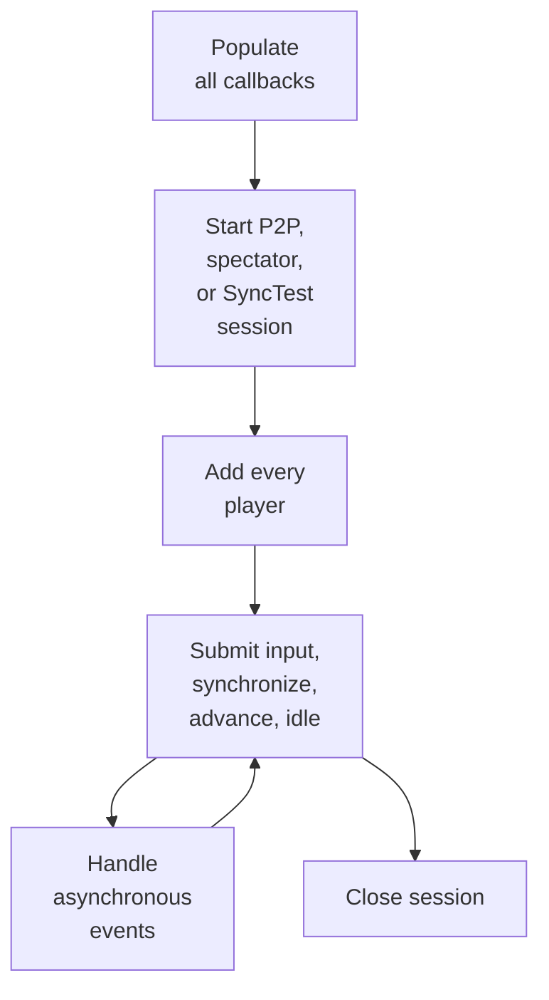

# Public API reference

## Contents

- [Header and linkage](#header-and-linkage)
- [Language and ABI contract](#language-and-abi-contract)
- [Integration lifecycle](#integration-lifecycle)
- [Core types](#core-types)
- [Required callbacks](#required-callbacks)
- [Session constructors](#session-constructors)
- [Frame and player operations](#frame-and-player-operations)
- [Connection controls and statistics](#connection-controls-and-statistics)
- [Function reference](#function-reference)
- [Events](#events)
- [Errors](#errors)
- [Minimal frame-loop example](#minimal-frame-loop-example)

## Header and linkage

The complete public declaration is [`src/include/ggponet.h`](../../src/include/ggponet.h),
implemented by [`src/lib/ggpo/main.cpp`](../../src/lib/ggpo/main.cpp). Include it
from C11 or C++98 and link `GGPO::GGPO` from the installed CMake package. Both
language paths resolve the same C-linkage exports, and the same API is
available from the shared and the static library; see
[Link GGPO into an application](../DeveloperGuide.md#link-ggpo-into-an-application).

This page is the reference generated from the source. The
[Developer Guide](../DeveloperGuide.md) covers installation, linking per
platform, and integration guidance, using the same names as the header.

## Language and ABI contract

`GGPO_API` controls DLL import/export visibility. On Windows, consumers of
`GGPO.dll` must define `GGPO_SHARED_LIB` (the `GGPO::shared` CMake target does
this); consumers of `libGGPO.lib` must not. `GGPO_CALL` expands to
`__cdecl` on Windows and to the platform's default C convention elsewhere; it
decorates both exported functions and application callback slots. C includes
`<stdbool.h>`, while C++ continues to use its built-in `bool`.

The [installed-consumer fixtures](../../tests/consumer) compile and link C11 and
C++98 programs using only the installed header and library. The frozen
[Windows ABI fixtures](../../tests/baseline/windows/README.md) separately guard
exports, public layouts, enum values, and callback offsets.

Versioning follows these rules:

- patch releases may change implementation but not the public ABI;
- minor releases may add declarations while retaining old source and binary
  compatibility;
- ABI-breaking declarations, layouts, or calling conventions require an
  explicit major version and separately named compatibility proposal;
- static consumers must rebuild, but still retain source compatibility; and
- wire-protocol compatibility is a separate contract and is not implied by the
  library version alone.

New platform packages must expose this same C declaration surface. They may
change how visibility is expressed internally, but cannot silently change
names, signatures, callback order, or public data layout.

## Integration lifecycle



## Core types

| Type | Meaning | Important fields |
| --- | --- | --- |
| `GGPOSession` | Opaque handle to one backend instance | Passed to every session operation |
| `GGPOPlayerHandle` | Session-local player identifier | Returned by `ggpo_add_player()` |
| `GGPOPlayerType` | Local, remote, or spectator classification | `GGPO_PLAYERTYPE_*` |
| `GGPOPlayer` | Player description supplied during setup | `size`, `type`, `player_num`, remote address/port |
| `GGPOSessionCallbacks` | Required application integration hooks | Save, load, advance, event, logging, allocation lifecycle |
| `GGPOEvent` | Asynchronous connection/time-sync notification | `code` plus event-specific union |
| `GGPONetworkStats` | Per-peer network and frame-advantage snapshot | queue lengths, ping, bandwidth, frame offsets |
| `GGPOErrorCode` | Result of API operations | Success, invalid state, prediction barrier, disconnect, unsupported operation |
| `GGPOLocalEndpoint` | Legacy public value type; currently unused by the exported API | `player_num` |

Constants in the header currently allow four players, eight speculative frames,
and 32 spectators.

### Constants and handles

| Declaration | Value | Meaning |
| --- | ---: | --- |
| `GGPO_MAX_PLAYERS` | `4` | Maximum participating player slots supported by the public contract |
| `GGPO_MAX_PREDICTION_FRAMES` | `8` | Public upper bound associated with speculative execution |
| `GGPO_MAX_SPECTATORS` | `32` | Maximum spectator endpoints accepted by a P2P host |
| `GGPO_SPECTATOR_INPUT_INTERVAL` | `4` | Legacy public spectator interval constant |
| `GGPO_INVALID_HANDLE` | `-1` | Sentinel for an unassigned `GGPOPlayerHandle` |

`GGPOSession` is intentionally opaque: applications own only the pointer and
must not inspect, allocate, copy, or free its storage. `GGPOPlayerHandle` is an
integer meaningful only within the session that returned it.

### `GGPOPlayer`

| Field | Required value |
| --- | --- |
| `size` | `sizeof(GGPOPlayer)`; retained as part of the public ABI even though current registration does not inspect it |
| `type` | `LOCAL`, `REMOTE`, or `SPECTATOR` |
| `player_num` | One-based participating slot from `1` through the session player count |
| `u.remote.ip_address` | Null-terminated numeric IPv4 address accepted by the current Windows adapter; storage is 32 bytes |
| `u.remote.port` | Remote peer or spectator UDP port in host byte order |

The `u.local` union member carries no application data. In C it contains a
reserved byte because standard C forbids empty structures; the C++ declaration
retains the frozen empty-member layout.

### `GGPONetworkStats`

| Field | Unit | Interpretation |
| --- | --- | --- |
| `network.send_queue_len` | packets | Reliable UDP packets awaiting acknowledgement |
| `network.recv_queue_len` | inputs | Remote inputs buffered but not yet validated |
| `network.ping` | milliseconds | Estimated round-trip latency, including polling cadence |
| `network.kbps_sent` | kilobits/second | Estimated outgoing bandwidth to the selected peer |
| `timesync.local_frames_behind` | frames | Estimated local lag relative to the remote simulation |
| `timesync.remote_frames_behind` | frames | Estimated remote lag relative to the local simulation |

## Required callbacks

Every callback slot must be populated before creating a session.

| Callback | Called when | Application contract |
| --- | --- | --- |
| `begin_game` | Backend construction | Deprecated; return success |
| `save_game_state` | GGPO creates a rollback checkpoint | Allocate and return the complete deterministic state, length, and optional checksum |
| `load_game_state` | GGPO restores a checkpoint | Replace current deterministic state from the supplied bytes |
| `log_game_state` | SyncTest writes mismatch evidence | Produce a human-readable representation of a saved state |
| `free_buffer` | A checkpoint slot is reused or destroyed | Release exactly the allocation returned by `save_game_state`; tolerate a null pointer because current teardown visits every slot |
| `advance_frame` | Rollback replay requires one frame | Obtain synchronized inputs, advance exactly one simulation frame, and notify GGPO |
| `on_event` | Session or peer state changes | Update host state without mutating GGPO internals |

Callback arguments are borrowed for the duration of the call unless the
specific contract transfers ownership. The callback table itself is copied
into the backend during construction; the functions and any application state
they access must remain available until the session closes.

### `begin_game`

```c
bool GGPO_CALL begin_game(const char *game);
```

Receives the diagnostic game name during backend construction. This callback is
deprecated but mandatory. Return `true`; the current backends do not branch on
its result. Do not start frame execution from this callback.

### `save_game_state`

```c
bool GGPO_CALL save_game_state(
    unsigned char **buffer,
    int *len,
    int *checksum,
    int frame);
```

Allocate `*buffer`, serialize all deterministic simulation state into it, set
`*len`, and set a stable checksum in `*checksum`. `frame` identifies the state
being captured. GGPO owns the returned allocation until it passes that same
pointer to `free_buffer`. Return `true` only after all outputs are valid.

The checksum is the SyncTest comparison oracle; it must depend on deterministic
state, not pointer values, padding with indeterminate bytes, rendering state,
wall-clock time, or other process-local data.

### `load_game_state`

```c
bool GGPO_CALL load_game_state(unsigned char *buffer, int len);
```

Replace current deterministic state with the exact checkpoint in the borrowed
`buffer`. Validate the expected length before reading it. Do not retain or free
the pointer. Return `true` after the state has been completely restored.

### `log_game_state`

```c
bool GGPO_CALL log_game_state(
    char *filename,
    unsigned char *buffer,
    int len);
```

Write a human-readable description of the supplied checkpoint for SyncTest
mismatch diagnosis. `filename` names the requested output. The buffer is
borrowed and may describe either the original or replayed state. Logging must
not mutate simulation state. Return `true` on successful diagnostic output.

### `free_buffer`

```c
void GGPO_CALL free_buffer(void *buffer);
```

Release an allocation previously returned by `save_game_state`. Use the same
allocator family used to create it. The current saved-state teardown can visit
empty slots, so implementations should safely tolerate null.

### `advance_frame`

```c
bool GGPO_CALL advance_frame(int flags);
```

Replay exactly one deterministic simulation frame during rollback:

1. call `ggpo_synchronize_input()` for corrected historical inputs;
2. update deterministic game state once; and
3. call `ggpo_advance_frame()` once.

Do not poll devices, submit fresh local input, render, or emit irreversible
presentation effects. `flags` is reserved and currently ignored. Return `true`
after the frame completes; current backends do not use the Boolean to recover
from a failed replay.

### `on_event`

```c
bool GGPO_CALL on_event(GGPOEvent *event);
```

Receives a borrowed event object synchronously from backend processing. Copy
any information needed after the callback returns. It is safe to update
application connection/presentation state, but the callback must not retain the
pointer or modify GGPO internals. Return `true`; current event dispatch does not
branch on the Boolean result.

The sample implementations are in
[`src/apps/vectorwar/vectorwar.cpp`](../../src/apps/vectorwar/vectorwar.cpp).

### Vector War: save and restore rollback state

Vector War treats `GameState gs` as its complete deterministic state. Its
[`save` and `load` callbacks](../../src/apps/vectorwar/vectorwar.cpp#L123-L149)
copy that value to and from GGPO-owned checkpoints:

```cpp
bool __cdecl
vw_load_game_state_callback(unsigned char *buffer, int len)
{
   memcpy(&gs, buffer, len);
   return true;
}

bool __cdecl
vw_save_game_state_callback(unsigned char **buffer, int *len,
                            int *checksum, int)
{
   *len = sizeof(gs);
   *buffer = (unsigned char *)malloc(*len);
   if (!*buffer) {
      return false;
   }
   memcpy(*buffer, &gs, *len);
   *checksum = fletcher32_checksum((short *)*buffer, *len / 2);
   return true;
}
```

The matching [`free_buffer` callback](../../src/apps/vectorwar/vectorwar.cpp#L190-L195)
releases the allocation after GGPO no longer needs that checkpoint.

## Session constructors

| Function | Backend | Use |
| --- | --- | --- |
| `ggpo_start_session()` | `Peer2PeerBackend` | Participating peer with local and remote players |
| `ggpo_start_spectating()` | `SpectatorBackend` | Read-only receiver of confirmed inputs from a host peer |
| `ggpo_start_synctest()` | `SyncTestBackend` | Local deterministic replay verification |
| `ggpo_close_session()` | All | Destroy the backend and release session resources |

Each start function returns a new handle through `GGPOSession**`. A session has a
fixed player count and input size.

### Vector War: configure and start a session

[`VectorWar_Init()`](../../src/apps/vectorwar/vectorwar.cpp#L209-L251) binds
application callbacks, creates the P2P session, and registers each participant:

```cpp
GGPOSessionCallbacks cb = { 0 };
cb.begin_game      = vw_begin_game_callback;
cb.advance_frame   = vw_advance_frame_callback;
cb.load_game_state = vw_load_game_state_callback;
cb.save_game_state = vw_save_game_state_callback;
cb.free_buffer     = vw_free_buffer;
cb.on_event        = vw_on_event_callback;
cb.log_game_state  = vw_log_game_state;

result = ggpo_start_session(&ggpo, &cb, "vectorwar",
                            num_players, sizeof(int), localport);

for (int i = 0; i < num_players + num_spectators; i++) {
   GGPOPlayerHandle handle;
   result = ggpo_add_player(ggpo, players + i, &handle);
}
```

The sample selects `ggpo_start_synctest()` at compile time when `SYNC_TEST` is
defined. Its [spectator initializer](../../src/apps/vectorwar/vectorwar.cpp#L266-L287)
uses the same callbacks with `ggpo_start_spectating()`.

## Frame and player operations

| Function | Phase | Result |
| --- | --- | --- |
| `ggpo_add_player()` | Setup | Registers one local, remote, or spectator participant and returns its handle |
| `ggpo_set_frame_delay()` | Before frame synchronization | Delays a local player's input by the requested frame count |
| `ggpo_add_local_input()` | Start of each frame | Queues and transmits one local player's raw input bytes |
| `ggpo_synchronize_input()` | Before simulation step | Returns one input value per player, confirmed or predicted |
| `ggpo_advance_frame()` | After one simulation step | Advances GGPO's frame, saves state, and polls the backend |
| `ggpo_idle()` | Regularly, usually once per frame | Gives the backend time to poll network and rollback work |
| `ggpo_disconnect_player()` | Runtime | Marks a remote participant disconnected at a synchronized frame |

### Vector War: normal and rollback frames

The normal [`VectorWar_RunFrame()` path](../../src/apps/vectorwar/vectorwar.cpp#L401-L427)
samples the keyboard, submits local input, obtains the synchronized input set,
and advances only when both API calls succeed:

```cpp
int input = ReadInputs(hwnd);
result = ggpo_add_local_input(ggpo, ngs.local_player_handle,
                              &input, sizeof(input));

if (GGPO_SUCCEEDED(result)) {
   result = ggpo_synchronize_input(ggpo, (void *)inputs,
                                   sizeof(int) * MAX_SHIPS,
                                   &disconnect_flags);
   if (GGPO_SUCCEEDED(result)) {
      VectorWar_AdvanceFrame(inputs, disconnect_flags);
   }
}
VectorWar_DrawCurrentFrame();
```

During rollback, GGPO instead invokes
[`vw_advance_frame_callback()`](../../src/apps/vectorwar/vectorwar.cpp#L106-L120).
It reuses corrected historical inputs without reading devices or drawing:

```cpp
bool __cdecl
vw_advance_frame_callback(int)
{
   int inputs[MAX_SHIPS] = { 0 };
   int disconnect_flags;

   ggpo_synchronize_input(ggpo, (void *)inputs,
                          sizeof(int) * MAX_SHIPS, &disconnect_flags);
   VectorWar_AdvanceFrame(inputs, disconnect_flags);
   return true;
}
```

Both paths converge on
[`VectorWar_AdvanceFrame()`](../../src/apps/vectorwar/vectorwar.cpp#L334-L365),
which updates `GameState` and then calls `ggpo_advance_frame()`.

## Connection controls and statistics

| Function | Purpose |
| --- | --- |
| `ggpo_set_disconnect_timeout()` | Set time without packets before final disconnect; zero disables it |
| `ggpo_set_disconnect_notify_start()` | Set time without packets before interruption notification |
| `ggpo_get_network_stats()` | Read queue lengths, ping, throughput, and frame advantage for a remote player |
| `ggpo_log()` / `ggpo_logv()` | Write through the session/backend logging path |

## Function reference

All functions are declared in
[`ggponet.h`](../../src/include/ggponet.h#L317-L579) and, unless stated
otherwise, implemented by the C entry points in
[`main.cpp`](../../src/lib/ggpo/main.cpp). A `GGPOSession *` must refer to a
live session returned by one of the three constructors. Passing a null session
to an error-code function returns `GGPO_ERRORCODE_INVALID_SESSION`; the
constructors require valid output and callback pointers.

### Session construction and teardown

#### `ggpo_start_session`

```c
GGPOErrorCode ggpo_start_session(
    GGPOSession **session,
    GGPOSessionCallbacks *callbacks,
    const char *game,
    int num_players,
    int input_size,
    unsigned short local_port);
```

Creates a peer-to-peer session and binds its UDP socket. The player count and
input byte size become fixed properties of the session.

| Parameter | Direction | Contract |
| --- | --- | --- |
| `session` | out | Receives the opaque session handle; must remain valid until `ggpo_close_session()` |
| `callbacks` | in | All seven callback fields must be populated and remain callable for the session lifetime |
| `game` | in | Diagnostic name passed to `begin_game`; not part of synchronization |
| `num_players` | in | Number of participating players, from 1 through `GGPO_MAX_PLAYERS` |
| `input_size` | in | Exact byte size submitted for each local player every frame |
| `local_port` | in | Local UDP port on which this peer listens |

**Returns:** the current implementation returns `GGPO_OK` after construction.
It does not convert invalid pointers, allocation failures, or socket setup
failures into documented error codes, so callers must provide valid arguments
and treat construction failures as outside the recoverable API contract.

Source: [`ggpo_start_session()`](../../src/lib/ggpo/main.cpp#L31-L45).

#### `ggpo_start_synctest`

```c
GGPOErrorCode ggpo_start_synctest(
    GGPOSession **session,
    GGPOSessionCallbacks *callbacks,
    char *game,
    int num_players,
    int input_size,
    int frames);
```

Creates a local deterministic-verification backend. It saves execution, rewinds
after `frames`, replays through `advance_frame`, and compares the application
checksums returned by `save_game_state`.

| Parameter | Direction | Contract |
| --- | --- | --- |
| `session` | out | Receives the SyncTest session |
| `callbacks` | in | Same complete callback table required by P2P |
| `game` | in | Diagnostic name used in SyncTest logs |
| `num_players` | in | Number of input slots in the local simulation |
| `input_size` | in | Per-player input size used by the application calls |
| `frames` | in | Replay/check distance; `1` gives the earliest mismatch detection |

**Returns:** `GGPO_OK` after construction. A mismatch is reported through the
SyncTest assertion/logging path rather than as a later `GGPOErrorCode`.

Source: [`ggpo_start_synctest()`](../../src/lib/ggpo/main.cpp#L60-L70) and
[`SyncTestBackend::IncrementFrame()`](../../src/lib/ggpo/backends/synctest.cpp#L102-L157).

#### `ggpo_start_spectating`

```c
GGPOErrorCode ggpo_start_spectating(
    GGPOSession **session,
    GGPOSessionCallbacks *callbacks,
    const char *game,
    int num_players,
    int input_size,
    unsigned short local_port,
    char *host_ip,
    unsigned short host_port);
```

Creates a non-participating session that receives confirmed input frames from a
host and advances the same deterministic simulation locally.

| Parameter | Direction | Contract |
| --- | --- | --- |
| `session` | out | Receives the spectator session |
| `callbacks` | in | Application callbacks used to initialize, advance, and report events |
| `game` | in | Diagnostic game name |
| `num_players` | in | Number of players represented in every received input frame |
| `input_size` | in | Bytes per player's input |
| `local_port` | in | Local UDP listening port for this spectator |
| `host_ip` | in | Address of a participating peer serving spectator inputs |
| `host_port` | in | UDP port exposed by that host |

**Returns:** `GGPO_OK` after construction. Connection progress and failure are
reported asynchronously through events and frame-operation results.

Source: [`ggpo_start_spectating()`](../../src/lib/ggpo/main.cpp#L183-L200).

#### `ggpo_close_session`

```c
GGPOErrorCode ggpo_close_session(GGPOSession *session);
```

Destroys the selected backend and releases its owned networking and rollback
resources. The handle is invalid immediately after the call and must not be
reused.

**Returns:** `GGPO_OK`, or `GGPO_ERRORCODE_INVALID_SESSION` for null. Close each
successfully created session exactly once.

Source: [`ggpo_close_session()`](../../src/lib/ggpo/main.cpp#L155-L163).

### Player registration and configuration

#### `ggpo_add_player`

```c
GGPOErrorCode ggpo_add_player(
    GGPOSession *session,
    GGPOPlayer *player,
    GGPOPlayerHandle *handle);
```

Registers one participant. Set `player->size = sizeof(GGPOPlayer)`, assign a
one-based `player_num`, and fill the remote address for remote players or
spectators. Store the returned handle; later calls use handles, not player
numbers.

| Backend | Behavior |
| --- | --- |
| P2P | Registers local/remote input slots or a spectator endpoint |
| SyncTest | Registers a local test input slot |
| Spectator | Returns `GGPO_ERRORCODE_UNSUPPORTED` |

**Returns:** `GGPO_OK`; `INVALID_SESSION`; `PLAYER_OUT_OF_RANGE`; or, for P2P
spectators, `TOO_MANY_SPECTATORS` and `INVALID_REQUEST` when added after initial
synchronization. The current implementation does not validate `player->size`.

Sources: [`Peer2PeerBackend::AddPlayer()`](../../src/lib/ggpo/backends/p2p.cpp#L242-L261)
and [`SyncTestBackend::AddPlayer()`](../../src/lib/ggpo/backends/synctest.cpp#L57-L65).

#### `ggpo_set_frame_delay`

```c
GGPOErrorCode ggpo_set_frame_delay(
    GGPOSession *session,
    GGPOPlayerHandle player,
    int frame_delay);
```

Delays a local player's submitted inputs by `frame_delay` simulation frames.
Call it after registration and before frame synchronization begins. This is an
intentional latency/rollback tradeoff and does not change network latency.

**Returns:** P2P returns `GGPO_OK` or `INVALID_PLAYER_HANDLE`; spectator and
SyncTest sessions return `UNSUPPORTED`; null returns `INVALID_SESSION`.

Source: [`Peer2PeerBackend::SetFrameDelay()`](../../src/lib/ggpo/backends/p2p.cpp#L535-L547).

### Per-frame execution

#### `ggpo_add_local_input`

```c
GGPOErrorCode ggpo_add_local_input(
    GGPOSession *session,
    GGPOPlayerHandle player,
    void *values,
    int size);
```

Copies one local player's input for the current frame into GGPO. `size` must
equal the session's per-player input size. Call once for every local player on a
normal frame, but never from rollback replay.

**Returns:** `GGPO_OK`; `INVALID_SESSION`; `INVALID_PLAYER_HANDLE`;
`NOT_SYNCHRONIZED` before the running event; `IN_ROLLBACK` during replay; or
`PREDICTION_THRESHOLD` when too many unconfirmed frames are already in flight.
SyncTest can return `NOT_SYNCHRONIZED`. The spectator backend accepts this call
as a no-op; spectator applications should not submit local input.

Source: [`Peer2PeerBackend::AddLocalInput()`](../../src/lib/ggpo/backends/p2p.cpp#L264-L308).

#### `ggpo_synchronize_input`

```c
GGPOErrorCode ggpo_synchronize_input(
    GGPOSession *session,
    void *values,
    int size,
    int *disconnect_flags);
```

Writes the complete input set for the simulation frame into `values`. The
buffer size is the per-player input size multiplied by player count. Call it on
both normal and rollback frames. `disconnect_flags` may be null; otherwise bit
`i` describes the zero-based input slot `i`, not the one-based player number.

**Returns:** P2P returns `GGPO_OK` or `NOT_SYNCHRONIZED`. A spectator can also
return `PREDICTION_THRESHOLD` while waiting for the host or `GENERAL_FAILURE`
if its required buffered frame has already been lost. SyncTest returns
`GGPO_OK`. Null returns `INVALID_SESSION`.

Sources: [`Peer2PeerBackend::SyncInput()`](../../src/lib/ggpo/backends/p2p.cpp#L311-L327)
and [`SpectatorBackend::SyncInput()`](../../src/lib/ggpo/backends/spectator.cpp#L58-L87).

#### `ggpo_advance_frame`

```c
GGPOErrorCode ggpo_advance_frame(GGPOSession *session);
```

Notifies GGPO that the application has advanced deterministic state exactly one
frame. It advances rollback bookkeeping and may save state, poll networking, or
invoke replay callbacks before returning. Call once after every successful
simulation step, including steps performed from `advance_frame`.

**Returns:** `GGPO_OK`, or `INVALID_SESSION` for null. SyncTest mismatches use
its diagnostic assertion path rather than an error return.

Source: [`ggpo_advance_frame()`](../../src/lib/ggpo/main.cpp#L125-L132).

#### `ggpo_idle`

```c
GGPOErrorCode ggpo_idle(GGPOSession *session, int timeout_ms);
```

Pumps network protocol events, connection progress, confirmed-frame cleanup,
rollback checks, and time-sync recommendations. Call regularly even when the
game is not advancing. `timeout_ms` is a polling hint; the current P2P backend
does not guarantee that it blocks for exactly that duration.

**Returns:** `GGPO_OK`, or `INVALID_SESSION` for null.

Source: [`ggpo_idle()`](../../src/lib/ggpo/main.cpp#L83-L90) and
[`Peer2PeerBackend::DoPoll()`](../../src/lib/ggpo/backends/p2p.cpp#L101-L169).

### Connection management and diagnostics

#### `ggpo_disconnect_player`

```c
GGPOErrorCode ggpo_disconnect_player(
    GGPOSession *session,
    GGPOPlayerHandle player);
```

Records a local disconnect decision, synchronizes it to the appropriate frame,
and emits `GGPO_EVENTCODE_DISCONNECTED_FROM_PEER`. Disconnecting the local
slot causes the P2P backend to disconnect its initialized remote endpoints.

**Returns:** P2P returns `GGPO_OK`, `INVALID_PLAYER_HANDLE`, or
`PLAYER_DISCONNECTED`; spectator returns `UNSUPPORTED`; null returns
`INVALID_SESSION`. SyncTest currently inherits a successful no-op and should
not use this operation.

Source: [`Peer2PeerBackend::DisconnectPlayer()`](../../src/lib/ggpo/backends/p2p.cpp#L453-L488).

#### `ggpo_get_network_stats`

```c
GGPOErrorCode ggpo_get_network_stats(
    GGPOSession *session,
    GGPOPlayerHandle player,
    GGPONetworkStats *stats);
```

Zeroes and fills a snapshot for the selected P2P endpoint: queue lengths,
estimated ping, sent bandwidth, and local/remote frame advantage.

**Returns:** P2P returns `GGPO_OK` or `INVALID_PLAYER_HANDLE`; spectator returns
`UNSUPPORTED`; null returns `INVALID_SESSION`. SyncTest currently reports
success without populating statistics, so only use this function with P2P.

Source: [`Peer2PeerBackend::GetNetworkStats()`](../../src/lib/ggpo/backends/p2p.cpp#L518-L533).

#### `ggpo_set_disconnect_timeout`

```c
GGPOErrorCode ggpo_set_disconnect_timeout(
    GGPOSession *session,
    int timeout_ms);
```

Sets the P2P interval without received packets before final disconnection.
Zero disables automatic disconnect. Existing initialized endpoints are updated
immediately; future endpoints inherit the stored value.

**Returns:** `GGPO_OK` for P2P, `UNSUPPORTED` for spectator/SyncTest, or
`INVALID_SESSION` for null.

Source: [`Peer2PeerBackend::SetDisconnectTimeout()`](../../src/lib/ggpo/backends/p2p.cpp#L549-L559).

#### `ggpo_set_disconnect_notify_start`

```c
GGPOErrorCode ggpo_set_disconnect_notify_start(
    GGPOSession *session,
    int timeout_ms);
```

Sets the no-packet interval before GGPO emits
`GGPO_EVENTCODE_CONNECTION_INTERRUPTED`. If traffic resumes before final
disconnect, GGPO emits `GGPO_EVENTCODE_CONNECTION_RESUMED`.

**Returns:** `GGPO_OK` for P2P, `UNSUPPORTED` for spectator/SyncTest, or
`INVALID_SESSION` for null.

Source: [`Peer2PeerBackend::SetDisconnectNotifyStart()`](../../src/lib/ggpo/backends/p2p.cpp#L561-L571).

#### `ggpo_log` and `ggpo_logv`

```c
void ggpo_log(GGPOSession *session, const char *format, ...);
void ggpo_logv(GGPOSession *session, const char *format, va_list args);
```

Formats diagnostic text through the selected backend. `ggpo_logv` exists for
callers that already hold a `va_list`; `ggpo_log` constructs one. A null session
is silently ignored. These functions return no status and must not be used as a
gameplay synchronization channel.

Source: [`ggpo_log()` and `ggpo_logv()`](../../src/lib/ggpo/main.cpp#L14-L29).

## Events

| Event code | Meaning | Relevant union member |
| --- | --- | --- |
| `CONNECTED_TO_PEER` | Handshake established | `connected.player` |
| `SYNCHRONIZING_WITH_PEER` | Handshake progress | `synchronizing.player/count/total` |
| `SYNCHRONIZED_WITH_PEER` | One peer finished synchronization | `synchronized.player` |
| `RUNNING` | All required peers are ready | none |
| `DISCONNECTED_FROM_PEER` | Peer is no longer participating | `disconnected.player` |
| `TIMESYNC` | Local client is sufficiently ahead to consider pausing | `timesync.frames_ahead` |
| `CONNECTION_INTERRUPTED` | No packet within notification threshold | player and remaining timeout |
| `CONNECTION_RESUMED` | Packets resumed before final disconnect | `connection_resumed.player` |

Vector War's [`vw_on_event_callback()`](../../src/apps/vectorwar/vectorwar.cpp#L58-L99)
maps these events to presentation-side connection state. For example:

```cpp
case GGPO_EVENTCODE_RUNNING:
   ngs.SetConnectState(Running);
   renderer->SetStatusText("");
   break;
case GGPO_EVENTCODE_CONNECTION_INTERRUPTED:
   ngs.SetDisconnectTimeout(info->u.connection_interrupted.player,
                            timeGetTime(),
                            info->u.connection_interrupted.disconnect_timeout);
   break;
case GGPO_EVENTCODE_CONNECTION_RESUMED:
   ngs.SetConnectState(info->u.connection_resumed.player, Running);
   break;
```

## Errors

Most calls return `GGPOErrorCode`. Check results with `GGPO_SUCCEEDED(result)`.
`GGPO_OK` and `GGPO_ERRORCODE_SUCCESS` are aliases with value zero.

| Code | Value | Meaning and typical response |
| --- | ---: | --- |
| `GGPO_ERRORCODE_GENERAL_FAILURE` | `-1` | Unclassified failure; stop the affected operation and preserve diagnostics |
| `GGPO_ERRORCODE_SUCCESS` | `0` | Operation completed |
| `GGPO_ERRORCODE_INVALID_SESSION` | `1` | Session pointer was null; fix lifetime or initialization logic |
| `GGPO_ERRORCODE_INVALID_PLAYER_HANDLE` | `2` | Handle is not a participating slot in this session |
| `GGPO_ERRORCODE_PLAYER_OUT_OF_RANGE` | `3` | Registration used a player number outside the configured count |
| `GGPO_ERRORCODE_PREDICTION_THRESHOLD` | `4` | Too many unconfirmed frames are in flight, or spectator input is not ready; do not advance this frame |
| `GGPO_ERRORCODE_UNSUPPORTED` | `5` | Selected backend does not implement this operation |
| `GGPO_ERRORCODE_NOT_SYNCHRONIZED` | `6` | Initial synchronization has not completed; keep polling and wait for `RUNNING` |
| `GGPO_ERRORCODE_IN_ROLLBACK` | `7` | Fresh local input was submitted during replay; use synchronized historical input instead |
| `GGPO_ERRORCODE_INPUT_DROPPED` | `8` | Reserved public result; no current backend return site |
| `GGPO_ERRORCODE_PLAYER_DISCONNECTED` | `9` | Target player was already disconnected |
| `GGPO_ERRORCODE_TOO_MANY_SPECTATORS` | `10` | P2P host already has `GGPO_MAX_SPECTATORS` |
| `GGPO_ERRORCODE_INVALID_REQUEST` | `11` | Request is invalid in the current phase, such as adding a spectator after startup |

Do not treat every non-success result as fatal. `NOT_SYNCHRONIZED` and
`PREDICTION_THRESHOLD` normally mean the application should skip simulation for
that iteration, continue polling, and retry on a later frame.

## Minimal frame-loop example

```cpp
Input local = read_local_input();
GGPOErrorCode result = ggpo_add_local_input(session, local_handle,
                                            &local, sizeof(local));

Input all_players[2] = {};
int disconnect_flags = 0;
if (GGPO_SUCCEEDED(result)) {
    result = ggpo_synchronize_input(session, all_players,
                                    sizeof(all_players), &disconnect_flags);
}

if (GGPO_SUCCEEDED(result)) {
    advance_deterministic_state(all_players, disconnect_flags);
    ggpo_advance_frame(session);
    render_current_state();
}

ggpo_idle(session, 0);
```

Rollback uses the same simulation step through the application's `advance_frame`
callback, but it should not sample new device input or render replay frames.
