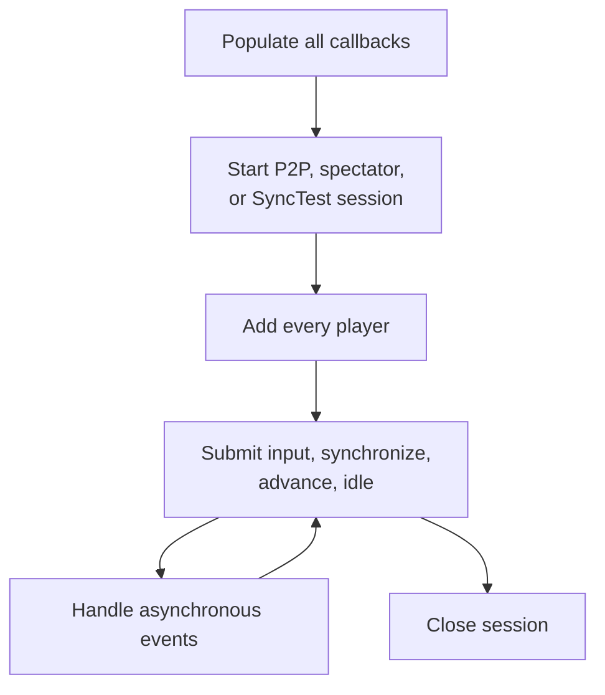

# Public API reference

## Contents

- [Header and linkage](#header-and-linkage)
- [Integration lifecycle](#integration-lifecycle)
- [Core types](#core-types)
- [Required callbacks](#required-callbacks)
- [Session constructors](#session-constructors)
- [Frame and player operations](#frame-and-player-operations)
- [Connection controls and statistics](#connection-controls-and-statistics)
- [Events](#events)
- [Errors](#errors)
- [Minimal frame-loop example](#minimal-frame-loop-example)

## Header and linkage

The complete public declaration is [`src/include/ggponet.h`](../../src/include/ggponet.h),
implemented by [`src/lib/ggpo/main.cpp`](../../src/lib/ggpo/main.cpp). Include it
from C++ and link the `GGPO` library. Declarations use `extern "C"`, but the
header currently depends on C++ `bool` and is not directly C-compilable.

This page reflects the source; the older [Developer Guide](../DeveloperGuide.md)
contains useful integration guidance but some example names differ from the header.

## Integration lifecycle



## Core types

| Type | Meaning | Important fields |
| --- | --- | --- |
| `GGPOSession` | Opaque handle to one backend instance | Passed to every session operation |
| `GGPOPlayerHandle` | Session-local player identifier | Returned by `ggpo_add_player()` |
| `GGPOPlayerType` | Local, remote, or spectator classification | `GGPO_PLAYERTYPE_*` |
| `GGPOPlayer` | Player description supplied during setup | `size`, `type`, `player_num`, remote address/port |
| `GGPOSessionCallbacks` | Required application integration hooks | Save, load, advance, event, logging, allocation lifecycle |
| `GGPOEvent` | Asynchronous connection/time-sync notification | `code` plus event-specific union |
| `GGPONetworkStats` | Per-peer network and frame-advantage snapshot | queue lengths, ping, bandwidth, frame offsets |
| `GGPOErrorCode` | Result of API operations | Success, invalid state, prediction barrier, disconnect, unsupported operation |

Constants in the header currently allow four players, eight speculative frames,
and 32 spectators.

## Required callbacks

Every callback slot must be populated before creating a session.

| Callback | Called when | Application contract |
| --- | --- | --- |
| `begin_game` | Backend construction | Deprecated; return success |
| `save_game_state` | GGPO creates a rollback checkpoint | Allocate and return the complete deterministic state, length, and optional checksum |
| `load_game_state` | GGPO restores a checkpoint | Replace current deterministic state from the supplied bytes |
| `log_game_state` | SyncTest writes mismatch evidence | Produce a human-readable representation of a saved state |
| `free_buffer` | A checkpoint slot is reused or destroyed | Release exactly the allocation returned by `save_game_state`; tolerate a null pointer because current teardown visits every slot |
| `advance_frame` | Rollback replay requires one frame | Obtain synchronized inputs, advance exactly one simulation frame, and notify GGPO |
| `on_event` | Session or peer state changes | Update host state without mutating GGPO internals |

The sample implementations are in
[`src/apps/vectorwar/vectorwar.cpp`](../../src/apps/vectorwar/vectorwar.cpp).

### Vector War: save and restore rollback state

Vector War treats `GameState gs` as its complete deterministic state. Its
[`save` and `load` callbacks](../../src/apps/vectorwar/vectorwar.cpp#L123-L149)
copy that value to and from GGPO-owned checkpoints:

```cpp
bool __cdecl
vw_load_game_state_callback(unsigned char *buffer, int len)
{
   memcpy(&gs, buffer, len);
   return true;
}

bool __cdecl
vw_save_game_state_callback(unsigned char **buffer, int *len,
                            int *checksum, int)
{
   *len = sizeof(gs);
   *buffer = (unsigned char *)malloc(*len);
   if (!*buffer) {
      return false;
   }
   memcpy(*buffer, &gs, *len);
   *checksum = fletcher32_checksum((short *)*buffer, *len / 2);
   return true;
}
```

The matching [`free_buffer` callback](../../src/apps/vectorwar/vectorwar.cpp#L190-L195)
releases the allocation after GGPO no longer needs that checkpoint.

## Session constructors

| Function | Backend | Use |
| --- | --- | --- |
| `ggpo_start_session()` | `Peer2PeerBackend` | Participating peer with local and remote players |
| `ggpo_start_spectating()` | `SpectatorBackend` | Read-only receiver of confirmed inputs from a host peer |
| `ggpo_start_synctest()` | `SyncTestBackend` | Local deterministic replay verification |
| `ggpo_close_session()` | All | Destroy the backend and release session resources |

Each start function returns a new handle through `GGPOSession**`. A session has a
fixed player count and input size.

### Vector War: configure and start a session

[`VectorWar_Init()`](../../src/apps/vectorwar/vectorwar.cpp#L209-L251) binds
application callbacks, creates the P2P session, and registers each participant:

```cpp
GGPOSessionCallbacks cb = { 0 };
cb.begin_game      = vw_begin_game_callback;
cb.advance_frame   = vw_advance_frame_callback;
cb.load_game_state = vw_load_game_state_callback;
cb.save_game_state = vw_save_game_state_callback;
cb.free_buffer     = vw_free_buffer;
cb.on_event        = vw_on_event_callback;
cb.log_game_state  = vw_log_game_state;

result = ggpo_start_session(&ggpo, &cb, "vectorwar",
                            num_players, sizeof(int), localport);

for (int i = 0; i < num_players + num_spectators; i++) {
   GGPOPlayerHandle handle;
   result = ggpo_add_player(ggpo, players + i, &handle);
}
```

The sample selects `ggpo_start_synctest()` at compile time when `SYNC_TEST` is
defined. Its [spectator initializer](../../src/apps/vectorwar/vectorwar.cpp#L266-L287)
uses the same callbacks with `ggpo_start_spectating()`.

## Frame and player operations

| Function | Phase | Result |
| --- | --- | --- |
| `ggpo_add_player()` | Setup | Registers one local, remote, or spectator participant and returns its handle |
| `ggpo_set_frame_delay()` | Before frame synchronization | Delays a local player's input by the requested frame count |
| `ggpo_add_local_input()` | Start of each frame | Queues and transmits one local player's raw input bytes |
| `ggpo_synchronize_input()` | Before simulation step | Returns one input value per player, confirmed or predicted |
| `ggpo_advance_frame()` | After one simulation step | Advances GGPO's frame, saves state, and polls the backend |
| `ggpo_idle()` | Regularly, usually once per frame | Gives the backend time to poll network and rollback work |
| `ggpo_disconnect_player()` | Runtime | Marks a remote participant disconnected at a synchronized frame |

### Vector War: normal and rollback frames

The normal [`VectorWar_RunFrame()` path](../../src/apps/vectorwar/vectorwar.cpp#L401-L427)
samples the keyboard, submits local input, obtains the synchronized input set,
and advances only when both API calls succeed:

```cpp
int input = ReadInputs(hwnd);
result = ggpo_add_local_input(ggpo, ngs.local_player_handle,
                              &input, sizeof(input));

if (GGPO_SUCCEEDED(result)) {
   result = ggpo_synchronize_input(ggpo, (void *)inputs,
                                   sizeof(int) * MAX_SHIPS,
                                   &disconnect_flags);
   if (GGPO_SUCCEEDED(result)) {
      VectorWar_AdvanceFrame(inputs, disconnect_flags);
   }
}
VectorWar_DrawCurrentFrame();
```

During rollback, GGPO instead invokes
[`vw_advance_frame_callback()`](../../src/apps/vectorwar/vectorwar.cpp#L106-L120).
It reuses corrected historical inputs without reading devices or drawing:

```cpp
bool __cdecl
vw_advance_frame_callback(int)
{
   int inputs[MAX_SHIPS] = { 0 };
   int disconnect_flags;

   ggpo_synchronize_input(ggpo, (void *)inputs,
                          sizeof(int) * MAX_SHIPS, &disconnect_flags);
   VectorWar_AdvanceFrame(inputs, disconnect_flags);
   return true;
}
```

Both paths converge on
[`VectorWar_AdvanceFrame()`](../../src/apps/vectorwar/vectorwar.cpp#L334-L365),
which updates `GameState` and then calls `ggpo_advance_frame()`.

## Connection controls and statistics

| Function | Purpose |
| --- | --- |
| `ggpo_set_disconnect_timeout()` | Set time without packets before final disconnect; zero disables it |
| `ggpo_set_disconnect_notify_start()` | Set time without packets before interruption notification |
| `ggpo_get_network_stats()` | Read queue lengths, ping, throughput, and frame advantage for a remote player |
| `ggpo_log()` / `ggpo_logv()` | Write through the session/backend logging path |

## Events

| Event code | Meaning | Relevant union member |
| --- | --- | --- |
| `CONNECTED_TO_PEER` | Handshake established | `connected.player` |
| `SYNCHRONIZING_WITH_PEER` | Handshake progress | `synchronizing.player/count/total` |
| `SYNCHRONIZED_WITH_PEER` | One peer finished synchronization | `synchronized.player` |
| `RUNNING` | All required peers are ready | none |
| `DISCONNECTED_FROM_PEER` | Peer is no longer participating | `disconnected.player` |
| `TIMESYNC` | Local client is sufficiently ahead to consider pausing | `timesync.frames_ahead` |
| `CONNECTION_INTERRUPTED` | No packet within notification threshold | player and remaining timeout |
| `CONNECTION_RESUMED` | Packets resumed before final disconnect | `connection_resumed.player` |

Vector War's [`vw_on_event_callback()`](../../src/apps/vectorwar/vectorwar.cpp#L58-L99)
maps these events to presentation-side connection state. For example:

```cpp
case GGPO_EVENTCODE_RUNNING:
   ngs.SetConnectState(Running);
   renderer->SetStatusText("");
   break;
case GGPO_EVENTCODE_CONNECTION_INTERRUPTED:
   ngs.SetDisconnectTimeout(info->u.connection_interrupted.player,
                            timeGetTime(),
                            info->u.connection_interrupted.disconnect_timeout);
   break;
case GGPO_EVENTCODE_CONNECTION_RESUMED:
   ngs.SetConnectState(info->u.connection_resumed.player, Running);
   break;
```

## Errors

Most calls return `GGPOErrorCode`. Check results with `GGPO_SUCCEEDED(result)`.
Common runtime results include:

- `GGPO_ERRORCODE_NOT_SYNCHRONIZED`: peers are not ready to run frames;
- `GGPO_ERRORCODE_PREDICTION_THRESHOLD`: too many unconfirmed frames are in flight;
- `GGPO_ERRORCODE_IN_ROLLBACK`: fresh local input was submitted during replay;
- `GGPO_ERRORCODE_PLAYER_DISCONNECTED`: operation targeted a disconnected peer;
- `GGPO_ERRORCODE_UNSUPPORTED`: the selected backend does not implement the operation.

## Minimal frame-loop example

```cpp
Input local = read_local_input();
GGPOErrorCode result = ggpo_add_local_input(session, local_handle,
                                            &local, sizeof(local));

Input all_players[2] = {};
int disconnect_flags = 0;
if (GGPO_SUCCEEDED(result)) {
    result = ggpo_synchronize_input(session, all_players,
                                    sizeof(all_players), &disconnect_flags);
}

if (GGPO_SUCCEEDED(result)) {
    advance_deterministic_state(all_players, disconnect_flags);
    ggpo_advance_frame(session);
    render_current_state();
}

ggpo_idle(session, 0);
```

Rollback uses the same simulation step through the application's `advance_frame`
callback, but it should not sample new device input or render replay frames.
