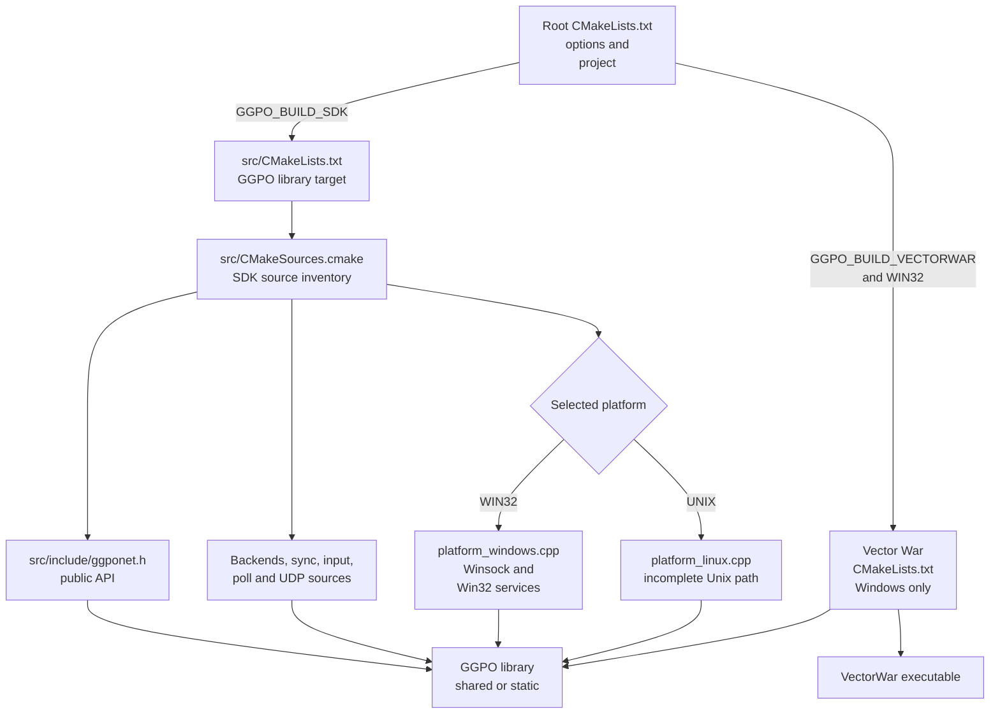

# Build architecture

## Contents

- [Build outputs](#build-outputs)
- [Build graph](#build-graph)
- [Configuration options](#configuration-options)
- [SDK source composition](#sdk-source-composition)
- [Vector War](#vector-war)
- [Install layout](#install-layout)
- [Platform status](#platform-status)

## Build outputs

The root [`CMakeLists.txt`](../../CMakeLists.txt) configures two independent
products. [`src/CMakeLists.txt`](../../src/CMakeLists.txt) builds the SDK library;
[`src/apps/vectorwar/CMakeLists.txt`](../../src/apps/vectorwar/CMakeLists.txt)
builds the Windows sample.

| Product | CMake target | Inputs | Output |
| --- | --- | --- | --- |
| GGPO SDK | `GGPO` | Public header, backends, sync core, UDP protocol, platform source | Shared or static library |
| Vector War | `VectorWar` | Sample game, Win32 loop, GDI/OpenGL renderer, `GGPO` | Windows executable |

## Build graph



The diagram includes the Unix source selected by CMake, but that source does not
make upstream `master` a supported Unix build. See [Portability](Portability.md).

## Configuration options

Declared in the [root build file](../../CMakeLists.txt):

| Option | Default | Effect |
| --- | ---: | --- |
| `GGPO_BUILD_SDK` | `ON` | Adds the `GGPO` library target |
| `GGPO_BUILD_VECTORWAR` | `ON` | Adds Vector War only when `WIN32` is true |
| `BUILD_SHARED_LIBS` | `ON` | Chooses a shared library instead of a static library |

Current Windows setup uses [`configure_windows.cmd`](../../configure_windows.cmd).
The generated solution is described in the root [README](../../README.md).

## SDK source composition

[`src/CMakeSources.cmake`](../../src/CMakeSources.cmake) groups sources by role:

| Group | What it contributes | Representative artifacts |
| --- | --- | --- |
| Core | Inputs, queues, saved state, polling, logging, and time synchronization | [`sync.cpp`](../../src/lib/ggpo/sync.cpp), [`input_queue.cpp`](../../src/lib/ggpo/input_queue.cpp), [`timesync.cpp`](../../src/lib/ggpo/timesync.cpp) |
| Network | UDP socket, wire messages, reliability, and peer state | [`udp.cpp`](../../src/lib/ggpo/network/udp.cpp), [`udp_proto.cpp`](../../src/lib/ggpo/network/udp_proto.cpp), [`udp_msg.h`](../../src/lib/ggpo/network/udp_msg.h) |
| Backends | Peer-to-peer, spectator, and deterministic sync-test sessions | [`backends`](../../src/lib/ggpo/backends) |
| Platform | Platform clock, process, configuration, and OS types | [`platform_windows.cpp`](../../src/lib/ggpo/platform_windows.cpp), [`platform_linux.cpp`](../../src/lib/ggpo/platform_linux.cpp) |
| Public | C-compatible integration contract | [`ggponet.h`](../../src/include/ggponet.h) |

The library exposes both `src/include` and the internal `src/lib/ggpo` directory
as public include paths in [`src/CMakeLists.txt`](../../src/CMakeLists.txt). The
latter is an implementation leak that consumers should not depend upon.

## Vector War

Vector War is a reference integration, not part of the public SDK contract. Its
build is Windows-specific:

- [`main.cpp`](../../src/apps/vectorwar/main.cpp) owns the Win32 message loop,
  Winsock initialization, command-line parsing, and 60 Hz scheduling.
- [`vectorwar.cpp`](../../src/apps/vectorwar/vectorwar.cpp) integrates the API
  and separates game state from rendering.
- [`gamestate.cpp`](../../src/apps/vectorwar/gamestate.cpp) advances the sample
  simulation.
- [`gdi_renderer.cpp`](../../src/apps/vectorwar/gdi_renderer.cpp) presents the
  current state.
- [`ggpo_perfmon.cpp`](../../src/apps/vectorwar/ggpo_perfmon.cpp) displays
  network statistics.

See [Vector War](VectorWar.md) for the end-to-end build and runtime walkthrough.

## Install layout

The SDK install rules in [`src/CMakeLists.txt`](../../src/CMakeLists.txt) place:

```text
<prefix>/
├── include/ggponet.h
├── bin/<shared library on Windows>
└── lib/<static library or Unix shared library>
```

The target is exported as `ggpo`, but the current build does not install a
complete CMake package configuration for `find_package()` consumers.

## Platform status

| Platform | Upstream build status | Main blockers |
| --- | --- | --- |
| Windows | Supported SDK and Vector War build | Existing reference platform |
| Linux | CMake selects an incomplete `platform_linux` source | Win32 polling, sockets, CRT calls, and syntax errors remain |
| macOS | Falls under the broad `UNIX` selection but has no validated path | Same Unix gaps plus no CI or sample frontend |
| Mobile and consoles | No build target | Platform services, lifecycle, socket policy, packaging, and validation absent |

The build-port roadmap should preserve the public API while moving OS facilities
behind explicit adapters. See [Portability](Portability.md).
