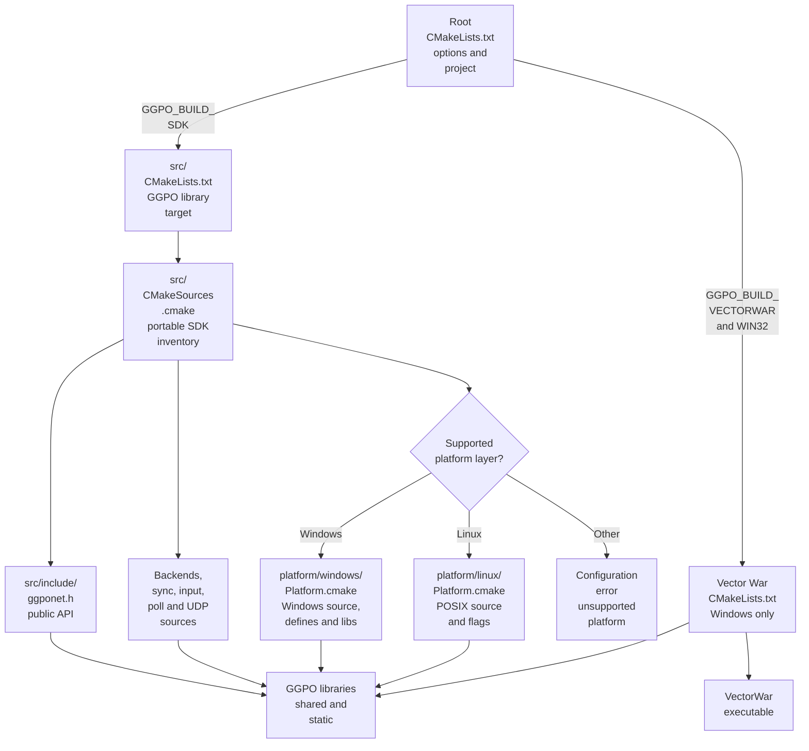

# Build architecture

## Contents

- [Build outputs](#build-outputs)
- [Build graph](#build-graph)
- [Linux container](#linux-container)
- [Configuration options](#configuration-options)
- [SDK source composition](#sdk-source-composition)
- [Vector War](#vector-war)
- [Install layout](#install-layout)
- [Release packages](#release-packages)
- [Platform status](#platform-status)

## Build outputs

The root [`CMakeLists.txt`](../../CMakeLists.txt) configures two independent
products. [`src/CMakeLists.txt`](../../src/CMakeLists.txt) builds the SDK library;
[`src/apps/vectorwar/CMakeLists.txt`](../../src/apps/vectorwar/CMakeLists.txt)
builds the Windows sample.

| Product | CMake target | Inputs | Output |
| --- | --- | --- | --- |
| GGPO SDK | `GGPO_shared`, `GGPO_static` | Public header, backends, sync core, UDP protocol, platform source | Shared and/or static library |
| Vector War | `VectorWar` | Sample game, Win32 loop, GDI/OpenGL renderer, `GGPO` | Windows executable |

## Build graph



The root selects exactly one supported platform layer. The incomplete legacy
Unix source was replaced by the Linux adapter. See [Portability](Portability.md).

## Linux container

[`docker/linux/Dockerfile`](../../docker/linux/Dockerfile) is the Linux build
environment source of truth for developers, CI, and release packaging.
[`build_in_container.py`](../../scripts/linux/build_in_container.py) builds that
image locally and runs configure, build, CTest, install-consumer, and ABI audits.

```bash
python3 scripts/linux/build_in_container.py \
  --compiler gcc --packages \
  --out build/linux-gcc
```

CI builds the same Dockerfile with layer caching; it does not maintain a second
package/toolchain recipe.

## Configuration options

Declared in the [root build file](../../CMakeLists.txt):

| Option | Default | Effect |
| --- | ---: | --- |
| `GGPO_BUILD_SDK` | `ON` | Adds the GGPO library targets |
| `GGPO_BUILD_VECTORWAR` | `ON` | Adds Vector War only when `WIN32` is true |
| `BUILD_SHARED_LIBS` | unset | Unset builds both libraries; `ON` builds only shared, `OFF` only static |
| `GGPO_BUILD_SHARED` | both / from `BUILD_SHARED_LIBS` | Builds `GGPO_shared` (`GGPO.dll` + `GGPO.lib`, `libGGPO.so`) |
| `GGPO_BUILD_STATIC` | both / from `BUILD_SHARED_LIBS` | Builds `GGPO_static` (`libGGPO.lib`, `libGGPO.a`) |
| `GGPO_RUN_TESTS_ON_BUILD` | `ON` | Runs the platform's self-contained CTests in the default build |

Current Windows setup uses [`configure_windows.cmd`](../../configure_windows.cmd).
The generated solution is described in the root [README](../../README.md).

## SDK source composition

[`src/CMakeSources.cmake`](../../src/CMakeSources.cmake) groups sources by role:

| Group | What it contributes | Representative artifacts |
| --- | --- | --- |
| Core | Inputs, queues, saved state, polling, logging, and time synchronization | [`sync.cpp`](../../src/lib/ggpo/sync.cpp), [`input_queue.cpp`](../../src/lib/ggpo/input_queue.cpp), [`timesync.cpp`](../../src/lib/ggpo/timesync.cpp) |
| Network | UDP socket, wire messages, reliability, and peer state | [`udp.cpp`](../../src/lib/ggpo/network/udp.cpp), [`udp_proto.cpp`](../../src/lib/ggpo/network/udp_proto.cpp), [`udp_msg.h`](../../src/lib/ggpo/network/udp_msg.h) |
| Backends | Peer-to-peer, spectator, and deterministic sync-test sessions | [`backends`](../../src/lib/ggpo/backends) |
| Platform | Selected separately from the portable inventory | [Windows](../../src/platform/windows/Platform.cmake), [Linux](../../src/platform/linux/Platform.cmake) |
| Public | C-compatible integration contract | [`ggponet.h`](../../src/include/ggponet.h) |

Only `src/include` is public. Internal headers remain private to the SDK target.
In-tree and installed consumers link the `GGPO::GGPO` target.

## Vector War

Vector War is a reference integration, not part of the public SDK contract. Its
build is Windows-specific:

- [`main.cpp`](../../src/apps/vectorwar/main.cpp) owns the Win32 message loop,
  Winsock initialization, command-line parsing, and 60 Hz scheduling.
- [`vectorwar.cpp`](../../src/apps/vectorwar/vectorwar.cpp) integrates the API
  and separates game state from rendering.
- [`gamestate.cpp`](../../src/apps/vectorwar/gamestate.cpp) advances the sample
  simulation.
- [`gdi_renderer.cpp`](../../src/apps/vectorwar/gdi_renderer.cpp) presents the
  current state.
- [`ggpo_perfmon.cpp`](../../src/apps/vectorwar/ggpo_perfmon.cpp) displays
  network statistics.

See [Vector War](VectorWar.md) for the end-to-end build and runtime walkthrough.

## Install layout

The SDK install rules in [`src/CMakeLists.txt`](../../src/CMakeLists.txt) place:

```text
<prefix>/
├── include/ggponet.h
├── bin/GGPO.dll                  # Windows shared library (MSVC)
├── lib/GGPO.lib                  # MSVC import library for GGPO.dll
├── lib/libGGPO.lib               # MSVC static library
├── bin/libGGPO.dll               # Windows shared library (MinGW)
├── lib/libGGPO.dll.a             # MinGW import library for libGGPO.dll
├── lib/libGGPO.a                 # MinGW and Linux static library
├── lib/libGGPO.so.0              # Linux shared library
├── lib/cmake/GGPO/               # CMake package and target exports
└── share/GGPO/                   # license and README
```

Windows names depend on the toolchain (`MSVC` vs `MINGW`), never on `WIN32`
alone. A MinGW `libGGPO.dll` is linked with `-static`, embedding libgcc,
libstdc++ and winpthread. `GGPOConfig.cmake` records the building toolchain
(`GGPO_TOOLCHAIN`: `msvc`, `mingw` or `gnu`) and rejects a Windows consumer
built with the other one.

Each built flavor installs its own export, `GGPOSharedTargets.cmake` or
`GGPOStaticTargets.cmake`. [`GGPOConfig.cmake`](../../src/cmake/GGPOConfig.cmake.in)
loads whichever exist and provides:

| Target | Resolves to |
| --- | --- |
| `GGPO::shared` | The shared library; carries `GGPO_SHARED_LIB` on Windows |
| `GGPO::static` | The static library |
| `GGPO::GGPO` | Shared when installed, otherwise static; `GGPO_USE_STATIC=ON` selects static and `OFF` requires shared |

`find_package(GGPO CONFIG REQUIRED COMPONENTS shared static)` fails when a
requested flavor is missing. Inside the source tree, `GGPO::GGPO` follows the
same rule. [`verify_consumers.py`](../../tests/consumer/verify_consumers.py)
checks every combination against an installed SDK; see the
[Developer Guide](../DeveloperGuide.md#link-ggpo-into-an-application) for
application usage.

## Release packages

Pushing a final tag such as `v0.2.0`, or a prerelease tag such as
`v0.2.0-rc.1`, runs the
[`Package release SDK`](../../.github/workflows/release-packages.yml) workflow.
The tag must match the version declared by the root [`project()`](../../CMakeLists.txt).

The workflow builds Windows x64 and x86 SDKs for MSVC and MinGW-w64, one Linux
x86-64 SDK, and one Android SDK containing arm64-v8a, armeabi-v7a, and x86_64.
Each ABI prefix contains both shared and static libraries. MinGW
zips end in `-mingw.zip` and carry `share/GGPO/TOOLCHAIN.txt`; validation
rejects `.lib` files in MinGW zips and `.a` files in MSVC zips. It also publishes standalone interactive Vector War archives
for Windows x64/x86 and Linux x86-64, plus a multi-ABI Android APK. Windows
publishes ZIP files; Android publishes a tar.gz SDK and APK; Linux publishes
the GUI as a tarball and the SDK in these formats:

| Format | Install shape | Validation |
| --- | --- | --- |
| DEB | `/usr` SDK for Debian-family systems | Extract, run C11/C++98 consumers for every linkage, ABI audit |
| RPM | `/usr` SDK for RPM-family systems | Extract, run C11/C++98 consumers for every linkage, ABI audit |
| tar.gz | Prefix-local raw SDK | Extract, run C11/C++98 consumers for every linkage, ABI audit |

[`package_linux_sdk.py`](../../scripts/ci/package_linux_sdk.py) creates and
validates all three formats from one installed SDK. The combined package is
named `ggpo-sdk` and replaces the 0.3.0 `ggpo-sdk-shared` / `ggpo-sdk-static`
packages. Single-flavor builds still produce those older names. All artifacts and the combined `SHA256SUMS` file are attached to
the GitHub Release.

## Platform status

| Platform | Current build status | Main blockers |
| --- | --- | --- |
| Windows | Supported SDK and Vector War build | Existing reference platform |
| Linux | SDK and SDL2 Vector War GUI supported through the Ubuntu 24.04 container | Additional distribution formats remain follow-up work |
| Android | NDK SDK and SDL2/touch Vector War APK for arm64-v8a, armeabi-v7a, and x86_64 | Physical-device qualification remains follow-up work |
| macOS | Explicitly rejected until an Apple platform layer exists | Adapter, CI, lifecycle/frontend, and packaging remain |
| Other mobile platforms and consoles | No build target | Platform services, lifecycle, socket policy, packaging, and validation absent |

The build-port roadmap should preserve the public API while moving OS facilities
behind explicit adapters. See [Portability](Portability.md).
