# CI workflows

Every GitHub Actions workflow in [`.github/workflows`](../../.github/workflows),
what starts it, how its jobs depend on each other, and which check it reports.
The job graphs below mirror the graphs GitHub draws on each run's summary page:
boxes are jobs, **matrix** boxes expand into one job per entry, and arrows are
`needs:` dependencies. What each test proves is described in
[Testing](Testing.md); the cross-host matrix in detail in
[Native cross-platform qualification](CrossPlatformTesting.md).

## Contents

- [At a glance](#at-a-glance)
- [What starts what](#what-starts-what)
- [Change routing](#change-routing)
- [Required checks](#required-checks)
- [Platform compatibility workflows](#platform-compatibility-workflows)
  - [Linux compatibility](#linux-compatibility)
  - [Windows compatibility baseline](#windows-compatibility-baseline)
  - [MinGW compatibility](#mingw-compatibility)
  - [Android compatibility](#android-compatibility)
  - [macOS compatibility](#macos-compatibility)
- [Interoperability workflows](#interoperability-workflows)
  - [Native cross-platform E2E](#native-cross-platform-e2e)
  - [NAT traversal](#nat-traversal)
- [Server and deployment workflows](#server-and-deployment-workflows)
  - [Infrastructure](#infrastructure)
  - [Deploy matchmaking server](#deploy-matchmaking-server)
  - [Public multi-platform game](#public-multi-platform-game)
- [Release and scheduled workflows](#release-and-scheduled-workflows)
  - [Package release SDK](#package-release-sdk)
  - [Extended sanitizer qualification](#extended-sanitizer-qualification)
- [Policy workflows](#policy-workflows)
  - [Classify changes](#classify-changes)
  - [Fork owner approval policy](#fork-owner-approval-policy)
- [Runners, concurrency and cost](#runners-concurrency-and-cost)
- [Running a workflow by hand](#running-a-workflow-by-hand)

## At a glance

| Workflow (as shown in Actions) | File | Starts on | Required check |
| --- | --- | --- | --- |
| [Linux compatibility](#linux-compatibility) | [`linux-compatibility.yml`](../../.github/workflows/linux-compatibility.yml) | PR, push to `master`, manual | `Complete Linux compatibility` |
| [Windows compatibility baseline](#windows-compatibility-baseline) | [`windows-compatibility.yml`](../../.github/workflows/windows-compatibility.yml) | PR, push to `master`, manual | `Complete Windows compatibility` |
| [MinGW compatibility](#mingw-compatibility) | [`mingw-compatibility.yml`](../../.github/workflows/mingw-compatibility.yml) | PR, push to `master`, manual | `Complete MinGW compatibility` |
| [Android compatibility](#android-compatibility) | [`android-compatibility.yml`](../../.github/workflows/android-compatibility.yml) | PR, push to `master`, manual | `Complete Android compatibility` |
| [macOS compatibility](#macos-compatibility) | [`macos-compatibility.yml`](../../.github/workflows/macos-compatibility.yml) | PR, push to `master`, manual | `Complete macOS compatibility` |
| [Native cross-platform E2E](#native-cross-platform-e2e) | [`cross-platform-e2e.yml`](../../.github/workflows/cross-platform-e2e.yml) | PR to `master`, push to `master`, manual | `Complete native E2E matrix` |
| [NAT traversal](#nat-traversal) | [`nat-traversal.yml`](../../.github/workflows/nat-traversal.yml) | PR, push to `master`, Mondays 07:23 UTC, manual | `Complete NAT traversal checks` |
| [Infrastructure](#infrastructure) | [`infrastructure.yml`](../../.github/workflows/infrastructure.yml) | PR or push to `master` touching its paths, manual | — (`Complete infrastructure checks` reports, not required) |
| [Deploy matchmaking server](#deploy-matchmaking-server) | [`deploy-matchmaking.yml`](../../.github/workflows/deploy-matchmaking.yml) | Called by Infrastructure, manual | — |
| [Public multi-platform game](#public-multi-platform-game) | [`public-multiplatform-game.yml`](../../.github/workflows/public-multiplatform-game.yml) | Called by Infrastructure, manual | — |
| [Package release SDK](#package-release-sdk) | [`release-packages.yml`](../../.github/workflows/release-packages.yml) | Tag `v*`, manual (dry run) | — |
| [Extended sanitizer qualification](#extended-sanitizer-qualification) | [`sanitizer-qualification.yml`](../../.github/workflows/sanitizer-qualification.yml) | Mondays 06:17 UTC, manual | — |
| [Classify changes](#classify-changes) | [`classify-changes.yml`](../../.github/workflows/classify-changes.yml) | Called by the others only | — |
| [Fork owner approval policy](#fork-owner-approval-policy) | [`owner-approval.yml`](../../.github/workflows/owner-approval.yml) | PR events, PR reviews | `Fork owner approval` |

## What starts what

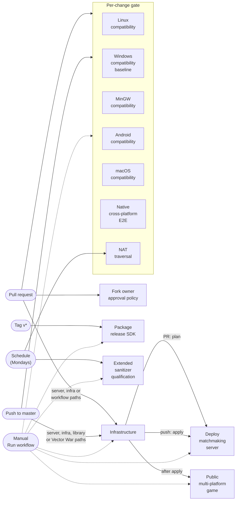

## Change routing

Every per-change workflow first calls [Classify changes](#classify-changes)
with its own **area**. The classifier diffs the change against its base and
asks [`affected_areas.py`](../../.github/ci/affected_areas.py) whether any
changed path affects that area. If not, the workflow skips its expensive jobs
but still reports its aggregate check, so required checks never wait.

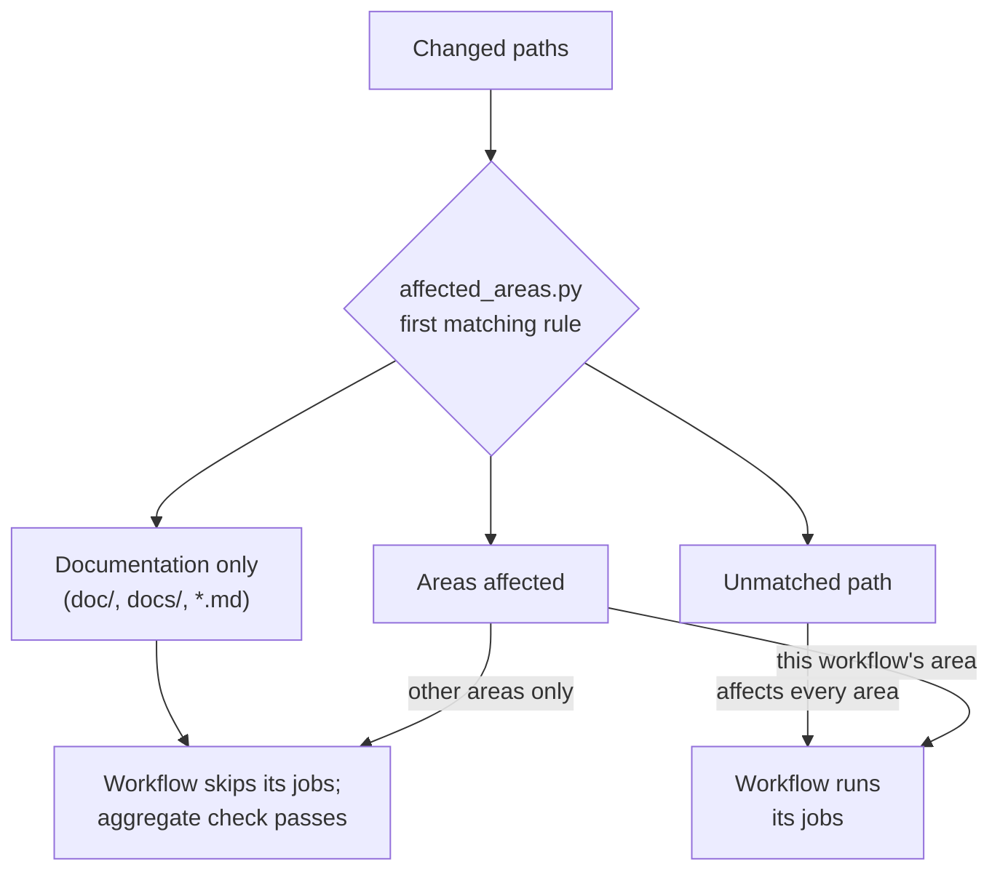

| Area | Workflow | Examples of paths that select it |
| --- | --- | --- |
| `linux` | Linux compatibility | `platform_posix.cpp`, `src/platform/linux/`, SDL frontend, `docker/`, matchmaking server |
| `windows` | Windows compatibility baseline | `platform_windows.cpp`, `src/platform/windows/`, Win32/GDI frontend, Windows CI scripts |
| `mingw` | MinGW compatibility | `platform_windows.cpp`, `src/platform/windows/` |
| `android` | Android compatibility | `platform_posix.cpp`, `src/platform/android/`, SDL frontend, `tests/android/` |
| `macos` | macOS compatibility | `platform_posix.cpp`, `src/platform/apple/`, SDL frontend, `scripts/macos/`, `src/apps/vectorwar/macos/` |
| `e2e` | Native cross-platform E2E | Both platform adapters, `tests/e2e/` |
| `nat` | NAT traversal | `platform_posix.cpp`, `tests/nat/`, matchmaking server |
| `infra` | Infrastructure (its jobs; its trigger is a path filter) | `infra/`, matchmaking server |

The shared core, public header, build system, Vector War's portable core and
`tests/` select every platform plus `e2e` and `nat`; a change to the classifier
or its rules selects everything. Pushes to `master` and manual runs skip
routing and run everything. The rules are tested by
[`test_affected_areas.py`](../../.github/ci/tests/test_affected_areas.py).

## Required checks

The `master` ruleset (**Master PR and CI baseline**) requires one stable
aggregate check per workflow, never individual matrix lanes: a lane skipped on
a documentation-only change never reports its expanded name, so requiring it
would wait forever. Each aggregate job (`final-report`) runs with
`if: always()`, fails if its classifier failed, passes at once for a change
outside its area, and otherwise requires every lane of its workflow.

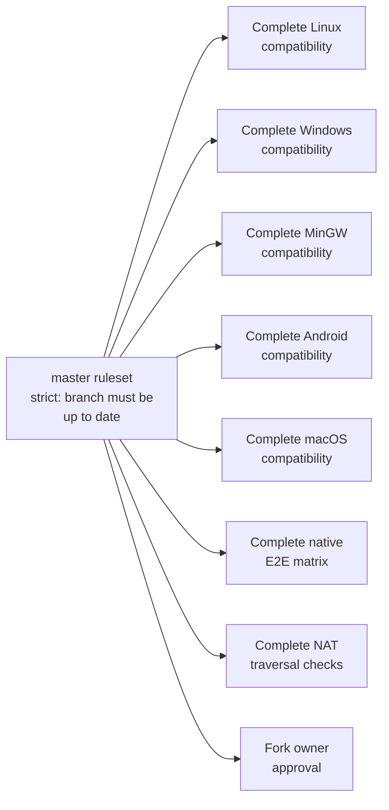

See also [CI gating and labels](Testing.md#ci-gating-and-labels).

## Platform compatibility workflows

Each builds GGPO, runs the platform's CTest suite (the
[shared tests](Testing.md#shared-tests) plus its own), and checks the
installed SDK with the C11 and C++98 consumers.

### Linux compatibility

Builds the repository's Ubuntu 24.04 image
([`docker/linux/Dockerfile`](../../docker/linux/Dockerfile)), then builds,
tests, installs and audits shared and static GGPO with each compiler; the GCC
lane also produces the DEB, RPM and tar.gz packages. Details:
[Linux: CI lanes](Testing.md#linux-ci-lanes).

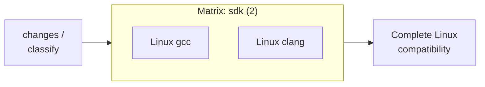

### Windows compatibility baseline

MSVC on `windows-2022`: two Release lanes (x64, Win32) and one x64 Debug lane,
each building both libraries; a comparison against the frozen Windows
baseline commit; and a header-only C11/C++98 compile check on Linux. Details:
[MSVC: CI lanes](Testing.md#msvc-ci-lanes) and
[MSVC: frozen baseline](Testing.md#msvc-frozen-baseline).

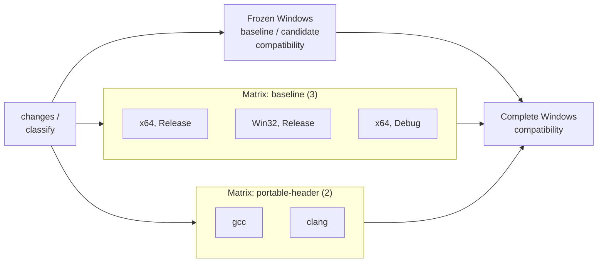

### MinGW compatibility

MSYS2 MinGW-w64 for x64 and x86, plus a check that MinGW and MSVC builds never
mix toolchains. Details: [MinGW: CI lanes](Testing.md#mingw-ci-lanes) and
[MinGW: toolchain isolation](Testing.md#mingw-toolchain-isolation).

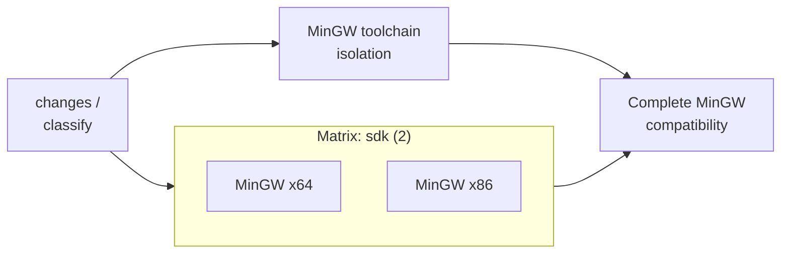

### Android compatibility

NDK builds for each ABI, native execution of the test suite on ARM and x86_64
runners, SDK audits, API 21 and API 35 emulators, and the Vector War APK.
Details: [Android: CI lanes](Testing.md#android-ci-lanes).

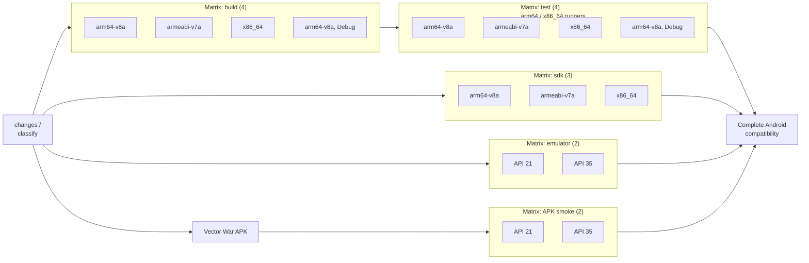

### macOS compatibility

One universal (arm64 + x86_64) build on `macos-15` with Xcode pinned, audited
for both slices and a macOS 11 minimum, plus the installed-SDK consumers. The
build tree is then tested on four runners at once, so every runner executes
exactly the same binaries. Details: [macOS: CI lanes](Testing.md#macos-ci-lanes).

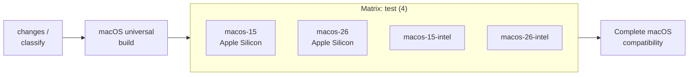

## Interoperability workflows

### Native cross-platform E2E

Two GGPO peers on two different hosted runners, connected over an ephemeral
Tailscale network, for every ordered platform pair and both test programs
(the generic peer and Vector War). The macOS pairs have their own matrix so
they can be capped separately. Pull requests run it only from branches in this
repository by the repository owner, because it uses repository secrets.
Details, including the scenario table: [Native cross-platform
qualification](CrossPlatformTesting.md#scenario-matrix).

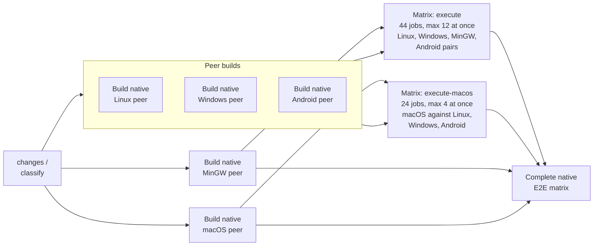

Each scenario is two adjacent matrix entries (role 1 hosts player 1, role 2
runs player 2 and validates). The caps keep a waiting role's partner next in
line and stay below the 20-job account limit; macOS jobs are capped at two
pairs so at most two of the five macOS runners are held. These invariants are
checked by [`test_e2e_matrix.py`](../../.github/ci/tests/test_e2e_matrix.py).
To retry a failed scenario, re-run the whole workflow: re-running only the
failed role leaves it waiting for a partner that already finished.

### NAT traversal

Linux network namespaces with emulated cone and symmetric NAT routers, the
real matchmaking server and Vector War's hole punching with relay fallback;
nine scenarios on one runner. Also runs weekly. Details:
[Matchmaking: testing](Matchmaking.md#testing) and
[NAT matrix results](Matchmaking.md#nat-matrix-results).

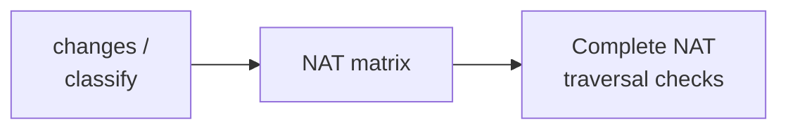

## Server and deployment workflows

### Infrastructure

Tests the Terraform configuration and the matchmaking server, builds the
server image, then, on a push to `master`, applies the real OCI
infrastructure and qualifies it with the public multi-platform game. A pull
request only produces a Terraform plan. Its push trigger also includes the
GGPO library and Vector War, so the deployed game is re-qualified whenever the
game code changes. Details: [Terraform README](../../infra/terraform/README.md).

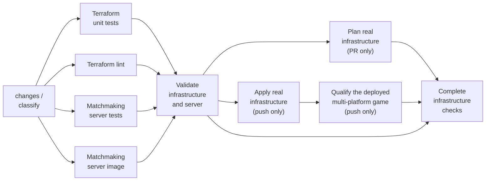

`Plan` and `Apply` call [Deploy matchmaking server](#deploy-matchmaking-server);
`Qualify the deployed multi-platform game` calls
[Public multi-platform game](#public-multi-platform-game) in required mode.

### Deploy matchmaking server

One Terraform job for the production environment, run with `plan`, `apply` or
`destroy` (manual runs choose; Infrastructure passes `plan` or `apply`). Runs
are serialized in the `deploy-matchmaking` concurrency group and never
cancelled. Details: [Terraform README](../../infra/terraform/README.md).

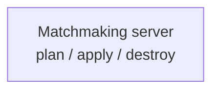

### Public multi-platform game

One real four-player Vector War match through the deployed server's DuckDNS
name: Linux, Windows (MSVC), Android (on an emulator) and macOS, every pair
forced through the relay. The preflight probes the lobby first; in `optional`
mode (manual default) a missing server is a clean skip, in `required` mode
(from Infrastructure) it fails. Details:
[Public multi-platform game](Testing.md#public-multi-platform-game).

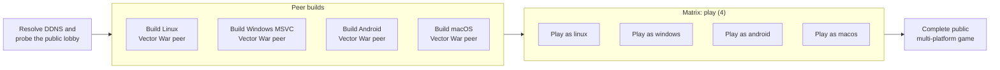

## Release and scheduled workflows

### Package release SDK

Pushing a `v*` tag builds every package, validates each one after extracting
or mounting it, and publishes them with `SHA256SUMS` to the GitHub Release.
The release notes start with
[`.github/release-notes.md`](../../.github/release-notes.md) (installing the
unsigned macOS app), followed by GitHub's generated changelog. A tag must
match `project(GGPO VERSION …)` in [`CMakeLists.txt`](../../CMakeLists.txt)
(`vX.Y.Z` or `vX.Y.Z-rc.N`, published as a pre-release). A manual run is a dry
run: it builds and validates everything and publishes nothing. Details:
[Release packages](Build.md#release-packages).

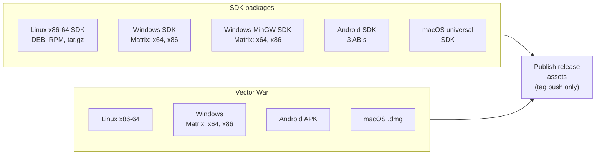

### Extended sanitizer qualification

Weekly and manual: production GGPO and every registered test under Linux Clang
ASan + UBSan, MSVC AddressSanitizer, and Android ASan + UBSan on an x86_64
emulator. Three independent jobs, no aggregate.

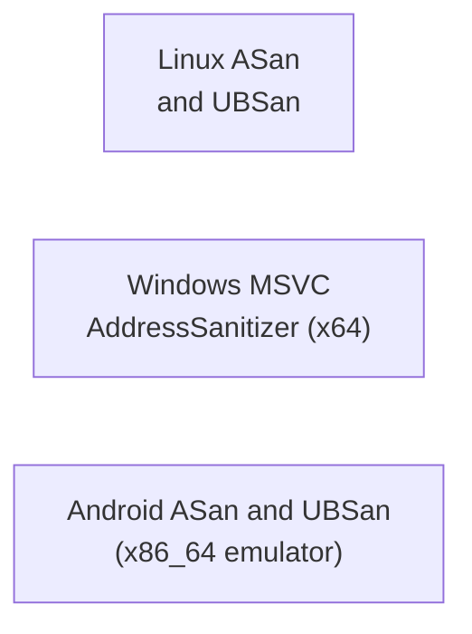

## Policy workflows

### Classify changes

A reusable workflow (`workflow_call` only), so it has no runs of its own; it
appears inside each caller as `changes / classify`. It outputs `code=true`
when the caller's area is affected, always for pushes to `master` and manual
runs. See [Change routing](#change-routing).

### Fork owner approval policy

Reports the required `Fork owner approval` check on every PR: pull requests by
the fork owner pass at once; any other author's PR needs the owner's active
approving review. It re-runs on review submission and dismissal.

## Runners, concurrency and cost

- **Runners:** `ubuntu-24.04`, `ubuntu-24.04-arm` (Android ARM execution and
  E2E peers), `windows-2022`, `macos-15`, `macos-26`, `macos-15-intel`,
  `macos-26-intel`. The repository is public, so hosted minutes are free; the
  account runs at most 20 jobs at once, 5 of them macOS.
- **Superseded runs:** the per-change workflows share one concurrency group
  per pull request, so a new push cancels the previous run. Runs on `master`
  and manual runs always finish. Deploy and the public game serialize in their
  own groups and are never cancelled.
- **Caps:** the E2E matrices are capped (12 and 4 jobs) so paired roles can't
  deadlock the job limit; the macOS test matrix holds at most four macOS jobs.
- **Typical wall-clock times** of recent `master` runs, including runner
  queueing: Linux, MinGW and NAT traversal 2–3.5 minutes; Windows and Android
  about 4–5; macOS 3.5–4.5; the E2E matrices 5–7; the public game about 4.

## Running a workflow by hand

Actions → choose the workflow → **Run workflow**. A manual run skips change
routing and runs every job.

| Workflow | Useful inputs |
| --- | --- |
| Any compatibility workflow, E2E, NAT | none |
| Public multi-platform game | `mode` (`optional` skips if the server is down; `required` fails), `server` (`HOST:PORT`; empty uses the DuckDNS name) |
| Deploy matchmaking server | `action` (`apply`, `plan`, `destroy`) |
| Package release SDK | none; always a dry run |
| Extended sanitizer qualification | none |
