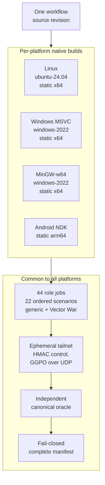
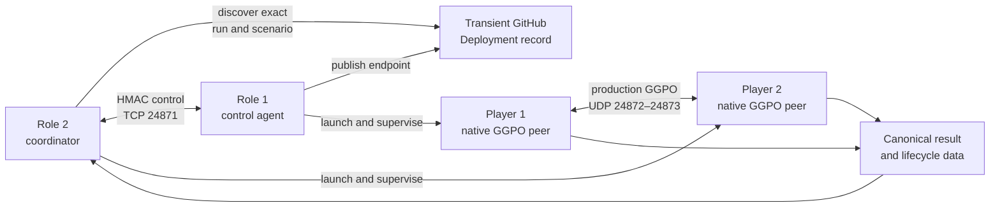
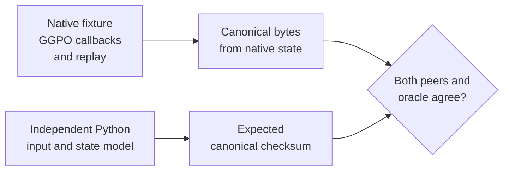
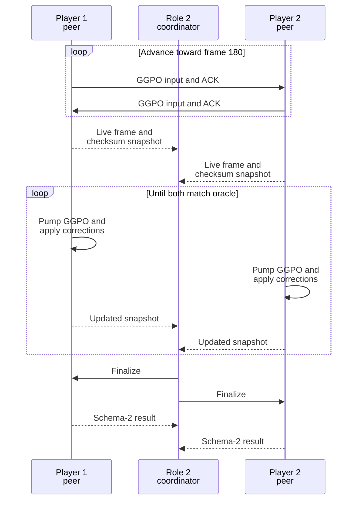

# Native cross-platform qualification

## Contents

- [Overview](#overview)
  - [What the suite proves](#what-the-suite-proves)
  - [Scenario matrix](#scenario-matrix)
- [Platforms](#platforms)
  - [Linux](#linux)
    - [Linux: peer build](#linux-peer-build)
    - [Linux: execution](#linux-execution)
  - [Windows with MSVC](#windows-with-msvc)
    - [MSVC: peer build](#msvc-peer-build)
    - [MSVC: execution](#msvc-execution)
  - [Windows with MinGW-w64](#windows-with-mingw-w64)
    - [MinGW: peer build](#mingw-peer-build)
    - [MinGW: execution](#mingw-execution)
  - [Android](#android)
    - [Android: peer build](#android-peer-build)
    - [Android: execution](#android-execution)
- [Common to all platforms](#common-to-all-platforms)
  - [Why each scenario has two jobs](#why-each-scenario-has-two-jobs)
  - [Components](#components)
  - [Control and data boundaries](#control-and-data-boundaries)
  - [Deterministic state contract](#deterministic-state-contract)
  - [Completion protocol](#completion-protocol)
  - [Security model](#security-model)
  - [Failure contracts](#failure-contracts)
  - [Evidence and interpretation](#evidence-and-interpretation)
  - [Running the workflow](#running-the-workflow)
  - [Adding another platform](#adding-another-platform)
  - [Limits](#limits)
  - [References](#references)

## Overview

The native E2E suite proves that GGPO peers built from one source revision for
Linux, Windows (MSVC and MinGW) and Android can establish a real UDP session
between two hosts, exchange deterministic inputs, converge after prediction and
rollback, and close cleanly.

It complements the local loopback tests in [Testing](Testing.md): local tests
isolate one platform; this matrix detects differences in socket adapters,
compilers, byte representation, scheduling, and cross-host transport.

The implementation is [`cross-platform-e2e.yml`](../../.github/workflows/cross-platform-e2e.yml).
It runs two fixtures through the same orchestration: the generic GGPO peer
[`peer_smoke.cpp`](../../tests/smoke/peer_smoke.cpp) and the real Vector War
application core, [`VectorWarHeadless`](../../src/apps/vectorwar/headless_main.cpp)
(see [Vector War](VectorWar.md#headless-application-contract)). Neither is a
performance benchmark.



### What the suite proves

| Contract | How it is checked | Why it matters |
| --- | --- | --- |
| Source identity | Both native bundles come from the same workflow checkout | Prevents comparing unrelated revisions |
| Native execution | Each platform runs its own native binary on its own runner (ELF, PE, Android NDK) | Wine or cross-compiled peers cannot substitute for native interoperability |
| GGPO transport | Peers exchange production GGPO messages over UDP | Exercises platform sockets and the peer protocol |
| Role symmetry | Each mixed-platform pair runs in both player orders | Detects behavior tied to host role |
| Deterministic convergence | Both peers match an independent canonical oracle | Detects prediction, rollback, serialization, or input divergence |
| Lifecycle | One running event, clean close, zero unexpected disconnects | Detects incomplete sessions hidden by a matching checksum |
| Completeness | Final manifest requires every declared ordered platform/fixture scenario | Prevents a partial matrix from appearing successful |
| Cleanup | Firewall removal, process cancellation, Deployment retirement, and ephemeral logout run unconditionally | Keeps failed CI runs from leaving durable test infrastructure |

A pass does not certify Internet matchmaking, NAT traversal, performance,
spectators, more than two players, or arbitrary application determinism.

### Scenario matrix

The matrix is ordered because the player role can affect connection setup,
input timing, and platform-specific behavior. **G** is the generic peer
fixture and **V** the Vector War fixture; each cell is one scenario per
fixture, run as two jobs.

| Player 1 ↓ / Player 2 → | Linux | Windows (MSVC) | MinGW | Android |
| --- | --- | --- | --- | --- |
| **Linux** | G V | G V | — | G V |
| **Windows (MSVC)** | G V | G V | — | G V |
| **MinGW** | G | G | — | G |
| **Android** | G V | G V | G | G V |

That is 13 generic and 9 Vector War scenarios, 44 role jobs in total. Vector
War has no MinGW build, so MinGW pairs are generic only. MinGW is paired with
MSVC and Linux as player 1 only, and with Android in both orders.

[`validate_manifest.py`](../../tests/e2e/validate_manifest.py) defines the
required assignments. The workflow names generic scenarios `linux-linux`,
`android-windows`, etc., and Vector War scenarios `vectorwar-linux-linux`,
`vectorwar-android-windows`, etc. Each scenario expands into a role-1 host job
and a role-2 coordinator job.

## Platforms

Each platform contributes one native build job and its own execution runner.
Everything after the build is [common to all platforms](#common-to-all-platforms).

### Linux

#### Linux: peer build

The `Build native Linux peer` job compiles `ggpo_linux_peer_smoke` and
`VectorWarHeadless` as static Release x64 executables on `ubuntu-24.04` and
uploads them as `e2e-peer-linux`, with SHA-256 and toolchain metadata.

#### Linux: execution

Linux roles run on `ubuntu-24.04`. Linux plays every other platform in both
orders, with both fixtures, except MinGW, which it meets only as player 2 in
the generic fixture.

### Windows with MSVC

#### MSVC: peer build

The `Build native Windows peer` job compiles `ggpo_windows_peer_smoke` and
`VectorWarHeadless` with Visual Studio as static Release x64 executables on
`windows-2022` and uploads them as `e2e-peer-windows`.

#### MSVC: execution

Windows roles run on `windows-2022`. Each Windows job opens only the E2E ports
(TCP `24871`, UDP `24872–24873`) in the firewall and removes those rules with
`if: always()`. MSVC Windows plays Linux and Android in both orders with both
fixtures, and meets MinGW as player 2 in the generic fixture.

### Windows with MinGW-w64

#### MinGW: peer build

The `Build native MinGW peer` job compiles `ggpo_windows_peer_smoke` in MSYS2
`MINGW64` as a static Release x64 executable on `windows-2022` and uploads it
as `e2e-peer-mingw`. Vector War is not built with MinGW.

#### MinGW: execution

MinGW roles run on `windows-2022` with the same firewall handling as MSVC.
Scenarios: `mingw-windows` and `mingw-linux` (MinGW as player 1), and
`android-mingw` / `mingw-android`. All are generic-fixture only.

### Android

#### Android: peer build

The `Build native Android peer` job cross-compiles `ggpo_android_peer_smoke`
and `VectorWarHeadless` with the NDK for arm64-v8a, API 21, fully static
(`-static`, bionic linked in), and uploads them as `e2e-peer-android`.

#### Android: execution

Android roles run on `ubuntu-24.04-arm`, where the static NDK executables run
natively. This exercises Android's production socket and platform adapter; it
is not an emulator, APK lifecycle, or physical-device test, which the
[Android compatibility workflow](Testing.md#android) covers. Android plays
every platform, including itself, in both orders; MinGW pairs are generic only.

## Common to all platforms

### Why each scenario has two jobs

A scenario is two GGPO peers on two different hosts, and every GitHub Actions
job runs on its own runner, so each peer needs its own job. Mixed scenarios
also need two operating systems at once, which one runner cannot provide.
Same-OS scenarios use two runners as well, so every scenario sends real
traffic between hosts rather than over loopback.

The two jobs are deliberately asymmetric:

| | Role 1 (`player1`) | Role 2 (`player2`) |
| --- | --- | --- |
| Peer | Runs player 1 | Runs player 2 |
| Startup | Publishes its tailnet address, then waits | Discovers role 1 and connects to it |
| Control | Executes authenticated requests | Decides when to start, finalize, collect, and shut down |
| Result | Uploads its own log | Validates both peers and writes the scenario report |

One side must decide when both peers have converged; making role 2 the single
coordinator avoids two jobs racing to that decision. Only role-2 reports feed
the final manifest, and "Complete native E2E matrix" is the single check that
summarizes all scenarios. Because each mixed pair also runs in reverse order
(LW and WL), each operating system serves in both roles.

### Components

| Component | Responsibility | Source |
| --- | --- | --- |
| Vector War fixture | Runs the production Vector War session, callbacks, rollback, and frame loop without a renderer; must reach checksum `b3381958` at frame 180 | [`headless_main.cpp`](../../src/apps/vectorwar/headless_main.cpp) |
| Native peer fixture | Starts GGPO, submits deterministic inputs, pumps transport, publishes state, and records results | [`peer_smoke.cpp`](../../tests/smoke/peer_smoke.cpp) |
| Test simulation | Implements save/load/free/advance callbacks and canonical state hashing | [`smoke_session.cpp`](../../tests/smoke/smoke_session.cpp) |
| Result oracle | Independently computes expected state and validates schema 2 | [`result_schema.py`](../../tests/e2e/result_schema.py) |
| Role-1 agent | Publishes the endpoint, serves authenticated control, and retires the Deployment | [`host_agent.py`](../../tests/e2e/host_agent.py) |
| Peer supervisor | Restricts paths and operations and owns the child process lifecycle | [`peer_agent.py`](../../tests/e2e/peer_agent.py) |
| Role-2 coordinator | Discovers role 1, starts both peers, confirms state, and writes the scenario report | [`execute_pair.py`](../../tests/e2e/execute_pair.py) |
| Rendezvous | Publishes, discovers, and retires an exact run-scoped GitHub Deployment | [`rendezvous.py`](../../tests/e2e/rendezvous.py) |
| Control authentication | Derives run-bound keys and verifies HMAC plus monotonic nonces | [`control.py`](../../tests/e2e/control.py) |
| Final verifier | Rejects missing, duplicate, or non-passing scenario reports | [`validate_manifest.py`](../../tests/e2e/validate_manifest.py) |

### Control and data boundaries



#### Address discovery

Hosted runners have no stable or mutually reachable addresses, so the workflow
never uses runner hostnames or public IPs:

1. Every execution job joins an ephemeral tailnet as `tag:ggpo-ci` using the
   Tailscale OAuth secrets, then records its own address with `tailscale ip -4`.
2. Role 1 starts [`host_agent.py`](../../tests/e2e/host_agent.py), which
   publishes that address as a transient GitHub Deployment keyed to the exact
   run ID and scenario ([`rendezvous.py`](../../tests/e2e/rendezvous.py)).
   Every scenario uses a distinct Deployment environment, so a large matrix
   cannot hide one pair's rendezvous record behind newer scenarios.
3. Role 2's [`execute_pair.py`](../../tests/e2e/execute_pair.py) discovers that
   record, rejecting stale, duplicate, or mismatched records, and connects to
   the role-1 agent on TCP `24871` with run-bound HMAC authentication.
4. Role 2 passes its own tailnet address over the control channel, and both
   peers are launched with each other's tailnet address on UDP `24872–24873`.
   Windows jobs open only those ports in the firewall for the run.
5. Cleanup removes the firewall rules, cancels processes, retires the
   Deployment, and logs the ephemeral node out, including on failure.

The control plane never carries GGPO input packets. It starts peers, observes
state, releases finalization, collects results, and requests cleanup. Production
[`UdpProtocol`](../../src/lib/ggpo/network/udp_proto.cpp) traffic travels
directly between the native peers.

### Deterministic state contract

Each logical frame has one deterministic integer input per player. The fixture
applies both synchronized inputs to a small game-owned state containing:

- current frame;
- accumulator; and
- disconnect flags.

[`SmokeCanonicalChecksum`](../../tests/smoke/smoke_session.cpp) serializes these
values as three unsigned little-endian 32-bit integers before hashing them.
The Vector War fixture instead uses
[`VectorWarCanonicalChecksum`](../../src/apps/vectorwar/state_contract.cpp)
over its padding-independent game state and must match the frozen frame-180
value `b3381958`.
[`expected_state()`](../../tests/e2e/result_schema.py) independently reproduces
the input sequence and state transition in Python.

This separation is intentional:



The legacy native-memory checksum is retained for schema-1 compatibility. It
is not the cross-platform oracle because padding and host byte representation
must not become protocol requirements.

### Completion protocol

Reaching frame 180 is not sufficient. A peer can reach the target using a
predicted remote input and later correct it through rollback.



The coordinator releases both finalize markers before collecting either peer.
This prevents one peer from exiting while the other continues applying late
corrections. The final validator again checks both results against the oracle.

### Security model

The native workflow uses three repository secrets:

| Secret | Purpose |
| --- | --- |
| `TS_OAUTH_CLIENT_ID` | Identifies the Tailscale OAuth client |
| `TS_OAUTH_SECRET` | Creates short-lived tagged runner nodes |
| `GGPO_E2E_SESSION_SECRET` | Derives a unique control HMAC key per repository, SHA, run, and attempt |

Tailscale runners are ephemeral and use `tag:ggpo-ci`. The tailnet grant permits
only control TCP `24871` and GGPO UDP `24872–24873` between those tagged nodes.
Windows firewall rules for the same ports are removed with `if: always()`.

The control protocol accepts only `prepare`, `launch-peer`, `status`,
`finalize`, `collect`, `cancel`, and `shutdown`. It rejects:

- an invalid MAC or session;
- replayed or out-of-order nonces;
- commands outside the allow-list;
- executable or artifact paths outside the workspace; and
- results from another repository, SHA, run, attempt, or scenario.

Secrets run only for owner-authored same-repository PRs, trusted `master`
pushes, or manual dispatch. The workflow does not use `pull_request_target`.

### Failure contracts

| Failure | Detection | Cleanup behavior |
| --- | --- | --- |
| Native build or staging failure | Build job fails; execution dependency is skipped | No tailnet node is created |
| Agent authentication or identity mismatch | Control or rendezvous validation fails closed | Supervisor cancellation and action cleanup run |
| Peer startup/crash | Nonzero process status before the completion barrier | Surviving child is terminated |
| Peer timeout | Bounded rendezvous, control, execution, and job deadlines | Child, server, firewall, and ephemeral node cleanup run |
| Missing paired role | Role 1 and role 2 fail after the 10-minute rendezvous deadline | Published endpoint is retired and the surviving agent is stopped |
| State divergence | Live snapshot never reaches the oracle or final schema validation fails | Scenario report is absent or non-passing |
| Missing or duplicate scenario | [`validate_manifest.py`](../../tests/e2e/validate_manifest.py) rejects the evidence set | Final job fails even if other scenarios passed |
| Role job failure | `needs.execute.result` is not `success` | Final job fails unconditionally |

Focused regressions live in
[`test_orchestration.py`](../../tests/e2e/test_orchestration.py),
[`test_rendezvous.py`](../../tests/e2e/test_rendezvous.py), and
[`test_result_schema.py`](../../tests/e2e/test_result_schema.py).

### Evidence and interpretation

The workflow publishes:

| Artifact | Contents | Use |
| --- | --- | --- |
| `e2e-peer-<platform>` | Peer (and Vector War fixture where built), SHA-256, toolchain | Identifies each platform's executables; see [Platforms](#platforms) |
| `e2e-<scenario>-role1` | Host log and lifecycle evidence | Diagnoses role-1 startup and transport |
| `e2e-<scenario>-role2` | Coordinator log and validated `report.json` | Proves one complete scenario |
| `e2e-complete-manifest` | Exactly 22 passing scenario reports: 13 generic, 9 Vector War | Merge-level qualification evidence |

Schema-2 results record frame, canonical and native checksums, save/load/replay
counts, running events, disconnects, close state, and exit status. Exact
save/load/replay counts are diagnostic because host scheduling changes them;
the gates are deterministic state, identity, required events, clean lifecycle,
and complete scenario coverage.

The three-run qualification is recorded in the
[cross-platform progress ledger](../planning/2026-11-07-cross_platform_e2e_ci/PROGRESS.md#evidence-ledger).

### Running the workflow

Owner-authored same-repository PR updates run the suite automatically. After
the workflow exists on `master`, an administrator can also start it manually:

```bash
gh workflow run cross-platform-e2e.yml \
  --repo irregularthanis/ggpo-next \
  --ref master
```

Required setup:

1. Define `tag:ggpo-ci` and its bounded grant in the tailnet policy.
2. Create a Tailscale OAuth credential with writable `auth_keys` for that tag.
3. Configure the three repository secrets listed under [Security model](#security-model).
4. Keep workflow permissions at `contents: read`, `actions: read`, and
   `deployments: write`.

For ordinary local validation, use CTest instead; the cross-host workflow
depends on GitHub Deployments, native hosted runners, and ephemeral Tailscale
nodes. See [CI gating and labels](Testing.md#ci-gating-and-labels).

### Adding another platform

A new platform first needs its native adapter, local conformance tests,
two-process loopback, and package/consumer checks described in
[Portability](Portability.md#follow-up-platform-contract). Only then should it
enter this ordered interoperability matrix.

macOS can use a native GitHub-hosted runner and the same ephemeral Tailscale
control plane. A future Android physical-device topology must separately prove
that the device itself reaches the tailnet; a host proxy must be reported as a
distinct topology.

The complete ordered matrix grows as the square of the platform count. Keep a
small required per-change matrix and move the complete matrix to scheduled
qualification when its cost becomes excessive.

### Limits

- The matrix covers native Ubuntu, Windows (MSVC and MinGW), and Android-NDK peers on hosted
  runners, not SteamOS, macOS, consoles, simulators, or physical devices.
- It uses two players and does not cover spectators or disconnect/resume.
- Clean qualification injects no latency or packet loss.
- It does not test NAT traversal, relay selection, matchmaking, encryption, or
  public-Internet reachability.
- It is a correctness suite, not a throughput or latency benchmark.

Seeded impairment is the next independent nightly tier; it is not part of the
completed clean interoperability gate.

### References

- [Testing architecture](Testing.md)
- [Networking architecture](Networking.md)
- [Synchronization architecture](Synchronization.md)
- [Portability architecture](Portability.md)
- [Cross-platform E2E technical plan](../planning/2026-11-07-cross_platform_e2e_ci/TECH_PLAN.md)
- [Cross-platform E2E progress](../planning/2026-11-07-cross_platform_e2e_ci/PROGRESS.md)
- [Architecture overview](Overview.md)
