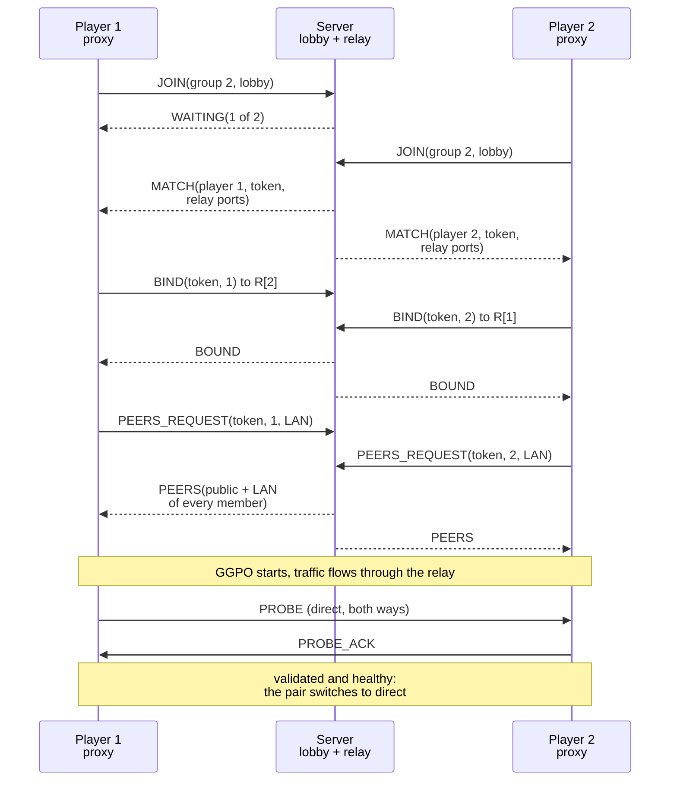
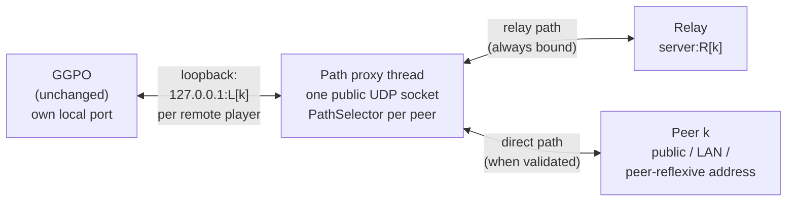
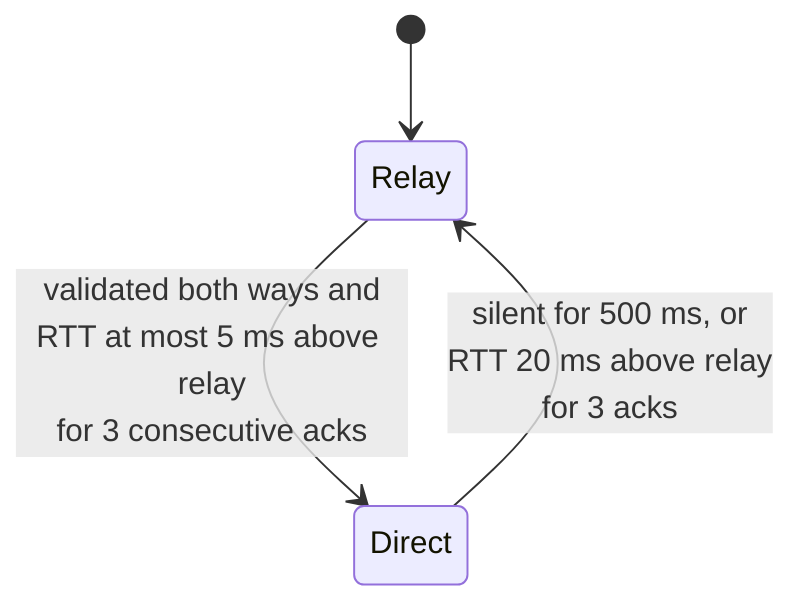

# Matchmaking, relay and hole punching

## Contents

- [Purpose and boundaries](#purpose-and-boundaries)
- [Components](#components)
- [Session flow](#session-flow)
- [Protocol](#protocol)
- [Relay forwarding](#relay-forwarding)
- [Hole punching with relay fallback](#hole-punching-with-relay-fallback)
- [Safety](#safety)
- [Compatibility](#compatibility)
- [Server and deployment](#server-and-deployment)
- [Testing](#testing)
- [Limits](#limits)

## Purpose and boundaries

Vector War players on different home networks, mobile data or carrier-grade
NAT can play over the Internet without port forwarding or a VPN. A small
lobby and relay server groups 2 to 4 players and relays their traffic; once a
session runs, each pair of players tries a direct path (UDP hole punching) and
uses it while it is healthy, keeping the relay as a live fallback.

All of this lives in the **Vector War sample** and the **matchmaking server**.
The GGPO library is unchanged: no code, public API, ABI, export or wire-format
change. GGPO itself still knows nothing about matchmaking, relays or NAT
traversal ([Overview](Overview.md)); it sees every remote player at an ordinary
`IP:PORT`. Vector War's direct `IP:PORT` mode, without a server, works exactly
as before.

Plan and decisions: [internet play plan](../planning/2026-11-11-internet_play/TECH_PLAN.md)
(D4 relay, D6 hole punching with relay fallback).

## Components

| Component | Responsibility | Source |
| --- | --- | --- |
| Lobby and relay server | Groups 2-4 players by lobby code and size, allocates one relay port per player, forwards datagrams between bound members, hands out hole-punching candidates | [`services/matchmaking`](../../services/matchmaking/README.md) (Python, `asyncio`) |
| Protocol codec (client) | Encodes and decodes every server message byte for byte like the server | [`vw_net_protocol`](../../src/apps/vectorwar/net/vw_net_protocol.h) |
| Matchmaking client | `JOIN` until `MATCH`, `BIND` to every relay port, `PEERS_REQUEST` for candidates | [`vw_matchmaking`](../../src/apps/vectorwar/net/vw_matchmaking.h) |
| Probes | 32-byte `PROBE`, `PROBE_ACK`, `KEEPALIVE` with a SipHash-2-4 MAC keyed by the session token | [`vw_path_probe`](../../src/apps/vectorwar/net/vw_path_probe.h), [`vw_siphash`](../../src/apps/vectorwar/net/vw_siphash.h) |
| Path selector | Per-peer choice between the relay and direct candidates | [`vw_path_selector`](../../src/apps/vectorwar/net/vw_path_selector.h) |
| Path proxy | Owns the public socket; sits between GGPO and the network on its own thread | [`vw_path_proxy`](../../src/apps/vectorwar/net/vw_path_proxy.h) |
| Frontend glue | `--matchmaking` for the Win32, SDL (Linux, Android) and headless frontends: resolve, matchmake, start the proxy, build GGPO's player list | [`matchmade`](../../src/apps/vectorwar/matchmade.h) |
| Sockets and threads | Non-blocking IPv4 UDP, `select`, mutex, thread for Windows and POSIX | [`vw_udp`](../../src/apps/vectorwar/net/vw_udp.h) |
| Infrastructure | Oracle Cloud always-free VM, DuckDNS name, Terraform, deploy workflow | [`infra/terraform`](../../infra/terraform/README.md) |

The client modules form the `VectorWarNet` static library
([`src/apps/vectorwar/CMakeLists.txt`](../../src/apps/vectorwar/CMakeLists.txt)),
C++98 and free of GGPO, so they build on every supported platform.

## Session flow

Every message is sent from the same UDP socket, the proxy's public socket, so
the relay binding, the server-observed public address and the direct path all
share one NAT mapping.

## Protocol

Every datagram starts with an 8-byte header: magic `VWMM`, version, type, two
reserved zero bytes. Integers are little-endian.

| Type | Message | Version | Direction | Purpose |
| --- | --- | --- | --- | --- |
| 1 | `JOIN` | 2 | client → lobby | Group size 2-4, optional lobby code; padded to 64 bytes |
| 2 | `WAITING` | 2 | lobby → client | Players joined so far |
| 3 | `MATCH` | 2 | lobby → client | Player number, session token, every player's relay port and platform (44 bytes) |
| 4/5 | `BIND` / `BOUND` | 2 | client ↔ relay port | Latch the client's exact source address per relay port |
| 6 | `HELLO` | 2 | peer ↔ peer | Direct `IP:PORT` mode platform exchange |
| 7 | `ERROR` | 2 | lobby → client | Version mismatch, rate limited, server full |
| 8 | `PEERS_REQUEST` | 3 | client → lobby | Token, player, LAN address; padded to 68 bytes |
| 9 | `PEERS` | 3 | lobby → client | Each member's public and LAN candidates (68 bytes) |

The shared vectors in
[`protocol_vectors.json`](../../services/matchmaking/protocol_vectors.json)
are decoded by both the Python server tests and the C++ client tests, so the
two implementations cannot drift apart.

## Relay forwarding

For a session with players `1..N` and relay ports `R[1..N]`, a datagram from
player `i` arriving at `R[k]` is forwarded unchanged **from** `R[i]` **to**
player `k`. Player `k` therefore sees it coming from `server:R[i]`, exactly
the endpoint configured for player `i`, so GGPO's per-endpoint state needs no
change. Only addresses that bound with the session token are forwarded, only to
other members; a session ends after 30 s idle or 2 hours.

## Hole punching with relay fallback

### Placement

- GGPO binds its own free local port and is configured with remote player `k`
  at `127.0.0.1:L[k]`, a loopback socket owned by the proxy. It never sees an
  address change.
- **Outbound:** a GGPO datagram arriving on `L[k]` (only from GGPO's own port)
  is sent on peer `k`'s active route.
- **Inbound:** datagrams from `server:R[k]` or from a validated direct address
  of peer `k` are delivered to GGPO from `L[k]`; anything else is dropped. Both
  routes are always accepted, so each side switches independently and no switch
  handshake exists.
- The proxy runs on its own thread so the game loop, which may block in GGPO
  for up to a frame, never delays forwarding.

### Candidates

| Index | Candidate | Source |
| --- | --- | --- |
| 0 | Relay `server:R[k]` | `MATCH`; always present, the start route and fallback |
| 1.. | Peer's public address | `PEERS`: where the server saw the peer's `PEERS_REQUEST` come from |
| 1.. | Peer's LAN address | `PEERS`: RFC 1918 address reported by the peer (same-network play) |
| 1.. | Peer-reflexive address | An authenticated probe arriving from an address the server did not advertise |

### Probes

32 bytes: magic `VWPATH01`, type, sender, receiver, a reserved byte, sequence,
send time, a session tag and a SipHash-2-4 MAC keyed by the session token. The
magic separates them from GGPO datagrams without framing game data. A `PROBE`
is answered with a `PROBE_ACK` echoing its sequence and time. Probes through
the relay measure the relay's round trip and double as keepalives.

### Path selection

- A direct candidate is **validated** once our probe is acknowledged *and* the
  peer's own probe arrived from it, so both NAT directions are open.
- A healthy direct path is preferred even at equal latency, because it takes
  the server off the data path. The wider fallback margin prevents flapping.
- After a fallback, probing that candidate backs off 500 ms → 1 s → 2 s → 4 s →
  5 s and resets when it validates again.
- GGPO's rollback absorbs the datagrams lost during a switch.

### NAT outcomes

| Router pair | Route |
| --- | --- |
| Full-cone or port-restricted on both sides | Direct |
| Same LAN | Direct through the LAN candidate |
| Different mapping per destination (peer-reflexive) | Direct when the peer's probe reveals a reachable address |
| Symmetric on one or both sides, carrier-grade NAT | Relay for the whole match |
| Direct path lost mid-match | Relay within about 500 ms, then direct again when probes recover |
| Relay lost while direct | The match continues direct |

## Safety

- **No amplification:** only a full 64-byte `JOIN` gets a lobby reply and every
  reply is smaller; `BOUND` equals `BIND`; `PEERS` equals `PEERS_REQUEST`;
  forwarding never sends more bytes than it received.
- **No open proxy:** the relay forwards only between token-bound members.
- **No probe hijacking:** probes are authenticated, and an acknowledgement
  counts only if it echoes a probe sent to that exact address within 2 s.
- **No aiming at third parties:** the server relays only RFC 1918 LAN
  candidates, so a member cannot point the others' probes at an arbitrary host.
- Rate limits per source, capped queues, session expiry, and no logged
  addresses.

## Compatibility

| Party | Behavior |
| --- | --- |
| GGPO library | Unchanged; other applications are unaffected |
| Vector War direct `IP:PORT` mode | Unchanged; no server, proxy or probes involved |
| v2 client, v3 server | Never sends `PEERS_REQUEST`; relay only |
| v3 client, v2 server | `PEERS_REQUEST` is never answered; relay only |
| `--relay-only` | Candidates are ignored; every pair stays on the relay |

On the network, GGPO's datagrams are unchanged byte for byte; probe datagrams
appear only between v3 clients in matchmade sessions.

## Server and deployment

The server is plain Python 3 with no third-party dependencies, shipped as an
unprivileged, read-only container image for amd64 and arm64
(`ghcr.io/irregularthanis/ggpo-matchmaking`). It runs on one Oracle Cloud
always-free Ampere A1 VM, with UDP 7100 for the lobby and 7101-7499 for the
relay, behind a DuckDNS name.

- **Up and down:** locally with Terraform, or with one click on the manual,
  non-blocking **Deploy matchmaking server** workflow (`apply`, `plan`,
  `destroy`).
- **DNS:** the VM updates its own DuckDNS record 30 s after boot and every
  5 minutes. After `apply` the workflow waits for the record and a lobby
  answer; `destroy` clears the record so the name never points at a released
  IP.

Details: [`infra/terraform/README.md`](../../infra/terraform/README.md).

## Testing

| Test | What it proves |
| --- | --- |
| `matchmaking_server_contract` | Server protocol rules and vectors, lobby grouping, relay latching and forwarding for 2 and 4 players, candidate exchange and filtering, expiry, rate limits; real sockets on loopback |
| `vectorwar_net_contract` | C++ codec against the shared vectors, the SipHash reference vector, probe authentication and tamper rejection, and every path-selector scenario on a fake clock |
| `vectorwar_net_proxy_loopback` | Real server and one path proxy per player with a stand-in for GGPO: 2 and 3 players switch to direct with data flowing throughout; with direct disabled everything stays on the relay |
| `vectorwar_matchmaking_loopback` | Real server and real Vector War sessions: 2, 3 and 4 players with every pair direct, and 2 players relay-only; every group converges and two players reach portable frozen checksum `b3381958` |
| `NAT traversal` workflow ([`run_nat_matrix.py`](../../tests/nat/run_nat_matrix.py)) | Linux network namespaces with emulated routers: cone NAT is `MASQUERADE`, symmetric is `MASQUERADE --random-fully`, and routers drop unsolicited inbound UDP. Nine scenarios, listed below |
| `Infrastructure` workflow | Terraform `fmt`, `validate`, `terraform test` with mocked providers, `tflint`, server tests, multi-arch image smoke |

The two loopback tests run on every native platform (Linux, Windows MSVC,
MinGW); a cross-compiled Android build cannot reach the build host's loopback
server. See [Testing](Testing.md).

### NAT matrix results

| Scenario | Outcome checked |
|---|---|
| cone-cone | Both directions direct; frozen checksum `b3381958` |
| symmetric-symmetric | Relay for the whole match |
| cone-symmetric | Recorded only; currently stays on the relay |
| same-lan | Direct over the RFC1918 LAN candidate |
| three-players-mixed | Cone pair direct, pairs with the symmetric player on the relay |
| four-players-mixed | Four peers across two cone and two symmetric routers converge to one checksum; the cone pair is direct and restrictive pairs remain available through the relay |
| impaired-cone-cone | A paced match under 60 ± 15 ms WAN delay, 2% loss, and 1% reordering selects a measured direct or relay path and converges |
| direct-cut-mid-match | Direct, then the router path is cut at 8 s: falls back to the relay (1 switch, 1 fallback) and both peers converge |
| server-lost-while-direct | Server killed at 8 s while direct: the match finishes direct |

Timed and impaired scenarios set `VW_HEADLESS_FRAME_MS=16` so route health,
fallback and rollback are exercised against real elapsed time; without it the
headless loop is unpaced. The workflow also runs weekly so impairment coverage
does not depend on a networking-code change.

## Limits

- The NAT matrix runs only on Linux in CI because namespaces and `tc netem`
  require root; real carrier-grade and mobile networks remain manual trials.
- IPv4 only, like GGPO's endpoints.
- No port prediction for symmetric NAT; such pairs stay on the relay.
- Peer platforms in direct play are not exchanged, so peers show `unknown`
  there. Matchmade routes and RTTs are visible in the Windows performance
  monitor; SDL frontends currently expose the route in the in-game legend.
