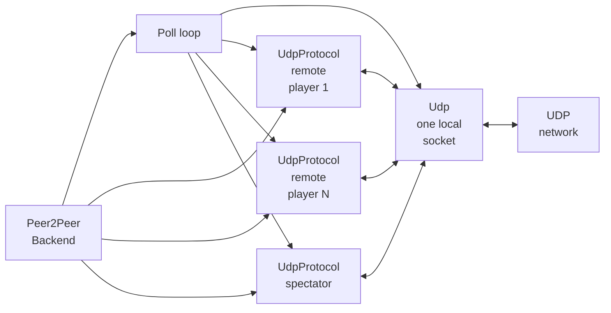
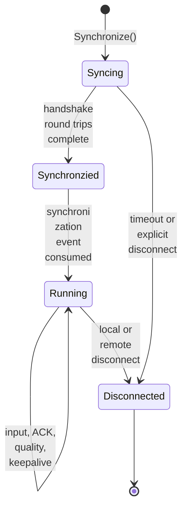
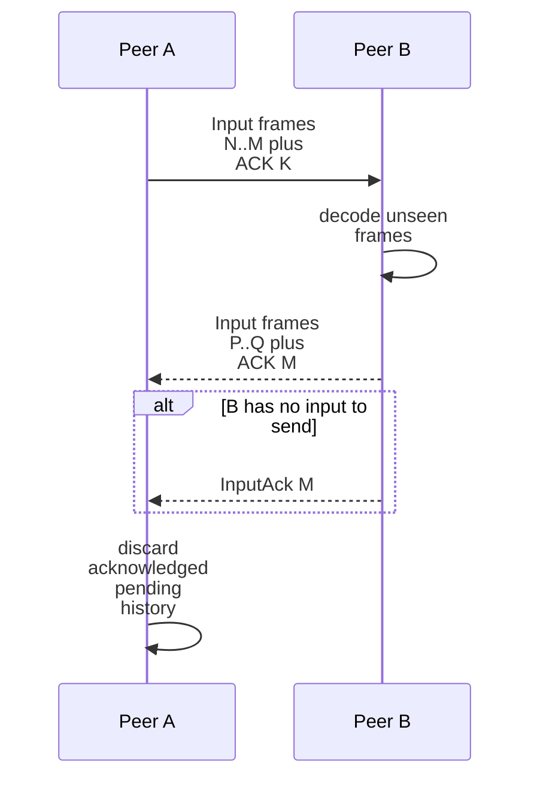

# Networking architecture

## Contents

- [Network boundaries](#network-boundaries)
- [Transport and endpoint model](#transport-and-endpoint-model)
- [Peer state machine](#peer-state-machine)
- [Wire messages](#wire-messages)
- [Input delivery and acknowledgement](#input-delivery-and-acknowledgement)
- [Quality and time synchronization](#quality-and-time-synchronization)
- [Disconnect handling](#disconnect-handling)
- [Security boundary](#security-boundary)

## Network boundaries

GGPO's network layer consists of a shared UDP socket and one `UdpProtocol`
instance per remote player or spectator. The application supplies peer IP
addresses and ports through [`GGPOPlayer`](../../src/include/ggponet.h).

[`Peer2PeerBackend::OnMsg`](../../src/lib/ggpo/backends/p2p.cpp) identifies the
endpoint that accepts each datagram. The protocol then validates its header magic
and sequence state before interpreting the payload.

## Transport and endpoint model

[`Udp`](../../src/lib/ggpo/network/udp.h) binds a non-blocking IPv4 datagram
socket, sends raw buffers, and drains received datagrams when polled. It does not
implement reliability itself. [`UdpProtocol`](../../src/lib/ggpo/network/udp_proto.h)
adds GGPO-specific sequencing, redundant input history, acknowledgements, quality
measurements, connection state, and simulated latency/loss diagnostics.

## Peer state machine

The spelling `Synchronzied` reflects the current enum in
[`udp_proto.h`](../../src/lib/ggpo/network/udp_proto.h). Handshake requests carry
a random value and endpoint identity; replies echo the random value. See
[`OnSyncRequest`](../../src/lib/ggpo/network/udp_proto.cpp) and
[`OnSyncReply`](../../src/lib/ggpo/network/udp_proto.cpp).

## Wire messages

The packed [`UdpMsg`](../../src/lib/ggpo/network/udp_msg.h) union defines the
current protocol:

| Type | Purpose | Main fields |
| --- | --- | --- |
| `SyncRequest` | Establish endpoint identity and validate reachability | random request, remote magic, endpoint index |
| `SyncReply` | Complete one handshake round trip | echoed random value |
| `Input` | Carry input history and peer connection status | start frame, compressed bits, ACK frame, frame advantage |
| `InputAck` | Confirm the highest processed input frame | ACK frame |
| `QualityReport` | Measure round-trip time and compare frame advantage | ping timestamp, frame advantage |
| `QualityReply` | Echo a quality timestamp | pong value |
| `KeepAlive` | Keep an otherwise idle connection active | no payload |

The header carries a 16-bit magic value, sequence number, and message type. The
structure is packed and transmitted directly, so layout, integer width, and byte
order are part of the current implicit wire contract.

## Input delivery and acknowledgement

[`UdpProtocol::SendInput`](../../src/lib/ggpo/network/udp_proto.cpp) queues inputs.
[`SendPendingOutput`](../../src/lib/ggpo/network/udp_proto.cpp) encodes the change
between frames into a bit vector, includes recent connection status, and retains
unacknowledged history. [`OnInput`](../../src/lib/ggpo/network/udp_proto.cpp)
decodes frames, ignores duplicates, queues new input events, and processes the
piggybacked acknowledgement. `InputAck` messages provide an acknowledgement when
there is no outbound input to carry one.

## Quality and time synchronization

Quality reports estimate ping and exchange local frame advantage in
[`OnQualityReport`](../../src/lib/ggpo/network/udp_proto.cpp). [`TimeSync`](../../src/lib/ggpo/timesync.h)
combines frame-advantage history and input-idle observations to recommend that a
leading client pause. The peer backend emits `GGPO_EVENTCODE_TIMESYNC`; the game
decides how to apply the recommendation.

## Disconnect handling

Each protocol endpoint tracks the last receive time, an interruption-notification
threshold, and a final disconnect timeout. It emits `NetworkInterrupted`,
`NetworkResumed`, or `Disconnected` events from
[`OnLoopPoll`](../../src/lib/ggpo/network/udp_proto.cpp). The peer backend maps
these to public [`GGPOEvent`](../../src/include/ggponet.h) notifications and updates
the per-player connect-status frame used by synchronization.

## Security boundary

The current protocol has no encryption, authentication, replay protection, relay,
or NAT traversal. It accepts application-provided IPv4 endpoints and exchanges
packed native structures over UDP. A production integration should treat remote
packets as untrusted and assess length validation, endian assumptions, structure
layout, denial-of-service limits, and protocol versioning before Internet exposure.
