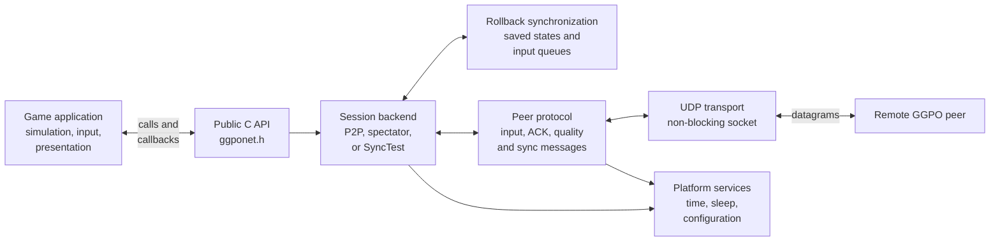
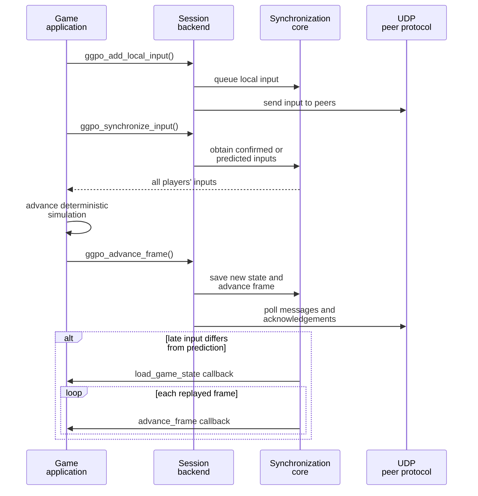

# Architecture overview

## Contents

- [What GGPO is](#what-ggpo-is)
- [What GGPO is not](#what-ggpo-is-not)
- [High-level view](#high-level-view)
- [Component map](#component-map)
- [Execution model](#execution-model)
- [Continue reading](#continue-reading)

## What GGPO is

GGPO is a rollback networking SDK with a C-linkage-style public API. A game submits local inputs and
implements callbacks for saving, loading, and advancing deterministic game state.
GGPO exchanges inputs, predicts missing remote inputs, detects mispredictions,
restores an earlier state, and replays frames to catch up.

The current header uses C++ types such as `bool`, so consumers should treat it as
a C++ header despite its `extern "C"` linkage block. The public boundary is
[`ggponet.h`](../../src/include/ggponet.h). The sample
integration is [Vector War](../../src/apps/vectorwar/vectorwar.cpp).

## What GGPO is not

- It is not a game engine or renderer. The application owns simulation, audio,
  presentation, input devices, and persistent data.
- It does not synchronize full game-state snapshots over the network. Peers send
  inputs; saved states remain local and support rollback.
- It does not make a simulation deterministic. The application must provide a
  deterministic, serializable, fixed-step simulation.
- It is not a matchmaking, relay, NAT-traversal, authentication, or encryption
  service. The current transport sends GGPO protocol messages over UDP.

See the existing [Developer Guide](../DeveloperGuide.md) for integration advice.

## High-level view

This is a contract map, not thread or call order. In the current design, the
application drives GGPO through `ggpo_idle()` and `ggpo_advance_frame()`; GGPO
does not create a background networking thread.

## Component map

| Component | Responsibility | Primary source |
| --- | --- | --- |
| Public API | Stable C-facing types and entry points | [`ggponet.h`](../../src/include/ggponet.h), [`main.cpp`](../../src/lib/ggpo/main.cpp) |
| Backend interface | Dispatches API operations to a session type | [`backend.h`](../../src/lib/ggpo/backends/backend.h) |
| Peer-to-peer backend | Coordinates players, peers, confirmation, rollback, spectators, and time sync | [`p2p.h`](../../src/lib/ggpo/backends/p2p.h), [`p2p.cpp`](../../src/lib/ggpo/backends/p2p.cpp) |
| Spectator backend | Receives confirmed input streams from a host | [`spectator.h`](../../src/lib/ggpo/backends/spectator.h), [`spectator.cpp`](../../src/lib/ggpo/backends/spectator.cpp) |
| SyncTest backend | Replays frames locally and compares saved-state checksums | [`synctest.h`](../../src/lib/ggpo/backends/synctest.h), [`synctest.cpp`](../../src/lib/ggpo/backends/synctest.cpp) |
| Synchronization core | Owns per-player input queues, saved states, prediction, and rollback | [`sync.h`](../../src/lib/ggpo/sync.h), [`sync.cpp`](../../src/lib/ggpo/sync.cpp) |
| Input queue | Applies frame delay and tracks confirmed versus predicted input | [`input_queue.h`](../../src/lib/ggpo/input_queue.h), [`input_queue.cpp`](../../src/lib/ggpo/input_queue.cpp) |
| Peer protocol | Performs handshake, input compression, ACKs, quality reports, disconnect detection, and time sync | [`udp_proto.h`](../../src/lib/ggpo/network/udp_proto.h), [`udp_proto.cpp`](../../src/lib/ggpo/network/udp_proto.cpp) |
| UDP transport | Owns the bound non-blocking socket and datagram dispatch | [`udp.h`](../../src/lib/ggpo/network/udp.h), [`udp.cpp`](../../src/lib/ggpo/network/udp.cpp) |
| Poll loop | Invokes loop, periodic, message, and handle sinks | [`poll.h`](../../src/lib/ggpo/poll.h), [`poll.cpp`](../../src/lib/ggpo/poll.cpp) |
| Platform layer | Supplies process, clock, sleep, configuration, socket, and event primitives | [`platform_windows.h`](../../src/lib/ggpo/platform_windows.h), [`platform_linux.h`](../../src/lib/ggpo/platform_linux.h) |
| Sample application | Demonstrates callbacks, frame submission, rendering separation, spectators, and statistics | [`src/apps/vectorwar`](../../src/apps/vectorwar) |

For the complete application flow, see the [Vector War walkthrough](VectorWar.md).

## Execution model

The game remains authoritative over simulation state. GGPO stores opaque snapshots
through callbacks and never interprets their contents.

## Continue reading

Continue to [Build](Build.md), then [Runtime](Runtime.md).
