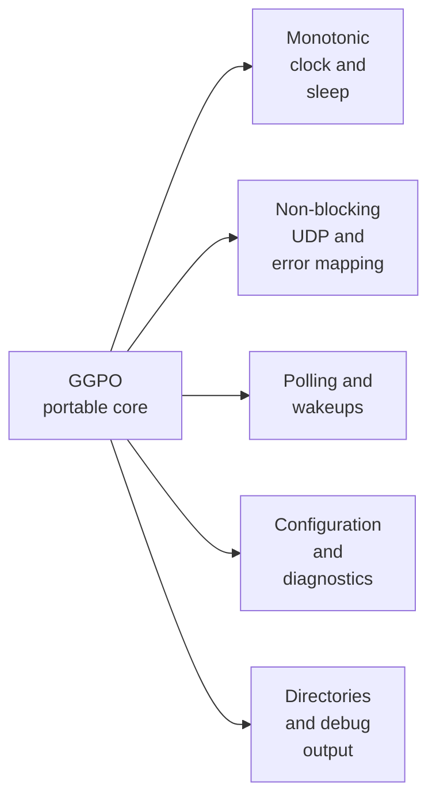

# Portability boundaries

## Contents

- [Current boundary](#current-boundary)
- [Platform dependencies](#platform-dependencies)
- [Portable core](#portable-core)
- [Required adapter contracts](#required-adapter-contracts)
- [Protocol considerations](#protocol-considerations)
- [Recommended port sequence](#recommended-port-sequence)

## Current boundary

The core consumes semantic services declared by
[`platform.h`](../../src/lib/ggpo/platform.h). The Windows implementation in
[`platform_windows.cpp`](../../src/lib/ggpo/platform_windows.cpp) owns Win32,
Winsock, native error mapping, and socket representation.

This is a source boundary, not Linux support. The checked-in legacy
[`platform_linux.cpp`](../../src/lib/ggpo/platform_linux.cpp) remains incomplete;
platform selection and build-layer separation are the next milestone.

## Platform dependencies

| Concern | Core contract | Windows implementation |
| --- | --- | --- |
| UDP sockets | `UdpSocket` with `ok`, `would_block`, and `error` results | Winsock startup, bind, send/receive, and close |
| Addresses | `UdpEndpoint` with four IPv4 octets and host-order port | `sockaddr_in` conversion and text formatting |
| Polling | Computed deadline plus `WaitMs()` | `Sleep()`; unused native-handle registration was removed |
| Time | Wrapping `MonotonicTimeMs()` | `timeGetTime()` |
| Configuration | Integer/boolean lookup with explicit fallback | Windows environment lookup |
| Filesystem and diagnostics | Directory creation and assertion reporting | `CreateDirectoryA` and Windows diagnostic UI |
| Network lifetime | Balanced startup/shutdown contract | `WSAStartup()` and `WSACleanup()` |
| Shared-library lifecycle | Public ABI macros remain in [`ggponet.h`](../../src/include/ggponet.h) | `DllMain` is isolated in the Windows adapter |
| Sample UI | Win32 messages, GDI/OpenGL, keyboard polling | [`src/apps/vectorwar`](../../src/apps/vectorwar) |

## Portable core

The rollback algorithms are largely OS-independent:

- [`GameInput`](../../src/lib/ggpo/game_input.h) and
  [`InputQueue`](../../src/lib/ggpo/input_queue.h);
- [`Sync`](../../src/lib/ggpo/sync.h) saved-state and replay logic;
- [`TimeSync`](../../src/lib/ggpo/timesync.h);
- fixed-capacity [`RingBuffer`](../../src/lib/ggpo/ring_buffer.h) and
  [`StaticBuffer`](../../src/lib/ggpo/static_buffer.h);
- backend coordination after socket, clock, sleep, filesystem, and poll calls are
  routed through platform-neutral contracts.

## Required adapter contracts

These contracts are implemented in [`platform.h`](../../src/lib/ggpo/platform.h).
The production [`Udp`](../../src/lib/ggpo/network/udp.cpp) and
[`Poll`](../../src/lib/ggpo/poll.cpp) code sees no native handles or address
structures. A [deterministic fake adapter](../../tests/platform/fake/platform_fake.cpp)
uses the same contracts for rollback and failure/cleanup tests.

Adapters expose semantic operations rather than reproducing Win32 names on
Unix. That keeps Linux (`poll`/`epoll`), macOS (`poll`/`kqueue`), and future
mobile event loops replaceable without changing rollback logic.

## Protocol considerations

The current wire format transmits a packed native C++ structure defined by
[`UdpMsg`](../../src/lib/ggpo/network/udp_msg.h). A multiplatform port must verify:

- fixed integer widths and signed bit-field behavior;
- little- versus big-endian encoding;
- identical packed layout across MSVC, Clang, and GCC;
- unaligned access safety;
- explicit packet length validation before accessing payload fields;
- compatibility/version behavior when protocol structures change.

Compilation on another OS is insufficient without cross-platform peer tests.

## Recommended port sequence

1. Freeze current Windows behavior with unit and loopback integration tests.
2. Define clock, sleep, configuration, diagnostics, socket, and poll contracts.
3. Build the SDK on Linux while retaining Windows CI.
4. Validate two Linux peers, then Windows-to-Linux interoperability.
5. Add macOS adapters and cross-OS protocol tests.
6. Replace the Win32-only Vector War host with a portable frontend while reusing
   the same deterministic game state and GGPO callbacks.
7. Add mobile lifecycle/socket adapters only after desktop behavior is stable.

Prior community work is available in upstream
[PR #37](https://github.com/pond3r/ggpo/pull/37),
[PR #52](https://github.com/pond3r/ggpo/pull/52), and
[PR #57](https://github.com/pond3r/ggpo/pull/57). Preserve attribution when
reusing those implementations.
