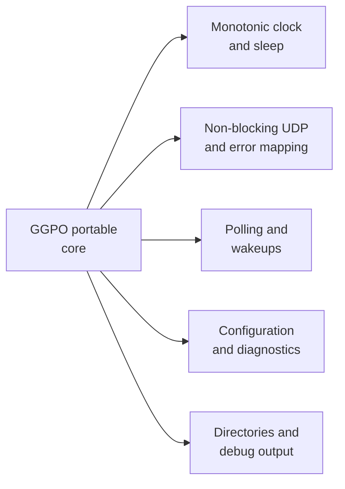

# Portability boundaries

## Contents

- [Current boundary](#current-boundary)
- [Platform dependencies](#platform-dependencies)
- [Portable core](#portable-core)
- [Required adapter contracts](#required-adapter-contracts)
- [Protocol considerations](#protocol-considerations)
- [Recommended port sequence](#recommended-port-sequence)

## Current boundary

The intended platform selection occurs in [`types.h`](../../src/lib/ggpo/types.h)
and [`src/CMakeSources.cmake`](../../src/CMakeSources.cmake). In practice, Windows
types and APIs still leak into polling, networking, logging, backends, and the
sample. The checked-in [`platform_linux.cpp`](../../src/lib/ggpo/platform_linux.cpp)
is incomplete and does not provide a working Unix SDK build.

## Platform dependencies

| Concern | Current dependency | Source |
| --- | --- | --- |
| UDP sockets | Winsock `SOCKET`, `ioctlsocket`, `closesocket`, WSA errors | [`udp.cpp`](../../src/lib/ggpo/network/udp.cpp), [`udp.h`](../../src/lib/ggpo/network/udp.h) |
| Address types | `sockaddr_in` and IPv4 text conversion | [`udp_proto.h`](../../src/lib/ggpo/network/udp_proto.h) |
| Pollable events | Win32 `HANDLE`, wait APIs | [`poll.h`](../../src/lib/ggpo/poll.h), [`poll.cpp`](../../src/lib/ggpo/poll.cpp) |
| Time and sleep | `timeGetTime`, `Sleep` | [`platform_windows.h`](../../src/lib/ggpo/platform_windows.h), [`p2p.cpp`](../../src/lib/ggpo/backends/p2p.cpp) |
| Configuration | Windows environment helpers | [`platform_windows.cpp`](../../src/lib/ggpo/platform_windows.cpp) |
| Filesystem and diagnostics | `CreateDirectoryA`, `DebugBreak`, backslash paths | [`synctest.cpp`](../../src/lib/ggpo/backends/synctest.cpp) |
| C runtime | Microsoft secure-CRT functions | Core and sample sources |
| Shared-library lifecycle | `DllMain` and Windows export macros | [`main.cpp`](../../src/lib/ggpo/main.cpp), [`ggponet.h`](../../src/include/ggponet.h) |
| Sample UI | Win32 messages, GDI/OpenGL, keyboard polling | [`src/apps/vectorwar`](../../src/apps/vectorwar) |

## Portable core

The rollback algorithms are largely OS-independent:

- [`GameInput`](../../src/lib/ggpo/game_input.h) and
  [`InputQueue`](../../src/lib/ggpo/input_queue.h);
- [`Sync`](../../src/lib/ggpo/sync.h) saved-state and replay logic;
- [`TimeSync`](../../src/lib/ggpo/timesync.h);
- fixed-capacity [`RingBuffer`](../../src/lib/ggpo/ring_buffer.h) and
  [`StaticBuffer`](../../src/lib/ggpo/static_buffer.h);
- backend coordination after socket, clock, sleep, filesystem, and poll calls are
  routed through platform-neutral contracts.

## Required adapter contracts

Adapters should expose semantic operations rather than reproducing Win32 names on
Unix. That keeps Linux (`poll`/`epoll`), macOS (`poll`/`kqueue`), and future mobile
event loops replaceable without changing rollback logic.

## Protocol considerations

The current wire format transmits a packed native C++ structure defined by
[`UdpMsg`](../../src/lib/ggpo/network/udp_msg.h). A multiplatform port must verify:

- fixed integer widths and signed bit-field behavior;
- little- versus big-endian encoding;
- identical packed layout across MSVC, Clang, and GCC;
- unaligned access safety;
- explicit packet length validation before accessing payload fields;
- compatibility/version behavior when protocol structures change.

Compilation on another OS is insufficient without cross-platform peer tests.

## Recommended port sequence

1. Freeze current Windows behavior with unit and loopback integration tests.
2. Define clock, sleep, configuration, diagnostics, socket, and poll contracts.
3. Build the SDK on Linux while retaining Windows CI.
4. Validate two Linux peers, then Windows-to-Linux interoperability.
5. Add macOS adapters and cross-OS protocol tests.
6. Replace the Win32-only Vector War host with a portable frontend while reusing
   the same deterministic game state and GGPO callbacks.
7. Add mobile lifecycle/socket adapters only after desktop behavior is stable.

Prior community work is available in upstream
[PR #37](https://github.com/pond3r/ggpo/pull/37),
[PR #52](https://github.com/pond3r/ggpo/pull/52), and
[PR #57](https://github.com/pond3r/ggpo/pull/57). Preserve attribution when
reusing those implementations.
