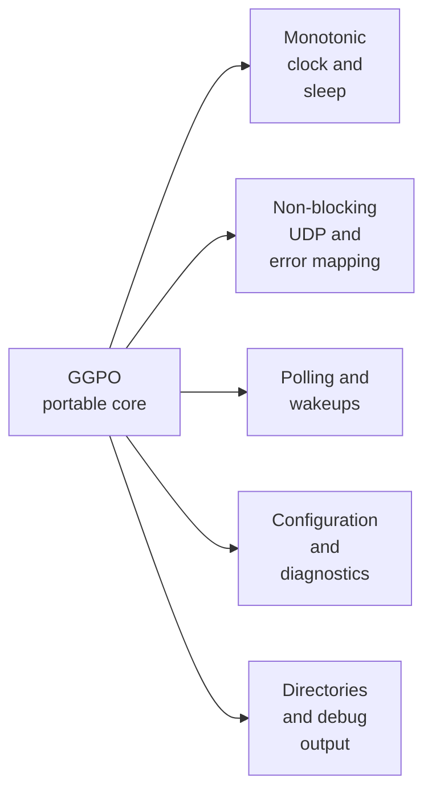

# Portability boundaries

## Contents

- [Current boundary](#current-boundary)
- [Platform dependencies](#platform-dependencies)
- [Portable core](#portable-core)
- [Required adapter contracts](#required-adapter-contracts)
- [Protocol considerations](#protocol-considerations)
- [Follow-up platform contract](#follow-up-platform-contract)
- [Recommended port sequence](#recommended-port-sequence)

## Current boundary

The core consumes semantic services declared by
[`platform.h`](../../src/lib/ggpo/platform.h). The Windows implementation in
[`platform_windows.cpp`](../../src/lib/ggpo/platform_windows.cpp) owns Win32,
Winsock, native error mapping, and socket representation. The Linux
implementation in [`platform_linux.cpp`](../../src/lib/ggpo/platform_linux.cpp)
provides the same contracts with POSIX facilities. Platform CMake modules own
their native source and build inputs; Apple remains follow-up work.

## Platform dependencies

| Concern | Core contract | Windows | Linux |
| --- | --- | --- | --- |
| UDP sockets | `ok`, `would_block`, or `error` | Winsock | Nonblocking POSIX UDP |
| Addresses | IPv4 octets and host-order port | `sockaddr_in` | `sockaddr_in` |
| Wait and time | `WaitMs()`, monotonic milliseconds | `Sleep`, `timeGetTime` | `nanosleep`, `clock_gettime` |
| Configuration | Value with explicit fallback | Environment | Environment |
| Filesystem/diagnostics | Directory and assertion services | Win32/UI | `mkdir`/stderr |
| Network lifetime | Balanced startup/shutdown | Winsock startup/cleanup | No-op process service |
| Sample UI | Win32 messages, GDI/OpenGL, keyboard polling | [`src/apps/vectorwar`](../../src/apps/vectorwar) |

## Portable core

The rollback algorithms are largely OS-independent:

- [`GameInput`](../../src/lib/ggpo/game_input.h) and
  [`InputQueue`](../../src/lib/ggpo/input_queue.h);
- [`Sync`](../../src/lib/ggpo/sync.h) saved-state and replay logic;
- [`TimeSync`](../../src/lib/ggpo/timesync.h);
- fixed-capacity [`RingBuffer`](../../src/lib/ggpo/ring_buffer.h) and
  [`StaticBuffer`](../../src/lib/ggpo/static_buffer.h);
- backend coordination after socket, clock, sleep, filesystem, and poll calls are
  routed through platform-neutral contracts.

## Required adapter contracts

These contracts are implemented in [`platform.h`](../../src/lib/ggpo/platform.h).
The production [`Udp`](../../src/lib/ggpo/network/udp.cpp) and
[`Poll`](../../src/lib/ggpo/poll.cpp) code sees no native handles or address
structures. A [deterministic fake adapter](../../tests/platform/fake/platform_fake.cpp)
uses the same contracts for rollback and failure/cleanup tests.

Adapters expose semantic operations rather than reproducing Win32 names on
Unix. That keeps Linux (`poll`/`epoll`), macOS (`poll`/`kqueue`), and future
mobile event loops replaceable without changing rollback logic.

## Protocol considerations

The current wire format transmits a packed native C++ structure defined by
[`UdpMsg`](../../src/lib/ggpo/network/udp_msg.h). A multiplatform port must verify:

- fixed integer widths and signed bit-field behavior;
- little- versus big-endian encoding;
- identical packed layout across MSVC, Clang, and GCC;
- unaligned access safety;
- explicit packet length validation before accessing payload fields;
- compatibility/version behavior when protocol structures change.

Compilation on another OS is insufficient without cross-platform peer tests.

## Follow-up platform contract

Each supported platform adds one module implementing [`platform.h`](../../src/lib/ggpo/platform.h);
portable core sources and the public header remain shared.

| Required artifact | Qualification before support is claimed |
| --- | --- |
| Platform CMake module | Owns native sources, private definitions, and system libraries |
| Platform adapter | Implements time, wait, configuration, diagnostics, filesystem, network lifetime, endpoints, and nonblocking UDP |
| Shared contracts | Core, public API, protocol, and fake-adapter suites remain green |
| Native conformance | The shared [`platform_conformance_test.cpp`](../../tests/platform/conformance/platform_conformance_test.cpp) and local two-peer UDP loopback pass |
| Public package | C11/C++98 consumers link only `GGPO::GGPO` and installed headers |
| Interoperability | Same-platform peers and native Windows-to-platform sessions pass |

An adapter is **experimental** while any mandatory shared/native contract,
package/consumer check, documented limitation, or CI lane is missing. It becomes
**supported** only when all rows above have reproducible evidence. Cross-host
result and orchestration ownership remains with [PR #5](https://github.com/irregularthanis/ggpo-next/pull/5).

The Windows [compatibility workflow](../../.github/workflows/windows-compatibility.yml)
remains required while another adapter is introduced.

## Recommended port sequence

1. Freeze current Windows behavior with unit and loopback integration tests.
2. Define clock, sleep, configuration, diagnostics, socket, and poll contracts.
3. Build the SDK on Linux through the repository container while retaining Windows CI.
4. Validate two Linux peers, then Windows-to-Linux interoperability.
5. Add macOS adapters and cross-OS protocol tests.
6. Replace the Win32-only Vector War host with a portable frontend while reusing
   the same deterministic game state and GGPO callbacks.
7. Add mobile lifecycle/socket adapters only after desktop behavior is stable.

Prior community work is available in upstream
[PR #37](https://github.com/pond3r/ggpo/pull/37),
[PR #52](https://github.com/pond3r/ggpo/pull/52), and
[PR #57](https://github.com/pond3r/ggpo/pull/57). Preserve attribution when
reusing those implementations.
