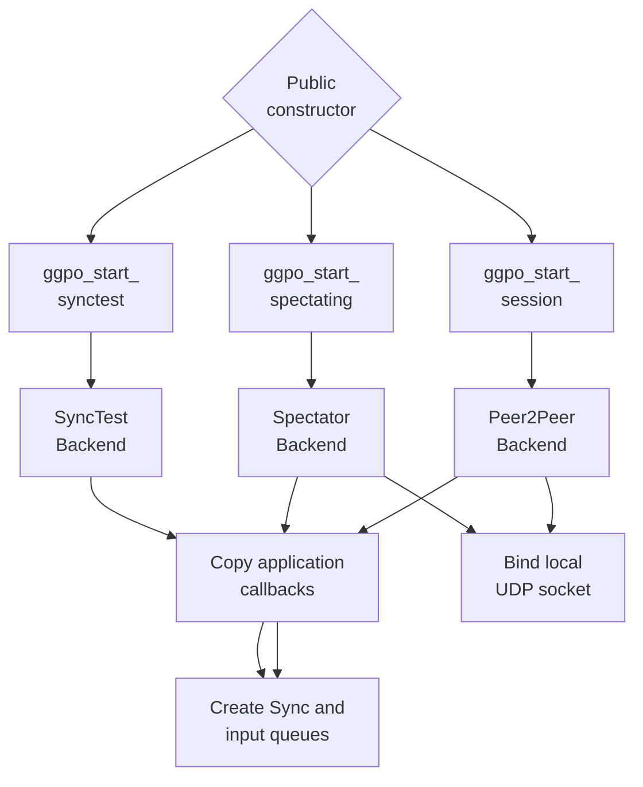
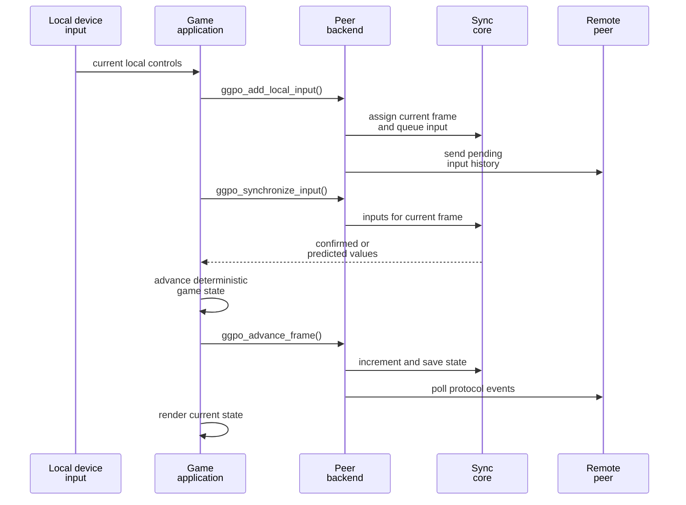
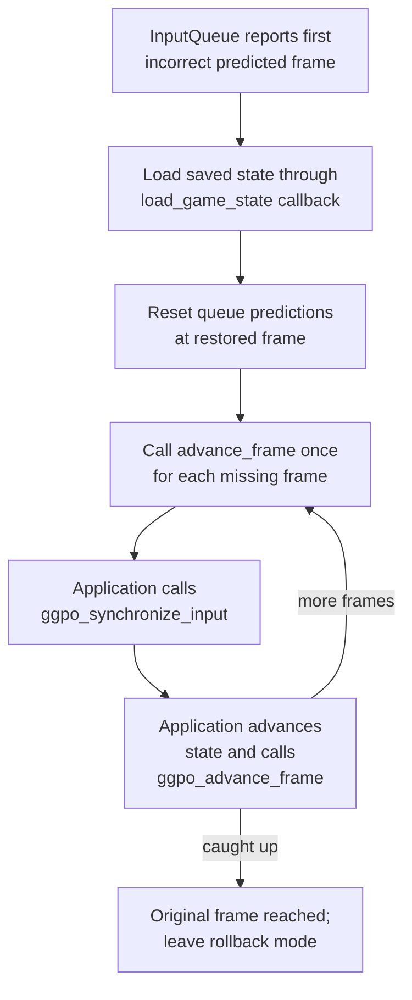

# Runtime architecture

## Contents

- [Runtime entities](#runtime-entities)
- [Session construction](#session-construction)
- [Normal frame](#normal-frame)
- [Rollback frame](#rollback-frame)
- [Polling and events](#polling-and-events)
- [Backend variants](#backend-variants)
- [Ownership and threading](#ownership-and-threading)

## Runtime entities

| Entity | Runtime responsibility | Source |
| --- | --- | --- |
| Game application | Owns authoritative simulation state, local device input, rendering, audio, and callback implementations | [Vector War integration](../../src/apps/vectorwar/vectorwar.cpp) |
| Public API | Validates the session pointer and forwards calls to a backend | [`main.cpp`](../../src/lib/ggpo/main.cpp), [`ggponet.h`](../../src/include/ggponet.h) |
| `GGPOSession` backend | Implements the selected peer-to-peer, spectator, or sync-test behavior | [`backend.h`](../../src/lib/ggpo/backends/backend.h) |
| `Sync` | Coordinates input queues, prediction, state snapshots, and rollback replay | [`sync.h`](../../src/lib/ggpo/sync.h), [`sync.cpp`](../../src/lib/ggpo/sync.cpp) |
| `InputQueue` | Stores one player's confirmed inputs and predicted continuation | [`input_queue.h`](../../src/lib/ggpo/input_queue.h), [`input_queue.cpp`](../../src/lib/ggpo/input_queue.cpp) |
| `UdpProtocol` | Maintains one peer endpoint's handshake, reliability, quality, and disconnect state | [`udp_proto.h`](../../src/lib/ggpo/network/udp_proto.h) |
| `Udp` | Owns one shared non-blocking local socket and dispatches received datagrams | [`udp.h`](../../src/lib/ggpo/network/udp.h) |
| `Poll` | Drives registered loop and periodic work when the application yields time | [`poll.h`](../../src/lib/ggpo/poll.h), [`poll.cpp`](../../src/lib/ggpo/poll.cpp) |

## Session construction

The public constructors in [`main.cpp`](../../src/lib/ggpo/main.cpp) allocate a
backend and return it through the opaque `GGPOSession*` handle.

For peer-to-peer sessions, the constructor initializes [`Sync`](../../src/lib/ggpo/sync.cpp),
the shared [`Udp`](../../src/lib/ggpo/network/udp.cpp) socket, and an endpoint per
player. Calls to `ggpo_add_player()` then classify local, remote, and spectator
participants in [`Peer2PeerBackend::AddPlayer`](../../src/lib/ggpo/backends/p2p.cpp).

## Normal frame

The application drives every frame. Vector War provides the concrete sequence in
[`VectorWar_RunFrame`](../../src/apps/vectorwar/vectorwar.cpp):

`ggpo_add_local_input()` can return `GGPO_ERRORCODE_PREDICTION_THRESHOLD` when
the simulation has advanced too far beyond confirmed remote input. The game must
not advance unless input submission and synchronization succeed.

## Rollback frame

When confirmed remote input differs from a prediction, `Sync` finds the earliest
incorrect frame and runs [`AdjustSimulation`](../../src/lib/ggpo/sync.cpp):

The application should avoid presenting intermediate replay frames. GGPO does not
own rendering or audio suppression; the host integration must keep simulation
advancement separate from presentation.

## Polling and events

`ggpo_idle()` forwards to backend `DoPoll()`. The peer backend:

1. Pumps the registered UDP and protocol loop sinks.
2. Converts protocol events into application `GGPOEvent` callbacks.
3. Checks whether corrected inputs require rollback.
4. Computes the minimum confirmed frame across peers.
5. Discards obsolete inputs and forwards confirmed frames to spectators.
6. Emits time-synchronization recommendations.

See [`Peer2PeerBackend::DoPoll`](../../src/lib/ggpo/backends/p2p.cpp) and
[`Peer2PeerBackend::OnUdpProtocolEvent`](../../src/lib/ggpo/backends/p2p.cpp).

## Backend variants

| Backend | Created by | Input source | State behavior |
| --- | --- | --- | --- |
| Peer-to-peer | `ggpo_start_session()` | Local submission plus remote UDP inputs | Predicts, confirms, rolls back, and serves spectators |
| Spectator | `ggpo_start_spectating()` | Confirmed composite inputs streamed by a host | Buffers inputs and advances without prediction |
| SyncTest | `ggpo_start_synctest()` | Local test inputs | Replays frames and compares saved-state checksums |

The implementations are linked from [`src/lib/ggpo/backends`](../../src/lib/ggpo/backends).

## Ownership and threading

- The caller owns the `GGPOSessionCallbacks` functions and all game state.
- A backend copies the callback table during construction.
- Saved-state buffers are allocated by `save_game_state` and released through
  `free_buffer`; [`Sync::SaveCurrentFrame`](../../src/lib/ggpo/sync.cpp) manages
  their lifecycle.
- The backend is allocated by a `ggpo_start_*` function and deleted by
  [`ggpo_close_session`](../../src/lib/ggpo/main.cpp).
- Current network and rollback work executes synchronously on the thread calling
  GGPO. The API does not provide internal locking or document concurrent calls.
