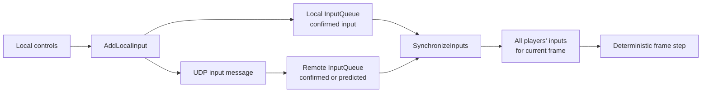
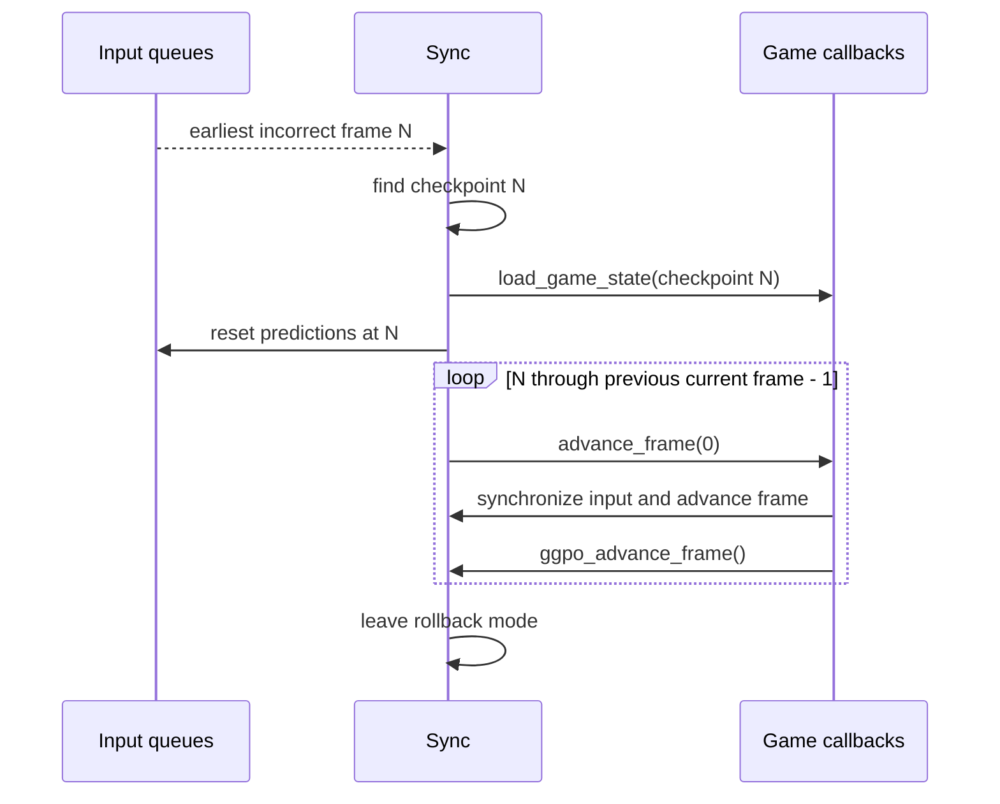

# Synchronization and rollback

## Contents

- [State model](#state-model)
- [Input lifecycle](#input-lifecycle)
- [Prediction](#prediction)
- [Saved-state ring](#saved-state-ring)
- [Rollback mechanics](#rollback-mechanics)
- [Confirmed frames](#confirmed-frames)
- [Determinism contract](#determinism-contract)

## State model

GGPO separates three kinds of state:

| State | Owner | Representation | Source |
| --- | --- | --- | --- |
| Game simulation | Application | Opaque serialized buffers supplied through callbacks | [`GGPOSessionCallbacks`](../../src/include/ggponet.h) |
| Per-player input history | GGPO | `InputQueue` ring plus current prediction | [`input_queue.h`](../../src/lib/ggpo/input_queue.h) |
| Session/network state | GGPO | Backend, protocol endpoints, connect status, timers, and queues | [`p2p.h`](../../src/lib/ggpo/backends/p2p.h), [`udp_proto.h`](../../src/lib/ggpo/network/udp_proto.h) |

Saved game-state buffers are local rollback checkpoints. They are not transmitted
to peers by the current protocol.

## Input lifecycle



`GameInput` stores a frame number, byte count, and fixed-size input bytes in
[`game_input.h`](../../src/lib/ggpo/game_input.h). One `InputQueue` is created per
player by [`Sync::CreateQueues`](../../src/lib/ggpo/sync.cpp).

## Prediction

When a requested remote frame has not arrived, [`InputQueue::GetInput`](../../src/lib/ggpo/input_queue.cpp)
reuses the last known input as a prediction. When the actual input arrives,
[`InputQueue::AddInput`](../../src/lib/ggpo/input_queue.cpp) compares it with the
prediction and records the first incorrect frame.

```text
Known remote input: frame 40 = LEFT
Missing input:      frame 41 → predict LEFT
Missing input:      frame 42 → predict LEFT
Arriving input:     frame 41 = RIGHT
Result:             first incorrect frame = 41
```

Prediction is capped by `MAX_PREDICTION_FRAMES`, currently eight in
[`sync.h`](../../src/lib/ggpo/sync.h). [`Sync::AddLocalInput`](../../src/lib/ggpo/sync.cpp)
rejects further advancement when the simulation reaches this barrier.

## Saved-state ring

`Sync` keeps `MAX_PREDICTION_FRAMES + 2` saved-frame slots. Each slot contains:

- the application-owned serialized buffer;
- buffer length;
- simulation frame number;
- optional application checksum.

[`Sync::SaveCurrentFrame`](../../src/lib/ggpo/sync.cpp) frees the slot's previous
buffer, invokes `save_game_state`, and advances the ring head. The initial state
is saved when the first local input is accepted; subsequent states are saved by
[`Sync::IncrementFrame`](../../src/lib/ggpo/sync.cpp).

## Rollback mechanics



The callback recursively re-enters the normal synchronization API. During this
period [`Peer2PeerBackend::AddLocalInput`](../../src/lib/ggpo/backends/p2p.cpp)
rejects new device input with `GGPO_ERRORCODE_IN_ROLLBACK`.

## Confirmed frames

The peer backend calculates a minimum frame confirmed by all connected peers in
[`Poll2Players`](../../src/lib/ggpo/backends/p2p.cpp) or
[`PollNPlayers`](../../src/lib/ggpo/backends/p2p.cpp). It passes that value to
[`Sync::SetLastConfirmedFrame`](../../src/lib/ggpo/sync.cpp), which discards older
input history. Confirmed composite inputs are also forwarded to spectators.

## Determinism contract

For rollback correctness, the application must ensure:

- identical state and inputs produce identical next state;
- every simulation-affecting value is serialized;
- one callback invocation advances exactly one fixed simulation frame;
- replay can run without rendering or sampling fresh device input;
- random-generator and timing state are part of the deterministic state;
- saved buffers remain valid until GGPO calls `free_buffer`.

The [Developer Guide](../DeveloperGuide.md) expands these requirements, while
[`SyncTestBackend`](../../src/lib/ggpo/backends/synctest.cpp) provides the built-in
determinism check.
