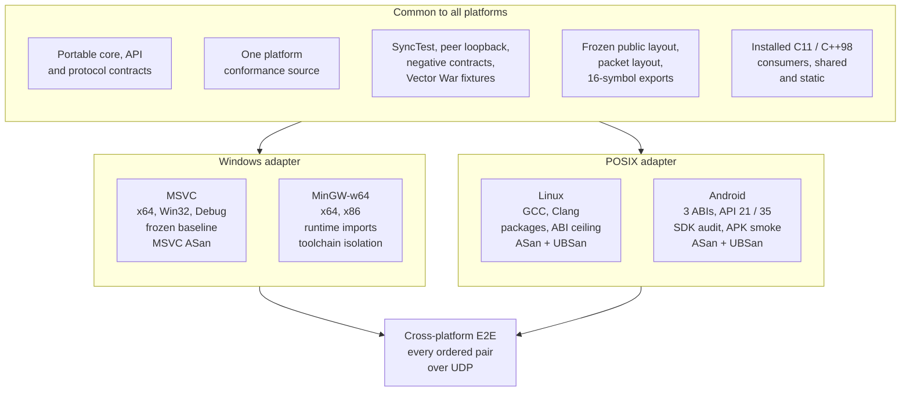
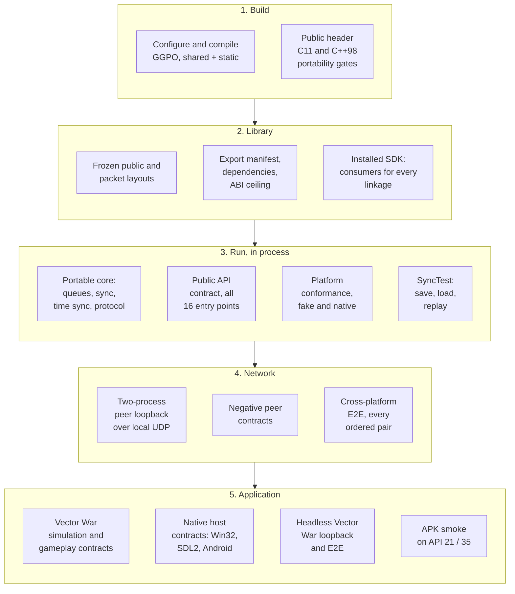
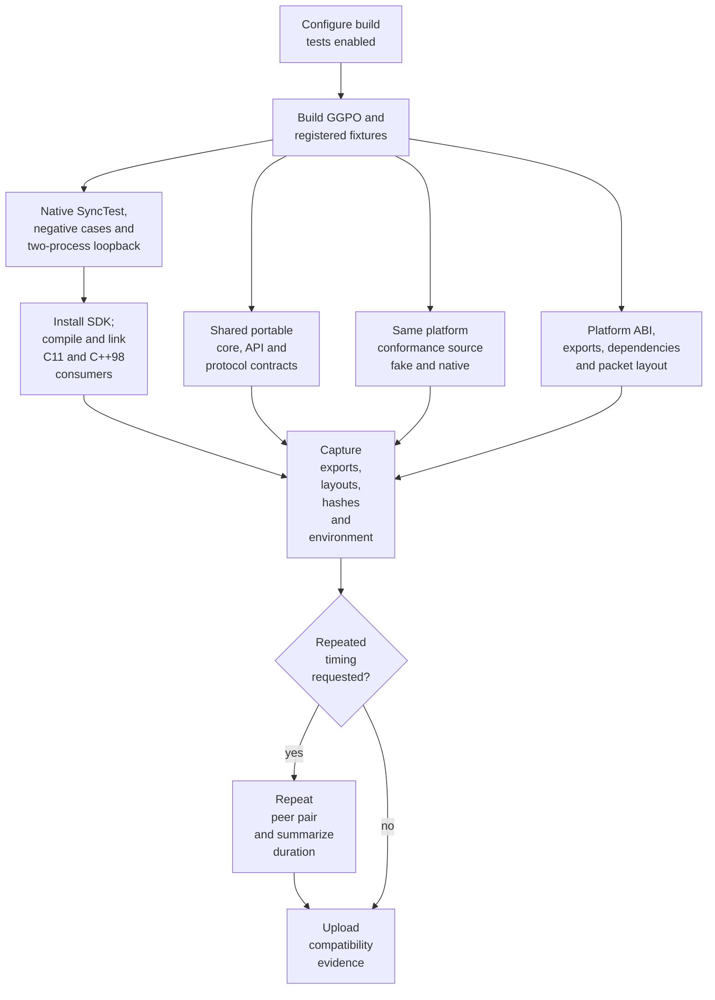
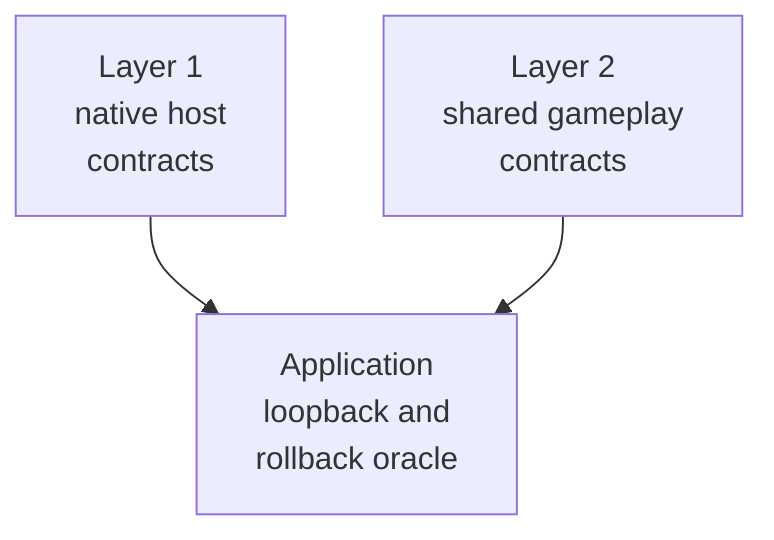
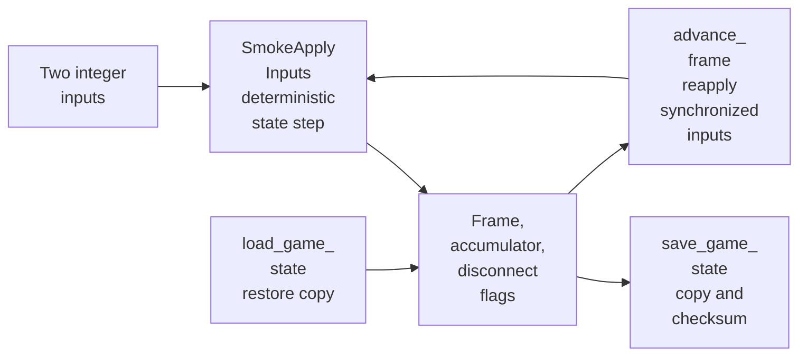
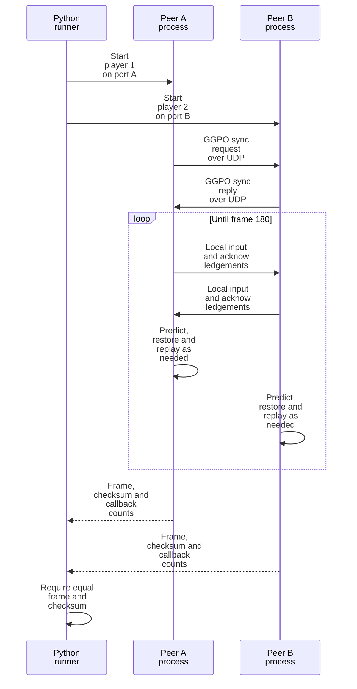
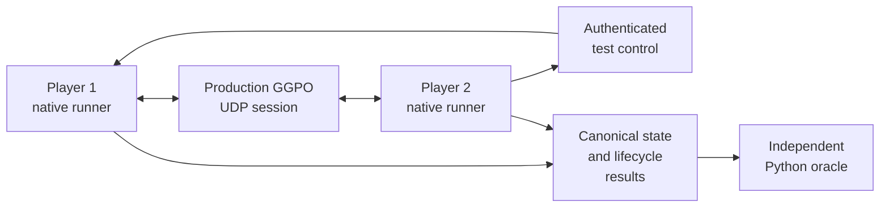

# Testing architecture

## Contents

- [Overview](#overview)
  - [Testing sequence](#testing-sequence)
- [Platforms](#platforms)
  - [Windows with MSVC](#windows-with-msvc)
    - [MSVC: registered tests](#msvc-registered-tests)
    - [MSVC: run locally](#msvc-run-locally)
    - [MSVC: CI lanes](#msvc-ci-lanes)
    - [MSVC: frozen baseline](#msvc-frozen-baseline)
  - [Windows with MinGW-w64](#windows-with-mingw-w64)
    - [MinGW: registered tests](#mingw-registered-tests)
    - [MinGW: run locally](#mingw-run-locally)
    - [MinGW: CI lanes](#mingw-ci-lanes)
    - [MinGW: toolchain isolation](#mingw-toolchain-isolation)
  - [Linux](#linux)
    - [Linux: registered tests](#linux-registered-tests)
    - [Linux: run locally](#linux-run-locally)
    - [Linux: CI lanes](#linux-ci-lanes)
  - [Android](#android)
    - [Android: registered tests](#android-registered-tests)
    - [Android: run locally](#android-run-locally)
    - [Android: CI lanes](#android-ci-lanes)
    - [Android: SDK audit and APK smoke](#android-sdk-audit-and-apk-smoke)
- [Common to all platforms](#common-to-all-platforms)
  - [Shared tests](#shared-tests)
  - [Coverage map](#coverage-map)
  - [Shared contracts](#shared-contracts)
  - [Validation flow](#validation-flow)
  - [Vector War two-layer contracts](#vector-war-two-layer-contracts)
  - [Vector War simulation contract](#vector-war-simulation-contract)
  - [Vector War application loopback](#vector-war-application-loopback)
  - [Shared deterministic state](#shared-deterministic-state)
  - [Deterministic SyncTest](#deterministic-synctest)
  - [Two-process loopback](#two-process-loopback)
  - [Negative peer contracts](#negative-peer-contracts)
  - [Cross-platform E2E](#cross-platform-e2e)
  - [CI gating and labels](#ci-gating-and-labels)
  - [Evidence and interpretation](#evidence-and-interpretation)
  - [Current limits and follow-ups](#current-limits-and-follow-ups)

## Overview

GGPO's tests freeze Windows compatibility while qualifying the shared core and
the Windows, Linux, MinGW, and Android platform paths. They protect public ABI,
packed protocol data, deterministic rollback, packages, and real loopback
sessions without requiring the interactive Vector War frontend.

Most contracts are written once and compiled for every platform. Each platform
adds only its adapter, launcher, loader and artifact inspection, then all
platforms meet again in the cross-platform E2E matrix.



The fixtures live under [`tests`](../../tests). Their frozen values represent
the current compatibility contract; they should not be updated merely to make a
behavior-changing refactor pass.

The [platform sections](#platforms) say what runs where and how to run it; the
[common sections](#common-to-all-platforms) describe the contracts every
platform shares.

### Testing sequence

Each stage only starts proving something once the stage before it holds, so a
failure points at the lowest broken layer. Every platform runs the same
sequence; only the tools in each box differ.



| Stage | Proves | Where it is described |
| --- | --- | --- |
| 1. Build | GGPO and the tests compile with every supported toolchain | [Platforms](#platforms) |
| 2. Library | The binaries keep the frozen ABI, exports and packaging; consumers link either flavor | [Platforms](#platforms), [coverage map](#coverage-map) |
| 3. Run | Core, API, adapter and rollback behave the same without a network | [Shared contracts](#shared-contracts), [Deterministic SyncTest](#deterministic-synctest) |
| 4. Network | Real UDP sessions converge, locally and between platforms | [Two-process loopback](#two-process-loopback), [Cross-platform E2E](#cross-platform-e2e) |
| 5. Application | A real game integration stays deterministic end to end | [Vector War contracts](#vector-war-two-layer-contracts) |

## Platforms

Every platform first has to produce compatible headers, shared/static
libraries, package metadata and consumer-visible layouts. Every lane builds
the shared and the static library together. CTest runs the
suite against the shared library and adds `*_static_synctest_smoke` and
`*_static_peer_loopback` against the static one. The installed-consumer step
then proves shared consumers depend on the GGPO runtime and static consumers do
not (`readelf -d` on Linux; on Windows the static programs run with the SDK's
`bin` removed from `PATH`).

| Platform | Produced artifacts | Build-level proof |
| --- | --- | --- |
| [Windows with MSVC](#windows-with-msvc) | `GGPO.dll`, import/static `.lib`, CMake package | x64/Win32 layouts, exports, frozen baseline compatibility and installed consumers |
| [Windows with MinGW-w64](#windows-with-mingw-w64) | `libGGPO.dll`, `.dll.a`, static `.a` | x86/x64 exports, no external MinGW runtime DLLs, consumers and MSVC isolation |
| [Linux](#linux) | `libGGPO.so`, static `.a`, DEB/RPM/tar SDKs | GCC/Clang builds, SONAME/glibc audit, consumers and package layout |
| [Android](#android) | Per-ABI `libGGPO.so`, static `.a`, CMake SDK | API-21 ceiling, ELF exports/dependencies, 16 KB alignment, consumers and cross-toolchain rejection |

### Windows with MSVC

#### MSVC: registered tests

Runs every [shared test](#shared-tests) with the `windows_` prefix, plus the
test below. DLL exports are checked in the [CI lane](#msvc-ci-lanes) with
`dumpbin` rather than as a CTest test.

| Test | Code | What it tests |
| --- | --- | --- |
| `windows_vectorwar_gui_host_contract` | [`win32_host_contract_test.cpp`](../../tests/vectorwar/win32_host_contract_test.cpp) | Real hidden Win32 window: client bounds, GDI renderer, diagnostics |

#### MSVC: run locally

From a Developer PowerShell prompt:

```powershell
cmake -S . -B build -G "Visual Studio 17 2022" -A x64
cmake --build build --config Release --parallel   # runs ggpo_check
ctest --test-dir build -C Release --output-on-failure
```

Or run the full CI lane, including install, consumers and evidence capture:

```powershell
scripts/ci/windows_compatibility_baseline.ps1 -Architecture x64 `
  -Configuration Release -Generator "Visual Studio 17 2022"
```

#### MSVC: CI lanes

[`windows_compatibility_baseline.ps1`](../../scripts/ci/windows_compatibility_baseline.ps1)
configures, builds, runs CTest, installs the SDK, builds and runs the consumer
fixtures for every installed linkage, and calls the evidence collector. GitHub
Actions runs it across this matrix:

| Architecture | Libraries | Configuration | Why |
| --- | --- | --- | --- |
| x64 | Shared and static | Release | Shipped configuration, 64-bit |
| Win32 | Shared and static | Release | Shipped configuration, 32-bit |
| x64 | Shared and static | Debug | MSVC debug runtime checks: `/RTC1`, debug heap, checked iterators |

GGPO's `ASSERT` is unconditional, so additional Debug variants compile the same
checks as Release; the scheduled MSVC AddressSanitizer lane below covers memory
errors more thoroughly than the debug runtime.

The final [Windows compatibility verifier](../../scripts/ci/verify_windows_compatibility.ps1)
builds the frozen Windows baseline and the current candidate. It compares
exports and layouts, then runs both cross-revision directions: the baseline
executable with the candidate DLL and the candidate executable with the
baseline DLL.

[`sanitizer-qualification.yml`](../../.github/workflows/sanitizer-qualification.yml)
also builds static GGPO with MSVC `/fsanitize=address` on x64 and runs the full
Windows CTest suite, weekly and on demand. [`appveyor.yml`](../../appveyor.yml)
runs CTest and captures evidence for its existing x64 Windows builds.

#### MSVC: frozen baseline

[`windows_public_layout`](../../tests/baseline/windows/public_layout.cpp) prints
and verifies consumer-visible sizes and offsets. Pointer-sized callback slots
adapt to x64 or Win32, while fixed public values must remain unchanged.

For shared builds, the evidence script runs MSVC `dumpbin /exports`, normalizes
the `ggpo_*` symbols, and records them. x64 additionally compares the result
with [`exports-x64.txt`](../../tests/baseline/windows/exports-x64.txt).

[`windows_packet_layout`](../../tests/baseline/windows/packet_layout.cpp)
verifies the packed `UdpMsg` header, union members, input-bit offset, and packet
sizes for empty and nine-bit input payloads. This catches compiler-packing or
field changes before they silently alter peer-visible datagrams.

It does not prove safe parsing, delivery, endianness across different hosts, or
protocol-version compatibility; those require separate execution tests.

### Windows with MinGW-w64

#### MinGW: registered tests

Runs every [shared test](#shared-tests) with the `windows_` prefix, except
the two headless Vector War tests: MinGW builds neither Vector War's Win32/GDI
frontend nor its headless app. Exports and runtime imports are checked in the
[CI lane](#mingw-ci-lanes).

*No platform-only tests.*

#### MinGW: run locally

From an MSYS2 `MINGW64` (or `MINGW32`) shell:

```bash
cmake -S . -B build/mingw -G Ninja -DCMAKE_BUILD_TYPE=Release
cmake --build build/mingw --parallel
ctest --test-dir build/mingw --output-on-failure
```

#### MinGW: CI lanes

[`mingw-compatibility.yml`](../../.github/workflows/mingw-compatibility.yml)
runs x64 (`MINGW64`) and x86 (`MINGW32`), both MSVCRT and both libraries: full
CTest, installed consumers for every linkage, the export manifest, and a check
that `libGGPO.dll` imports no MinGW runtime DLLs.

#### MinGW: toolchain isolation

A separate job on one runner with both toolchains proves that MSVC and MinGW
SDKs reject each other's CMake consumers, and that a MinGW program runs against
the MSVC `GGPO.dll`.

### Linux

#### Linux: registered tests

Runs every [shared test](#shared-tests) with the `linux_` prefix, plus the
tests below. The layout tests reuse the frozen Windows sources, whose values
are identical on LP64; see the
[Linux baseline README](../../tests/baseline/linux/README.md).

| Test | Code | What it tests |
| --- | --- | --- |
| `linux_exports` | [`check_exports.py`](../../tests/baseline/linux/check_exports.py), [`exports.txt`](../../tests/baseline/linux/exports.txt) | The shared library exports exactly the frozen `ggpo_*` symbols (shared builds) |
| `linux_vectorwar_gui_host_contract` | [`sdl_host_contract_test.cpp`](../../tests/vectorwar/sdl_host_contract_test.cpp) | SDL2 frontend with `SDL_VIDEODRIVER=dummy`: bounds, input, renderer |

#### Linux: run locally

Use the same Ubuntu 24.04 image as CI:

```bash
python3 scripts/linux/build_in_container.py --compiler gcc --out build/linux-gcc
python3 scripts/linux/build_in_container.py --compiler clang --library static \
  --sanitizers --out build/linux-sanitizers
```

#### Linux: CI lanes

[`linux-compatibility.yml`](../../.github/workflows/linux-compatibility.yml)
builds [`docker/linux/Dockerfile`](../../docker/linux/Dockerfile), then runs the
GCC and Clang lanes inside that image, each building both libraries. Each lane runs CTest,
installs the SDK, builds and executes external C11/C++98 consumers, and audits
the installed Linux library.

[`sanitizer-qualification.yml`](../../.github/workflows/sanitizer-qualification.yml)
runs manually and weekly. It uses the same image to instrument production GGPO,
all registered tests, and installed static-library consumers with Clang ASan and
UBSan.
Sanitizer findings fail immediately and the workflow retains CTest evidence.

The GCC and Clang portable-header jobs also compile the public C11 and C++98
consumers without linking an SDK. These remain header-portability gates.
The Clang C++ gate suppresses only `-Wextern-c-compat`: C requires the documented
one-byte `GGPOPlayer.local` placeholder while C++ retains the frozen empty-member
Windows ABI. All other pedantic diagnostics remain errors.

### Android

#### Android: registered tests

Runs every [shared test](#shared-tests) with the `android_` prefix, plus the
test below. [`run_on_device.py`](../../tests/android/run_on_device.py) is
CMake's cross-compiling emulator: it pushes executables and shared libraries
through `adb`, runs them on API 21 and a current emulator, and returns their
output and exit status to CTest. Static arm64-v8a, armeabi-v7a, and x86_64
fixtures also run natively on matching Linux runners. There is no CTest GUI
host test; the SDL frontend is covered by the
[APK smoke](#android-sdk-audit-and-apk-smoke).

| Test | Code | What it tests |
| --- | --- | --- |
| `android_exports` | [`check_exports.py`](../../tests/baseline/linux/check_exports.py), [`exports.txt`](../../tests/baseline/linux/exports.txt) | The shared library exports exactly the frozen `ggpo_*` symbols (shared builds) |

#### Android: run locally

With an emulator or device visible to `adb` (`ANDROID_SERIAL` selects one):

```bash
cmake -S . -B build/emu -G Ninja \
  -DCMAKE_TOOLCHAIN_FILE="$ANDROID_NDK_HOME/build/cmake/android.toolchain.cmake" \
  -DANDROID_ABI=x86_64 -DANDROID_PLATFORM=21 -DCMAKE_BUILD_TYPE=Release \
  -DBUILD_TESTING=ON \
  "-DCMAKE_CROSSCOMPILING_EMULATOR=python3;$PWD/tests/android/run_on_device.py"
cmake --build build/emu --parallel
ctest --test-dir build/emu --output-on-failure --timeout 300
```

#### Android: CI lanes

[`android-compatibility.yml`](../../.github/workflows/android-compatibility.yml)
builds all three ABIs, runs static fixtures natively on matching Linux runners,
runs the full suite on API 21 and API 35 x86_64 emulators, and runs ASan+UBSan
on an x86_64 emulator.

#### Android: SDK audit and APK smoke

The Android SDK lane separately verifies all three installed prefixes:

- frozen public layout and 16-symbol export manifest;
- API 21 imported-symbol ceiling and system-only dependencies;
- 16 KB load alignment on 64-bit ABIs;
- C11/C++98 public-header compilation and installed consumers; and
- rejection when a host Linux project consumes an Android SDK or vice versa.

The Vector War APK smoke installs and launches the SDL frontend on API 21 and
API 35, then waits for the application's explicit frontend-ready log marker.

## Common to all platforms

### Shared tests

Every platform runs these tests from the same source. The platform sections
list only what a platform adds or skips.

**Platform-prefixed:** one copy per platform, named `windows_`, `linux_` or
`android_` (MinGW uses `windows_`). The `static_` rows need a build with both
libraries, which is the default.

| Test | Code | What it tests |
| --- | --- | --- |
| `<platform>_public_layout` | [`public_layout.cpp`](../../tests/baseline/windows/public_layout.cpp) | Public struct sizes, offsets, enum values and callback order match the frozen ABI |
| `<platform>_packet_layout` | [`packet_layout.cpp`](../../tests/baseline/windows/packet_layout.cpp) | Packed `UdpMsg` wire layout and packet sizes are byte-identical |
| `<platform>_synctest_smoke` | [`synctest_smoke.cpp`](../../tests/smoke/synctest_smoke.cpp) | Local rollback: save, load and replay converge to the reference state |
| `<platform>_peer_loopback` | [`run_peer_smoke.py`](../../tests/smoke/run_peer_smoke.py), [`peer_smoke.cpp`](../../tests/smoke/peer_smoke.cpp) | Two processes play 180 frames over real UDP and finish with equal checksums |
| `<platform>_peer_schema2_loopback` | [`run_schema2_loopback.py`](../../tests/e2e/run_schema2_loopback.py) | The cross-platform result schema and completion barrier, run locally |
| `<platform>_peer_negative_contracts` | [`peer_runner_negative.py`](../../tests/smoke/peer_runner_negative.py) | The peer runner rejects startup failure, timeout, divergence and dirty shutdown |
| `<platform>_static_synctest_smoke` | [`synctest_smoke.cpp`](../../tests/smoke/synctest_smoke.cpp) | SyncTest again, linked to the static library |
| `<platform>_static_peer_loopback` | [`run_peer_smoke.py`](../../tests/smoke/run_peer_smoke.py) | Peer loopback again, linked to the static library |
| `<platform>_platform_conformance` | [`platform_conformance_test.cpp`](../../tests/platform/conformance/platform_conformance_test.cpp) | The native OS adapter: clock, waits, config, endpoints, UDP lifecycle |
| `<platform>_vectorwar_native_host_contract` | [`native_host_contract_test.cpp`](../../tests/vectorwar/native_host_contract_test.cpp) | Vector War native clock, sleep, bounds, input and diagnostics |

**Unprefixed:** the same name on every platform.

| Test | Code | What it tests |
| --- | --- | --- |
| `cross_host_result_contract` | [`test_result_schema.py`](../../tests/e2e/test_result_schema.py) | E2E result schema and the independent state oracle |
| `cross_host_orchestration_contract` | [`test_orchestration.py`](../../tests/e2e/test_orchestration.py) | E2E matrix completeness and control-request authentication |
| `cross_host_rendezvous_contract` | [`test_rendezvous.py`](../../tests/e2e/test_rendezvous.py) | E2E rendezvous record fails closed on stale or duplicate data |
| `fake_platform_synctest` | [`synctest_smoke.cpp`](../../tests/smoke/synctest_smoke.cpp), [`platform_fake.cpp`](../../tests/platform/fake/platform_fake.cpp) | Production rollback core runs with no OS adapter at all |
| `fake_platform_contract` | [`platform_fake_test.cpp`](../../tests/platform/fake/platform_fake_test.cpp) | The deterministic fake adapter itself: virtual time, fallbacks, failures |
| `input_queue_contract` | [`input_queue_test.cpp`](../../tests/unit/input_queue_test.cpp) | Input prediction, confirmation and frame delay |
| `sync_contract` | [`sync_contract_test.cpp`](../../tests/unit/sync_contract_test.cpp) | Rollback bookkeeping: save, load and replay windows |
| `timesync_contract` | [`timesync_test.cpp`](../../tests/unit/timesync_test.cpp) | Frame-advantage estimation and recommended waits |
| `core_utilities_contract` | [`core_utilities_test.cpp`](../../tests/unit/core_utilities_test.cpp) | Ring buffer, static buffer and bit-vector encoding |
| `protocol_contract` | [`protocol_test.cpp`](../../tests/unit/protocol_test.cpp) | Packet validation: exact sizes, truncated, trailing or unknown messages |
| `public_api_contract` | [`public_api_contract_test.cpp`](../../tests/contract/public_api_contract_test.cpp) | All 16 public entry points: construction, lifecycle, null guards, config, logging |
| `fake_platform_conformance` | [`platform_conformance_test.cpp`](../../tests/platform/conformance/platform_conformance_test.cpp) | The shared adapter conformance contract against the fake adapter |
| `vectorwar_state_contract` | [`gamestate_contract_test.cpp`](../../tests/vectorwar/gamestate_contract_test.cpp) | Vector War simulation hits the canonical checkpoints over 180 frames |
| `vectorwar_gameplay_contract` | [`gameplay_determinism_test.cpp`](../../tests/vectorwar/gameplay_determinism_test.cpp) | Vector War starts and initialization are identical on every platform |
| `vectorwar_headless_loopback` ¹ | [`run_headless_loopback.py`](../../tests/vectorwar/run_headless_loopback.py) | Two headless Vector War processes converge over UDP with rollback |
| `vectorwar_headless_negative_contracts` ¹ | [`headless_negative.py`](../../tests/vectorwar/headless_negative.py) | The Vector War runner rejects controlled failures |

¹ Needs the headless Vector War app, which MinGW does not build.

### Coverage map

| Layer | Contract | Source | Runs against |
| --- | --- | --- | --- |
| Public ABI | Public sizes, offsets, enum values, callback order, and DLL/shared-object exports | [`public_layout.cpp`](../../tests/baseline/windows/public_layout.cpp), [`exports-x64.txt`](../../tests/baseline/windows/exports-x64.txt), [`linux/exports.txt`](../../tests/baseline/linux/exports.txt) | Compiled header, shared DLL and `libGGPO.so` |
| Installed consumers | C11 and C++98 programs build and run from installed files for every linkage: default, `GGPO_USE_STATIC=ON`, and `GGPO::shared`; each binary's real runtime dependency is checked | [`tests/consumer`](../../tests/consumer/CMakeLists.txt), [`verify_consumers.py`](../../tests/consumer/verify_consumers.py) | Installed header plus shared and static libraries |
| Wire layout | Packed `UdpMsg` sizes, offsets, and representative packet lengths | [`packet_layout.cpp`](../../tests/baseline/windows/packet_layout.cpp) | Internal protocol structures on Windows, Linux, MinGW, and Android |
| Portable core | Queue prediction, rollback/replay, time sync, containers, and bit encoding | [`tests/unit`](../../tests/unit/input_queue_test.cpp) | Production algorithms with deterministic state |
| Public API | Session construction, lifecycle, null guards, configuration, and logging | [`public_api_contract_test.cpp`](../../tests/contract/public_api_contract_test.cpp) | Production backends with fake services |
| Protocol safety | Exact packet sizes and truncated, trailing, or unknown messages | [`protocol_test.cpp`](../../tests/unit/protocol_test.cpp) | Production packet validator and receive guard |
| Platform contract | Virtual clock/wait, fallbacks, endpoint/socket results, failure, and cleanup | [`platform_fake_test.cpp`](../../tests/platform/fake/platform_fake_test.cpp) | Deterministic fake adapter |
| Native conformance | One clock/config/endpoint/UDP assertion source | [`platform_conformance_test.cpp`](../../tests/platform/conformance/platform_conformance_test.cpp) | Fake, Windows, Linux, and Android adapters |
| Platform-free rollback | Production core linked without the Windows adapter | [`platform_fake.cpp`](../../tests/platform/fake/platform_fake.cpp), [`synctest_smoke.cpp`](../../tests/smoke/synctest_smoke.cpp) | Fake adapter and production rollback core |
| Sample simulation | Scripted Vector War inputs, explicit arena bounds, and canonical checkpoints | [`gamestate_contract_test.cpp`](../../tests/vectorwar/gamestate_contract_test.cpp), [`state_contract.cpp`](../../src/apps/vectorwar/state_contract.cpp) | Real sample `GameState` without a window or socket |
| Sample gameplay determinism | Exact cardinal starts and shared initialization semantics | [`gameplay_determinism_test.cpp`](../../tests/vectorwar/gameplay_determinism_test.cpp) | Same gameplay assertions on Windows, Linux, and Android |
| Sample native hosts | Native clock, sleep, bounds, input and presentation ownership | [`native_host_contract_test.cpp`](../../tests/vectorwar/native_host_contract_test.cpp), [`win32_host_contract_test.cpp`](../../tests/vectorwar/win32_host_contract_test.cpp), [`sdl_host_contract_test.cpp`](../../tests/vectorwar/sdl_host_contract_test.cpp) | POSIX/Win32 adapter branches and the Windows, Linux, and Android GUI hosts |
| Sample application loopback | Real Vector War callbacks, scripted host input, native UDP, rollback, and final golden state | [`headless_main.cpp`](../../src/apps/vectorwar/headless_main.cpp), [`run_headless_loopback.py`](../../tests/vectorwar/run_headless_loopback.py) | Two headless Vector War processes on Windows, Linux, or Android |
| Sample application negatives | Startup, timeout, divergence, absent rollback, and dirty shutdown are rejected | [`headless_negative.py`](../../tests/vectorwar/headless_negative.py) | Fault-injected Vector War processes |
| Rollback behavior | Save, restore, synchronized input, replay, and deterministic final state | [`synctest_smoke.cpp`](../../tests/smoke/synctest_smoke.cpp) | SyncTest backend without sockets |
| Native transport | Handshake, events, prediction, rollback, UDP delivery, and shutdown | [`peer_smoke.cpp`](../../tests/smoke/peer_smoke.cpp), [`run_peer_smoke.py`](../../tests/smoke/run_peer_smoke.py) | Two native or on-device GGPO processes on every supported platform |
| Negative peer contracts | Startup, timeout, checksum mismatch, and shutdown failures are rejected | [`peer_runner_negative.py`](../../tests/smoke/peer_runner_negative.py) | Fault-injected real peer processes |
| Build compatibility | x64/Win32 Release and x64 Debug, each with both libraries | [`windows-compatibility.yml`](../../.github/workflows/windows-compatibility.yml) | Three Windows lanes |
| Linux transport | The same peer contract through POSIX UDP | [`peer_smoke.cpp`](../../tests/smoke/peer_smoke.cpp), [`platform_posix.cpp`](../../src/lib/ggpo/platform_posix.cpp) | Two native Linux processes |
| Linux package | GCC/Clang with both libraries, installed consumers and ABI ceiling | [`linux-compatibility.yml`](../../.github/workflows/linux-compatibility.yml) | Shared Ubuntu 24.04 image |
| MinGW-w64 | x64 (MINGW64) and x86 (MINGW32), both MSVCRT, with both libraries: full CTest, installed consumers, export manifest, no MinGW runtime imports | [`mingw-compatibility.yml`](../../.github/workflows/mingw-compatibility.yml) | MSYS2 on Windows runners |
| Toolchain isolation | MSVC and MinGW SDKs reject each other's CMake consumers; a MinGW program runs against the MSVC `GGPO.dll` | [`mingw-compatibility.yml`](../../.github/workflows/mingw-compatibility.yml) | One runner with both toolchains |
| Android compatibility | Three ABIs, API 21/current emulators, installed consumers, SDK audit, APK smoke, and sanitizer qualification | [`android-compatibility.yml`](../../.github/workflows/android-compatibility.yml), [`tests/android`](../../tests/android) | NDK builds, native ARM execution, and x86_64 Android emulators |
| Cross-host | Linux, Windows, MinGW, and Android peers converge | [`cross-platform-e2e.yml`](../../.github/workflows/cross-platform-e2e.yml), [`tests/e2e`](../../tests/e2e) | Native hosted runners joined through ephemeral Tailscale nodes |

### Shared contracts

The suite separates shared behavioral assertions from platform execution and
artifact inspection:

| Contract | Common test source | Platform-specific execution |
| --- | --- | --- |
| Core, API, protocol and rollback | One assertion set for algorithms, all 16 public entry points, packet validation and SyncTest | Compiled with each supported toolchain; fake services isolate shared behavior |
| Platform adapter | One [`platform_conformance_test.cpp`](../../tests/platform/conformance/platform_conformance_test.cpp) contract | Linked once to the fake adapter and again to MSVC/MinGW Windows or POSIX Linux/Android implementations |
| ABI and wire layout | Frozen sizes, offsets, enums, callbacks and packet layouts | MSVC/MinGW inspect PE exports; Linux/Android inspect ELF exports, SONAME, dependencies and ABI ceilings |
| Installed SDK | Same C11/C++98 consumers and shared/static selection | Native compiler, package layout, runtime loader and toolchain-isolation checks per SDK |
| Vector War gameplay | Shared deterministic state, inputs, checkpoints and rollback oracle | Win32, SDL2 Linux and SDL2 Android hosts add window, input, renderer and lifecycle contracts |
| Native networking | Same peer and Vector War headless protocols and result schema | Local loopback per platform, then ordered cross-platform pairs over ephemeral Tailscale nodes |

Common sources define what must remain identical. Platform wrappers only
select the native adapter, launch mechanism, loader and artifact inspector.
MinGW uses the Windows runtime adapter but remains a separate compiler, ABI,
packaging and interoperability lane.

[`public_api_contract_test.cpp`](../../tests/contract/public_api_contract_test.cpp)
calls all 16 exports declared by [`ggponet.h`](../../src/include/ggponet.h).
It shares one fake-platform production core across every platform build, so
null-session, construction, backend lifecycle, configuration, logging, and
cleanup expectations do not diverge by host or toolchain.

This is complete API *entry-point* coverage, not every combination of backend,
state, and argument. Deeper behavior is divided deliberately:

- the shared API contract covers common wrapper and lifecycle behavior;
- SyncTest and focused core contracts cover rollback and replay;
- native peer tests cover real platform sockets and two-process sessions; and
- native layout fixtures cover the frozen ABI, exports, and packet layout on
  Windows, Linux, MinGW, and Android.

[`platform_conformance_test.cpp`](../../tests/platform/conformance/platform_conformance_test.cpp)
is the single assertion source compiled against the fake, Windows, Linux, and
Android adapters. It exercises clocks, waits, process identity, configuration
defaults, directory handling, endpoints, network lifetime, and UDP lifecycle. All 16
callable platform operations plus socket construction/destruction are linked.
`AssertFailed` is link-checked but not invoked because the Windows contract
opens a modal diagnostic; platform setup and system-library linkage remain
adapter-specific.

### Validation flow



The diagram shows validation order, not runtime threads. CTest may schedule
independent tests differently when parallel execution is requested.

### Vector War two-layer contracts

Vector War separates platform adapters from gameplay so failures identify the
right ownership boundary:



- The native-host layer runs the selected Windows or POSIX clock and sleep
  implementation and freezes the headless bounds, input, renderer, and
  diagnostics contract. Windows additionally creates a real hidden Win32
  window and validates client bounds, GDI renderer ownership, and diagnostics.
- The shared-gameplay layer runs identical sources and assertions across
  supported platforms. It checks exact two- and four-player cardinal starts, the
  180-frame simulation checkpoints, and canonical state hashing.

These layers do not replace the two-process application fixture. They localize
adapter and gameplay failures before native UDP, prediction, and rollback are
introduced.

### Vector War simulation contract

[`gamestate_contract_test.cpp`](../../tests/vectorwar/gamestate_contract_test.cpp)
advances the real sample simulation for 180 frames using a fixed two-player
input script and explicit 640×480 arena bounds. It validates canonical
checkpoints at frames 1, 30, 60, 90, 120, 150, and 180.

[`VectorWarCanonicalChecksum`](../../src/apps/vectorwar/state_contract.cpp)
hashes explicitly ordered fixed-width integers, booleans, and IEEE-754 double
bits. It excludes native structure padding and the old Win32 `RECT` layout.
This test freezes simulation behavior before the sample host is ported; it does
not exercise GGPO callbacks, UDP, rendering, or interactive input.

### Vector War application loopback

[`VectorWarHeadless`](../../src/apps/vectorwar/headless_main.cpp) supplies the
portable application core with scripted input and no renderer. Two processes
use the production GGPO session, callbacks, native UDP adapter, save/load path,
and frame loop. Player 2 starts submitting after a bounded delay so rollback is
an explicit fixture contract rather than a scheduler accident.

[`run_headless_loopback.py`](../../tests/vectorwar/run_headless_loopback.py)
requires both peers to reach frame 180 and canonical checksum `b3381958`, report
one running event, and record at least one replayed frame. The fixture continues
pumping both sessions before collecting results so late authoritative inputs
can converge.

[`headless_negative.py`](../../tests/vectorwar/headless_negative.py) proves the
runner rejects controlled startup failure, timeout, divergent state, missing
rollback evidence, and dirty shutdown. Rendering and interactive input remain
separate frontend contracts.

### Shared deterministic state

[`smoke_session.cpp`](../../tests/smoke/smoke_session.cpp) provides a small
game-owned state, checksum, and the callbacks GGPO needs to save, load, free,
and replay it.

The cross-host result uses `SmokeCanonicalChecksum`: frame, accumulator, and
disconnect flags are serialized as three little-endian 32-bit values before
hashing. [`result_schema.py`](../../tests/e2e/result_schema.py) independently
computes the same state and fixed vectors, avoiding native padding and byte
order as an accidental test contract. The legacy native-memory checksum remains
available to schema-1 loopback results.



This is a test simulation, not a model of a real game's state or performance.

### Deterministic SyncTest

The platform-named SyncTest fixture, implemented by
[`synctest_smoke.cpp`](../../tests/smoke/synctest_smoke.cpp), creates two
local players and submits fixed inputs for 90 frames. It advances the same
inputs through a direct reference state and through GGPO, then requires:

- equal final state and checksum;
- at least one saved-state load and replayed frame;
- exactly one running event; and
- successful session shutdown.

A pass shows that the callbacks and local rollback path converge. It does not
exercise Winsock, peer negotiation, or process timing.

The same fixture also builds as `fake_platform_synctest`, linking the production
rollback sources to [`platform_fake.cpp`](../../tests/platform/fake/platform_fake.cpp)
instead of the Windows adapter. `fake_platform_contract` separately checks
virtual time, configuration fallbacks, endpoint representation, would-block
results, scripted socket-open failure, close behavior, and balanced network
lifetime calls.

### Two-process loopback

[`run_peer_smoke.py`](../../tests/smoke/run_peer_smoke.py) reserves two ephemeral
localhost ports and launches two copies of the native
[`peer_smoke.cpp`](../../tests/smoke/peer_smoke.cpp) executable. Each process owns
one local player and treats the other as remote.



A pass establishes real platform socket and two-peer behavior on one machine.
It does not establish Internet/NAT behavior, loss tolerance, spectators, more
than two players, or interoperability between operating systems.

### Negative peer contracts

[`peer_runner_negative.py`](../../tests/smoke/peer_runner_negative.py) launches
the real peer fixture with one controlled test-only fault at a time. It requires
the runner to reject startup failure, bounded timeout, divergent checksums, and
shutdown failure with the matching diagnostic. The fault variable is removed
from ordinary peer environments, so these cases cannot weaken positive smoke
tests.

### Cross-platform E2E

[`cross-platform-e2e.yml`](../../.github/workflows/cross-platform-e2e.yml)
automates ordered Linux, Windows, MinGW, and Android role assignments on
GitHub-hosted runners. The generic fixture covers every supported pairing;
Vector War covers platforms where that sample builds. Every assignment runs
from the same source SHA for 180 deterministic frames:

- `ggpo_peer_smoke` isolates the public GGPO session and transport contract.
- `VectorWarHeadless` adds the real sample's callbacks, state, frame loop,
  scripted input, rollback, and shutdown path.



The role-1 runner publishes a run- and scenario-bound endpoint through a
transient GitHub Deployment. [`host_agent.py`](../../tests/e2e/host_agent.py)
accepts only authenticated lifecycle operations; production GGPO data still
travels directly over UDP. At frame 180, both peers keep pumping GGPO and
publishing frame/checksum snapshots. The coordinator releases the finalize
markers only when both snapshots match the independent expected state; merely
reaching frame 180 can still leave predicted inputs awaiting correction.

[`result_schema.py`](../../tests/e2e/result_schema.py) retains schema-1
compatibility and validates schema 2. The latter requires matching run/session
identity, expected platform roles, independent oracle checksum, one running
event, no unexpected disconnect, clean session close, and zero exit status.
The generic fixture uses its independently advanced integer-state oracle;
Vector War uses the frozen 180-frame application checksum `b3381958`.
[`validate_manifest.py`](../../tests/e2e/validate_manifest.py) rejects a run
unless every required generic and Vector War scenario for Linux, Windows,
MinGW, and Android produces a passing role-2 report.
[`compare_peer_results.py`](../../tests/smoke/compare_peer_results.py) exposes
that validator for standalone result files. Wine is not native Windows
interoperability evidence.

See [Native cross-platform qualification](CrossPlatformTesting.md) for the
complete scenario matrix, build artifacts, control/data boundaries, completion
protocol, security model, failure contracts, evidence, and execution guide.

The trusted-only [native E2E workflow](../../.github/workflows/cross-platform-e2e.yml)
builds static Release peers on their native runners. It joins ephemeral
Tailscale nodes with a commit-pinned action, executes the required ordered
Linux, Windows, MinGW, and Android roles, uploads per-role evidence, and rejects
a missing, duplicate, or failed scenario in an unconditional final job. It runs for owner-authored
same-repository PRs, trusted `master` pushes, and manual dispatch; fork and
non-owner PR jobs are skipped.

### CI gating and labels

[`classify-changes.yml`](../../.github/workflows/classify-changes.yml) keeps
documentation-only changes (`doc/**`, `docs/**`, and Markdown files) on a
lightweight path. Compatibility workflows still report their check state, but
skip build, emulator, and E2E matrices. Manual dispatch always runs the full
suite.

Branch protection requires two stable aggregate checks for the new platform
coverage. `Complete Android compatibility` covers every Android build, native
test, emulator, SDK, sanitizer, Vector War APK, and APK-smoke lane. `Complete
native E2E matrix` covers the trusted Linux, Windows, MinGW, and Android peer
matrix. The aggregates pass without running their expensive matrices for a
documentation-only change; for a code change, any missing or failed required
lane makes its aggregate fail.

With `BUILD_TESTING=ON` and the default `GGPO_RUN_TESTS_ON_BUILD=ON`, the
`ggpo_check` target runs these tests as part of the normal build. Packaging or
consumer-only builds can disable execution explicitly.

CTest labels select contract families without changing their stable names:

```bash
ctest --test-dir build -L portable --output-on-failure
ctest --test-dir build -L native --output-on-failure
ctest --test-dir build -L abi --output-on-failure   # Windows layout fixtures
```

### Evidence and interpretation

[`capture_windows_compatibility_baseline.ps1`](../../scripts/ci/capture_windows_compatibility_baseline.ps1)
records:

- public and packet layout reports;
- normalized and raw DLL exports for shared builds;
- CMake configuration and source identity;
- built-artifact sizes and SHA-256 values; and
- optional repeated loopback results and elapsed-time summary.

Hashes identify the exact artifacts; different Debug/Release or shared/static
hashes are expected. Repeated duration is a noise measurement for designing
later A/B comparisons, not a performance threshold. Runtime compatibility is
established by the frame, checksum, callback, and lifecycle assertions.

### Current limits and follow-ups

- No spectator, disconnect/resume, simulated loss, or multi-player automated
  session exists.
- The automated matrix covers native Linux, Windows, MinGW, and Android peers,
  but not SteamOS hardware.
- The clean cross-platform workflow does not inject latency or packet loss;
  deterministic impairment remains a follow-up after clean-run qualification.
- No macOS adapter or build exists.
- Android ASan+UBSan is scheduled on an x86_64 emulator; Linux Clang and MSVC
  sanitizer configurations remain in the same qualification workflow.
- Android physical devices are not yet part of required CI; current device
  semantics use API 21/API 35 x86_64 emulators plus native ARM execution.

The focused core, API, protocol, and platform suites are tracked by the
[shared-core testing plan](../planning/2026-11-07-shared_core_testing_ci/TECH_PLAN.md).

The platform-extraction plan tracks those additions in the
[technical plan](../planning/2026-11-06-platform_agnostic_core/TECH_PLAN.md) and
[progress ledger](../planning/2026-11-06-platform_agnostic_core/PROGRESS.md).
Return to the [architecture overview](Overview.md).
