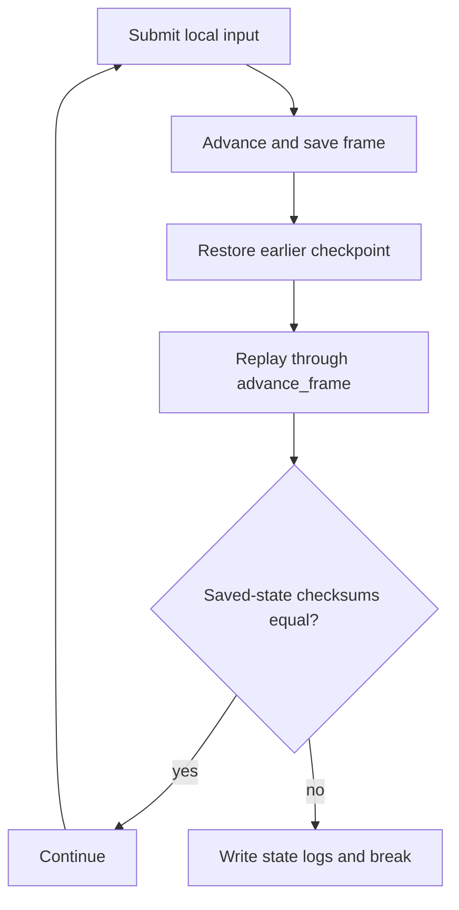

# Testing architecture

## Contents

- [Current validation surfaces](#current-validation-surfaces)
- [SyncTest](#synctest)
- [Vector War](#vector-war)
- [Network validation](#network-validation)
- [Current gaps](#current-gaps)
- [Recommended multiplatform matrix](#recommended-multiplatform-matrix)

## Current validation surfaces

| Surface | What it exercises | Entry point | Limitation |
| --- | --- | --- | --- |
| SyncTest backend | Deterministic save/load/replay behavior | [`ggpo_start_synctest`](../../src/include/ggponet.h), [`synctest.cpp`](../../src/lib/ggpo/backends/synctest.cpp) | Requires an integrating game; not an automated repository test |
| Vector War local sessions | API setup, callbacks, input synchronization, frame advancement | [`vectorwar.cpp`](../../src/apps/vectorwar/vectorwar.cpp) | Windows-only interactive sample |
| Vector War network sessions | Handshake, UDP input, rollback, spectators, disconnects, statistics | [`bin/start_vectorwar_*.cmd`](../../bin) | Manual multi-process execution |
| AppVeyor | Windows project build | [`appveyor.yml`](../../appveyor.yml) | No Linux/macOS build and no runtime tests |

The repository currently has no unit-test target, CTest registration, protocol
fixture suite, or automated two-peer integration test.

## SyncTest

[`SyncTestBackend`](../../src/lib/ggpo/backends/synctest.cpp) runs a local
determinism oracle:

It validates the application's deterministic-state contract. It does not test
UDP transport, peer handshake, packet loss, spectators, or cross-platform wire
compatibility.

## Vector War

The sample supplies concrete state callbacks and a fixed 60 Hz loop. Useful paths:

- normal peer setup: [`VectorWar_Init`](../../src/apps/vectorwar/vectorwar.cpp);
- spectator setup: [`VectorWar_InitSpectator`](../../src/apps/vectorwar/vectorwar.cpp);
- one host frame: [`VectorWar_RunFrame`](../../src/apps/vectorwar/vectorwar.cpp);
- rollback callback: [`vw_advance_frame_callback`](../../src/apps/vectorwar/vectorwar.cpp);
- state serialization and checksum: [`vw_save_game_state_callback`](../../src/apps/vectorwar/vectorwar.cpp);
- network statistics display: [`ggpo_perfmon.cpp`](../../src/apps/vectorwar/ggpo_perfmon.cpp).

The launch scripts under [`bin`](../../bin) cover two-to-four players and a
spectator arrangement.

The [Vector War walkthrough](VectorWar.md) traces the same sample from process
startup through normal frames, rollback, spectators, and shutdown.

## Network validation

A portable automated integration harness should run two SDK sessions over loopback
with deterministic scripted inputs. It should assert:

1. both peers reach `GGPO_EVENTCODE_RUNNING`;
2. intentionally delayed input causes prediction and rollback;
3. both final state checksums match;
4. ACKs eventually drain pending input history;
5. interruption, resumption, and disconnect events occur at configured deadlines;
6. a spectator receives only confirmed composite inputs;
7. a Windows peer interoperates with Linux and macOS peers.

## Current gaps

- No automated tests for `InputQueue`, `Sync`, bit vectors, ring buffers, or time sync.
- No malformed/truncated datagram tests for `UdpMsg` parsing.
- No protocol version or endian/layout compatibility test.
- No sanitizer jobs.
- No Linux/macOS compilation in upstream CI.
- No test proves that installed headers and libraries work from a consumer project.

## Recommended multiplatform matrix

| Layer | Windows | Linux | macOS | Evidence |
| --- | ---: | ---: | ---: | --- |
| Static and shared SDK build | Required | Required | Required | CMake jobs |
| Unit tests | Required | Required | Required | CTest |
| Loopback two-peer rollback | Required | Required | Required | Deterministic final checksums |
| Cross-OS peer compatibility | Required | Required | Required | Paired CI or downloadable artifacts |
| Sample frontend | Required | Required | Required | Portable SDL-based smoke test |
| Sanitizers | Optional | ASan/UBSan | ASan/UBSan | Clean runtime report |
