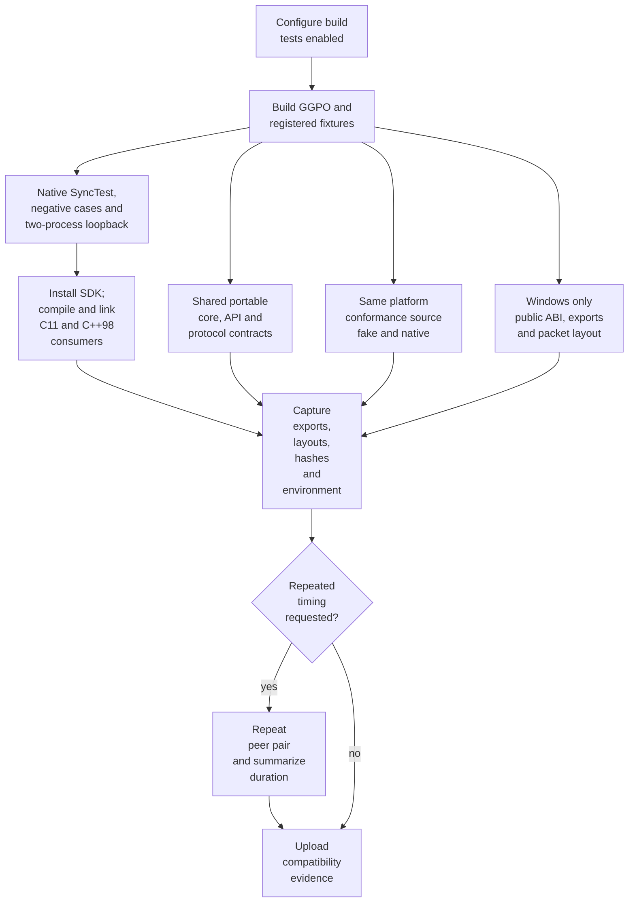
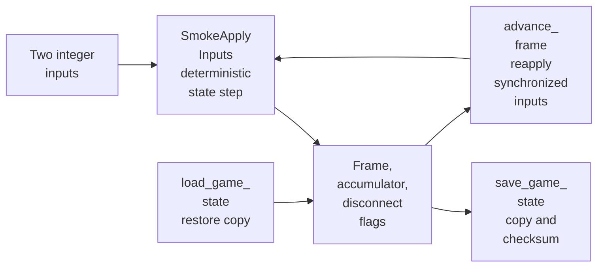
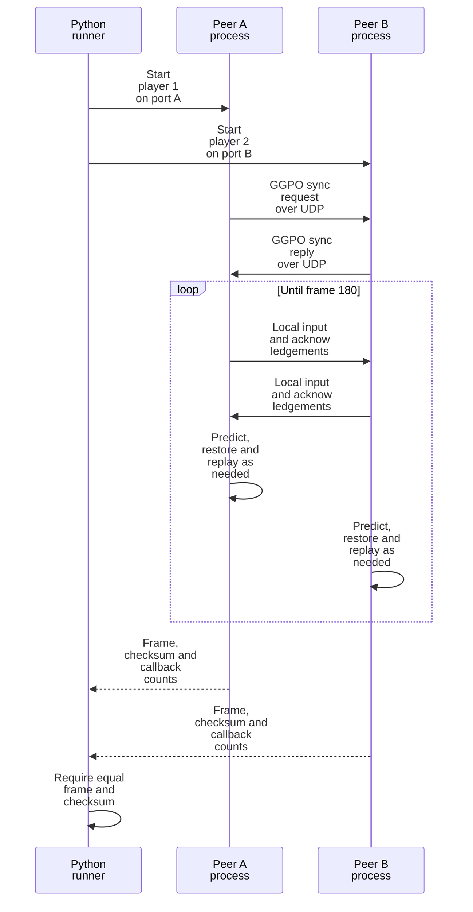
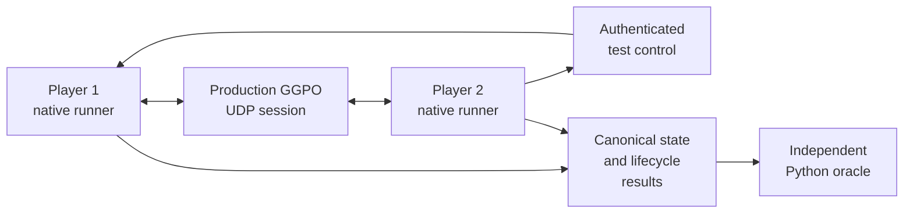

# Testing architecture

## Contents

- [Purpose](#purpose)
- [Test layers](#test-layers)
- [Shared coverage and platform normalization](#shared-coverage-and-platform-normalization)
- [Execution flow](#execution-flow)
- [Windows compatibility baseline](#windows-compatibility-baseline)
- [Runtime fixtures](#runtime-fixtures)
- [Build and CI integration](#build-and-ci-integration)
- [Evidence and interpretation](#evidence-and-interpretation)
- [Current limits and follow-ups](#current-limits-and-follow-ups)

## Purpose

GGPO's tests freeze Windows compatibility while qualifying the shared core and
Linux adapter. They protect public ABI, packed protocol data, deterministic
rollback, and real loopback sessions without requiring Vector War.

The fixtures live under [`tests`](../../tests). Their frozen values represent
the current compatibility contract; they should not be updated merely to make a
behavior-changing refactor pass.

## Test layers

| Layer | Contract | Source | Runs against |
| --- | --- | --- | --- |
| Public ABI | Public sizes, offsets, enum values, callback order, and DLL exports | [`public_layout.cpp`](../../tests/baseline/windows/public_layout.cpp), [`exports-x64.txt`](../../tests/baseline/windows/exports-x64.txt) | Compiled header and shared DLL |
| Installed consumers | C11 and C++98 compile/link use only installed SDK files | [`tests/consumer`](../../tests/consumer/CMakeLists.txt), [`verify_installed_consumers.ps1`](../../scripts/ci/verify_installed_consumers.ps1) | Installed header and shared/static library |
| Wire layout | Packed `UdpMsg` sizes, offsets, and representative packet lengths | [`packet_layout.cpp`](../../tests/baseline/windows/packet_layout.cpp) | Internal protocol structures |
| Portable core | Queue prediction, rollback/replay, time sync, containers, and bit encoding | [`tests/unit`](../../tests/unit/input_queue_test.cpp) | Production algorithms with deterministic state |
| Public API | Session construction, lifecycle, null guards, configuration, and logging | [`public_api_contract_test.cpp`](../../tests/contract/public_api_contract_test.cpp) | Production backends with fake services |
| Protocol safety | Exact packet sizes and truncated, trailing, or unknown messages | [`protocol_test.cpp`](../../tests/unit/protocol_test.cpp) | Production packet validator and receive guard |
| Platform contract | Virtual clock/wait, fallbacks, endpoint/socket results, failure, and cleanup | [`platform_fake_test.cpp`](../../tests/platform/fake/platform_fake_test.cpp) | Deterministic fake adapter |
| Native conformance | One clock/config/endpoint/UDP assertion source | [`platform_conformance_test.cpp`](../../tests/platform/conformance/platform_conformance_test.cpp) | Fake, Windows, and Linux adapters |
| Platform-free rollback | Production core linked without the Windows adapter | [`platform_fake.cpp`](../../tests/platform/fake/platform_fake.cpp), [`synctest_smoke.cpp`](../../tests/smoke/synctest_smoke.cpp) | Fake adapter and production rollback core |
| Sample simulation | Scripted Vector War inputs, explicit arena bounds, and canonical checkpoints | [`gamestate_contract_test.cpp`](../../tests/vectorwar/gamestate_contract_test.cpp), [`state_contract.cpp`](../../src/apps/vectorwar/state_contract.cpp) | Real sample `GameState` without a window or socket |
| Sample application loopback | Real Vector War callbacks, scripted host input, native UDP, rollback, and final golden state | [`headless_main.cpp`](../../src/apps/vectorwar/headless_main.cpp), [`run_headless_loopback.py`](../../tests/vectorwar/run_headless_loopback.py) | Two headless Vector War processes on Windows or Linux |
| Sample application negatives | Startup, timeout, divergence, absent rollback, and dirty shutdown are rejected | [`headless_negative.py`](../../tests/vectorwar/headless_negative.py) | Fault-injected Vector War processes |
| Rollback behavior | Save, restore, synchronized input, replay, and deterministic final state | [`synctest_smoke.cpp`](../../tests/smoke/synctest_smoke.cpp) | SyncTest backend without sockets |
| Native transport | Handshake, events, prediction, rollback, UDP delivery, and shutdown | [`peer_smoke.cpp`](../../tests/smoke/peer_smoke.cpp), [`run_peer_smoke.py`](../../tests/smoke/run_peer_smoke.py) | Two Windows or Linux GGPO processes over localhost |
| Negative peer contracts | Startup, timeout, checksum mismatch, and shutdown failures are rejected | [`peer_runner_negative.py`](../../tests/smoke/peer_runner_negative.py) | Fault-injected real peer processes |
| Build compatibility | x64/Win32, shared/static, Debug/Release | [`windows-compatibility.yml`](../../.github/workflows/windows-compatibility.yml) | Eight Windows build variants |
| Linux transport | The same peer contract through POSIX UDP | [`peer_smoke.cpp`](../../tests/smoke/peer_smoke.cpp), [`platform_linux.cpp`](../../src/lib/ggpo/platform_linux.cpp) | Two native Linux processes |
| Linux package | GCC/Clang, static/shared, installed consumers and ABI ceiling | [`linux-compatibility.yml`](../../.github/workflows/linux-compatibility.yml) | Shared Ubuntu 24.04 image |
| Cross-host | Native Windows and Linux peers converge | [`cross-platform-e2e.yml`](../../.github/workflows/cross-platform-e2e.yml), [`tests/e2e`](../../tests/e2e) | Native GitHub-hosted Windows↔Ubuntu matrix over ephemeral Tailscale nodes |

The shared/static lanes are both required. Shared builds additionally validate
DLL exports and import linkage; static builds ensure consumers do not depend on
DLL-only definitions or lifecycle behavior.

## Shared coverage and platform normalization

[`public_api_contract_test.cpp`](../../tests/contract/public_api_contract_test.cpp)
calls all 16 exports declared by [`ggponet.h`](../../src/include/ggponet.h).
It shares one fake-platform production core across Windows and Linux builds, so
null-session, construction, backend lifecycle, configuration, logging, and
cleanup expectations do not diverge by host.

This is complete API *entry-point* coverage, not every combination of backend,
state, and argument. Deeper behavior is divided deliberately:

- the shared API contract covers common wrapper and lifecycle behavior;
- SyncTest and focused core contracts cover rollback and replay;
- native peer tests cover real platform sockets and two-process sessions; and
- Windows-only fixtures cover frozen ABI, exports, and packet layout.

[`platform_conformance_test.cpp`](../../tests/platform/conformance/platform_conformance_test.cpp)
is the single assertion source compiled against the fake, Windows, and Linux
adapters. It exercises clocks, waits, process identity, configuration defaults,
directory handling, endpoints, network lifetime, and UDP lifecycle. All 16
callable platform operations plus socket construction/destruction are linked.
`AssertFailed` is link-checked but not invoked because the Windows contract
opens a modal diagnostic; platform setup and system-library linkage remain
adapter-specific.

## Execution flow



The diagram shows validation order, not runtime threads. CTest may schedule
independent tests differently when parallel execution is requested.

## Windows compatibility baseline

### Public layout and exports

[`windows_public_layout`](../../tests/baseline/windows/public_layout.cpp) prints
and verifies consumer-visible sizes and offsets. Pointer-sized callback slots
adapt to x64 or Win32, while fixed public values must remain unchanged.

For shared builds, the evidence script runs MSVC `dumpbin /exports`, normalizes
the `ggpo_*` symbols, and records them. x64 additionally compares the result
with [`exports-x64.txt`](../../tests/baseline/windows/exports-x64.txt).

### Packet layout

[`windows_packet_layout`](../../tests/baseline/windows/packet_layout.cpp)
verifies the packed `UdpMsg` header, union members, input-bit offset, and packet
sizes for empty and nine-bit input payloads. This catches compiler-packing or
field changes before they silently alter peer-visible datagrams.

It does not prove safe parsing, delivery, endianness across different hosts, or
protocol-version compatibility; those require separate tests.

## Runtime fixtures

### Vector War simulation contract

[`gamestate_contract_test.cpp`](../../tests/vectorwar/gamestate_contract_test.cpp)
advances the real sample simulation for 180 frames using a fixed two-player
input script and explicit 640×480 arena bounds. It validates canonical
checkpoints at frames 1, 30, 60, 90, 120, 150, and 180.

[`VectorWarCanonicalChecksum`](../../src/apps/vectorwar/state_contract.cpp)
hashes explicitly ordered fixed-width integers, booleans, and IEEE-754 double
bits. It excludes native structure padding and the old Win32 `RECT` layout.
This test freezes simulation behavior before the sample host is ported; it does
not exercise GGPO callbacks, UDP, rendering, or interactive input.

### Vector War application loopback

[`VectorWarHeadless`](../../src/apps/vectorwar/headless_main.cpp) supplies the
portable application core with scripted input and no renderer. Two processes
use the production GGPO session, callbacks, native UDP adapter, save/load path,
and frame loop. Player 2 starts submitting after a bounded delay so rollback is
an explicit fixture contract rather than a scheduler accident.

[`run_headless_loopback.py`](../../tests/vectorwar/run_headless_loopback.py)
requires both peers to reach frame 180 and canonical checksum `b3381958`, report
one running event, and record at least one replayed frame. The fixture continues
pumping both sessions before collecting results so late authoritative inputs
can converge.

[`headless_negative.py`](../../tests/vectorwar/headless_negative.py) proves the
runner rejects controlled startup failure, timeout, divergent state, missing
rollback evidence, and dirty shutdown. Rendering and interactive input remain
separate frontend contracts.

### Shared deterministic state

[`smoke_session.cpp`](../../tests/smoke/smoke_session.cpp) provides a small
game-owned state, checksum, and the callbacks GGPO needs to save, load, free,
and replay it.

The cross-host result uses `SmokeCanonicalChecksum`: frame, accumulator, and
disconnect flags are serialized as three little-endian 32-bit values before
hashing. [`result_schema.py`](../../tests/e2e/result_schema.py) independently
computes the same state and fixed vectors, avoiding native padding and byte
order as an accidental test contract. The legacy native-memory checksum remains
available to schema-1 loopback results.



This is a test simulation, not a model of a real game's state or performance.

### Deterministic SyncTest

The platform-named SyncTest fixture, implemented by
[`synctest_smoke.cpp`](../../tests/smoke/synctest_smoke.cpp), creates two
local players and submits fixed inputs for 90 frames. It advances the same
inputs through a direct reference state and through GGPO, then requires:

- equal final state and checksum;
- at least one saved-state load and replayed frame;
- exactly one running event; and
- successful session shutdown.

A pass shows that the callbacks and local rollback path converge. It does not
exercise Winsock, peer negotiation, or process timing.

The same fixture also builds as `fake_platform_synctest`, linking the production
rollback sources to [`platform_fake.cpp`](../../tests/platform/fake/platform_fake.cpp)
instead of the Windows adapter. `fake_platform_contract` separately checks
virtual time, configuration fallbacks, endpoint representation, would-block
results, scripted socket-open failure, close behavior, and balanced network
lifetime calls.

### Two-process loopback

[`run_peer_smoke.py`](../../tests/smoke/run_peer_smoke.py) reserves two ephemeral
localhost ports and launches two copies of the native
[`peer_smoke.cpp`](../../tests/smoke/peer_smoke.cpp) executable. Each process owns
one local player and treats the other as remote.



A pass establishes real platform socket and two-peer behavior on one machine.
It does not establish Internet/NAT behavior, loss tolerance, spectators, more
than two players, or interoperability between operating systems.

### Negative peer contracts

[`peer_runner_negative.py`](../../tests/smoke/peer_runner_negative.py) launches
the real peer fixture with one controlled test-only fault at a time. It requires
the runner to reject startup failure, bounded timeout, divergent checksums, and
shutdown failure with the matching diagnostic. The fault variable is removed
from ordinary peer environments, so these cases cannot weaken positive smoke
tests.

### Native cross-host smoke

[`cross-platform-e2e.yml`](../../.github/workflows/cross-platform-e2e.yml)
automates native Linux↔Linux, Windows↔Windows, Linux↔Windows, and
Windows↔Linux role assignments on GitHub-hosted runners. Both peers use the
same source SHA and advance 180 deterministic frames.



The role-1 runner publishes a run- and scenario-bound endpoint through a
transient GitHub Deployment. [`host_agent.py`](../../tests/e2e/host_agent.py)
accepts only authenticated lifecycle operations; production GGPO data still
travels directly over UDP. At frame 180, both peers keep pumping GGPO and
publishing frame/checksum snapshots. The coordinator releases the finalize
markers only when both snapshots match the independent expected state; merely
reaching frame 180 can still leave predicted inputs awaiting correction.

[`result_schema.py`](../../tests/e2e/result_schema.py) retains schema-1
compatibility and validates schema 2. The latter requires matching run/session
identity, expected platform roles, independent oracle checksum, one running
event, no unexpected disconnect, clean session close, and zero exit status.
[`compare_peer_results.py`](../../tests/smoke/compare_peer_results.py) exposes
that validator for standalone result files. Wine is not native Windows
interoperability evidence.

See [Native cross-platform qualification](CrossPlatformTesting.md) for the
complete scenario matrix, build artifacts, control/data boundaries, completion
protocol, security model, failure contracts, evidence, and execution guide.

## Build and CI integration

[`tests/CMakeLists.txt`](../../tests/CMakeLists.txt) registers Windows-only
layout checks plus shared smoke families. Linux registers:

```text
linux_synctest_smoke
linux_peer_loopback
linux_peer_schema2_loopback
linux_peer_negative_contracts
cross_host_result_contract
cross_host_orchestration_contract
cross_host_rendezvous_contract
fake_platform_synctest
fake_platform_contract
input_queue_contract
sync_contract
timesync_contract
core_utilities_contract
protocol_contract
public_api_contract
fake_platform_conformance
linux_platform_conformance
```

Windows retains these entries:

```text
windows_public_layout
windows_packet_layout
windows_synctest_smoke
windows_peer_loopback
windows_peer_schema2_loopback
windows_peer_negative_contracts
cross_host_result_contract
cross_host_orchestration_contract
cross_host_rendezvous_contract
fake_platform_synctest
fake_platform_contract
input_queue_contract
sync_contract
timesync_contract
core_utilities_contract
protocol_contract
public_api_contract
fake_platform_conformance
windows_platform_conformance
```

With `BUILD_TESTING=ON` and the default `GGPO_RUN_TESTS_ON_BUILD=ON`, the
`ggpo_check` target runs these tests as part of the normal build. Packaging or
consumer-only builds can disable execution explicitly.

CTest labels select contract families without changing their stable names:

```bash
ctest --test-dir build -L portable --output-on-failure
ctest --test-dir build -L native --output-on-failure
ctest --test-dir build -L abi --output-on-failure   # Windows layout fixtures
```

[`windows_compatibility_baseline.ps1`](../../scripts/ci/windows_compatibility_baseline.ps1)
configures, builds, runs CTest, installs the SDK, compiles and links the two
consumer fixtures, and calls the evidence collector. GitHub Actions runs it
across this matrix:

| Architecture | Linkage | Configuration |
| --- | --- | --- |
| x64 | Shared and static | Debug and Release |
| Win32 | Shared and static | Debug and Release |

The final [Windows compatibility verifier](../../scripts/ci/verify_windows_compatibility.ps1)
builds the frozen Windows baseline and the current candidate. It compares
exports and layouts, then runs both cross-revision directions: the baseline
executable with the candidate DLL and the candidate executable with the
baseline DLL.

[`linux-compatibility.yml`](../../.github/workflows/linux-compatibility.yml)
builds [`docker/linux/Dockerfile`](../../docker/linux/Dockerfile), then runs the
GCC/Clang × static/shared matrix inside that image. Each lane runs CTest,
installs the SDK, builds and executes external C11/C++98 consumers, and audits
the installed Linux library.

[`sanitizer-qualification.yml`](../../.github/workflows/sanitizer-qualification.yml)
runs manually and weekly. It uses the same image to instrument production GGPO,
all 13 tests, and installed static-library consumers with Clang ASan and UBSan.
Sanitizer findings fail immediately and the workflow retains CTest evidence.

The GCC and Clang portable-header jobs also compile the public C11 and C++98
consumers without linking an SDK. These remain header-portability gates.
The Clang C++ gate suppresses only `-Wextern-c-compat`: C requires the documented
one-byte `GGPOPlayer.local` placeholder while C++ retains the frozen empty-member
Windows ABI. All other pedantic diagnostics remain errors.

[`appveyor.yml`](../../appveyor.yml) also runs CTest and captures evidence for
its existing x64 Windows builds. Unsupported SDK platforms now fail CMake
configuration explicitly instead of selecting the incomplete legacy Unix file.

The trusted-only [native E2E workflow](../../.github/workflows/cross-platform-e2e.yml)
builds static Release x64 peers on their native runners. It joins ephemeral
Tailscale nodes with a commit-pinned action, executes all four ordered platform
roles, uploads per-role evidence, and rejects a missing, duplicate, or failed
scenario in an unconditional final job. It runs for owner-authored
same-repository PRs, trusted `master` pushes, and manual dispatch; fork and
non-owner PR jobs are skipped.

## Evidence and interpretation

[`capture_windows_compatibility_baseline.ps1`](../../scripts/ci/capture_windows_compatibility_baseline.ps1)
records:

- public and packet layout reports;
- normalized and raw DLL exports for shared builds;
- CMake configuration and source identity;
- built-artifact sizes and SHA-256 values; and
- optional repeated loopback results and elapsed-time summary.

Hashes identify the exact artifacts; different Debug/Release or shared/static
hashes are expected. Repeated duration is a noise measurement for designing
later A/B comparisons, not a performance threshold. Runtime compatibility is
established by the frame, checksum, callback, and lifecycle assertions.

## Current limits and follow-ups

- No spectator, disconnect/resume, simulated loss, or multi-player automated
  session exists.
- The automated matrix covers native Windows↔Ubuntu, but not SteamOS hardware.
- The clean cross-platform workflow does not inject latency or packet loss;
  deterministic impairment remains a follow-up after clean-run qualification.
- No macOS adapter or build exists.
- Sanitizers qualify Linux Clang static builds; Windows and shared-library
  sanitizer configurations are not currently automated.

The focused core, API, protocol, and platform suites are tracked by the
[shared-core testing plan](../planning/2026-11-07-shared_core_testing_ci/TECH_PLAN.md).

The platform-extraction plan tracks those additions in the
[technical plan](../planning/2026-11-06-platform_agnostic_core/TECH_PLAN.md) and
[progress ledger](../planning/2026-11-06-platform_agnostic_core/PROGRESS.md).
Return to the [architecture overview](Overview.md).
