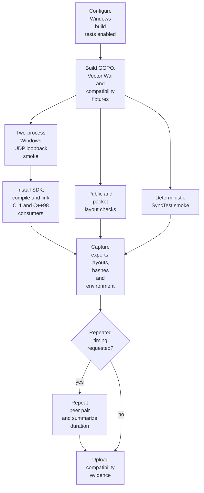
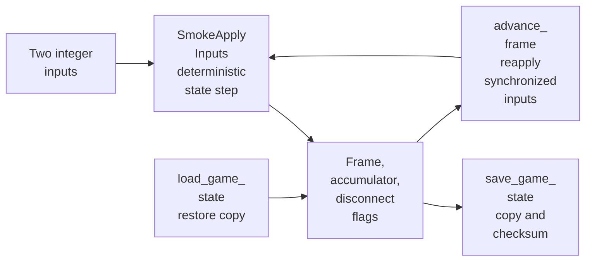
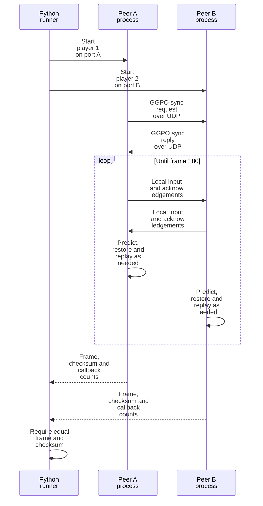

# Testing architecture

## Contents

- [Purpose](#purpose)
- [Test layers](#test-layers)
- [Execution flow](#execution-flow)
- [Windows compatibility baseline](#windows-compatibility-baseline)
- [Runtime fixtures](#runtime-fixtures)
- [Build and CI integration](#build-and-ci-integration)
- [Evidence and interpretation](#evidence-and-interpretation)
- [Current limits and follow-ups](#current-limits-and-follow-ups)

## Purpose

GGPO's tests freeze observable Windows behavior before the core is separated
from platform code. They protect public ABI, packed protocol data, deterministic
rollback, and real loopback sessions without requiring Vector War or a person
to operate a game window.

The fixtures live under [`tests`](../../tests). Their frozen values represent
the current compatibility contract; they should not be updated merely to make a
behavior-changing refactor pass.

## Test layers

| Layer | Contract | Source | Runs against |
| --- | --- | --- | --- |
| Public ABI | Public sizes, offsets, enum values, callback order, and DLL exports | [`public_layout.cpp`](../../tests/baseline/windows/public_layout.cpp), [`exports-x64.txt`](../../tests/baseline/windows/exports-x64.txt) | Compiled header and shared DLL |
| Installed consumers | C11 and C++98 compile/link use only installed SDK files | [`tests/consumer`](../../tests/consumer), [`verify_installed_consumers.ps1`](../../scripts/ci/verify_installed_consumers.ps1) | Installed header and shared/static library |
| Wire layout | Packed `UdpMsg` sizes, offsets, and representative packet lengths | [`packet_layout.cpp`](../../tests/baseline/windows/packet_layout.cpp) | Internal protocol structures |
| Rollback behavior | Save, restore, synchronized input, replay, and deterministic final state | [`synctest_smoke.cpp`](../../tests/smoke/synctest_smoke.cpp) | SyncTest backend without sockets |
| Windows transport | Handshake, events, prediction, rollback, UDP delivery, and shutdown | [`peer_smoke.cpp`](../../tests/smoke/peer_smoke.cpp), [`run_peer_smoke.py`](../../tests/smoke/run_peer_smoke.py) | Two GGPO processes over localhost |
| Build compatibility | x64/Win32, shared/static, Debug/Release | [`windows-compatibility.yml`](../../.github/workflows/windows-compatibility.yml) | Eight Windows build variants |

The shared/static lanes are both required. Shared builds additionally validate
DLL exports and import linkage; static builds ensure consumers do not depend on
DLL-only definitions or lifecycle behavior.

## Execution flow



The diagram shows validation order, not runtime threads. CTest may schedule
independent tests differently when parallel execution is requested.

## Windows compatibility baseline

### Public layout and exports

[`windows_public_layout`](../../tests/baseline/windows/public_layout.cpp) prints
and verifies consumer-visible sizes and offsets. Pointer-sized callback slots
adapt to x64 or Win32, while fixed public values must remain unchanged.

For shared builds, the evidence script runs MSVC `dumpbin /exports`, normalizes
the `ggpo_*` symbols, and records them. x64 additionally compares the result
with [`exports-x64.txt`](../../tests/baseline/windows/exports-x64.txt).

### Packet layout

[`windows_packet_layout`](../../tests/baseline/windows/packet_layout.cpp)
verifies the packed `UdpMsg` header, union members, input-bit offset, and packet
sizes for empty and nine-bit input payloads. This catches compiler-packing or
field changes before they silently alter peer-visible datagrams.

It does not prove safe parsing, delivery, endianness across different hosts, or
protocol-version compatibility; those require separate tests.

## Runtime fixtures

### Shared deterministic state

[`smoke_session.cpp`](../../tests/smoke/smoke_session.cpp) provides a small
game-owned state, checksum, and the callbacks GGPO needs to save, load, free,
and replay it.



This is a test simulation, not a model of a real game's state or performance.

### Deterministic SyncTest

[`windows_synctest_smoke`](../../tests/smoke/synctest_smoke.cpp) creates two
local players and submits fixed inputs for 90 frames. It advances the same
inputs through a direct reference state and through GGPO, then requires:

- equal final state and checksum;
- at least one saved-state load and replayed frame;
- exactly one running event; and
- successful session shutdown.

A pass shows that the callbacks and local rollback path converge. It does not
exercise Winsock, peer negotiation, or process timing.

### Two-process loopback

[`run_peer_smoke.py`](../../tests/smoke/run_peer_smoke.py) reserves two ephemeral
localhost ports and launches two copies of
[`windows_peer_loopback`](../../tests/smoke/peer_smoke.cpp). Each process owns
one local player and treats the other as remote.



A pass establishes real Windows socket and two-peer behavior on one machine.
It does not establish Internet/NAT behavior, loss tolerance, spectators, more
than two players, or interoperability between operating systems.

## Build and CI integration

[`tests/CMakeLists.txt`](../../tests/CMakeLists.txt) registers four Windows CTest
entries:

```text
windows_public_layout
windows_packet_layout
windows_synctest_smoke
windows_peer_loopback
```

[`windows_compatibility_baseline.ps1`](../../scripts/ci/windows_compatibility_baseline.ps1)
configures, builds, runs CTest, installs the SDK, compiles and links the two
consumer fixtures, and calls the evidence collector. GitHub Actions runs it
across this matrix:

| Architecture | Linkage | Configuration |
| --- | --- | --- |
| x64 | Shared and static | Debug and Release |
| Win32 | Shared and static | Debug and Release |

[`appveyor.yml`](../../appveyor.yml) also runs CTest and captures evidence for
its existing x64 Windows builds. On non-Windows hosts, CMake reports that these
compatibility fixtures are Windows-only; portable and platform-conformance test
layers are planned separately.

## Evidence and interpretation

[`capture_windows_compatibility_baseline.ps1`](../../scripts/ci/capture_windows_compatibility_baseline.ps1)
records:

- public and packet layout reports;
- normalized and raw DLL exports for shared builds;
- CMake configuration and source identity;
- built-artifact sizes and SHA-256 values; and
- optional repeated loopback results and elapsed-time summary.

Hashes identify the exact artifacts; different Debug/Release or shared/static
hashes are expected. Repeated duration is a noise measurement for designing
later A/B comparisons, not a performance threshold. Runtime compatibility is
established by the frame, checksum, callback, and lifecycle assertions.

## Current limits and follow-ups

- No focused unit tests yet cover `InputQueue`, `Sync`, bit vectors, ring
  buffers, or time synchronization.
- No malformed/truncated packet suite validates parser rejection.
- No spectator, disconnect/resume, simulated loss, or multi-player automated
  session exists.
- No Linux/macOS build, platform conformance, or cross-OS peer test exists.
- No sanitizer job is configured.

The platform-extraction plan tracks those additions in the
[technical plan](../planning/2026-11-06-platform_agnostic_core/TECH_PLAN.md) and
[progress ledger](../planning/2026-11-06-platform_agnostic_core/PROGRESS.md).
Return to the [architecture overview](Overview.md).
