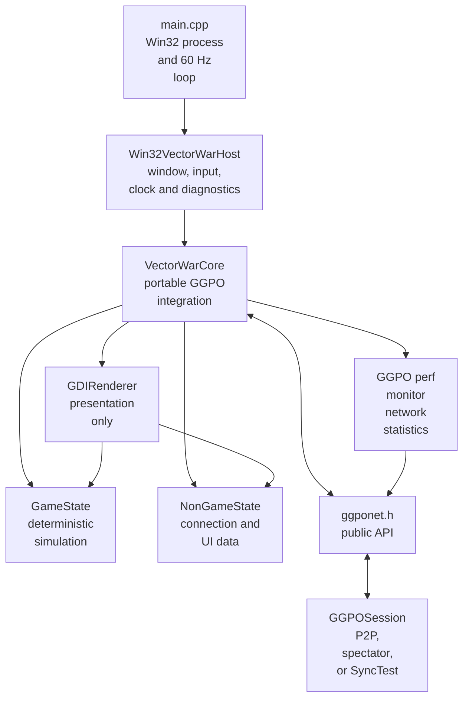
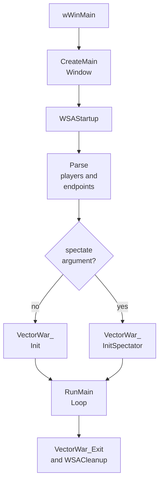
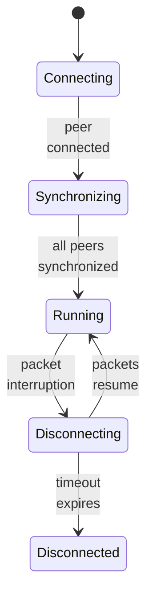
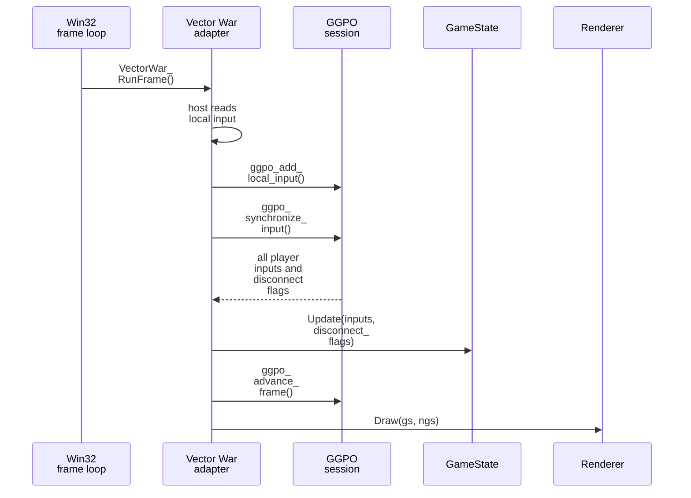
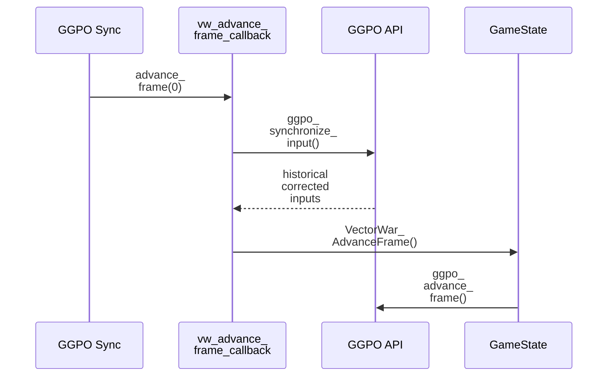
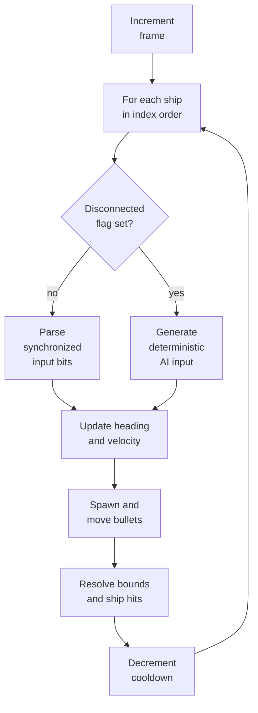
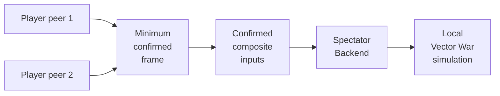

# Vector War sample application

## Contents

- [Purpose and boundaries](#purpose-and-boundaries)
- [Component map](#component-map)
- [Build and launch](#build-and-launch)
- [1. Process startup](#1-process-startup)
- [2. Session and callback setup](#2-session-and-callback-setup)
- [3. Player registration and synchronization](#3-player-registration-and-synchronization)
- [4. Normal frame](#4-normal-frame)
- [5. Rollback frame](#5-rollback-frame)
- [6. State ownership](#6-state-ownership)
- [7. Simulation](#7-simulation)
- [8. Rendering and diagnostics](#8-rendering-and-diagnostics)
- [9. Spectators](#9-spectators)
- [10. Shutdown](#10-shutdown)
- [Headless application contract](#headless-application-contract)
- [End-to-end two-player example](#end-to-end-two-player-example)
- [What the sample demonstrates](#what-the-sample-demonstrates)
- [Sample limitations](#sample-limitations)

## Purpose and boundaries

Vector War is GGPO's reference game integration under
[`src/apps/vectorwar`](../../src/apps/vectorwar). It is a small deterministic
four-ship simulation with a portable application core and a Windows host. It demonstrates how
an application owns game state and presentation while GGPO owns input prediction,
network synchronization, saved checkpoints, and rollback scheduling.

It is not part of the public API. The reusable contract is
[`ggponet.h`](../../src/include/ggponet.h); Vector War is one concrete consumer.
The interactive frontend remains Windows-only while its session and simulation
core is also compiled on Linux.

## Component map



| Piece | Responsibility | Source |
| --- | --- | --- |
| Process host | Window, command line, Winsock, message loop, frame schedule | [`main.cpp`](../../src/apps/vectorwar/main.cpp), [`win32_host.cpp`](../../src/apps/vectorwar/win32_host.cpp) |
| Host contract | Bounds, input, renderer creation, clock, sleep, and diagnostics | [`vectorwar_host.h`](../../src/apps/vectorwar/vectorwar_host.h) |
| GGPO adapter | Session lifecycle, callbacks, input submission, simulation/render split | [`vectorwar.cpp`](../../src/apps/vectorwar/vectorwar.cpp), [`vectorwar.h`](../../src/apps/vectorwar/vectorwar.h) |
| Deterministic state | Frame, platform-neutral arena bounds, ships, bullets, health, score | [`gamestate.h`](../../src/apps/vectorwar/gamestate.h), [`gamestate.cpp`](../../src/apps/vectorwar/gamestate.cpp) |
| Non-rollback state | Player handles, connection progress, timeouts, displayed checksums | [`nongamestate.h`](../../src/apps/vectorwar/nongamestate.h) |
| Rendering | Draw current simulation and connection state | [`renderer.h`](../../src/apps/vectorwar/renderer.h), [`gdi_renderer.cpp`](../../src/apps/vectorwar/gdi_renderer.cpp) |
| Network monitor | Display ping, bandwidth, queues, and frame advantage | [`ggpo_perfmon.cpp`](../../src/apps/vectorwar/ggpo_perfmon.cpp) |

## Build and launch

[`src/apps/vectorwar/CMakeLists.txt`](../../src/apps/vectorwar/CMakeLists.txt)
builds portable `VectorWarCore` whenever `GGPO_BUILD_VECTORWAR` is enabled. On
Windows it also builds the `VectorWar` executable from that core and the Win32
host. The SDK's Windows platform layer carries `winmm` and `ws2_32` transitively.

The command line is parsed by [`wWinMain`](../../src/apps/vectorwar/main.cpp):

```text
VectorWar.exe <local-port> <player-count> \
  ('local' | <remote-ip>:<remote-port>)* \
  [<spectator-ip>:<spectator-port> ...]
```

Repository scripts provide complete topologies:

| Script | Processes |
| --- | --- |
| [`start_vectorwar_2p.cmd`](../../bin/start_vectorwar_2p.cmd) | Two peers on ports 7000 and 7001 |
| [`start_vectorwar_3p.cmd`](../../bin/start_vectorwar_3p.cmd) | Three fully connected peers |
| [`start_vectorwar_4p.cmd`](../../bin/start_vectorwar_4p.cmd) | Four fully connected peers |
| [`start_vectorwar_2p_4s.cmd`](../../bin/start_vectorwar_2p_4s.cmd) | Two players and four spectators served by one peer |

## 1. Process startup

[`wWinMain`](../../src/apps/vectorwar/main.cpp) performs the platform work:

1. Create the 640×480 Win32 window.
2. Start Winsock with `WSAStartup`.
3. Parse local port, player count, player endpoints, and optional spectators.
4. Select participating-peer or spectator initialization.
5. Run the message/frame loop.
6. Close the GGPO session, Winsock, renderer, and window.



[`RunMainLoop`](../../src/apps/vectorwar/main.cpp) drains Win32 messages, gives
remaining time to `VectorWar_Idle`, and targets one game frame every 16 ms.

## 2. Session and callback setup

[`VectorWar_Init`](../../src/apps/vectorwar/vectorwar.cpp) constructs three
application-owned objects:

- global `GameState gs`, initialized for the requested players;
- global `NonGameState ngs`, used only by UI/connection handling;
- a `GDIRenderer`, which reads both structures.

It then fills every [`GGPOSessionCallbacks`](../../src/include/ggponet.h) slot:

| Callback | Vector War function | Behavior |
| --- | --- | --- |
| `begin_game` | `vw_begin_game_callback` | Deprecated no-op returning success |
| `advance_frame` | `vw_advance_frame_callback` | Replays one deterministic frame using GGPO inputs |
| `load_game_state` | `vw_load_game_state_callback` | Copies a checkpoint over `gs` |
| `save_game_state` | `vw_save_game_state_callback` | Copies `gs`, allocates its buffer, and computes Fletcher-32 |
| `free_buffer` | `vw_free_buffer` | Frees a saved-state allocation |
| `on_event` | `vw_on_event_callback` | Updates `ngs` connection/UI state |
| `log_game_state` | `vw_log_game_state` | Writes a readable state dump for SyncTest |

Normal builds call `ggpo_start_session`. Defining `SYNC_TEST` switches the same
integration to `ggpo_start_synctest`, demonstrating that the simulation callbacks
are independent of the session backend.

## 3. Player registration and synchronization

After session creation, `VectorWar_Init` sets disconnect thresholds and calls
`ggpo_add_player()` for every player and spectator. Local players receive a
two-frame input delay through `ggpo_set_frame_delay`; the constant is declared in
[`vectorwar.h`](../../src/apps/vectorwar/vectorwar.h).

Remote endpoints exchange handshake messages. GGPO delivers progress through
[`vw_on_event_callback`](../../src/apps/vectorwar/vectorwar.cpp), which changes
only `NonGameState`:



The renderer shows these values, but they are deliberately excluded from saved
simulation state.

## 4. Normal frame

[`VectorWar_RunFrame`](../../src/apps/vectorwar/vectorwar.cpp) is the central
integration example:



If either input call fails, the simulation does not advance. Rendering still
draws the current state. `VectorWar_Idle()` separately calls `ggpo_idle()` with
the time remaining before the next scheduled frame.

The essential integration is:

```cpp
result = ggpo_add_local_input(ggpo, ngs.local_player_handle,
                              &input, sizeof(input));
if (GGPO_SUCCEEDED(result)) {
    result = ggpo_synchronize_input(ggpo, inputs, sizeof(inputs),
                                    &disconnect_flags);
    if (GGPO_SUCCEEDED(result)) {
        VectorWar_AdvanceFrame(inputs, disconnect_flags);
    }
}
VectorWar_DrawCurrentFrame();
```

## 5. Rollback frame

GGPO invokes `vw_advance_frame_callback` when corrected remote input requires
replay. The callback does not read the keyboard or render:



`VectorWar_AdvanceFrame` updates the simulation and calls `ggpo_advance_frame`
for both normal and replayed frames. Only the outer normal loop calls
`VectorWar_DrawCurrentFrame`, keeping presentation outside rollback.

## 6. State ownership

The sample makes the rollback boundary explicit:

| State | Rolled back? | Why |
| --- | ---: | --- |
| `GameState::_framenumber` | Yes | Determines simulation time |
| Arena bounds | Yes | Affect collision and movement |
| Ships, health, velocity, cooldown, score | Yes | Affect future outcomes |
| Bullets and their position/velocity | Yes | Affect future collisions |
| Player handles and connection progress | No | GGPO/host metadata, not simulation |
| Current network timeout display | No | Presentation of connection state |
| Renderer and window resources | No | Derived presentation resources |
| Performance monitor | No | Diagnostic data only |

[`vw_save_game_state_callback`](../../src/apps/vectorwar/vectorwar.cpp) serializes
the complete `GameState` with `memcpy`. [`vw_load_game_state_callback`](../../src/apps/vectorwar/vectorwar.cpp)
restores it the same way. This is safe for this sample because `GameState` contains
fixed arrays and values rather than owning pointers.

The application converts the Win32 client rectangle into explicit
[`VectorWarBounds`](../../src/apps/vectorwar/gamestate.h) before initialization,
so rollback state no longer contains `HWND` or `RECT`. The portable
[`VectorWarCanonicalChecksum`](../../src/apps/vectorwar/state_contract.cpp)
provides a padding-independent test representation; GGPO's current save/load
callback still copies the complete in-process state.

## 7. Simulation

[`GameState::Update`](../../src/apps/vectorwar/gamestate.cpp) increments the frame
and processes every ship in stable index order. Connected players use the
frame's synchronized input bit mask. Disconnected players use deterministic
`GetShipAI` behavior.



Input bits are declared in [`VectorWarInputs`](../../src/apps/vectorwar/vectorwar.h):
thrust, brake, left/right rotation, fire, and an unused bomb bit.

## 8. Rendering and diagnostics

[`Renderer`](../../src/apps/vectorwar/renderer.h) receives `GameState` and
`NonGameState` by reference and must not advance either. The current
[`GDIRenderer`](../../src/apps/vectorwar/gdi_renderer.cpp) draws ships, bullets,
connection status, checksums, and text into the Win32 window.

`VectorWar_AdvanceFrame` computes a checksum after each simulation step and stores
it in `ngs` for display. This displayed checksum is diagnostic state; the saved
state checksum returned to GGPO is calculated directly from the serialized
`GameState` in `vw_save_game_state_callback`.

Pressing `P` toggles the separate performance monitor, which calls
`ggpo_get_network_stats()` for remote handles. Function keys disconnect players;
Escape exits. These controls are handled by
[`MainWindowProc`](../../src/apps/vectorwar/main.cpp).

## 9. Spectators

A spectator process selects `VectorWar_InitSpectator`, creates the same local
`GameState` and callback table, and starts `ggpo_start_spectating()` instead of a
peer session. The host peer forwards only confirmed composite inputs. The
spectator buffers those inputs and advances the same deterministic simulation,
so no game-state snapshots are streamed.



The four-spectator topology is executable through
[`start_vectorwar_2p_4s.cmd`](../../bin/start_vectorwar_2p_4s.cmd).

## 10. Shutdown

[`VectorWar_Exit`](../../src/apps/vectorwar/vectorwar.cpp) clears game and
non-game state, closes the GGPO session, and deletes the renderer. `wWinMain`
then calls `WSACleanup` and destroys the window. `ggpo_close_session()` is the
operation that deletes the selected backend and releases its saved states,
queues, endpoints, and socket.

## Headless application contract

[`VectorWarHeadless`](../../src/apps/vectorwar/headless_main.cpp) uses the same
`VectorWarCore`, GGPO callbacks, native UDP session, and frame functions as the
interactive host. [`HeadlessVectorWarHost`](../../src/apps/vectorwar/headless_host.cpp)
supplies fixed bounds, frame-indexed input, monotonic time, and no renderer.

The local fixture launches two processes for 180 frames, forces a bounded input
delay to exercise rollback, and requires canonical checksum `b3381958` on both
peers. See the [testing contract](Testing.md#vector-war-application-loopback).

## End-to-end two-player example

[`start_vectorwar_2p.cmd`](../../bin/start_vectorwar_2p.cmd) creates:

```text
Process A: local UDP 7000, player 1 local, player 2 at 127.0.0.1:7001
Process B: local UDP 7001, player 1 at 127.0.0.1:7000, player 2 local
```

For frame 120:

1. A reads player 1's keyboard; B reads player 2's keyboard.
2. Each submits its local bit mask tagged for frame 120.
3. Each peer sends recent unacknowledged input history over UDP.
4. If the remote frame has not arrived, each predicts from the last input.
5. Each advances `GameState::Update` with the two input slots.
6. Each saves frame 121 and renders it.
7. If the late remote input differs, GGPO restores frame 120 and calls the
   rollback callback until frame 121 is reconstructed.
8. Matching deterministic inputs and state produce matching checksums.

## What the sample demonstrates

- A small, explicitly serializable deterministic state.
- Separation of rollback state from UI and network presentation state.
- One shared simulation function for normal and replay frames.
- No rendering during rollback replay.
- Local, remote, disconnected-AI, spectator, and SyncTest flows.
- Per-peer network statistics and connection lifecycle events.

## Sample limitations

- The interactive host, renderer, input devices, and launch scripts remain
  Windows-specific; the application core and headless host are portable.
- The simulation uses raw `double`, native structure layout, and a window-derived
  arena; cross-platform determinism has not been established.
- Raw `memcpy` serialization is not versioned and is unsuitable for pointers or
  dynamic containers.
- The sample uses a full peer mesh rather than an authoritative server.
- Vector War's window, renderer, and interactive input still require frontend
  validation. Automated tests now cover its real application core and two
  native processes exchanging scripted inputs over loopback UDP.

Continue with the general [Runtime](Runtime.md), [Synchronization](Synchronization.md),
and [API reference](API.md).
