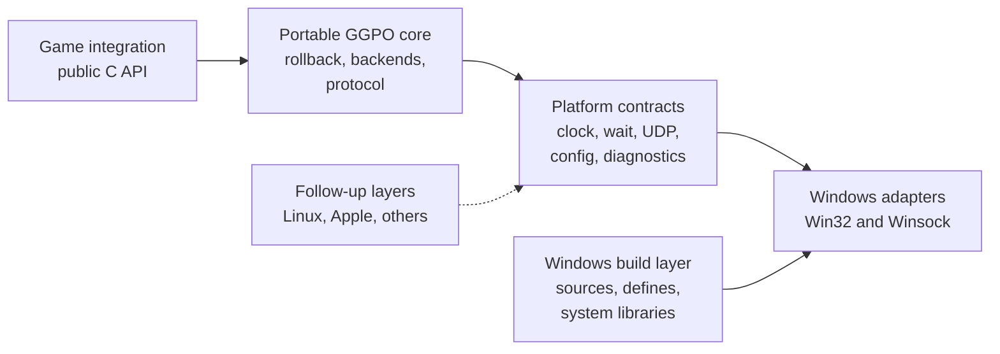
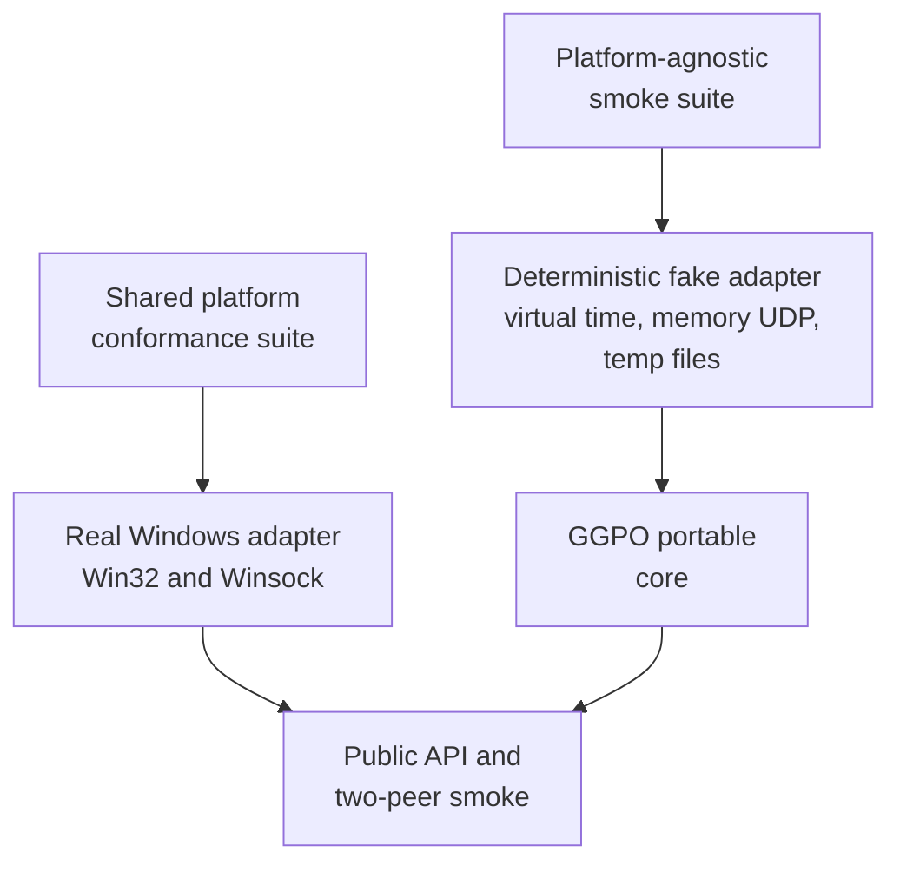
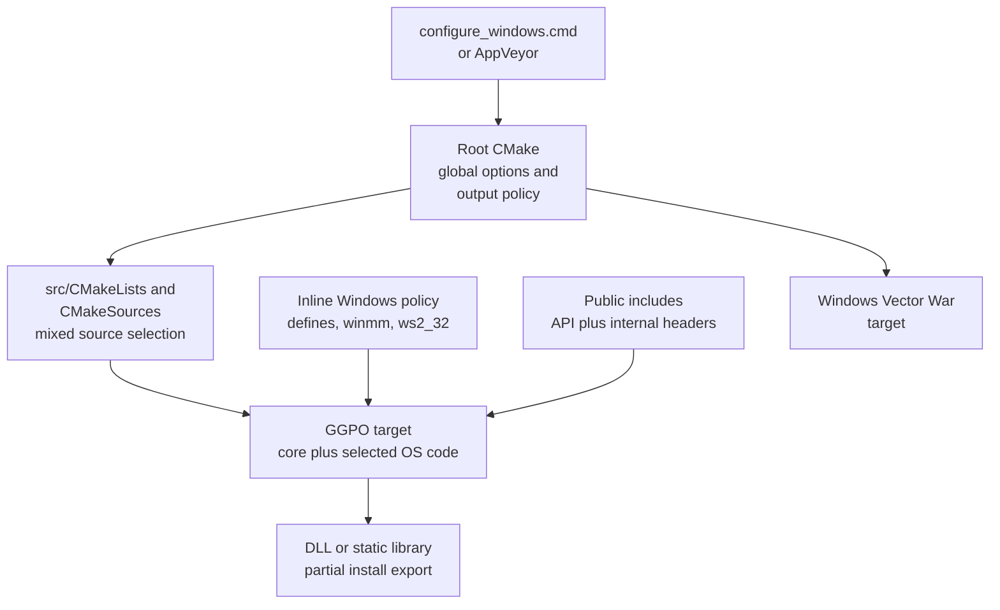
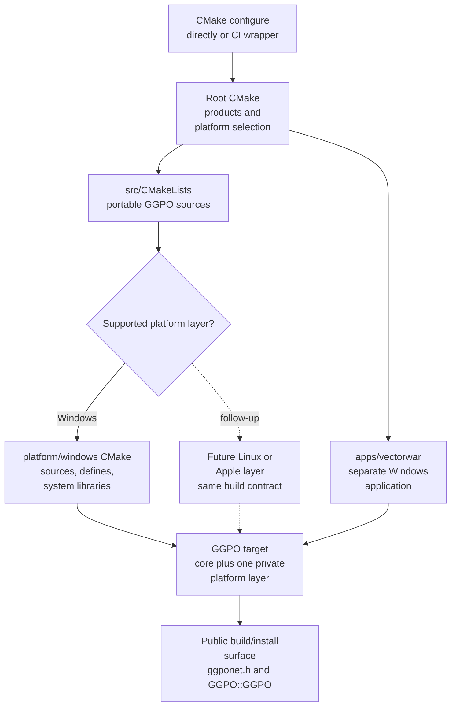
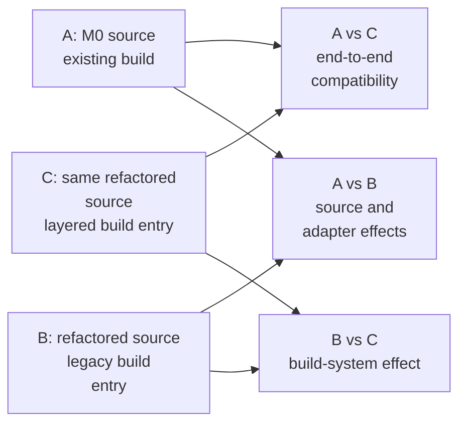

# TECH_PLAN — Platform-agnostic GGPO core and Windows build layer

Status: M0–M2 implemented; M3–M4 planned
Source: [`004ffd7`](https://github.com/irregularthanis/ggpo-next/tree/004ffd7f47603d3bae4abd1d541501d715e03279)  
M0 implementation: [`3498899`](https://github.com/irregularthanis/ggpo-next/commit/34988996cab45c1a37a9c556fe66b192d60a547b)

M1 implementation: [`1f31b0a`](https://github.com/irregularthanis/ggpo-next/commit/1f31b0a16a8dae7edfc271db6fd44d5670dc190f)

M2 implementation: [`70929d1`](https://github.com/irregularthanis/ggpo-next/commit/70929d142c2cdd069b0cda9f0fdf137010c1cbd7),
qualified at [`9ac7b45`](https://github.com/irregularthanis/ggpo-next/commit/9ac7b454fe414bd58f77c5bd657d95b393058654)
[Product brief](PRD.md) · [Tracker](PROGRESS.md)

## Inspected facts

- [`types.h`](../../../src/lib/ggpo/types.h) selects a platform header; the
  selected header supplies types used throughout otherwise portable code.
- [`Poll`](../../../src/lib/ggpo/poll.h) stores `HANDLE` and
  [`poll.cpp`](../../../src/lib/ggpo/poll.cpp) calls Win32 wait APIs. No in-tree
  caller registers a real handle at this revision; backends use loop/periodic
  polling.
- [`Udp`](../../../src/lib/ggpo/network/udp.cpp) directly owns Winsock handles,
  nonblocking setup, error mapping, send/receive, and address formatting.
- [`ggponet.h`](../../../src/include/ggponet.h) exports a C-linkage API but exposes
  `bool` and `__cdecl`; Windows import/export is already partly abstracted.
- [`src/CMakeLists.txt`](../../../src/CMakeLists.txt) publicly exposes the internal
  include tree. [`CMakeSources.cmake`](../../../src/CMakeSources.cmake) selects a
  syntactically incomplete Unix source, while Windows libraries and definitions
  are configured inline.
- Current validation is the Windows-only [AppVeyor matrix](../../../appveyor.yml).
  The architecture guide records the same gaps in
  [Build](../../architecture/Build.md) and
  [Portability](../../architecture/Portability.md).
- Upstream [PR #81](https://github.com/pond3r/ggpo/pull/81) and older
  [PR #52](https://github.com/pond3r/ggpo/pull/52) prove useful POSIX directions,
  but emulate several Win32 names inside Unix code. This plan instead keeps OS
  names out of the core and preserves attribution for reused logic.

## M0 Windows compatibility baseline

M0 adds tests and evidence capture without changing GGPO runtime behavior. The
[successful matrix](https://github.com/irregularthanis/ggpo-next/actions/runs/42296246130)
builds x64 and Win32, shared and static, in Debug and Release.

| Contract | Persistent fixture | Qualified result |
| --- | --- | --- |
| Public ABI | [`public_layout.cpp`](../../../tests/baseline/windows/public_layout.cpp), [`exports-x64.txt`](../../../tests/baseline/windows/exports-x64.txt) | 16 exports plus public sizes, offsets, enum values, and callback slots pass |
| Wire layout | [`packet_layout.cpp`](../../../tests/baseline/windows/packet_layout.cpp) | Packed `UdpMsg` sizes, offsets, and representative input packet sizes pass |
| Deterministic rollback | [`synctest_smoke.cpp`](../../../tests/smoke/synctest_smoke.cpp) | Fixed inputs reach the expected frame and checksum through SyncTest |
| Real transport | [`peer_smoke.cpp`](../../../tests/smoke/peer_smoke.cpp), [`run_peer_smoke.py`](../../../tests/smoke/run_peer_smoke.py) | Two loopback processes reach frame 180 with matching state |
| Build recipe | [`windows_compatibility_baseline.ps1`](../../../scripts/ci/windows_compatibility_baseline.ps1), [`windows-compatibility.yml`](../../../.github/workflows/windows-compatibility.yml) | Eight variants pass and publish nonempty evidence |

The ten-run x64 shared Release sample ranged from 17,484.7 to 33,180.3 ms
with a 32,984.7 ms median. Every run produced checksum `0x7db6c67b`, but timing
and rollback counts varied; future performance comparisons therefore require
repeated, interleaved A/B runs rather than a single elapsed-time result.

## M1 public API implementation

M1 makes the one installed header consumable from C11 and C++98 without
creating a second API. [`GGPO_CALL`](../../../src/include/ggponet.h) preserves
Windows `__cdecl` and becomes empty on other toolchains; C gains
`<stdbool.h>` support. Every function and callback uses the same macro.

[`tests/consumer`](../../../tests/consumer/CMakeLists.txt) contains minimal C11 and C++98
programs. The [Windows validation wrapper](../../../scripts/ci/verify_installed_consumers.ps1)
installs each matrix build into a clean prefix, then compiles and links both
programs using only that installed header and library. The M0 layout and export
fixtures remain the hard ABI gate, now including an x86 export manifest.

The [M1 Windows matrix](https://github.com/irregularthanis/ggpo-next/actions/runs/42321026313)
passed all eight variants. Existing four-test runtime/layout coverage remained
green; both installed consumers linked in every lane, and shared x64/Win32
exports matched their frozen 16-symbol manifests.

## M2 platform-service extraction

[`platform.h`](../../../src/lib/ggpo/platform.h) now defines the core-facing
clock, wait, process/configuration, diagnostics/filesystem, network lifetime,
endpoint, and nonblocking UDP contracts. The core stores `UdpEndpoint` and
`UdpSocket`; only [`platform_windows.cpp`](../../../src/lib/ggpo/platform_windows.cpp)
sees Win32/Winsock types and errors.

The unused `HANDLE` registration path was removed from `Poll`; no source caller
registered a native handle. Standard C runtime calls replace MSVC-only secure
CRT names in portable sources. The fake adapter exercises virtual time,
fallbacks, socket failure, would-block, close, and balanced lifetime behavior;
the production SyncTest runs against it without Windows services.

The [M2 Windows matrix](https://github.com/irregularthanis/ggpo-next/actions/runs/42340436948)
passed all eight variants and all six CTest entries. Existing ABI exports,
packet layout, deterministic rollback, and two-process Windows UDP behavior
remain qualified. This does not qualify Linux or Apple; M3 still owns platform
selection and build-layer separation.

## Target boundary



The platform contract owns semantic operations, not compatibility aliases such
as defining `SOCKET`, `HANDLE`, or `WSAGetLastError` on every OS.

## Planned changes

| Status | File / symbol | Practical edit | Milestone |
| --- | --- | --- | --- |
| Implemented | [`ggponet.h`](../../../src/include/ggponet.h) | Add `GGPO_CALL` and complete `GGPO_API`; include C boolean support without changing Windows signatures/layout | M1 |
| Implemented | [Windows baseline fixtures](../../../tests/baseline/windows/README.md), [installed consumers](../../../tests/consumer/CMakeLists.txt) | Export/layout fixtures, SyncTest, real two-peer baseline, and installed C11/C++98 compile/link checks | M0, M1 |
| Implemented | [`types.h`](../../../src/lib/ggpo/types.h), [`platform.h`](../../../src/lib/ggpo/platform.h) | Include neutral clock/wait, process/config/diagnostic, filesystem, endpoint, and UDP contracts | M2 |
| Implemented | [`platform_windows.cpp`](../../../src/lib/ggpo/platform_windows.cpp), [`poll.cpp`](../../../src/lib/ggpo/poll.cpp), [`udp.cpp`](../../../src/lib/ggpo/network/udp.cpp) | Keep Win32/Winsock implementation and native representation behind the adapter | M2 |
| Implemented | [fake platform tests](../../../tests/platform/fake/platform_fake_test.cpp), [core SyncTest wiring](../../../tests/CMakeLists.txt) | Run production rollback core with deterministic time/config/filesystem/UDP outcomes and failure/cleanup checks | M2 |
| Proposed | `src/platform/windows/Platform.cmake` | Own Windows sources, definitions, `winmm`, and `ws2_32` | M3 |
| Proposed | `tests/smoke/platform/` | Reusable adapter conformance and two-peer loopback tests, first instantiated for Windows | M3 |
| Modify | Root and [`src` CMake](../../../src/CMakeLists.txt) | Build portable `GGPO`, select one platform target, install `GGPO::GGPO`, and make internal includes private | M3 |
| Modify | [`appveyor.yml`](../../../appveyor.yml), architecture docs | Run compatibility gates and document the extension point | M4 |

## Contracts and examples

### Public API and ABI contract

The installed header remains the only consumer contract. Existing function
names, parameter order, enum values, public field order, and Windows x64 calling
convention do not change. Portability is expressed through macros and language
support, not parallel platform-specific headers.

**Hard gate:** the refactor cannot change an existing export name or decoration,
function signature, calling convention, enum value, public type size/alignment,
field offset/order, union layout, callback slot/order, library name, or existing
consumer behavior. Failing any comparison blocks the change; a version bump is
not an escape hatch within this work.

| Surface | Proposed contract | Compatibility gate |
| --- | --- | --- |
| Linkage | All functions retain C linkage | C and C++ consumers resolve the same exported names |
| Visibility | `GGPO_API` maps build/import/export visibility per toolchain | M0 Windows DLL export manifest is unchanged |
| Calls and callbacks | `GGPO_CALL` replaces direct `__cdecl` on functions and callback fields | Windows x86/x64 convention is explicit; other targets use their default C convention |
| Boolean callbacks | C includes `<stdbool.h>`; C++ continues using built-in `bool` | Callback structure size/offsets match M0 on Windows |
| Public data | Existing integer, enum, union, and array declarations remain unchanged | `sizeof` and `offsetof` report matches M0 |
| Versioning | ABI-breaking cleanup is deferred to a separate future proposal; this work is compatibility-preserving | CI rejects every export/layout drift |

**Proposed declaration pattern:**

```c
#ifndef __cplusplus
#  include <stdbool.h>
#endif

#if defined(_WIN32)
#  define GGPO_CALL __cdecl
#else
#  define GGPO_CALL
#endif

GGPO_API GGPOErrorCode GGPO_CALL ggpo_idle(GGPOSession *session,
                                            int timeout);
```

The same `GGPO_CALL` macro is applied to every function pointer in
`GGPOSessionCallbacks`. `GGPOSession` remains opaque. Internal C++ classes never
become installed ABI.

### Internal platform contracts

The contracts use GGPO-owned values. In particular, portable code never sees a
Win32 `HANDLE`, Winsock `SOCKET`, `sockaddr_in`, or WSA error number.

| Contract | Operations and semantics | Windows implementation | Core owner |
| --- | --- | --- | --- |
| Clock | `MonotonicTimeMs()` returns a wrapping millisecond counter; differences remain valid across wrap | `timeGetTime()` initially, replaceable with a monotonic source under the same semantics | `Poll`, UDP timing, logging |
| Wait | `WaitMs(timeout)` uses the requested wait budget; `0` is nonblocking and the caller recomputes deadlines after return | Win32 wait/sleep primitive | `Poll::Pump()` after it computes the next periodic deadline |
| Process/config | `ProcessId()`, `GetConfigInt(name, fallback)`, `GetConfigBool(name, fallback)` | Process ID and environment lookup | initialization, logging, simulated network settings |
| Diagnostics/files | `AssertFailed(message)` and `EnsureDirectory(path)` report failure without exposing UI or path separators | optional debugger/UI notification plus Win32 directory creation | assertions and SyncTest evidence |
| Network lifetime | `NetworkStartup()` / `NetworkShutdown()` acquire and release process socket services safely | balanced `WSAStartup()` / `WSACleanup()` | session/platform initialization, not Vector War |
| Endpoint | `UdpEndpoint` stores four IPv4 octets and a host-order port | adapter converts to/from `sockaddr_in` | UDP protocol, queues, backend callbacks |
| UDP socket | bind with retry, nonblocking send/receive, close, address formatting, and explicit `ok`/`would_block`/`error` results | Winsock socket and error mapping | `Udp`; no native handle leaves the adapter |

**Proposed C++98-compatible shape** (names may be refined during M2, semantics
are the contract):

```cpp
namespace ggpo_platform {
struct UdpEndpoint {
   uint8 address[4];
   uint16 port;                 // host byte order
};

enum IoResult { IO_OK, IO_WOULD_BLOCK, IO_ERROR };

uint32 MonotonicTimeMs();
void WaitMs(int timeout_ms);
int ProcessId();
int GetConfigInt(const char *name, int fallback);
bool GetConfigBool(const char *name, bool fallback);
void AssertFailed(const char *message);
bool EnsureDirectory(const char *path);

class UdpSocket {
public:
   bool OpenAndBind(uint16 requested_port, int retries, uint16 *bound_port);
   IoResult Send(const void *data, int bytes, const UdpEndpoint &to);
   IoResult Receive(void *data, int capacity, int *bytes, UdpEndpoint *from);
   void Close();
};
}
```

`UdpProtocol`, `Peer2PeerBackend`, and `SpectatorBackend` replace
`sockaddr_in` fields and callbacks with `UdpEndpoint`. Packet payloads are not
changed. `Poll` retains scheduling and callback ownership; only OS waiting moves
behind `WaitMs()`. The unused native-handle registration path is removed only if
M0 confirms no required behavior.

MSVC secure-CRT calls are a separate concern: bounded formatting, copying, and
file opening become portable internal helpers rather than fake platform APIs.
All adapters are synchronous on the calling GGPO thread; this phase adds no
threads, callbacks, or new public lifecycle obligations.

### Smoke-test contracts

The two suites answer different questions and must remain separate:



| Suite | Concrete cases | Required result | What it does not prove |
| --- | --- | --- | --- |
| Core startup | Link core with the fake adapter; create and close SyncTest sessions repeatedly | No OS symbols, leaks, or stale adapter state | Real socket/timer behavior |
| Core frames | Submit fixed inputs, save/load, force rollback, and compare checksums | Expected frame count and identical restored state | Cross-process networking |
| Core failures | Script `would_block`, send error, directory failure, and clock wrap in the fake adapter | Stable documented error/cleanup path | Windows error-code mapping |
| Platform contract | Run monotonic clock, zero/bounded wait, config fallback, assertion hook, and temporary-directory cases | Windows obeys every shared semantic contract | GGPO session correctness |
| UDP adapter | Startup, bind ephemeral loopback ports, exchange payloads, observe `would_block`, close, and restart | Exact payload/source endpoint; clean lifecycle | Internet/NAT behavior |
| Full platform | Run public C/C++ consumers, SyncTest, and two local GGPO peers | Fixed frames complete with matching checksums | Linux or Apple support |

The fake adapter is selected only by test targets and is never installed. It
uses virtual time and in-memory packet queues, so core tests contain no sleeps,
ports, or machine-dependent timing. The platform conformance source is shared:
every later `ggpo_configure_platform(target)` implementation must compile and
pass it before that platform is called supported.

**Proposed CMake shape:**

```cmake
add_library(GGPOTestPlatform STATIC tests/platform/fake/platform_fake.cpp)
add_executable(ggpo_core_smoke ${GGPO_CORE_SOURCES}
                               tests/smoke/core/core_smoke.cpp)
target_link_libraries(ggpo_core_smoke PRIVATE GGPOTestPlatform)

add_executable(ggpo_platform_smoke tests/smoke/platform/contract_smoke.cpp)
ggpo_configure_platform(ggpo_platform_smoke)
add_test(NAME ggpo_platform_smoke COMMAND ggpo_platform_smoke)
```

Tests use unique temporary directories and ephemeral loopback ports, clean them
on success/failure, and never access external networks. A missing adapter test is
`not qualified`, not a skip that still grants support.

### Default test execution

Tests are enabled and run during native builds by default. `include(CTest)` keeps
the standard `BUILD_TESTING=ON` default; `GGPO_RUN_TESTS_ON_BUILD=ON` adds an
`ALL` target that runs every self-contained test after its executables are built.
CTest failure therefore returns a failing build status in local builds and CI.

```cmake
include(CTest)
option(GGPO_RUN_TESTS_ON_BUILD "Run GGPO tests as part of the default build" ON)

if(BUILD_TESTING AND GGPO_RUN_TESTS_ON_BUILD)
  add_custom_target(ggpo_check ALL
    COMMAND ${CMAKE_CTEST_COMMAND} --output-on-failure
            -C $<CONFIG> -LE cross-revision
    DEPENDS ggpo_core_smoke ggpo_platform_smoke ggpo_api_smoke
    USES_TERMINAL)
endif()
```

`BUILD_TESTING=OFF` is the explicit consumer/packaging opt-out. Setting only
`GGPO_RUN_TESTS_ON_BUILD=OFF` still builds tests but requires an explicit
`ctest`. Cross-compilation must provide `CMAKE_CROSSCOMPILING_EMULATOR` or
explicitly disable execution; configuration fails instead of silently claiming
tests ran. Cross-revision old/new DLL checks carry the `cross-revision` label and
remain mandatory in CI, where the frozen M0 artifacts are available.

### Build toolchain: before



The root and SDK build files know Windows details, the source inventory chooses
an incomplete Unix file, and consumers inherit the internal include directory.

### Build toolchain: after



The root selects exactly one platform layer. Unsupported platforms fail during
configuration until their follow-up layer exists; they do not fall through to an
incomplete implementation.

**Proposed platform build entry:**

```cmake
# src/platform/windows/Platform.cmake
function(ggpo_configure_platform target)
  target_sources(${target} PRIVATE ${GGPO_WINDOWS_SOURCES})
  target_compile_definitions(${target} PRIVATE GGPO_PLATFORM_WINDOWS)
  target_link_libraries(${target} PRIVATE winmm ws2_32)
endfunction()

# src/CMakeLists.txt
add_library(GGPO ${GGPO_CORE_SOURCES})
include(platform/windows/Platform.cmake)
ggpo_configure_platform(GGPO)
add_library(GGPO::GGPO ALIAS GGPO)
```

Each future platform module implements `ggpo_configure_platform(target)` and the
internal runtime contracts. Consumers always link only `GGPO::GGPO`. Vector War
remains a separate Windows application layer in this phase.

### Build-system A/B qualification

Two comparisons are required because M0-versus-final proves overall
compatibility but does not isolate whether a difference came from core changes
or CMake restructuring.

| Artifact | Source | Build path | Purpose |
| --- | --- | --- | --- |
| A — M0 control | Pinned `004ffd7` | Unmodified existing build | True pre-refactor baseline |
| B — refactored legacy | Candidate commit | Temporary legacy entry point; only source-path updates allowed | Holds source constant while retaining the previous build organization |
| C — refactored layered | Same candidate commit as B | New core plus Windows platform layer | Candidate shipped build |



A/B/C use the same Windows image, MSVC version, generator, architecture,
configuration, static/shared choice, definitions, optimization/link flags, and
clean isolated output directories. The comparison records the complete CMake
cache and compiler/link command lines so an apparent build-system difference can
be traced to an actual flag or input.

| Comparison | Required evidence | Decision rule |
| --- | --- | --- |
| B vs C | Exports/layouts, installed headers, compile/link commands, smoke checksums, rollback traces, two-peer frame/checksum results | Exact contract and deterministic results; any flag/input difference is explained and removed unless intentionally additive |
| A vs B | Same API/ABI and runtime evidence | Identifies effects of source/platform refactoring independently of build layering |
| A vs C | Old consumer with candidate DLL plus complete qualification suite | Final compatibility gate; any API/ABI or deterministic behavior mismatch blocks merge |
| All artifacts | Build duration, output size, and paired runtime samples | Informational until M0 establishes same-build noise; differences outside that measured envelope require investigation |

Binary hashes are recorded for identity, not equality: compiler metadata, PDBs,
paths, and timestamps can differ. Export/layout reports and deterministic runtime
evidence are the equality contracts.

The legacy entry point is test-only, never installed, and deleted after B-vs-C
passes. If refactored sources cannot be built through it without changing flags
or behavior, the gap is recorded and the build-system effect remains
inconclusive rather than being attributed to the layered build.

The public ABI baseline covers exported symbol names and `sizeof`/`offsetof` for
`GGPOPlayer`, `GGPOEvent`, `GGPOSessionCallbacks`, and `GGPONetworkStats`.
Internal C++ classes are not ABI. Packet structure snapshots remain unchanged;
wire normalization belongs to a separately reviewed protocol change.

The Windows compatibility matrix is bidirectional where the contract allows:

| Consumer test | Header/import library | Runtime library | Required result |
| --- | --- | --- | --- |
| Existing binary | M0 | Refactored DLL | Loads and completes the fixed smoke scenario unchanged |
| Existing source | M0 application source, refactored SDK | Refactored DLL/static library | Compiles, links, and completes the same scenario without source edits |
| New-header consumer | Refactored header/import library | M0 DLL | Links and runs because no existing declaration/export changed |
| C and C++ fixtures | Refactored installed package | Refactored DLL/static library | Both use only the public include and `GGPO::GGPO` |

Static libraries have no cross-build binary promise; they must retain source and
link compatibility when consumers rebuild. Additive CMake targets or macros may
be introduced, but existing names and build options remain accepted.

## Verification

| Layer | Input / command | Required evidence | Failure / skip |
| --- | --- | --- | --- |
| Plan | `validate_plan.py <planning-dir>` | Structural pass and valid links | Any error blocks planning PR completion |
| Windows build | CMake x64 Debug/Release, static/shared | SDK, install tree, and Vector War compile | Any current matrix regression fails |
| Public API | Build C11 and C++98 consumers from installed headers | Compile and link with no internal includes | Either language failure fails |
| ABI | Run the M0/refactored compatibility matrix and compare exports/layouts | No signature, decoration, symbol, layout, or old-binary runtime drift | Any difference blocks this work; redesign or defer it |
| Core boundary | Source-contract scan plus target include inspection | No Win32/Winsock/secure-CRT names in portable sources | Match outside allowed Windows layer fails |
| Runtime | SyncTest and two local UDP peers over fixed frame counts | All frames complete; peer checksums match | Missing run or mismatch is inconclusive/fail |
| Agnostic smoke | Core linked with deterministic fake adapter | Startup, frames, rollback, scripted failures, cleanup all pass without OS calls | Any fallback to real time/network fails |
| Platform smoke | Shared conformance executable linked to Windows adapter | Contract cases and UDP loopback pass with cleanup | Missing/unsupported case leaves Windows layer unqualified |
| Default build | Native `cmake --build` with defaults | `ggpo_check` runs all self-contained tests and propagates failures | Absent test output or ignored failure fails qualification |
| Build A/B | A/B/C clean builds under one pinned Windows toolchain | Same-source B/C commands, ABI, smoke, and deterministic outputs match | Uncontrolled flag/input drift or missing legacy path is inconclusive/fail |
| Follow-up readiness | Header-only GCC/Clang compile on Linux/macOS | Public contract compiles; no SDK binary claim | Unavailable runner is recorded, not passed |

## Implementation order

| Milestone | Depends | Can run with | Deliverable / integration gate |
| --- | --- | --- | --- |
| M0 | — | — | Freeze Windows build, export/layout, wire, and runtime baselines |
| M1 | M0 | M2 | Portable header and installed-consumer fixtures preserve M0 ABI |
| M2 | M0 | M1 | Core uses semantic contracts; Windows adapters preserve runtime baseline |
| M3 | M2 | late M1 | Windows target owns OS inputs; consumer target/install surface is clean |
| M4 | M1, M2, M3 | — | CI, runtime evidence, docs, and follow-up contract agree |

### M0: Freeze Windows contracts

Capture the supported build, export/layout, packet, and runtime evidence before
moving code. These artifacts become the comparison inputs for every later gate.

### M1: Stabilize the public API and ABI

Own `src/include` plus API/ABI fixtures. Make declarations portable while
preserving the M0 Windows ABI and proving installed C and C++ consumption.

### M2: Extract platform services

Own internal core/platform sources. Replace OS names with semantic contracts,
implement them for Windows, and compare runtime behavior with M0.

### M3: Separate the Windows build layer

Own platform selection and Windows CMake wiring. Move OS sources, definitions,
libraries, install behavior, and default test execution behind the Windows target.
Retain the test-only legacy entry until the same-source B-vs-C gate passes.

### M4: Integrate and qualify

Combine M1–M3, run all compatibility gates, update architecture documentation,
and publish the stable contract consumed by later platform PRs.

Critical path: M0 → M2 → M3 → M4. M1 can proceed alongside M2 because it owns
the public header and ABI fixtures; coordinate only the target export definitions
with M3. Platform implementations are serialized after this PR because they all
depend on the same frozen contract.

## Decisions and gaps

- Preserve the complete Windows x64 API/ABI; do not rename, reorder, retype, or
  "clean up" any existing public declaration in this phase.
- If C compilation cannot be added without changing callback ABI, retain the
  existing ABI and add a separate compatible declaration layer or defer C mode.
- Remove or replace the unused handle-registration path only after M0 runtime
  evidence; absence of current callers is not alone proof of external use.
- The current repository has no automated test suite. M0/M1 fixtures are required
  work, not evidence that already exists.
- Win32/x86 qualification is conditional on establishing a working baseline.
- Linux and Apple build files, event loops, packages, and runtime claims are
  explicitly deferred.

## References

- [Architecture: portability boundaries](../../architecture/Portability.md)
- [Architecture: build graph](../../architecture/Build.md)
- [Architecture: public API](../../architecture/API.md)
- [Upstream Linux discussion](https://github.com/pond3r/ggpo/issues/19)
- [Current narrow POSIX SDK proposal](https://github.com/pond3r/ggpo/pull/81)

