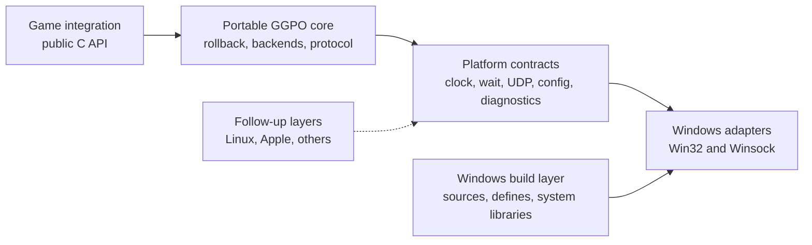

# TECH_PLAN — Platform-agnostic GGPO core and Windows build layer

Status: Planning only  
Source: [`004ffd7`](https://github.com/irregularthanis/ggpo-next/tree/004ffd7f47603d3bae4abd1d541501d715e03279)  
[Product brief](PRD.md) · [Tracker](PROGRESS.md)

## Inspected facts

- [`types.h`](../../../src/lib/ggpo/types.h) selects a platform header; the
  selected header supplies types used throughout otherwise portable code.
- [`Poll`](../../../src/lib/ggpo/poll.h) stores `HANDLE` and
  [`poll.cpp`](../../../src/lib/ggpo/poll.cpp) calls Win32 wait APIs. No in-tree
  caller registers a real handle at this revision; backends use loop/periodic
  polling.
- [`Udp`](../../../src/lib/ggpo/network/udp.cpp) directly owns Winsock handles,
  nonblocking setup, error mapping, send/receive, and address formatting.
- [`ggponet.h`](../../../src/include/ggponet.h) exports a C-linkage API but exposes
  `bool` and `__cdecl`; Windows import/export is already partly abstracted.
- [`src/CMakeLists.txt`](../../../src/CMakeLists.txt) publicly exposes the internal
  include tree. [`CMakeSources.cmake`](../../../src/CMakeSources.cmake) selects a
  syntactically incomplete Unix source, while Windows libraries and definitions
  are configured inline.
- Current validation is the Windows-only [AppVeyor matrix](../../../appveyor.yml).
  The architecture guide records the same gaps in
  [Build](../../architecture/Build.md) and
  [Portability](../../architecture/Portability.md).
- Upstream [PR #81](https://github.com/pond3r/ggpo/pull/81) and older
  [PR #52](https://github.com/pond3r/ggpo/pull/52) prove useful POSIX directions,
  but emulate several Win32 names inside Unix code. This plan instead keeps OS
  names out of the core and preserves attribution for reused logic.

## Target boundary



The platform contract owns semantic operations, not compatibility aliases such
as defining `SOCKET`, `HANDLE`, or `WSAGetLastError` on every OS.

## Planned changes

| Status | File / symbol | Practical edit | Milestone |
| --- | --- | --- | --- |
| Modify | [`ggponet.h`](../../../src/include/ggponet.h) | Add `GGPO_CALL` and complete `GGPO_API`; include C boolean support without changing Windows signatures/layout | M1 |
| Proposed | `tests/api/`, `tests/abi/windows/` | C/C++ consumer fixtures, export manifest, and public layout checks | M0, M1 |
| Modify | [`types.h`](../../../src/lib/ggpo/types.h) | Use fixed-width internal types and include a neutral platform contract | M2 |
| Proposed | `src/platform/common/` | Declare clock/sleep, process/config/diagnostic, wait, and UDP socket semantics | M2 |
| Move/modify | `platform_windows.*`, [`poll.cpp`](../../../src/lib/ggpo/poll.cpp), [`udp.cpp`](../../../src/lib/ggpo/network/udp.cpp) | Implement those contracts on Windows; keep protocol/session logic in core | M2 |
| Proposed | `src/platform/windows/CMakeLists.txt` | Own Windows sources, definitions, `winmm`, and `ws2_32` | M3 |
| Modify | Root and [`src` CMake](../../../src/CMakeLists.txt) | Build portable `GGPO`, select one platform target, install `GGPO::GGPO`, and make internal includes private | M3 |
| Modify | [`appveyor.yml`](../../../appveyor.yml), architecture docs | Run compatibility gates and document the extension point | M4 |

## Contracts and examples

**Proposed public declaration pattern** (the function signatures remain intact):

```c
#if defined(_WIN32)
#  define GGPO_CALL __cdecl
#else
#  define GGPO_CALL
#endif

GGPO_API GGPOErrorCode GGPO_CALL ggpo_idle(GGPOSession *session,
                                            int timeout);
```

**Proposed build ownership:**

```cmake
# src/platform/windows/CMakeLists.txt
add_library(GGPOPlatform STATIC ${GGPO_WINDOWS_SOURCES})
target_link_libraries(GGPOPlatform PRIVATE winmm ws2_32)
target_compile_definitions(GGPOPlatform PRIVATE GGPO_PLATFORM_WINDOWS)

# src/CMakeLists.txt
target_link_libraries(GGPO PRIVATE GGPOPlatform)
target_include_directories(GGPO PUBLIC $<BUILD_INTERFACE:${CMAKE_CURRENT_SOURCE_DIR}/include>)
```

`GGPOPlatform` is private implementation. Consumers continue linking only
`GGPO::GGPO`. The Windows sample remains an app layer and is not generalized.

The public ABI baseline covers exported symbol names and `sizeof`/`offsetof` for
`GGPOPlayer`, `GGPOEvent`, `GGPOSessionCallbacks`, and `GGPONetworkStats`.
Internal C++ classes are not ABI. Packet structure snapshots remain unchanged;
wire normalization belongs to a separately reviewed protocol change.

## Verification

| Layer | Input / command | Required evidence | Failure / skip |
| --- | --- | --- | --- |
| Plan | `validate_plan.py <planning-dir>` | Structural pass and valid links | Any error blocks planning PR completion |
| Windows build | CMake x64 Debug/Release, static/shared | SDK, install tree, and Vector War compile | Any current matrix regression fails |
| Public API | Build C11 and C++98 consumers from installed headers | Compile and link with no internal includes | Either language failure fails |
| ABI | Compare DLL exports and public layout report with M0 baseline | No removed/renamed symbol or layout drift | Difference requires explicit versioned decision |
| Core boundary | Source-contract scan plus target include inspection | No Win32/Winsock/secure-CRT names in portable sources | Match outside allowed Windows layer fails |
| Runtime | SyncTest and two local UDP peers over fixed frame counts | All frames complete; peer checksums match | Missing run or mismatch is inconclusive/fail |
| Follow-up readiness | Header-only GCC/Clang compile on Linux/macOS | Public contract compiles; no SDK binary claim | Unavailable runner is recorded, not passed |

## Implementation order

| Milestone | Depends | Can run with | Deliverable / integration gate |
| --- | --- | --- | --- |
| M0 | — | — | Freeze Windows build, export/layout, wire, and runtime baselines |
| M1 | M0 | M2 | Portable header and installed-consumer fixtures preserve M0 ABI |
| M2 | M0 | M1 | Core uses semantic contracts; Windows adapters preserve runtime baseline |
| M3 | M2 | late M1 | Windows target owns OS inputs; consumer target/install surface is clean |
| M4 | M1, M2, M3 | — | CI, runtime evidence, docs, and follow-up contract agree |

### M0: Freeze Windows contracts

Capture the supported build, export/layout, packet, and runtime evidence before
moving code. These artifacts become the comparison inputs for every later gate.

### M1: Stabilize the public API and ABI

Own `src/include` plus API/ABI fixtures. Make declarations portable while
preserving the M0 Windows ABI and proving installed C and C++ consumption.

### M2: Extract platform services

Own internal core/platform sources. Replace OS names with semantic contracts,
implement them for Windows, and compare runtime behavior with M0.

### M3: Separate the Windows build layer

Own platform selection and Windows CMake wiring. Move OS sources, definitions,
libraries, and install behavior behind the Windows target.

### M4: Integrate and qualify

Combine M1–M3, run all compatibility gates, update architecture documentation,
and publish the stable contract consumed by later platform PRs.

Critical path: M0 → M2 → M3 → M4. M1 can proceed alongside M2 because it owns
the public header and ABI fixtures; coordinate only the target export definitions
with M3. Platform implementations are serialized after this PR because they all
depend on the same frozen contract.

## Decisions and gaps

- Preserve Windows x64 ABI; do not "clean up" public field types in this phase.
- Remove or replace the unused handle-registration path only after M0 runtime
  evidence; absence of current callers is not alone proof of external use.
- The current repository has no automated test suite. M0/M1 fixtures are required
  work, not evidence that already exists.
- Win32/x86 qualification is conditional on establishing a working baseline.
- Linux and Apple build files, event loops, packages, and runtime claims are
  explicitly deferred.

## References

- [Architecture: portability boundaries](../../architecture/Portability.md)
- [Architecture: build graph](../../architecture/Build.md)
- [Architecture: public API](../../architecture/API.md)
- [Upstream Linux discussion](https://github.com/pond3r/ggpo/issues/19)
- [Current narrow POSIX SDK proposal](https://github.com/pond3r/ggpo/pull/81)

