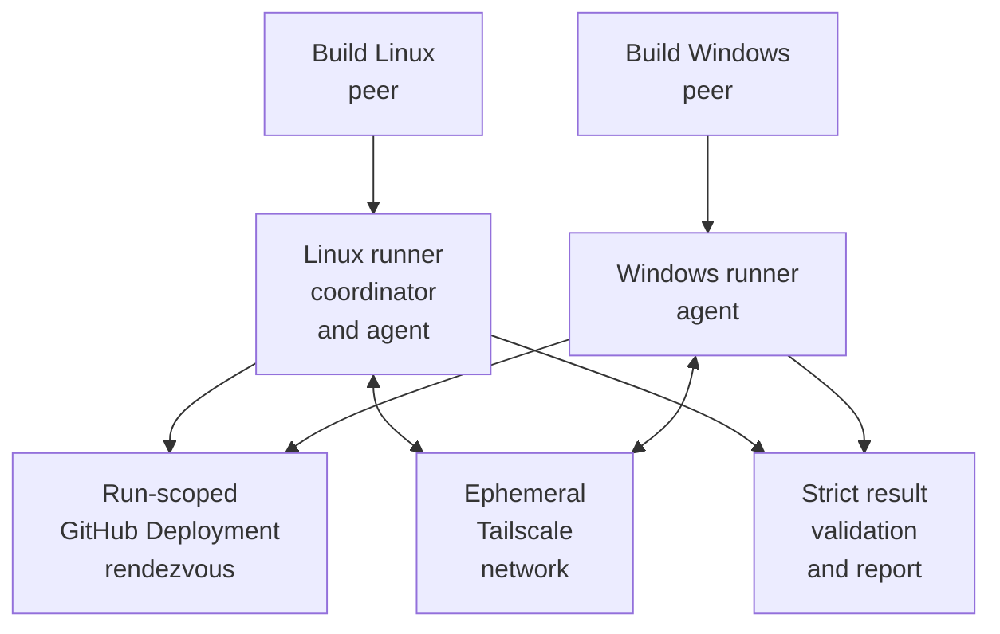

# TECH_PLAN — Native cross-platform end-to-end CI

Status: Planning only

Source: `3ae20afbda22f245d15ac28d67f9bd9d732100ab`

[Product brief](PRD.md) · [Tracker](PROGRESS.md)

## Inspected facts

- [`peer_smoke.cpp`](../../../tests/smoke/peer_smoke.cpp) already runs the production session API and native socket adapter, accepts a remote IP, advances 180 deterministic frames, and writes JSON.
- [`run_peer_smoke.py`](../../../tests/smoke/run_peer_smoke.py) owns same-host process supervision; [`compare_peer_results.py`](../../../tests/smoke/compare_peer_results.py) compares native-host results. Existing negative tests reject startup, timeout, mismatch, and shutdown faults.
- [`SmokeChecksum`](../../../tests/smoke/smoke_session.cpp) hashes native structure bytes, so padding/byte order are unsuitable as the cross-platform contract. The fixture also relies on a fixed one-second drain.
- Current [testing architecture](../../architecture/Testing.md#native-cross-host-smoke) documents a manual Windows↔Linux run; [portability](../../architecture/Portability.md#protocol-considerations) requires native cross-platform evidence.
- Tailscale Action v4.4.0 documents OAuth `auth_keys` scope, mandatory tags, ephemeral nodes, cleanup after logout, and eventual peer visibility. It must be pinned by commit, not a floating major tag.

## Changes

| Status | File / symbol | Practical edit | Milestone | Architecture |
|---|---|---|---|---|
| Modify | `tests/smoke/smoke_session.*`, `peer_smoke.cpp` | Add canonical state bytes, schema 2 identity/lifecycle fields, and a test-only completion barrier without changing GGPO API/wire data | M1 | [Shared deterministic state](../../architecture/Testing.md#shared-deterministic-state) |
| Modify | `tests/smoke/compare_peer_results.py` | Accept schema 1; strictly validate schema 2, scenario identity, canonical checksum, oracle state, events, and closure | M1 | [Native cross-host smoke](../../architecture/Testing.md#native-cross-host-smoke) |
| Add | `tests/e2e/result_schema.py`, tests | Define schema parsing, canonical encoding, independent state oracle, manifest completeness, and known vectors | M1 | [Evidence](../../architecture/Testing.md#evidence-and-interpretation) |
| Add | `tests/e2e/peer_agent.py`, `run_matrix.py`, `rendezvous.py` | Implement allow-listed agent commands, HMAC control messages, run-scoped Deployment discovery, matrix generation, deadlines, and cleanup | M2 | [Network boundaries](../../architecture/Networking.md#network-boundaries) |
| Add | `tests/e2e/test_*.py` | Reject wrong identity/MAC, replay, duplicate/missing scenario, timeout, crash, and unsafe command/path | M2 | [Negative peer contracts](../../architecture/Testing.md#negative-peer-contracts) |
| Add | `.github/workflows/cross-platform-e2e.yml` | Build native artifacts, join ephemeral nodes, execute two concurrent agents, validate with `if: always()`, and upload evidence | M3 | [Build and CI integration](../../architecture/Testing.md#build-and-ci-integration) |
| Modify | `doc/architecture/Testing.md`, `Networking.md`, `Portability.md` | Document the automated boundary, result contract, security/trigger limits, and remaining coverage | M4 | [Testing](../../architecture/Testing.md) |
| Add | `tests/e2e/udp_proxy.py`, seeded profiles | Add reproducible latency/loss after clean matrix stability | M5 | [Transport model](../../architecture/Networking.md#transport-and-endpoint-model) |

## Contracts and flow



The rendezvous environment is `ggpo-e2e-<run_id>-<attempt>`. Linux publishes only its Tailscale IPv4, control port, repository, SHA, run ID, and attempt in a transient Deployment payload. Windows polls that exact environment with a bounded deadline. Linux marks it inactive during unconditional cleanup.

Control requests contain `session_id`, monotonically increasing nonce, operation, arguments, and HMAC. Both jobs derive the HMAC key from `GGPO_E2E_SESSION_SECRET` plus repository/SHA/run/attempt. Agents allow only prepare, launch-peer, status, collect, cancel, and shutdown; executable/result paths must remain under the downloaded workspace.

Proposed schema 2 adds fields without changing schema 1 readers:

```json
{
  "schema": 2,
  "scenario": "linux-windows",
  "run_id": "4242-1",
  "player": 1,
  "platform": "linux",
  "frames": 180,
  "canonical_checksum": 12345678,
  "running_events": 1,
  "unexpected_disconnects": 0,
  "session_closed": true,
  "exit_code": 0
}
```

`SmokeCanonicalBytes` serializes frame, accumulator, and disconnect flags as explicitly sized unsigned 32-bit little-endian values. A Python oracle independently applies the documented input sequence and transition and checks known vectors. The existing native-memory checksum remains available only for legacy schema 1 tests.

At target frame, each fixture writes a ready marker and continues pumping GGPO. The coordinator releases a test-only finalize marker only after both peers are ready; peers then record state and close. This replaces the fixed delay as the success condition while keeping control traffic outside production UDP.

## Workflow and security

Build jobs upload one Release x64 executable bundle each, including shared libraries, commit/toolchain metadata, and SHA-256. Concurrent Linux/Windows jobs download only their native bundle and use:

```yaml
uses: tailscale/github-action@064b10558093f38325e838ddea35486bdc6b1d5c
```

Required secrets are `TS_OAUTH_CLIENT_ID`, `TS_OAUTH_SECRET`, and `GGPO_E2E_SESSION_SECRET`. The Tailscale OAuth client has writable `auth_keys` only for `tag:ggpo-ci`; grants allow that tag only the E2E UDP/control ports. Workflow permissions are `contents: read`, `deployments: write`, and `actions: read`. No `pull_request_target` trigger is allowed.

The final job runs with `if: always()`, downloads both evidence artifacts, and fails if either execution job failed or any scenario/result is missing. Artifacts contain no OAuth/HMAC material.

## Verification

| Layer | Input / command | Required evidence | Failure / skip |
|---|---|---|---|
| Source contract | Existing CTest plus schema/oracle known vectors | Schema 1 compatibility; canonical cross-language vectors | Any existing test or vector mismatch blocks |
| Orchestrator unit | Python tests with fake agents/Deployment API | Matrix generalizes by platform; auth, replay, timeout, crash, duplicates, cleanup fail closed | Missing negative case blocks |
| Native clean matrix | LL, WW, LW, WL; Release x64; 180 frames | Exact four scenarios, expected state, events, closure, hashes and logs | Any absent native runner/secret is incomplete, not pass |
| Reliability | Three consecutive trusted workflow runs | All four scenarios pass each run with no orphan Deployment/node/process | Any intermittent failure blocks required status |
| Nightly impairment | Seeded latency and loss profiles on all four roles | Seed/profile, actual packet decisions, loads and replay frames greater than zero, deterministic final state | No actual impairment/rollback is inconclusive |
| Security | Trusted trigger and artifact review | No fork secret exposure, public port, reusable credential, or secret in logs | Any exposure blocks deployment |

## Implementation order

| Milestone | Depends | Can run with | Deliverable / integration gate |
|---|---|---|---|
| M0 | — | — | Freeze schema, identity, rendezvous, permissions, timeout, and cleanup contracts |
| M1 | M0 | M2, M3 | Canonical fixture/result/oracle contract with legacy compatibility |
| M2 | M0 | M1, M3 | Authenticated agent, rendezvous, matrix, and negative unit suite |
| M3 | M0 | M1, M2 | Native build/execution/report workflow scaffold using pinned Tailscale Action |
| M4 | M1, M2, M3 | — | Four-scenario clean integration and three-run qualification |
| M5 | M4 | — | Seeded latency/loss nightly tier with proven rollback activation |

Critical path: M0 → M1/M2/M3 → M4 → M5. M1 owns smoke/result files, M2 owns `tests/e2e`, and M3 owns the workflow; changes to shared schema imports integrate at M4.

## Decisions / gaps

- GitHub Deployments are the proposed bootstrap record because they can be run-scoped, transient, queried while both jobs remain alive, and cleaned explicitly. A proof in M2 must confirm payload visibility/rate limits before workflow integration.
- The public GGPO API, ABI, packed UDP messages, and production sources do not change.
- Initial workflow execution is trusted-only. Enabling same-repository PRs requires a separate approval policy; fork PRs remain unprivileged.
- Current GGPO code has no public confirmed-frame query. The fixture-level ready/finalize barrier plus independent expected state is the planned completion proof; M1 must reject it if source testing shows predicted state can still pass.

## References

- [Tailscale GitHub Action v4.4.0](https://github.com/tailscale/github-action/releases/tag/v4.4.0) — current official action; pinned commit `064b10558093f38325e838ddea35486bdc6b1d5c`.
- [Testing architecture](../../architecture/Testing.md#native-cross-host-smoke) — existing manual cross-host contract.
- [Networking architecture](../../architecture/Networking.md#transport-and-endpoint-model) — production UDP ownership.
- [Portability architecture](../../architecture/Portability.md#protocol-considerations) — cross-platform wire risks and qualification sequence.
