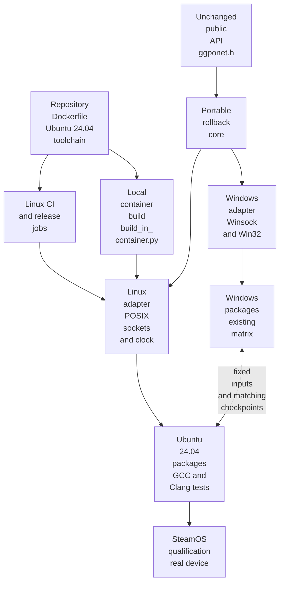

# TECH_PLAN — Linux SDK support

Status: Planning only

Source: `2c339c056c4a210638d88b55083e641e78370ca9`

[Product brief](PRD.md) · [Tracker](PROGRESS.md)

## Inspected facts

- The portable core consumes clock, configuration, filesystem, diagnostics, network lifetime, endpoint, and nonblocking UDP contracts from [`platform.h`](../../../src/lib/ggpo/platform.h). The current semantics are implemented by [`platform_windows.cpp`](../../../src/lib/ggpo/platform_windows.cpp).
- [`src/CMakeLists.txt`](../../../src/CMakeLists.txt) rejects non-Windows hosts and selects [`src/platform/windows/Platform.cmake`](../../../src/platform/windows/Platform.cmake). The checked-in `platform_linux.cpp`/`.h` are incomplete legacy files and are not a supported baseline.
- [`tests/CMakeLists.txt`](../../../tests/CMakeLists.txt) returns immediately outside Windows. Its SyncTest, peer smoke, fake adapter, public-layout, and packet-layout fixtures are reusable after platform-neutral extraction.
- [`run_peer_smoke.py`](../../../tests/smoke/run_peer_smoke.py) currently starts two copies of one executable locally. Cross-OS qualification needs two executable identities and a controlled two-host mode.
- The wire format uses packed native C++ data; the existing [portability guide](../../architecture/Portability.md#protocol-considerations) already requires compiler/layout and cross-platform peer validation.
- No repository-owned Linux Dockerfile or Linux CI workflow exists at the inspected revision. Adding one shared image is new work, not a reuse of an existing recipe.

## Changes

| Status | File / symbol | Practical edit | Milestone | Architecture |
|---|---|---|---|---|
| Modify | `src/CMakeLists.txt`, root CMake | Select Windows or Linux modules; keep unsupported platforms explicit | M1 | [Build](../../architecture/Build.md) |
| Add | `src/platform/linux/Platform.cmake` | Own Linux sources, definitions, threads/system libraries, visibility, and warnings | M1 | [Portability](../../architecture/Portability.md#required-adapter-contracts) |
| Replace | `src/lib/ggpo/platform_linux.cpp`; remove obsolete `.h` | Implement the existing semantic contract with POSIX APIs | M1 | [Runtime](../../architecture/Runtime.md) |
| Add | `docker/linux/Dockerfile` | Define the Ubuntu 24.04 GCC/Clang, CMake, Ninja, test, packaging, and ABI-audit environment once | M1 | [Build](../../architecture/Build.md) |
| Add | `scripts/linux/build_in_container.py` | Build/cache the repository image, mount source/output, select GCC or Clang and static/shared mode, and preserve host ownership | M1 | [Build](../../architecture/Build.md) |
| Modify | `tests/CMakeLists.txt`, smoke fixtures | Separate shared tests from Windows-only layout checks; add Linux matrix | M3 | [Testing](../../architecture/Testing.md) |
| Modify | `tests/smoke/run_peer_smoke.py`; add cross-host runner if needed | Accept distinct peers and emit comparable machine-readable evidence | M2 | [Testing](../../architecture/Testing.md) |
| Add/modify | Linux CI, release workflows, and install docs | Build the same Dockerfile, run the matrix inside it, and package Ubuntu 24.04 x86-64 archives | M3/M4 | [Build](../../architecture/Build.md) |
| Add | `src/cmake/linux_packaging.cmake`, `scripts/ci/package_linux_sdk.py` | Generate DEB/RPM metadata and a raw archive, then extract-test every format | M3 | [Build](../../architecture/Build.md#release-packages) |

## Contracts and flow

The public API remains unchanged. Platform selection changes only private implementation ownership:

```cmake
# Proposed selection; exact helper names may follow repository convention.
if(WIN32)
  include(platform/windows/Platform.cmake)
elseif(CMAKE_SYSTEM_NAME STREQUAL "Linux")
  include(platform/linux/Platform.cmake)
else()
  message(FATAL_ERROR "Unsupported GGPO platform")
endif()
ggpo_configure_platform(GGPO)
```



The Dockerfile is the build-environment source of truth. The local wrapper and CI may supply compiler/library mode and output paths, but must not install substitute toolchains or dependencies outside the image. CI builds the Dockerfile from the checked-out revision, uses layer caching, records the resulting image identity and tool versions, then runs configure, build, CTest, install-consumer, packaging, and ABI-audit commands inside it.

```bash
# Proposed local interface; all compilation and tests execute in the shared image.
python3 scripts/linux/build_in_container.py \
  --compiler gcc --library shared --packages --out build/linux-gcc-shared
```

The wrapper must support ordinary clones and worktrees, explicit external output directories, host UID/GID ownership, clear missing-Docker/daemon failures, and cleanup of temporary containers. The Docker build context excludes build outputs and credentials.

Linux must preserve the meanings already exposed by `platform.h`: monotonic milliseconds, host-order endpoint ports, numeric IPv4 parsing, balanced network startup/shutdown, nonblocking UDP, and `IO_WOULD_BLOCK` only for retryable empty receives. `errno` values such as `EAGAIN`/`EWOULDBLOCK` map to that result; other failures remain `IO_ERROR`.

Linux shared libraries receive a project-major `SOVERSION`. Hidden-by-default visibility may be used only after confirming every `ggpo_*` API export. The v0.1.0 `ggponet.h` is compared byte-for-byte; Linux ABI introduction must not alter Windows ABI.

## Verification

| Layer | Input / command | Required evidence | Failure / skip |
|---|---|---|---|
| Source/API | Header hash/diff against v0.1.0; Windows matrix | Identical public header; all existing Windows lanes green | Any header/Windows regression blocks |
| Linux native | Ubuntu 24.04, GCC/Clang, static/shared; CTest | Four passing lanes, fake adapter, SyncTest, two-peer loopback | Any configuration failure blocks |
| Environment parity | Local wrapper and Linux CI at one revision | Same Dockerfile; recorded image identity and matching compiler/CMake/Ninja versions | Alternate CI/local dependency recipe blocks |
| Installed package | Extract DEB, RPM, and raw tar.gz; external C11 and C++98 consumers using `find_package` | Every format compiles, links, and runs without source-tree includes | Missing format, file, transitive dependency, or export blocks |
| ABI audit | `readelf`, `objdump`, `ldd` | SONAME/exports; max `GLIBC <= 2.39`; recorded `GLIBCXX`/`CXXABI` ceilings | Newer symbol or untracked dependency blocks |
| Cross-host | Native Windows ↔ Ubuntu and native Windows ↔ SteamOS on a controlled LAN, 3×180 frames | Artifact SHAs, OS/toolchain identity, matching checkpoints/checksum/events, and clean exits | Unavailable evidence leaves support unqualified |
| Release | Tag workflow | Separate static/shared Linux x86-64 DEB, RPM, and raw archives plus checksums | No publication until every format passes extraction and consumer audits |

Ordinary GitHub-hosted Windows and Linux jobs are not assumed to share a reachable LAN. The cross-host gate therefore needs controlled/self-hosted machines or a documented release qualification run. Wine is not accepted as evidence of native Windows interoperability.

## Implementation order

| Milestone | Depends | Can run with | Deliverable / integration gate |
|---|---|---|---|
| M0 | — | — | Freeze public-header identity, adapter semantics, package ceiling, and evidence schema |
| M1 | M0 | M2 | Build the Linux adapter, shared container image, and local wrapper without core/API edits |
| M2 | M0 | M1 | Deliver a distinct-peer local/remote runner with deterministic comparable evidence |
| M3 | M1 | late M2 | Pass GCC/Clang × static/shared tests and installed-consumer/package audits |
| M4 | M2, M3 | — | Pass native Windows↔Linux/SteamOS gates; enable release and docs |

Critical path: M0 → M1 → M3 → M4. M2 can proceed beside M1 because it owns the runner rather than adapter files. Changes to `tests/CMakeLists.txt` are integrated in M3 to avoid concurrent edits.

## Decisions / gaps

- Ubuntu 24.04 is the build baseline because its glibc 2.39 ceiling is older than current SteamOS 3.9.5 glibc 2.43. This is forward compatibility by symbol requirement, not ABI identity.
- The repository Dockerfile is the reproducibility boundary. Ubuntu package repositories are not snapshot-pinned initially; image identity, installed versions, and the source revision are recorded with evidence.
- Clang packages use Ubuntu 24.04's default C++ runtime unless a later requirement justifies a separate libc++ artifact.
- Release artifacts come from GCC lanes only; Clang remains a build-compatibility lane. DEB and RPM install under `/usr`, while tar.gz remains prefix-local.
- Internet/NAT traversal, loss simulation, spectators, more than two peers, and Linux Vector War are follow-ups.
- Native Windows↔SteamOS qualification infrastructure is not yet identified; M0 must name the controlled hosts before M4 can complete.

## References

- [Ubuntu release list](https://ubuntu.com/project/docs/release-team/list-of-releases/) — LTS ordering.
- [Ubuntu 24.04 libc6](https://packages.ubuntu.com/noble/libc6) — glibc 2.39 baseline.
- [SteamOS 3.9.5 package manifest](https://steamdeck-images.steamos.cloud/steamdeck/20261023.100/steamdeck-20261023.100-3.9.5.manifest.pacman) — glibc 2.43 device baseline.
- [Portability architecture](../../architecture/Portability.md) — current boundary and port sequence.
