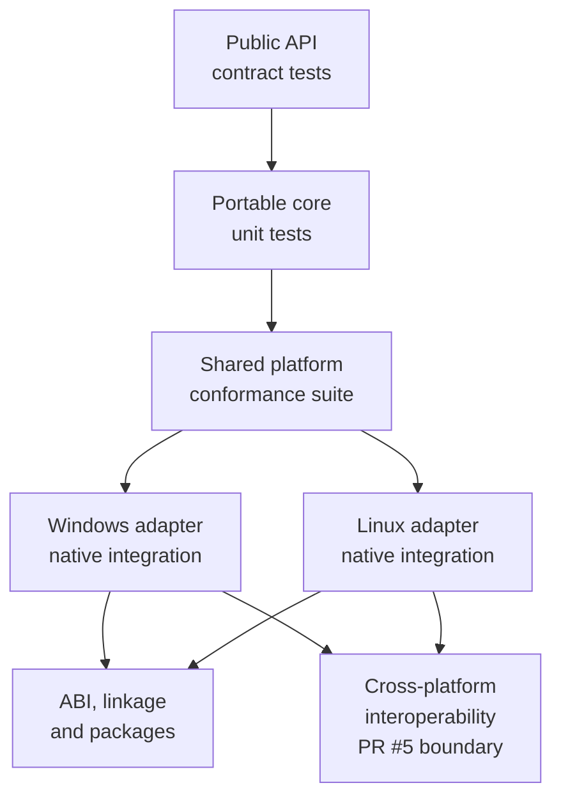

# TECH_PLAN — Shared-core testing and CI consolidation

Status: Planning only

Source: `d427210dc4b68f30dc6747de1a912dd6af4a3397`

[Product brief](PRD.md) · [Tracker](PROGRESS.md)

## Inspected facts

- Current `master` differs from the supplied `8a0b40f` baseline only in
  CODEOWNERS, owner-approval CI, and developer documentation; runtime/testing
  sources are unchanged.
- [`ggponet.h`](../../../src/include/ggponet.h) exports 16 functions. Current
  smoke directly exercises session creation, player registration, idle, local
  input, synchronization, frame advance and close; other exports are partial or
  untested as explicit contracts.
- [`tests/CMakeLists.txt`](../../../tests/CMakeLists.txt) defines layout, SyncTest,
  peer loopback/negative, fake-core SyncTest and fake-platform contracts. There
  are no focused `InputQueue`, `TimeSync`, container, malformed-packet, or
  reusable native-adapter conformance targets.
- The platform boundary is 15 operations in
  [`platform.h`](../../../src/lib/ggpo/platform.h): clock/wait/process,
  configuration, diagnostics/filesystem, endpoint conversion, network lifetime,
  and UDP socket lifecycle/I/O.
- Regular compatibility CI currently has four Linux SDK lanes and eight Windows
  baseline variants, plus Windows final compatibility and two header jobs.
  Release packaging and installed-consumer qualification are separate gates.

## Current inventories

| Surface | Existing evidence | Main gap |
|---|---|---|
| `InputQueue`, `Sync`, `TimeSync` | [`synctest_smoke.cpp`](../../../tests/smoke/synctest_smoke.cpp) | Focused boundaries, repeated rollback and time-history cases |
| Ring/static buffers, bit vector | Indirect production use | Empty/full, wrap, boundary and reuse invariants |
| 16 public functions | Peer/SyncTest smoke and DLL exports | Explicit backend, lifecycle, error and unsupported-operation matrix |
| Platform contract | [`platform_fake_test.cpp`](../../../tests/platform/fake/platform_fake_test.cpp) | One assertion source against both real adapters |
| UDP representation | Frozen Windows sizes/offsets | Malformed lengths/types and compiler/endian assumptions |
| Native integration | Windows/Linux loopback and consumers | Keep; do not substitute deterministic tests |

## Changes

| Status | File / symbol | Practical edit | Milestone | Architecture |
|---|---|---|---|---|
| Add | `doc/testing/*.md` or generated evidence directory | API, core, platform and CI baseline inventories | M0 | [Testing layers](../../architecture/Testing.md#test-layers) |
| Add | `tests/unit/*` | Focused InputQueue, Sync, TimeSync and utility invariants | M1 | [Portable core](../../architecture/Portability.md#portable-core) |
| Add | `tests/contract/*` | Reusable public API lifecycle/error suite | M2 | [Runtime fixtures](../../architecture/Testing.md#runtime-fixtures) |
| Modify | `tests/platform/fake/*`; add `tests/platform/conformance/*` | Deterministic transport capabilities and shared native adapter assertions | M3 | [Required adapter contracts](../../architecture/Portability.md#required-adapter-contracts) |
| Add | `tests/unit/protocol_test.cpp` | Valid boundary and malformed packet cases without changing wire format | M4 | [Wire messages](../../architecture/Networking.md#wire-messages) |
| Modify | `tests/CMakeLists.txt`, root CMake | Label portable/native/ABI suites and preserve existing CTest names | M1–M4 | [Build integration](../../architecture/Testing.md#build-and-ci-integration) |
| Modify | compatibility workflows and `scripts/ci/*` | Add sanitizer/full tiers, then reduce regular duplication from evidence | M5 | [Build architecture](../../architecture/Build.md) |
| Modify | architecture docs | Document test ownership, adapter qualification and CI tiers | M6 | [Testing](../../architecture/Testing.md) |

## Contracts and flow



Portable tests compile production classes with controlled callbacks/fakes; they
must not reproduce the algorithm under test. Expected queue, rollback and state
results come from explicit sequences or independent reference simulation.

The API inventory records for each export: applicable backend, valid lifecycle,
documented errors, observable-but-unspecified behavior, test, and status. A
negative assertion becomes compatibility only after the project decides that
behavior is intended.

The conformance suite calls the same `ggpo_platform` API on each native adapter.
Platform-specific setup may select an adapter, but mandatory assertions cannot
silently skip. Timing checks use monotonicity and bounded deadlines—not exact
host scheduling durations.

```cmake
# Proposed labels; existing test names remain stable.
set_tests_properties(input_queue_contract sync_contract timesync_contract
  PROPERTIES LABELS "portable;core")
set_tests_properties(platform_conformance
  PROPERTIES LABELS "native;platform")
```

## Verification

| Layer | Input / method | Required evidence | Failure / skip |
|---|---|---|---|
| Audit | Header/source/test/workflow inventory | 16 exports, core/platform maps, current job/runtime baseline | Missing entry blocks consolidation |
| Core | Fixed sequences, independent state oracle | Boundaries and activation counters; repeatable CTest | No exercised path is inconclusive |
| API | Shared fixture across peer/SyncTest/spectator applicability | Documented result, callbacks and cleanup | Undefined input is classified, not guessed |
| Platform | Same source on fake, Windows and Linux | Mandatory clock/UDP/lifecycle/config contracts | Native skip blocks platform qualification |
| Protocol | Valid and malformed datagrams | Layout remains frozen; invalid lengths fail safely where supported | Wire change requires separate design |
| Compatibility | Existing x64/Win32, static/shared, installed consumers and packages | All current gates pass before/after | Any regression blocks CI reduction |
| CI economics | Comparable Actions runs | Job count, runner minutes, critical path, retries and cache effectiveness | No measured improvement means keep matrix |

## Implementation order

| Milestone | Depends | Can run with | Deliverable / integration gate |
|---|---|---|---|
| M0 | — | — | Freeze inventories, test ownership and CI baseline; remove nothing |
| M1 | M0 | M2, M3 | Core/unit targets and independent oracles |
| M2 | M0 | M1, M3 | Public API classification and contract fixtures |
| M3 | M0 | M1, M2 | Fake capabilities plus reusable native conformance |
| M4 | M1, M3 | M2 | Protocol boundary/malformed cases; unchanged wire baseline |
| M5 | M1, M2, M3, M4 | — | Demonstrate replacement coverage, add sanitizer/full tiers, then consolidate PR CI |
| M6 | M5 | — | Architecture, local commands and new-platform qualification guide |

Critical path: M0 → M1/M3 → M4 → M5 → M6. M1–M3 own separate test
directories but share CMake registration; land target registration after target
names/contracts are frozen. CI reduction is deliberately serialized after
coverage evidence.

## Decisions / gaps

- PR #5 is held separately and is not a dependency for M1–M4. M6 documents its
  smoke/result interface as the interoperability boundary.
- Exact runner-minute and critical-path baselines must be captured from Actions
  during M0; job counts alone are not cost evidence.
- Adapter registration changes are optional. Keep current compile-time Windows/
  Linux selection unless a third adapter proves the existing modules inadequate.
- Sanitizer flags must instrument GGPO and tests, not only test executables.

## References

- [Testing architecture](../../architecture/Testing.md)
- [Build architecture](../../architecture/Build.md)
- [Portability boundary](../../architecture/Portability.md)
- [Networking and wire model](../../architecture/Networking.md)
- [Cross-platform E2E draft PR #5](https://github.com/irregularthanis/ggpo-next/pull/5)
