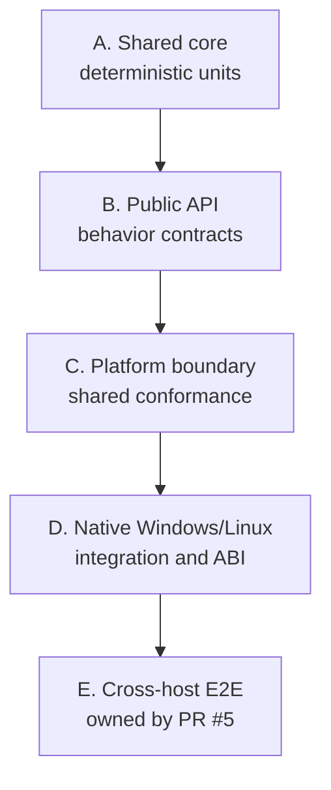

# TECH_PLAN — Shared-core testing and CI consolidation

Status: Planning only

Source: `d427210dc4b68f30dc6747de1a912dd6af4a3397`

[Product brief](PRD.md) · [Tracker](PROGRESS.md)

## Verified baseline

- [`ggponet.h`](../../../src/include/ggponet.h) exports 16 `ggpo_*` functions.
- [`platform.h`](../../../src/lib/ggpo/platform.h) defines 12 namespace functions
  and four `UdpSocket` operations, plus constructor/destructor lifecycle.
- [`tests/CMakeLists.txt`](../../../tests/CMakeLists.txt) registers Windows layout,
  SyncTest, two-process loopback, negative runner, fake-core SyncTest and fake
  platform tests. It has no focused queue, time-sync, container, malformed-wire,
  API lifecycle, or reusable native-adapter suite.
- Required checks are four Linux SDK variants, eight Windows baseline variants,
  frozen Windows compatibility, two public-header compilers, and owner approval.
  Packaging and installed-consumer checks remain separate release evidence.

## Test architecture



Layers A–C reuse production algorithms with controlled callbacks or adapters;
they do not reproduce GGPO as a second implementation. Layer D retains native
sockets, clocks, shared/static consumers, exports and packages. [PR #5](https://github.com/irregularthanis/ggpo-next/pull/5)
owns canonical peer results, completion barriers, Tailscale orchestration and
network impairment for layer E.

## Current coverage inventory

| Surface | Direct evidence now | Classification | Proposed contract |
|---|---|---|---|
| `InputQueue` | Exercised through SyncTest | Indirect | Order, prediction, confirmation, mismatch, earliest incorrect frame, delay, wrap and bounds |
| `Sync` | [`synctest_smoke.cpp`](../../../tests/smoke/synctest_smoke.cpp) | Partial | Snapshot retention/eviction, rollback/replay, repeated rollback, callback order, ownership and convergence |
| `TimeSync` | Peer runtime only | Indirect | Synthetic local/remote frame histories and recommendation boundaries |
| Ring/static buffers, bit vector | Production use only | Indirect | Empty/full, capacity, wrap, reuse and bit boundaries |
| UDP protocol | Frozen Windows layout | Partial | Valid edges, length/type/payload limits, truncated/unknown/malformed messages, sequence and acknowledgements |
| Native adapters | Loopback on each OS | Partial | One shared mandatory conformance source plus native setup |
| SDK/ABI | Consumers, Windows exports/layout, Linux audit | Direct | Preserve all existing evidence |

## Public API coverage map

“Partial” means a smoke path calls the function but does not establish its full
lifecycle/error contract. Unsupported and unspecified inputs are classified;
tests must not freeze accidental undefined behavior.

| Export | Backend / lifecycle | Current evidence | Proposed coverage |
|---|---|---|---|
| `ggpo_start_session` | P2P creation | Peer smoke | Valid/invalid player and input sizes; callback/socket failure cleanup |
| `ggpo_add_player` | P2P/SyncTest registration | Both smokes | Local/remote/spectator handles, capacity, duplicate/invalid registration |
| `ggpo_start_synctest` | SyncTest creation | SyncTest smoke | Valid/invalid frames and sizes; callback failure cleanup |
| `ggpo_start_spectating` | Spectator creation | Missing | Endpoint, player/input limits, startup and cleanup failures |
| `ggpo_close_session` | All backends, terminal | Both smokes | Each backend and partially initialized sessions |
| `ggpo_set_frame_delay` | Registered local player | Missing | Valid handles/delays and invalid lifecycle/handle cases |
| `ggpo_idle` | Active session | Partial | Backend applicability, bounded progress and shutdown state |
| `ggpo_add_local_input` | Active local player | Partial | Size, handle, synchronization and prediction-window outcomes |
| `ggpo_synchronize_input` | Active frame | Partial | Output/disconnect flags, buffer size and backend behavior |
| `ggpo_disconnect_player` | P2P player | Missing | Local/remote/invalid handles and idempotence decision |
| `ggpo_advance_frame` | After synchronized input | Partial | Callback ordering, repeated/invalid lifecycle and rollback behavior |
| `ggpo_get_network_stats` | Network peer | Missing | Connected/disconnected/local/unsupported backend results |
| `ggpo_set_disconnect_timeout` | P2P configuration | Missing | Pre/post-registration timing and boundary values |
| `ggpo_set_disconnect_notify_start` | P2P configuration | Missing | Ordering and boundary values relative to timeout |
| `ggpo_log` | Session diagnostics | Missing | Null/closed/session applicability without asserting log text |
| `ggpo_logv` | Session diagnostics | Missing | Same contract through a controlled variadic wrapper |

The implementation milestone turns this into a versioned evidence table with
test names, expected errors, and explicit “observable”, “documented”,
“unspecified”, or “future hardening” status for each negative input.

## Platform contract inventory

| Group | Operations from `platform.h` | Required assertions |
|---|---|---|
| Time/process | `MonotonicTimeMs`, `WaitMs`, `ProcessId` | Monotonic units, zero/bounded wait, stable nonzero process identity where promised |
| Configuration | `GetConfigInt`, `GetConfigBool` | Missing/default, valid values, malformed values and platform source |
| Diagnostics/files | `AssertFailed`, `EnsureDirectory` | Observable failure policy, create/existing/error and cleanup |
| Endpoints | `ParseUdpEndpoint`, `SameUdpEndpoint`, `FormatUdpEndpoint` | IPv4/port representation, invalid address, round-trip and buffer bounds |
| Network lifetime | `NetworkStartup`, `NetworkShutdown` | Balanced/repeated setup and cleanup/failure semantics |
| UDP socket | `OpenAndBind`, `Send`, `Receive`, `Close` | Port selection, would-block/error, capacity/source, repeated close and resource release |

The same assertion source runs on fake, Windows and Linux. Native-only setup may
differ, but mandatory cases cannot silently skip. Exact scheduler timing is not
a contract; monotonicity and bounded deadlines are.

## Deterministic fake capabilities

Extend [`tests/platform/fake/platform_fake.cpp`](../../../tests/platform/fake/platform_fake.cpp)
only when a concrete
regression needs it: virtual monotonic time, in-memory UDP, scripted open/send/
receive failures, loss, delay, duplication, reordering, closure and recovery.
Use fixed seeds, no real sleeps and independent expected event sequences. The
fake remains an adapter to production code—not a second network protocol.

```cpp
// Existing production boundary; tests exercise this interface unchanged.
IoResult Send(const void *data, int bytes, const UdpEndpoint &to);
IoResult Receive(void *data, int capacity, int *bytes, UdpEndpoint *from);
```

## Planned repository changes

| Status | Path | Practical change | Milestone |
|---|---|---|---|
| Add | `doc/testing/` or generated evidence directory | API/core/platform/CI inventories with test references | M0 |
| Add | `tests/unit/` | InputQueue, Sync, TimeSync, containers and protocol cases | M1, M4 |
| Add | `tests/contract/` | Backend-aware public API fixture and 16-export matrix | M2 |
| Extend | `tests/platform/fake/` | Only capabilities required by deterministic failure cases | M3, M4 |
| Add | `tests/platform/conformance/` | Shared assertions selected against fake/Windows/Linux | M3 |
| Modify | `tests/CMakeLists.txt`, root CMake | Stable targets and `portable`, `native`, `abi` labels | M1–M4 |
| Modify | workflows and `scripts/ci/` | Evidence-gated PR/full/release tiers and sanitizers | M6 |
| Modify | Testing, Build, Portability docs | Verified test ownership and new-platform checklist | M5, M7 |

## Native and future-platform qualification

Windows keeps Winsock, clocks, DLL exports/imports, calling conventions,
x64/Win32, shared/static, frozen layouts and cross-revision DLL checks. Linux
keeps POSIX sockets/clocks, symbol/loading audits, static consumers, installed
packages and GCC/Clang coverage.

A new platform is “supported” only after it:

1. Implements the verified `platform.h` contract and compiles the portable core.
2. Passes shared core, API and mandatory platform conformance.
3. Passes native loopback, linkage/package, lifecycle and documentation checks.
4. Publishes its limitations and CI lane.
5. Completes cross-host interoperability through PR #5’s result/orchestration
   contract when that infrastructure is available.

This does not promise macOS, FreeBSD, mobile or console support and does not
force adapter-registration refactoring before a real third port needs it.

## CI consolidation design

M0 records job count, runner minutes, critical path, test duration, cache use,
retries and failure distribution. Coverage lands before matrix reduction.

Proposed regular PR evidence—not a predetermined final matrix—is one Linux GCC
Debug comprehensive lane, Linux GCC Release shared/native/package plus a static
consumer, and Windows x64 Release shared/native/ABI plus static. Full compiler,
architecture, configuration and linkage matrices remain nightly/manual/release
until measurements prove an equivalent gate. ASan/UBSan must instrument GGPO
production objects as well as tests.

No required check is renamed or removed until branch protection and replacement
evidence are coordinated. If measured cost or gate equivalence is inconclusive,
the current matrix remains.

## Verification matrix

| Layer | Method | Passing evidence | Blocking result |
|---|---|---|---|
| Audit | Header/source/test/workflow inventory | All exports, core/platform surfaces and required checks mapped | Missing entry |
| Core | Fixed sequences and independent state oracle | Repeatable CTest; rollback path/count proven | Path not exercised |
| API | Shared backend-aware fixtures | Expected return, callbacks, ownership and cleanup | Guessed undefined behavior |
| Platform | Same assertions on fake/Windows/Linux | Mandatory clock/UDP/lifecycle/config cases | Native skip or divergent units |
| Protocol | Valid and malformed datagrams | Frozen layout; supported invalid inputs fail safely | Wire/ABI change |
| Native/ABI | Existing matrices, consumers, packages and loopback | All retained checks pass | Any regression |
| CI economics | Comparable Actions runs | Lower runner cost/critical path without lost gates | No measured improvement |
| E2E boundary | PR #5 schema/artifact compatibility | Native peers consumable by its harness | Duplicate orchestration |

## Milestones and dependencies

| Milestone | Depends | Parallel with | Deliverable |
|---|---|---|---|
| M0 | — | — | Coverage/CI audit: frozen inventories, ownership and baseline; remove nothing |
| M1 | M0 | M2, M3 | Shared-core contracts: deterministic InputQueue/Sync/TimeSync/utility tests |
| M2 | M0 | M1, M3 | Public API contracts: backend/lifecycle/error coverage for all 16 exports |
| M3 | M0 | M1, M2 | Platform conformance: fake capabilities and one Windows/Linux assertion suite |
| M4 | M1, M3 | M2 | Protocol robustness: deterministic boundaries/failures; unchanged wire |
| M5 | M1, M2, M3, M4 | — | Portability qualification: new-platform checklist and native evidence |
| M6 | M1, M2, M3, M4, M5 | — | CI consolidation: measured tiers and production sanitizers |
| M7 | M3, M5 | M6 | E2E readiness: documented artifact/result boundary with PR #5 |

Critical path: M0 → M1/M3 → M4 → M5 → M6. M1–M3 own separate
directories and can proceed concurrently after names/fixtures are frozen. M7
does not reimplement PR #5.

## References

- [Testing architecture](../../architecture/Testing.md)
- [Build architecture](../../architecture/Build.md)
- [Portability boundary](../../architecture/Portability.md)
- [Networking and wire model](../../architecture/Networking.md)
- [Cross-platform E2E draft PR #5](https://github.com/irregularthanis/ggpo-next/pull/5)
