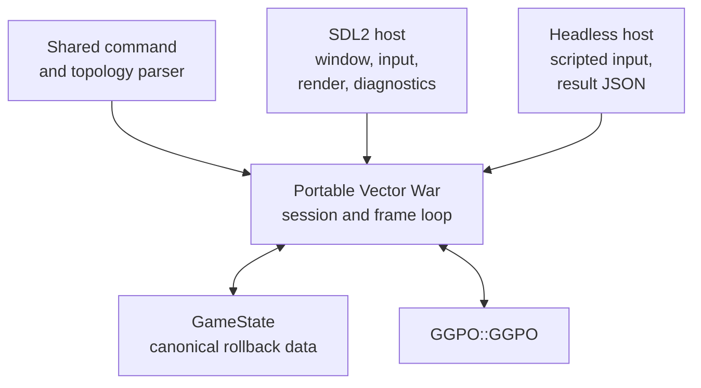

# TECH_PLAN — Portable Vector War and application E2E

Status: Implementation in progress

Source: `5184cbf2d0e094c063d704e139631a6db94323bc`

[PRD](PRD.md) · [Tracker](PROGRESS.md)

## Inspected facts

- [`main.cpp`](../../../src/apps/vectorwar/main.cpp) owns Win32 windowing,
  messages, command parsing, scheduling, Winsock lifetime, and keyboard events.
- [`vectorwar.cpp`](../../../src/apps/vectorwar/vectorwar.cpp) mixes GGPO
  callbacks with `HWND`, GDI construction, `Sleep`, `timeGetTime`, virtual-key
  polling, and secure-CRT calls.
- [`GameState::Init`](../../../src/apps/vectorwar/gamestate.cpp) derives rollback
  bounds from a window handle. [`gdi_renderer.cpp`](../../../src/apps/vectorwar/gdi_renderer.cpp)
  and [`ggpo_perfmon.cpp`](../../../src/apps/vectorwar/ggpo_perfmon.cpp) are GDI-only.
- The existing [Vector War guide](../../architecture/VectorWar.md) documents the
  full sample flow and explicitly describes it as Windows-only.
- PR #5 supplies authenticated native LL/WW/LW/WL orchestration and canonical
  result validation. Its synthetic peer remains the lower-level library gate;
  Vector War is an additional application-consumer gate.
- Upstream [PR #57](https://github.com/pond3r/ggpo/pull/57) contains an incomplete
  SDL2 port. Only app/frontend ideas or code with attribution are candidates for
  reuse; its obsolete SDK platform changes are not.

## Changes

| Status | File / symbol | Practical edit | Milestone | Architecture |
| --- | --- | --- | --- | --- |
| Modify | `gamestate.*`, `nongamestate.h` | Replace Win32 `RECT/HWND` inputs with explicit fixed-width arena/host data; add canonical state serialization | M0–M1 | [State ownership](../../architecture/VectorWar.md#6-state-ownership) |
| Add | `vectorwar_app.*`, `vectorwar_host.h` | Own callbacks, session lifecycle, scripted/live input, clock, sleep, renderer, and result contract behind platform-neutral interfaces | M1 | [Normal frame](../../architecture/VectorWar.md#4-normal-frame) |
| Add | `sdl_main.cpp`, `sdl_renderer.*`, `sdl_perfmon.*` | Implement one SDL2 frontend for Windows and Linux, including current controls and diagnostics | M2 | [Rendering](../../architecture/VectorWar.md#8-rendering-and-diagnostics) |
| Add | `headless_main.cpp`, `tests/vectorwar/*` | Run deterministic application sessions without a display and emit strict JSON evidence | M3 | [Testing layers](../../architecture/Testing.md#test-layers) |
| Modify | root/app CMake, Dockerfile, Linux/Windows CI | Discover SDL2, build both hosts, run tests by default, and retain SDK-only opt-out | M2–M4 | [Build graph](../../architecture/Build.md#build-graph) |
| Modify after #5 | native E2E workflow and `tests/e2e` validators | Add a `vectorwar` fixture dimension using the existing authenticated control plane | M4 | [PR #5](https://github.com/irregularthanis/ggpo-next/pull/5) |
| Modify | architecture and developer docs | Describe portable host boundaries, commands, results, and test interpretation | M4 | [Vector War](../../architecture/VectorWar.md) |

## Contracts and flow

The public GGPO surface does not change. Proposed internal host boundary:

```cpp
struct VectorWarHost {
   virtual ~VectorWarHost() {}
   virtual int ReadLocalInput() = 0;
   virtual unsigned int NowMs() = 0;
   virtual void SleepMs(unsigned int milliseconds) = 0;
   virtual Renderer *GetRenderer() = 0;
};

void VectorWar_Init(const VectorWarConfig &config, VectorWarHost *host);
```

This is a proposed C++98-compatible shape, not an executed API. The interactive
and headless hosts must call the same `VectorWar_RunFrame`, save/load/replay,
event, spectator, and shutdown paths.



M0 first records a controlled Windows trace from the current implementation:
fixed arena dimensions, player count, input script, frame count, canonical
field encoding, and final digest. The port must match it. Floating-point fields
are serialized by explicit IEEE-754 bit pattern rather than raw structure
memory; padding and native `RECT` layout are excluded.

The headless result adds fixture identity, source/run/scenario identity,
canonical digest, frames, saves, loads, replayed frames, GGPO events,
disconnects, and closure status. The independent validator checks the frozen
input trace and golden checkpoints. A peer-only match is insufficient.

SDL2 is a sample dependency, not a public SDK dependency. Linux obtains it from
the repository Dockerfile; Windows CI installs pinned x64/x86 packages. An SDK
build with `GGPO_BUILD_VECTORWAR=OFF` remains SDL-free.

## Verification

| Layer | Input / command | Required evidence | Failure / skip |
| --- | --- | --- | --- |
| Frozen behavior | Current Windows Vector War simulation with fixed bounds and scripted inputs | Versioned checkpoints and canonical digest | Cannot refactor before baseline exists |
| Portable application | Unit/contract tests for parser, bounds, input, save/load, frame and event state | Same cases on Windows and Linux | Platform-only implementation blocks |
| Frontend smoke | SDL dummy/software driver; create, render one frame, process input event, close | Clean lifecycle on Windows x64/x86 and Linux GCC/Clang | Missing SDL or display fallback fails relevant lane |
| Local integration | Two headless app processes, 180 frames, scripted inputs | Golden state, nonzero rollback, clean close | Matching peers without oracle is failure |
| Native application E2E | Generic peer and Vector War fixtures each run LL, WW, LW, WL through PR #5 orchestration | Exact eight-report manifest and native artifact hashes | Missing fixture/platform/role is incomplete |
| Regression | Existing SDK compatibility, API, ABI, protocol, package, sanitizer tests | No changed public contract | Any regression blocks |

## Implementation order

| Milestone | Depends | Can run with | Deliverable / integration gate |
| --- | --- | --- | --- |
| M0 | PR #5 available for integration planning | — | Freeze current sample behavior, features, CLI, canonical trace, and internal host contracts |
| M1 | M0 | — | Extract portable state/session/frame core while the existing Windows host still passes the baseline |
| M2 | M1 | M3 | SDL2 interactive Windows/Linux frontend and build provisioning; owns app UI files |
| M3 | M1 | M2 | Headless host, application contracts, local loopback, and strict result schema; owns tests/headless files |
| M4 | M2, M3, merged PR #5 | — | Integrate native application matrix, documentation, and complete qualification evidence |

Critical path: M0 → M1 → M3 → M4. M2 and M3 can proceed together only after
the host contract freezes. CMake/source inventories are shared integration
points and should be reconciled once at M4.

## Decisions / gaps

- Retain one portable SDL2 renderer instead of maintaining parallel GDI and SDL
  feature implementations. The frozen baseline protects behavior, not pixel
  identity.
- Port the performance monitor rather than silently dropping it; exact graph
  styling is not a deterministic correctness contract.
- Window placement is best effort because Wayland may reject explicit
  positioning. Topology, controls, state, status, and diagnostics remain
  required.
- Do not make GUI automation the native networking oracle. Headless execution
  exercises the same application code and produces reviewable results; SDL has
  a separate lifecycle smoke.
- Apple and mobile enter scope only after their SDK adapters become supported.

## References

- [Vector War architecture](../../architecture/VectorWar.md)
- [Build architecture](../../architecture/Build.md)
- [Portability contract](../../architecture/Portability.md#follow-up-platform-contract)
- [Native E2E PR #5](https://github.com/irregularthanis/ggpo-next/pull/5)
- [Upstream SDL2 RFC PR #57](https://github.com/pond3r/ggpo/pull/57)
