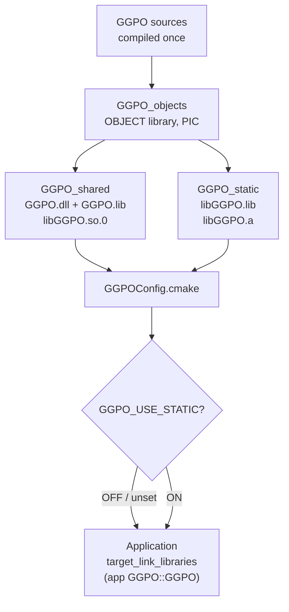

# TECH_PLAN — Dual-linkage SDK and CI consolidation

Status: In progress

Source: `59d831be59b1a6ff5a35bde31f112cfe7a3837ca`

[Product brief](PRD.md) · [Tracker](PROGRESS.md)

## Verified baseline

- [`src/CMakeLists.txt`](../../../src/CMakeLists.txt) defines one `GGPO`
  target whose type follows `BUILD_SHARED_LIBS`, aliased as `GGPO::GGPO`, and
  installs one `GGPOTargets.cmake` export.
- [`GGPOConfig.cmake.in`](../../../src/cmake/GGPOConfig.cmake.in) only includes
  that export.
- [`ggponet.h`](../../../src/include/ggponet.h) selects `dllexport` /
  `dllimport` from `GGPO_SHARED_LIB` and `GGPO_SDK_EXPORT`. The Windows
  [`Platform.cmake`](../../../src/platform/windows/Platform.cmake) publishes
  `GGPO_SHARED_LIB` as a public definition for shared builds.
- [`linux_packaging.cmake`](../../../src/cmake/linux_packaging.cmake) names
  packages `ggpo-sdk-shared` / `ggpo-sdk-static`, which conflict with each other.
- [`tests/consumer`](../../../tests/consumer/CMakeLists.txt) builds C11 and
  C++98 programs against `GGPO::GGPO` from the single installed flavor.
- Workflows: [`windows-compatibility.yml`](../../../.github/workflows/windows-compatibility.yml)
  (8 lanes), [`linux-compatibility.yml`](../../../.github/workflows/linux-compatibility.yml)
  (4 lanes), [`release-packages.yml`](../../../.github/workflows/release-packages.yml)
  (6 SDK jobs + 3 Vector War + publish),
  [`sanitizer-qualification.yml`](../../../.github/workflows/sanitizer-qualification.yml)
  (weekly Linux ASan+UBSan), and the cross-platform E2E (static Release x64,
  unchanged).

## Target design

### Build

- New options `GGPO_BUILD_SHARED` and `GGPO_BUILD_STATIC`, both `ON` by
  default. If neither is set explicitly, `BUILD_SHARED_LIBS` still selects a
  single flavor, so existing build scripts keep working.
- Each flavor compiles the sources itself. An `OBJECT` library shared by both
  was considered, but Windows needs `GGPO_SDK_EXPORT` only for the DLL, and the
  library is small enough that compiling it twice costs little. (Changed during
  M1.)
- In-tree alias `GGPO::GGPO` points at the shared library when it is built,
  otherwise the static one, so tests and Vector War keep working.

### Install and CMake package

- On Windows the static target sets `OUTPUT_NAME libGGPO`, producing
  `libGGPO.lib` next to the DLL import library `GGPO.lib` (the
  `lib`-prefixed static convention used by other MSVC SDKs).
- Separate exports: `GGPOSharedTargets.cmake` (`GGPO::shared`) and
  `GGPOStaticTargets.cmake` (`GGPO::static`). Each is optional.
- `GGPOConfig.cmake` includes whichever exports exist and creates
  `GGPO::GGPO` as an `INTERFACE IMPORTED` target:
  - `GGPO_USE_STATIC` unset: shared if installed, otherwise static.
  - `GGPO_USE_STATIC=ON`: static, or fail with a clear message.
  - `GGPO_USE_STATIC=OFF`: shared, or fail with a clear message.
- Support `find_package(GGPO COMPONENTS shared static)` so a missing flavor
  fails at configure time.
- `GGPO::shared` carries `GGPO_SHARED_LIB` as an interface definition on
  Windows; `GGPO::static` never does.

### Packages

| Platform | Before | After |
|---|---|---|
| Windows | `ggpo-V-windows-{x64,x86}-{shared,static}.zip` | `ggpo-V-windows-{x64,x86}.zip` containing `bin/GGPO.dll`, `lib/GGPO.lib`, `lib/libGGPO.lib`, PDBs |
| Linux tar.gz | `ggpo-V-linux-x86_64-{shared,static}.tar.gz` | `ggpo-V-linux-x86_64.tar.gz` with `libGGPO.so*` and `libGGPO.a` |
| Linux DEB/RPM | Conflicting `ggpo-sdk-shared` / `ggpo-sdk-static` | One `ggpo-sdk` DEB and RPM that replace and provide both old names |

A distro-style split into `libggpo0` + `libggpo-dev` is out of scope for this
work and can follow later.

## Test and CI consolidation

### Installed consumers

Rewrite [`tests/consumer`](../../../tests/consumer/CMakeLists.txt) to configure
three times against one installed SDK and build the C11 and C++98 programs each
time:

| Case | Configure | Assertion |
|---|---|---|
| Default | `find_package(GGPO)` | Links the shared library; runs with the runtime on `PATH` / rpath |
| Static | `-DGGPO_USE_STATIC=ON` | No dependency on `GGPO.dll` / `libGGPO.so` (`dumpbin /dependents`, `readelf -d`) |
| Explicit shared | `target_link_libraries(... GGPO::shared)` | Windows import uses `dllimport`; binary depends on the shared library |

### Lane changes

| Workflow | Before | After |
|---|---|---|
| Windows compatibility | x64/Win32 × shared/static × Debug/Release = 8 | x64 Release, Win32 Release, x64 Debug, each with both linkages = 3 |
| Linux compatibility | gcc/clang × shared/static = 4 | gcc, clang (both linkages each) = 2 |
| Frozen Windows baseline | Compares candidate with frozen evidence | Unchanged; reads the shared DLL from the dual build |
| Sanitizers | Weekly Linux ASan+UBSan | Add weekly/manual MSVC `/fsanitize=address` x64 lane |
| Release | 2 Linux + 4 Windows SDK jobs | 1 Linux + 2 Windows SDK jobs |
| Cross-platform E2E | Static Release x64 | Unchanged |

Each Release lane still runs the full CTest suite. Tests that link GGPO run
against the shared library, and the static library gets its own layout, SyncTest,
and peer-loopback run, so both libraries are exercised in every lane.

## Documentation

Developer Guide, section "Use the installed SDK from an application", gets one
subsection per combination:

| | Dynamic | Static |
|---|---|---|
| Windows (CMake) | `GGPO::GGPO`; copy `GGPO.dll` next to the executable | `-DGGPO_USE_STATIC=ON`; no DLL to deploy |
| Linux (CMake) | `GGPO::GGPO`; rpath or system install | `-DGGPO_USE_STATIC=ON`; single binary |
| Without CMake | MSVC: `GGPO.lib` + `/DGGPO_SHARED_LIB`; GCC/Clang: `-lGGPO` | MSVC: `libGGPO.lib` + `ws2_32 winmm`; GCC/Clang: `libGGPO.a` (link it as C++) |

It also covers the trade-offs (one runtime file to deploy vs. one binary),
licensing notes for static linking, a 0.3.0 → 0.4.0 package migration table,
and updates to [Build.md](../../architecture/Build.md) and
[Testing.md](../../architecture/Testing.md).

## Rollout

1. Build system and CMake package (both flavors installable; old switch kept).
2. Consumer tests for all three cases on both OSes.
3. Packaging and release workflow on an `-rc` tag.
4. CI lane consolidation, including the MSVC ASan lane, with before/after Actions minutes.
5. Documentation and 0.4.0 release notes.

## Open decisions

- Default flavor for `GGPO::GGPO` when both are installed: shared (proposed;
  matches today's most common package) or static.
- Whether to ship a Debug Windows SDK later. Out of scope here.
