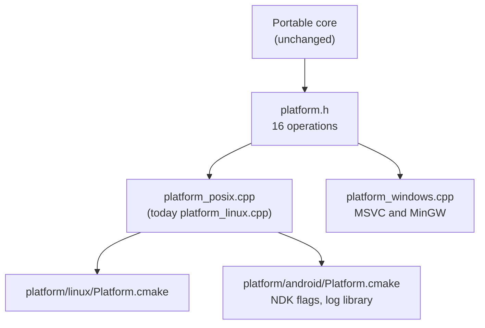

# TECH_PLAN — Android support

Status: Planning only

Source: `a9407a88ffbd9d593806e6d520e00c3d3ad0b0f6`

[Product brief](PRD.md) · [Tracker](PROGRESS.md)

## Verified baseline

- [`src/CMakeLists.txt`](../../../src/CMakeLists.txt) selects
  `platform/windows` or `platform/linux` and fails for any other
  `CMAKE_SYSTEM_NAME`; the NDK reports `Android`.
- [`platform_linux.cpp`](../../../src/lib/ggpo/platform_linux.cpp) (252 lines)
  implements all 16 operations in [`platform.h`](../../../src/lib/ggpo/platform.h)
  with POSIX calls: `clock_gettime`, `poll`/`nanosleep`, `getpid`,
  `getenv`, `mkdir`, `inet_pton`, and non-blocking UDP sockets. Bionic
  provides all of them.
- [`tests/CMakeLists.txt`](../../../tests/CMakeLists.txt) names native tests
  by platform prefix (`linux_*`, `windows_*`) and already supports
  cross-compiled targets through `CMAKE_CROSSCOMPILING_EMULATOR`.
- Vector War has a portable core, `VectorWarHeadless`, and an SDL2 frontend
  ([`sdl_main.cpp`](../../../src/apps/vectorwar/sdl_main.cpp),
  [`sdl_host.cpp`](../../../src/apps/vectorwar/sdl_host.cpp),
  [`sdl_renderer.cpp`](../../../src/apps/vectorwar/sdl_renderer.cpp)).
- The native E2E harness distributes per-platform peer bundles, runs role jobs
  over Tailscale, and validates a fixed scenario manifest.

## Platform layer

Android reuses the POSIX adapter instead of copying it:



- Rename `platform_linux.cpp` to `platform_posix.cpp` (`git mv`, no
  behavior change), or keep the name and include it from both platform files;
  decided in M1 by the size of the Android delta.
- Android-specific behavior, if any, stays behind `#ifdef __ANDROID__` inside
  the platform file or in a small `platform_android.cpp`:
  - `AssertFailed` also writes to logcat (`__android_log_print`).
  - Default log/config locations: Android apps have no writable working
    directory; `EnsureDirectory` callers get an app-provided path.
- `src/CMakeLists.txt` selects `platform/android` when
  `CMAKE_SYSTEM_NAME STREQUAL "Android"`. Everything else (targets, exports,
  `GGPOConfig.cmake`, toolchain record `GGPO_TOOLCHAIN = android`) is shared.
- Android builds compile with `-ffp-contract=off` (see Determinism).

## Builds

| ABI | Use | Minimum API |
|---|---|---|
| `arm64-v8a` | All current devices | 24 (proposed) |
| `armeabi-v7a` | Older 32-bit devices | 24 |
| `x86_64` | Emulators, Chromebooks | 24 |

NDK r27 LTS (proposed), `-DCMAKE_TOOLCHAIN_FILE=$NDK/build/cmake/android.toolchain.cmake
-DANDROID_ABI=<abi> -DANDROID_PLATFORM=24`, `libc++_static` for the shared
library so `libGGPO.so` carries no C++ runtime dependency (mirrors the MinGW
decision); the static library uses the application's STL.

## Tests on Android

Tests stay command-line executables; no test APK is needed for CTest.

- `tests/android/run_on_device.py` is set as `CMAKE_CROSSCOMPILING_EMULATOR`:
  it `adb push`es the executable (and `libGGPO.so`, `libc++_shared.so` if
  any) to `/data/local/tmp/ggpo/`, runs it with `adb shell`, and returns its
  exit code and output. `ctest` then runs the **same suite** as Linux.
- Python-driven tests (peer loopback runner, negative contracts) run on the host
  and start their peer executables through the same wrapper.
- Test prefix `android_*` for native tests, mirroring `linux_*`/`windows_*`.
- `verify_consumers.py` gains an Android mode: configure the consumers with the
  NDK against the installed SDK, push and run them, and check `NEEDED` entries
  with `llvm-readelf` for shared vs static.

## Runners (arm64 preferred)

| Priority | Runner | Runs | Status |
|---|---|---|---|
| 1 | GitHub `ubuntu-24.04-arm` with an arm64 Android emulator | arm64-v8a natively | **M0 spike**: needs KVM on the arm runner and a Linux arm64 emulator build |
| 2 | GitHub `ubuntu-24.04` with KVM and an x86_64 emulator (`reactivecircus/android-emulator-runner`) | x86_64 ABI | Known to work; PR fallback |
| 3 | Real arm64/armv7 devices (Firebase Test Lab or AWS Device Farm) through a small test APK | arm64-v8a, armeabi-v7a | Scheduled/pre-release if option 1 fails |

The required PR check runs on option 1 if the spike succeeds, otherwise option 2
with option 3 weekly. Emulator images and AVD snapshots are cached.

## Determinism

AArch64 and ARMv7 compilers contract `a*b+c` into fused multiply-add by
default, which rounds differently from x86. GGPO's core state is integer, but
Vector War and many games simulate with floating point. Android builds of GGPO,
the fixtures, and Vector War use `-ffp-contract=off`; the frozen Vector War
checksum (`b3381958` at frame 180) must match on arm64. The guide tells game
developers to do the same.

## Vector War on Android

- Reuse the SDL2 frontend: SDL2's Android support (`SDLActivity`) hosts
  `sdl_main.cpp` unchanged in structure; `SDLVectorWarHost` gains touch
  input mapped to the same input bits (on-screen D-pad and fire/bomb buttons).
- Command-line arguments come from a small launcher screen or intent extras
  (`local port`, `player count`, `local`/`IP:PORT` list).
- Gradle project under `src/apps/vectorwar/android/` builds the APK by
  calling the same CMake (`externalNativeBuild`); the SDK stays CMake-only.
- `VectorWarHeadless` is cross-compiled like the tests and used in E2E.
- CI: build the APK, install it on the emulator, launch it in a smoke mode
  (`--frontend-smoke` equivalent through an intent extra), and require a clean
  exit.

## E2E

- New peer bundle `e2e-peer-android`: `ggpo_peer_smoke` and
  `vectorwar_headless` for the runner's ABI.
- Android role jobs run on the emulator runner: the job joins the tailnet on the
  host, forwards the UDP ports with the emulator console
  (`redir add udp:<port>:<port>`), and starts the peer inside the emulator
  through the same `adb` wrapper. The control agent stays on the host.
- Scenarios (both fixtures): `android-linux`, `linux-android`,
  `android-windows`, `windows-android`, `android-mingw`, plus
  `vectorwar-android-*` equivalents. The manifest requires all of them.

## CI

| Workflow | Addition |
|---|---|
| New `android-compatibility.yml` | `Android build (<abi>)` for three ABIs; `Android tests (arm64 or x86_64)` full CTest + consumers |
| Cross-platform E2E | `Build native Android peer`; Android scenarios above |
| Release | `Android SDK` (all ABIs in one archive) and `Android Vector War` (APK) |
| Ruleset + branch protection | Add the Android build and test checks at merge |

Existing workflows are not modified except to add jobs.

## Packaging

```text
ggpo-V-android/
├── include/ggponet.h
├── <abi>/lib/libGGPO.so
├── <abi>/lib/libGGPO.a
├── <abi>/lib/cmake/GGPO/          # one CMake package per ABI
└── share/GGPO/
```

A Prefab AAR for Gradle consumers is a possible follow-up, not in scope.

## Documentation

Developer Guide: Android section (download, NDK CMake integration per ABI,
shared vs static, packaging `libGGPO.so` into an APK, `INTERNET` permission,
`-ffp-contract=off`, running Vector War). Build.md, Testing.md,
CrossPlatformTesting.md, VectorWar.md, README.

## Rollout

1. M0 spikes: runner feasibility (arm64 emulator), NDK build of the unmodified tree.
2. Platform selection and shared POSIX adapter; existing CI unchanged.
3. Android CTest and consumers in CI.
4. Vector War APK.
5. E2E scenarios.
6. Release, docs, required checks.

## Open decisions

- Minimum API level (proposed 24) and NDK version (proposed r27 LTS).
- Rename `platform_linux.cpp` to `platform_posix.cpp` or keep the name.
- Whether `armeabi-v7a` is in scope or dropped (32-bit Android is declining).
- Required test runner: arm64 emulator (if the spike succeeds) or x86_64
  emulator plus scheduled devices.
