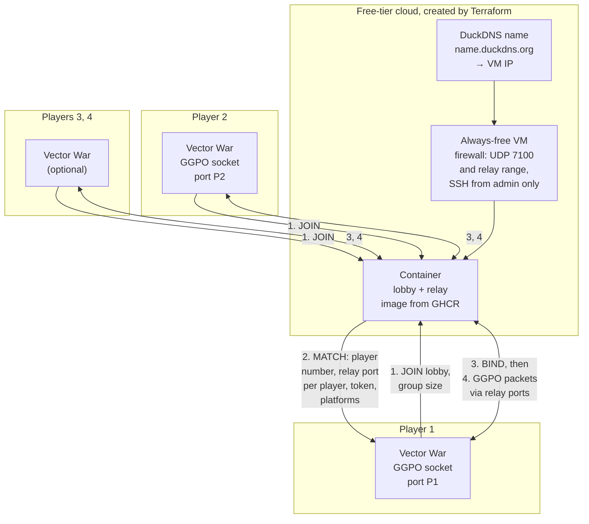
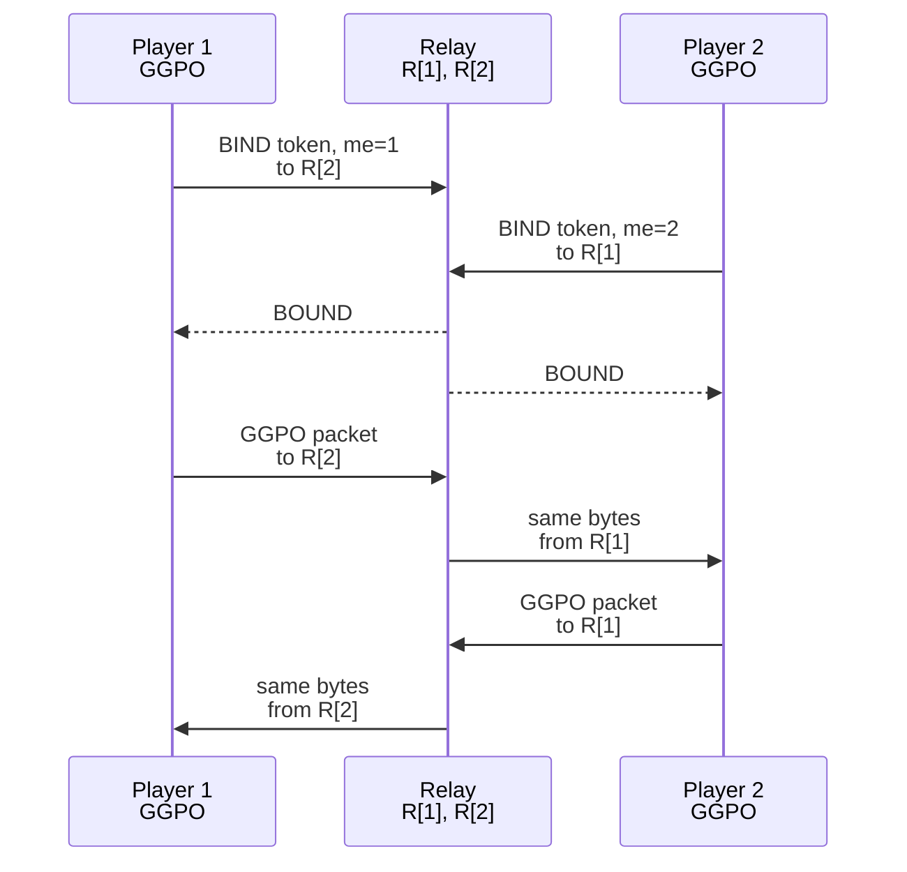
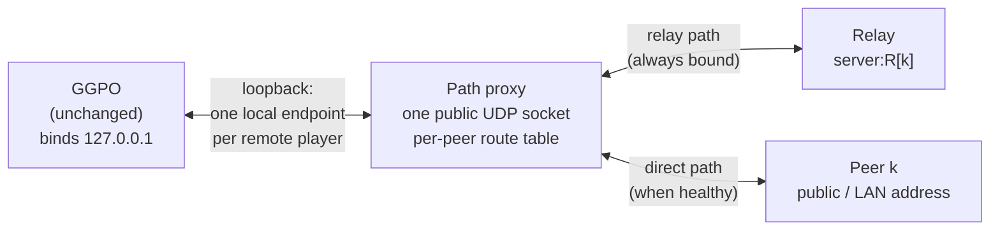
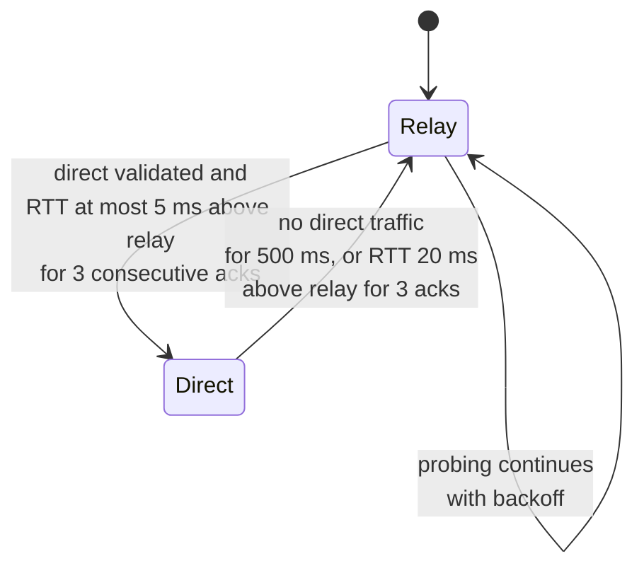

# TECH_PLAN — Internet play for Vector War

Status: Draft

[Product brief](PRD.md) · [Progress](PROGRESS.md)

## Contents

- [Verified baseline](#verified-baseline)
- [Architecture](#architecture)
  - [Relay forwarding](#relay-forwarding)
  - [Direct path negotiation](#direct-path-negotiation)
- [Matchmaking protocol](#matchmaking-protocol)
- [Matchmaking server](#matchmaking-server)
- [Infrastructure](#infrastructure)
- [Infrastructure tests](#infrastructure-tests)
- [Vector War client](#vector-war-client)
- [Start screen](#start-screen)
- [Platform legend](#platform-legend)
- [Testing](#testing)
- [CI](#ci)
- [Operation](#operation)
- [Documentation](#documentation)
- [Rollout](#rollout)
- [Open decisions](#open-decisions)

## Verified baseline

Facts from `4587549` that constrain the design:

| Fact | Source | Consequence |
| --- | --- | --- |
| GGPO accepts only a numeric IPv4 string in `GGPOPlayer.u.remote.ip_address[32]` | [`ggponet.h`](../../../src/include/ggponet.h), `inet_pton(AF_INET)` in both adapters | Vector War resolves hostnames and passes numeric IPv4; no library change |
| GGPO binds one UDP socket to the given local port and sends to the exact configured endpoint | [`platform_posix.cpp`](../../../src/lib/ggpo/platform_posix.cpp), [`platform_windows.cpp`](../../../src/lib/ggpo/platform_windows.cpp) | Routers rewrite ports, so a peer cannot simply be told the other's address; a relay presents every remote player as `server:port` instead |
| GGPO sends keep-alives every 200 ms and sync retries every 2 s | [`udp_proto.cpp`](../../../src/lib/ggpo/network/udp_proto.cpp) | Once open, NAT mappings stay open during play |
| GGPO's packet validator rejects unknown messages | [`protocol_test.cpp`](../../../tests/unit/protocol_test.cpp) | Late matchmaking, `BOUND` or `HELLO` packets reaching the GGPO socket are dropped safely |
| GGPO's peer-to-peer backend keeps one `UdpProtocol` endpoint per remote player and sends each player's packets to that player's configured address | [`p2p.cpp`](../../../src/lib/ggpo/backends/p2p.cpp) | A relay port per player makes every remote player look like an ordinary peer; no library change |
| `GGPO_MAX_PLAYERS` is 4 | [`ggponet.h`](../../../src/include/ggponet.h) | Groups of 2 to 4 players |
| `ggpo_chat` is a no-op in every backend | [`backend.h`](../../../src/lib/ggpo/backends/backend.h) | Platform names cannot travel inside the GGPO session; they are exchanged before it starts |
| The SDL renderer draws no text; its status goes to the window title | [`sdl_renderer.cpp`](../../../src/apps/vectorwar/sdl_renderer.cpp) | SDL needs an embedded bitmap font for the start screen and legend |
| GDI and SDL use different ship colors (GDI: red, green, blue, gray; SDL: lighter red, green, blue, light gray) | [`gdi_renderer.cpp`](../../../src/apps/vectorwar/gdi_renderer.cpp), `SetPlayerColor` in `sdl_renderer.cpp` | Each legend uses its own renderer's colors, read from one table per renderer |
| Android already shows `LauncherActivity` and passes an argument string to the native app | [`LauncherActivity.java`](../../../src/apps/vectorwar/android/app/src/main/java/org/ggponext/vectorwar/LauncherActivity.java) | The Android start screen extends the launcher instead of drawing in SDL |
| Vector War's frame delay is a compile-time constant | `FRAME_DELAY` in [`vectorwar.cpp`](../../../src/apps/vectorwar/vectorwar.cpp) | Unchanged by this plan; tuning is a follow-up |

## Architecture

Decision (2026-11-12): **relay**, not hole punching. Every matchmade session
goes through the server, which forwards GGPO's own packets between players
without understanding them. This works behind any router, including symmetric
NAT, carrier-grade NAT and mobile data, and supports 2 to 4 players. GGPO, its
peer-to-peer backend, rollback and wire format are unchanged; each client just
sees every remote player at `server:relay_port`. Once a session runs, clients
negotiate a direct path per pair and use it while it is healthy, keeping the
relay as a live fallback ([direct path negotiation](#direct-path-negotiation),
decision D6).



1. Each client sends `JOIN` with a lobby code (or none) and a group size of 2,
   3 or 4, from the same local UDP port GGPO will use.
2. When a group is full, the server allocates one relay port `R[j]` per player
   `j` and sends each member a `MATCH`: its player number, every player's relay
   port and platform, and a random 64-bit session token.
3. From its GGPO port, each client sends `BIND` (token and own player number) to
   every other player's relay port until acknowledged. The server records the
   exact source address each `BIND` arrives from, so routers that use a
   different public port per destination are handled.
4. The client closes its socket, GGPO binds the same port, and every remote
   player `k` is configured as `server:R[k]`. GGPO's packets then flow through
   the relay.

### Relay forwarding

For a session with players `1..N` and relay ports `R[1..N]`:

- `addr[i][k]`: the source address observed when player `i`'s `BIND` reached
  `R[k]`.
- A datagram arriving at `R[k]` from `addr[i][k]` is player `i`'s packet for
  player `k`. The server forwards it unchanged **from** `R[i]` **to**
  `addr[k][i]`, so player `k` sees it coming from `server:R[i]`, exactly the
  endpoint it configured for player `i`. GGPO's per-endpoint state machine is
  satisfied without knowing a relay exists.
- Datagrams from any other address are dropped, so the relay cannot be used to
  reach arbitrary hosts or to amplify traffic: output never exceeds input, and
  only to addresses that proved they hold the session token.
- A session ends after 30 s with no traffic from any member, or 2 hours at
  most; its ports return to the pool.



### Direct path negotiation

Decision D6 (accepted 2026-11-12): **UDP hole punching with the relay as a
live fallback** (ICE-style direct paths), implemented in an in-process **path proxy** inside Vector War.
GGPO, its API, ABI and wire format stay unchanged, preserving this plan's
constraint.

#### Placement



- GGPO binds a loopback port and is configured with one loopback endpoint per
  remote player (`127.0.0.1:L[k]`). It never sees a real address change.
- The proxy owns the single public socket used for `JOIN`, `BIND`, the relay and
  the direct paths, so all paths share one NAT mapping.
- Outbound: a GGPO datagram for peer `k` is sent on peer `k`'s **current send
  route** (relay `server:R[k]` or the peer's direct address).
- Inbound: datagrams from `server:R[k]` **and** from peer `k`'s validated direct
  address are both delivered to GGPO as coming from `127.0.0.1:L[k]`. Accepting
  both at all times means each side may switch independently; no switch
  handshake is needed.

What does **not** change:

- The GGPO library: no code, public API, ABI, export or wire-format change;
  other applications are unaffected.
- Vector War's existing direct mode (`IP:PORT` on the command line or start
  screen, no server): GGPO binds the public socket itself exactly as today; the
  proxy, probes and keepalives are not involved.
- GGPO's datagrams on the network, byte for byte. The proxy adds only its own
  authenticated control datagrams, and only between v3 clients in a matchmade
  session.

Alternative considered: the same route table inside ggpo-next's transport
layer, exposed through an additive API. It avoids the loopback hop and helps
other applications, but changes the library; deferred until another consumer
needs it.

#### Candidates

| Candidate | Source | Purpose |
| --- | --- | --- |
| Relay `server:R[k]` | `MATCH` (protocol v2) | Always available; the start path and fallback |
| Public (server-reflexive) address of peer `k` | Server, as observed on its lobby port | Direct path across different routers |
| LAN address of peer `k` | Sent by the peer in `JOIN` | Players on the same network, where routers often do not hairpin |

Protocol v3 adds `PEERS_REQUEST` (session token, player, LAN address) and
`PEERS` (each member's public and LAN candidates). The client sends the request
to the lobby port from its socket after `MATCH`; the server records the
request's source as that member's public candidate and answers with the same
size, keeping the no-amplification rule. `JOIN` and every other message stay
version 2. Only RFC 1918 LAN addresses are relayed, so a member cannot aim the
others' probes at an arbitrary host. v2 clients and servers keep working on the
relay only; a v3 client that receives no `PEERS` never leaves the relay.

#### Probes and authentication

Control datagrams between proxies start with an 8-byte magic and carry a
SipHash-2-4 MAC keyed by the session token, so the relay forwards them like any
datagram and a receiver separates them from GGPO packets without framing game
data:

| Message | Fields | Use |
| --- | --- | --- |
| `PROBE` | session tag, from, to, sequence, send time, MAC | Every 250 ms per candidate pair; opens and keeps NAT mappings |
| `PROBE_ACK` | echoed sequence and time, MAC | Round-trip time and proof of reachability both ways |
| `KEEPALIVE` | session tag, from, MAC | About once per second on the relay while a pair is direct, so the relay session and mapping never expire |

A candidate becomes a usable direct path only after an authenticated
`PROBE`/`PROBE_ACK` round trip in both directions. Datagrams that fail the magic
or MAC check are treated as GGPO data (relay path) or dropped (unvalidated
direct source).

#### Path selection per peer



- Prefer a healthy direct path even at equal latency, since it takes the
  server off the data path: switch once it is validated and its smoothed
  round-trip time is at most 5 ms above the relay's for three consecutive
  acknowledgements. Fall back on 500 ms of silence, or when it is more than
  20 ms slower than the relay for three acknowledgements. The gap between the
  two margins prevents flapping.
- After a fallback, direct probing resumes with exponential backoff (up to 5 s).
- GGPO's rollback absorbs the frames lost during a switch; the frozen checksum
  tests prove no desync.
- The performance monitor and legend show each peer's active path.

#### NAT outcomes

| Router pair | Expected path |
| --- | --- |
| Full-cone or port-restricted on both sides | Direct |
| Same LAN | Direct via LAN candidate |
| Symmetric on one or both sides, carrier-grade NAT | Relay for the whole match |
| Direct path lost mid-match | Relay within ~500 ms, then direct again when probes recover |
| Relay lost while direct | Match continues direct |

## Matchmaking protocol

Small fixed-layout UDP datagrams, little-endian, versioned. Defined once in a
shared header for the C++ client and mirrored in the server, with a shared test
vector file that both sides' tests parse. Version 2 replaces the unreleased
version 1 (two-player hole punching).

| Message | Direction | Fields |
| --- | --- | --- |
| `JOIN` | client → server port 7100 | magic `VWMM`, version, type, 64-bit client nonce, platform code, group size (2–4), lobby code (8 bytes, zero = public queue), padding to 64 bytes |
| `WAITING` | server → client | magic, version, type, nonce echo, players joined, group size |
| `MATCH` | server → client | magic, version, type, nonce echo, session token, player number, player count, per player: relay port and platform code |
| `BIND` | client → relay port | magic, version, type, session token, sender player number, padding to `BOUND` size |
| `BOUND` | relay port → client | magic, version, type, session token, sender player number |
| `HELLO` | client ↔ client (direct `IP:PORT` mode only) | magic, version, type, sender nonce, sender platform code |
| `ERROR` | server → client | magic, version, type, nonce echo, code (version mismatch, rate limited, server full, bad group size) |

Rules:

- Every reply is no larger than the request it answers (`JOIN` is padded to
  64 bytes; `MATCH` for 4 players is under 64), so nothing amplifies floods.
- Clients resend `JOIN` every second while waiting; the server forgets a
  waiting client after 10 s without one.
- Groups form first come, first served within the same lobby code and group
  size; earlier joiners get lower player numbers.
- The magic and version let GGPO's validator and the server reject each
  other's packets.

## Matchmaking server

- **Language:** Python 3 `asyncio`, standard library only, matching the
  repository's existing Python test tooling.
- **Location:** `services/matchmaking/` with `protocol.py`, `matchmaker.py`
  (lobbies), `relay.py` (port pool and forwarding), `server.py`, `tests/`, and
  a `Dockerfile` (non-root user, read-only filesystem).
- **Ports:** lobby on UDP 7100; relay ports from a configurable range
  (default 7101–7499, so up to 99 four-player sessions at once).
- **State:** in memory only. Restarting the container ends sessions; players
  rejoin.
- **Limits:** per-source rate limit on `JOIN`, maximum waiting clients,
  maximum concurrent sessions, per-player forwarding rate cap well above
  GGPO's needs, and no logging of addresses.
- **Health:** answers a `JOIN` with an unknown version with `ERROR`, which
  doubles as an external health probe.

## Infrastructure

### Provider (decision D1)

| Option | Always free | Notes |
| --- | --- | --- |
| **Oracle Cloud Always Free** (recommended) | Yes: AMD micro VMs and Ampere A1 capacity, generous outbound traffic | Room for a relay later; official `oracle/oci` Terraform provider |
| Google Cloud `e2-micro` | Yes, in three US regions, with a small monthly outbound allowance | Fine for matchmaking only; tight for a future relay |
| AWS Lightsail | No: free only for the first months | Excluded by the cost goal |
| DigitalOcean | No free tier | Excluded by the cost goal |

M0 confirms the chosen provider's current free-tier terms before any apply.

**Why a VM and not a managed container service.** The server already runs as a
container; the VM exists only to run it. Matchmaking and hole punching need a
public UDP port, and the free managed container services (Cloud Run, Render,
Koyeb) accept only HTTP or TCP, while those with UDP (Fly.io, Azure Container
Instances, AWS Fargate) have no lasting free tier.

**Oracle Container Instances (candidate, M0-T05).** Research on 2026-11-11:

| Question | Finding | Confidence |
| --- | --- | --- |
| Free? | Oracle's pricing page: no extra charge beyond the shape's compute rate, and the free Ampere A1 hours are shared across bare metal, VMs and Container Instances | Search excerpts of the pricing page; the page itself refused direct access |
| Allowance | 1,500 OCPU-hours and 9,000 GB-hours per month (about 2 OCPUs, 12 GB) since the 2026 reduction, plus 10 TB outbound per month | Oracle's Always Free resource page |
| Always Free-only accounts | Not stated; Container Instances is absent from the Always Free resource page | Unknown |
| UDP | Each instance has its own VNIC and optional public IP; ingress is opened with security list or NSG rules, which support UDP; no documented restriction and no port mapping | Very likely, not proven |

If M0-T05 passes, the `host` module creates an A1 container instance instead
of a VM, and the `dns` module updates DuckDNS from Terraform after creation (or
the instance uses a reserved public IP), because there is no cloud-init.
Everything else in this plan is unchanged.

### DNS (decision D2: DuckDNS)

Decided: no domain is owned, so the server uses a free DuckDNS subdomain.

| Option | Cost | Notes |
| --- | --- | --- |
| **Cloudflare DNS** on a domain you own (recommended if you have one) | Free DNS hosting; the domain itself is not free | Official `cloudflare/cloudflare` provider; record must be DNS-only (not proxied) because game traffic is UDP |
| DuckDNS subdomain (`name.duckdns.org`) | Free, no domain needed | No official Terraform provider; the VM's cloud-init updates the record over HTTPS with a token |

### Layout

```text
infra/terraform/
├── modules/
│   ├── host/        # VM, network, firewall, cloud-init that runs the container
│   └── dns/         # A record for the server name
├── envs/prod/       # Provider config, backend, variables, module wiring
└── tests/           # *.tftest.hcl unit tests with mocked providers
```

- **Host module:** one always-free VM with the provider's container-ready
  image; a security list or firewall allowing UDP 7100 and the relay port
  range from anywhere and SSH only from `admin_cidr`; cloud-init that installs Docker and runs the server
  image by digest with `--restart unless-stopped`, read-only and with dropped
  capabilities.
- **DNS module:** keeps the DuckDNS name pointing at the VM's public IP. With
  no official DuckDNS provider, the module renders the update URL and token
  into cloud-init, which calls it 30 s after boot and every 5 minutes, so the
  server publishes its own address whenever it comes up; Terraform outputs the
  expected name and IP so tests and the deploy workflow can check them.
- **Inputs:** image reference (digest), server port, DNS name, `admin_cidr`,
  SSH public key. **Outputs:** public IP, FQDN, server port.
- **State backend:** the provider's free object storage through Terraform's S3
  backend, with versioning on, so state is never local or in Git.
- **Pinned versions:** Terraform `>= 1.7` (required by mocked tests) and exact
  provider versions in a committed lock file.

## Infrastructure tests

Unit tests run with no cloud credentials and no cost, in CI on every change
under `infra/`:

| Check | Tool | What it proves |
| --- | --- | --- |
| Formatting and syntax | `terraform fmt -check`, `terraform validate` | The configuration parses with the pinned providers |
| Plan assertions | `terraform test` with `mock_provider`, `command = plan` | The firewall opens exactly UDP 7100 and the relay range publicly and SSH only from `admin_cidr`; the VM shape is in the free tier; cloud-init runs the requested image digest; cloud-init updates the configured DuckDNS name |
| State assertions | `terraform test` with `mock_provider`, `command = apply` | Applying against mocks produces state whose outputs (IP, FQDN, port) are wired correctly between modules, and the DuckDNS update in cloud-init targets the VM's IP and name from state |
| Variable validation | `terraform test` with `expect_failures` | Invalid inputs are rejected: a non-digest image tag, a world-open `admin_cidr`, a port outside the allowed range |
| Lint | `tflint` with the provider ruleset | Deprecated or invalid arguments |

Automatic CI (pushes and pull requests) never creates, changes or destroys real
infrastructure and needs no cloud credentials. Real `apply` and `destroy` run
only when a maintainer asks: locally, or with the manual **Deploy matchmaking
server** workflow (see [operation](#operation)).

## Vector War client

New portable sources in `src/apps/vectorwar/`, shared by all frontends:

| Source | Responsibility |
| --- | --- |
| `vw_udp.cpp` / `.h` | Minimal UDP socket for the pre-session exchange (POSIX and Winsock), bound to the same local port GGPO will use |
| `vw_matchmaking.cpp` / `.h` | Resolve the server name, `JOIN` / `WAITING` / `MATCH`, then `BIND` to every other player's relay port until each answers `BOUND` or 5 s pass |
| `vw_hello.cpp` / `.h` | Direct mode: exchange `HELLO` with the given peer for up to 3 s to learn its platform and agree on player order |
| `vw_platform_name.h` | Compile-time platform name: Windows, Linux, Android |

Then the client closes its socket and calls the existing `VectorWar_Init` with
`num_players` from `MATCH`, itself as the local player at its player number, and
every remote player `k` at `server_ip:R[k]`.

- **Player order in direct mode:** both peers exchange random nonces in
  `HELLO`; the higher nonce is player 1, so no one has to choose.
- **Hostnames:** resolved with `getaddrinfo` to IPv4 in Vector War before
  GGPO sees them.
- **Command line:** every existing argument form is unchanged. One new form
  lets tests, scripts and the Android launcher use matchmaking:
  `vectorwar --matchmaking HOST[:PORT] PLAYERS [LOBBY] LOCAL_PORT`, with
  `PLAYERS` from 2 to 4 and an optional lobby code. The headless fixture gains
  the same option for CI.
- **Default server:** `GGPO_VECTORWAR_MATCHMAKING_HOST` (CMake cache variable,
  default the production name from D2) compiled into the binary and shown,
  editable, on the start screen.

## Start screen

Shown only when Vector War is started with no arguments. **Every client gets
the same choices**, direct `IP:PORT` or **Matchmaking** with a player count
(2–4) and an optional lobby code to share with friends, with the same default
server; only the toolkit differs. The `--matchmaking` command-line form works
on every client as well, including the headless fixture.

| Platform | Implementation |
| --- | --- |
| Windows | A Win32 dialog in `VectorWar.rc`: remote IP, remote port, local port, matchmaking server, players, lobby code; **Connect**, **Matchmaking**, **Quit** |
| Linux | An SDL form drawn in the game window with the embedded bitmap font: the same fields with SDL text input, keyboard and mouse |
| Android | `LauncherActivity` gains server, players and lobby fields and a **Matchmaking** button that passes `--matchmaking HOST PLAYERS LOBBY LOCAL_PORT`; the existing fields keep working |

While matchmaking, the screen shows "Waiting for players… 2 of 4", and
**Cancel**. A failure says what happened: server unreachable, version
mismatch, or "could not reach the relay".

## Platform legend

- Drawn every frame in a corner, one row per player: a filled square in that
  player's ship color, then `P1 Windows`, `P2 Android (you)`, and so on.
- Peer platforms come from `MATCH` (matchmaking) or `HELLO` (direct); a peer
  that never answered shows `P2 unknown`.
- **GDI:** `TextOut` with each player's `_shipColors` entry.
- **SDL (Linux and Android):** an embedded public-domain 8×8 bitmap font
  (`vw_bitmap_font.h`) drawn with rectangles, colored from `SetPlayerColor`'s
  table, which moves to a shared accessor so legend and ships cannot drift.
  The same font draws the Linux start screen.

## Testing

| Layer | Test | Runs in |
| --- | --- | --- |
| Protocol | Shared test vectors parsed by the C++ client and the Python server; malformed, truncated and oversized datagrams rejected | CTest on every platform; server unit tests |
| Lobby | Grouping by lobby code and size, player numbering, expiry, rate limits, reply-never-larger-than-request, version mismatch | Python `unittest`, registered in CTest, plus container build smoke |
| Relay | `BIND` latching per destination port, forwarding source and destination for 2–4 players, unbound and foreign sources dropped, output never larger than input, session expiry returns ports | Python `unittest`, including real UDP sockets on loopback |
| Client | `JOIN` retries, `MATCH` handling, `BIND` timeout, `HELLO` ordering, hostname resolution, against a fake server on loopback | CTest on every platform |
| Legend and start screen | Host contracts: legend rows and colors from a fixed player table; start screen fields map to the same `VectorWar_Init` arguments as the CLI | Existing GUI host contract tests (Win32, SDL dummy driver, Android emulator) |
| NAT traversal | Linux network namespaces with `iptables` NAT: full-cone, port-restricted and symmetric routers; server in the "Internet" namespace; 2 and 4 headless Vector War peers with `--matchmaking`, mixing router types | New Linux CI job: every combination, symmetric included, must reach the frozen checksum |
| Impairment | The same topology with `tc netem` latency and loss | Scheduled, not required per change |
| Real world | Two and four friends on different home networks and mobile data, per the checklist in `PROGRESS.md` | Manual, before calling the feature done |

## CI

- **New workflow `infrastructure.yml`:** `fmt`, `validate`, `tflint`,
  `terraform test`; server unit tests; container build. Aggregate check
  **Complete infrastructure checks**, added to the `master` ruleset like the
  other aggregates.
- **Linux compatibility:** gains the NAT traversal job, covered by
  `Complete Linux compatibility`.
- **Change classification:** `infra/**` and `services/**` count as code, so
  they never take the documentation fast path.
- **Image publishing:** on `master`, build and push the server image to GHCR
  (free for public repositories), tagged by commit and recorded by digest.
- **No deploy workflow.** CI only proves the Terraform code and builds the
  image; it holds no cloud or DNS credentials.

## Operation

The server is not always on. It is created when friends want to play and
destroyed afterwards, either way:

| Way | How |
| --- | --- |
| One click | Actions → **Deploy matchmaking server** → Run workflow → `apply`, `plan` or `destroy` |
| Local | `terraform -chdir=infra/terraform/envs/prod init -backend-config=backend.hcl`, then `apply` / `destroy` |

The deploy workflow (`.github/workflows/deploy-matchmaking.yml`):

- runs only on manual dispatch; it is never a required check and never runs for
  pushes or pull requests, so it blocks nothing;
- is serialized, so `apply` and `destroy` never race on the state;
- reads credentials from repository Actions secrets and variables, checks that
  all are set, and keeps the OCI key and backend settings on the runner only
  for the run;
- targets the `matchmaking` environment as an optional approval boundary,
  without requiring environment-scoped secrets or variables;
- deploys `:latest` pinned by digest unless a digest is given;
- after `apply`, waits until the DuckDNS name resolves to the new VM (the VM
  updates its own record) and the lobby answers a version probe, then prints
  the server address;
- after `destroy`, clears the DuckDNS record so the name does not resolve to a
  released IP that may be reassigned.

- Local runs keep credentials on the maintainer's machine (environment
  variables or a git-ignored `terraform.tfvars`); the workflow reads them from
  repository Actions secrets and variables.
- State lives in the free object storage backend so a later `destroy` works
  from any machine; it is never committed.
- The DuckDNS name stays reserved while the server is destroyed (its record
  cleared by the workflow). Vector War's compiled default keeps pointing at it,
  and while the server is down the start screen reports "matchmaking server
  unreachable" and direct `IP:PORT` still works.

## Documentation

- [Developer Guide](../../DeveloperGuide.md#play-vector-war-over-the-internet):
  start screen, `--matchmaking`, relay-only diagnosis, visible routes, and
  deployment references.
- [Matchmaking architecture](../../architecture/Matchmaking.md): protocol,
  relay forwarding, direct-path proxy, security, NAT outcomes, and tests.
- [Terraform guide](../../../infra/terraform/README.md): prerequisites, local
  and workflow deployment, teardown, credentials, and cost guardrails.
- [Testing](../../architecture/Testing.md): server, codec, proxy, session, NAT,
  impairment, infrastructure, and deployment qualification.

## Rollout

1. Server and protocol with tests (no cloud).
2. Terraform with tests (no apply).
3. Vector War client, CLI form, and NAT emulation in CI (every router type,
   2 and 4 players) against a local server container. **Implemented.**
4. Start screens, legend, and Windows route/RTT monitor. **Implemented.**
5. First apply (deploy workflow or local); point the compiled default at the
   DuckDNS name.
6. Friends trial; then release with the next Vector War packages.
7. Direct path negotiation (D6): path proxy, protocol v3 candidates, NAT matrix
   and impairment in CI. **Implemented except for the real-network friends
   trial comparing relay and direct latency.**

## Open decisions

| ID | Decision | Default until decided |
| --- | --- | --- |
| D1 | Cloud provider | Oracle Cloud Always Free |
| D2 | DNS | **Decided:** DuckDNS subdomain (no domain owned) |
| D3 | Server ports | UDP 7100 for lobbies; relay range 7101–7499 |
| D4 | Relay or hole punching | **Decided (2026-11-12):** relay every matchmade session; works behind any router and for 2–4 players |
| D6 | Hole punching with relay fallback | **Decided (2026-11-12):** UDP hole punching through ICE-style candidates and authenticated probes; per-pair switch to a healthy direct path with the relay kept as a live fallback; in-process path proxy in Vector War so GGPO is unchanged ([details](#direct-path-negotiation)) |
| D7 | Server-run simulation (authoritative host backend for desync detection, late join, replays) | Separate future plan; needs a new GGPO backend next to peer-to-peer |
| D5 | Frame delay tuning from measured round-trip time | Not in this plan; follow-up |
