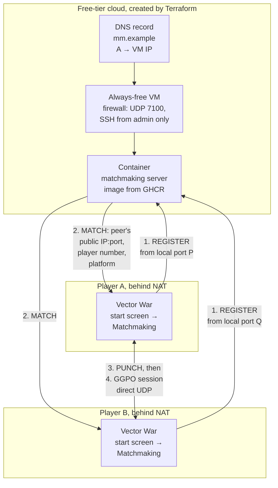

# TECH_PLAN — Internet play for Vector War

Status: Draft

[Product brief](PRD.md) · [Progress](PROGRESS.md)

## Contents

- [Verified baseline](#verified-baseline)
- [Architecture](#architecture)
- [Matchmaking protocol](#matchmaking-protocol)
- [Matchmaking server](#matchmaking-server)
- [Infrastructure](#infrastructure)
- [Infrastructure tests](#infrastructure-tests)
- [Vector War client](#vector-war-client)
- [Start screen](#start-screen)
- [Platform legend](#platform-legend)
- [Testing](#testing)
- [CI and deployment](#ci-and-deployment)
- [Documentation](#documentation)
- [Rollout](#rollout)
- [Open decisions](#open-decisions)

## Verified baseline

Facts from `4587549` that constrain the design:

| Fact | Source | Consequence |
| --- | --- | --- |
| GGPO accepts only a numeric IPv4 string in `GGPOPlayer.u.remote.ip_address[32]` | [`ggponet.h`](../../../src/include/ggponet.h), `inet_pton(AF_INET)` in both adapters | Vector War resolves hostnames and passes numeric IPv4; no library change |
| GGPO binds one UDP socket to the given local port and sends to the exact configured endpoint | [`platform_posix.cpp`](../../../src/lib/ggpo/platform_posix.cpp), [`platform_windows.cpp`](../../../src/lib/ggpo/platform_windows.cpp) | Each peer must be given the other's **public** `IP:PORT`, which only a rendezvous server can observe |
| GGPO sends keep-alives every 200 ms and sync retries every 2 s | [`udp_proto.cpp`](../../../src/lib/ggpo/network/udp_proto.cpp) | Once open, NAT mappings stay open during play |
| GGPO's packet validator rejects unknown messages | [`protocol_test.cpp`](../../../tests/unit/protocol_test.cpp) | Late matchmaking or hello packets reaching the GGPO socket are dropped safely |
| `ggpo_chat` is a no-op in every backend | [`backend.h`](../../../src/lib/ggpo/backends/backend.h) | Platform names cannot travel inside the GGPO session; they are exchanged before it starts |
| The SDL renderer draws no text; its status goes to the window title | [`sdl_renderer.cpp`](../../../src/apps/vectorwar/sdl_renderer.cpp) | SDL needs an embedded bitmap font for the start screen and legend |
| GDI and SDL use different ship colors (GDI: red, green, blue, gray; SDL: lighter red, green, blue, light gray) | [`gdi_renderer.cpp`](../../../src/apps/vectorwar/gdi_renderer.cpp), `SetPlayerColor` in `sdl_renderer.cpp` | Each legend uses its own renderer's colors, read from one table per renderer |
| Android already shows `LauncherActivity` and passes an argument string to the native app | [`LauncherActivity.java`](../../../src/apps/vectorwar/android/app/src/main/java/org/ggponext/vectorwar/LauncherActivity.java) | The Android start screen extends the launcher instead of drawing in SDL |
| Vector War's frame delay is a compile-time constant | `FRAME_DELAY` in [`vectorwar.cpp`](../../../src/apps/vectorwar/vectorwar.cpp) | Unchanged by this plan; tuning is a follow-up |

## Architecture



1. Each client sends `REGISTER` from the same local UDP port GGPO will use. The
   server sees the router's public `IP:PORT` for that socket.
2. When two clients are waiting, the server sends each a `MATCH` with the
   other's public endpoint, player number, and platform.
3. Both clients send `PUNCH` to each other from that port until they hear the
   peer, opening both routers' mappings.
4. The client closes its socket and GGPO binds the same port at once, pointed
   at the peer's public endpoint. Play then uses only direct UDP; the server is
   not involved.

The server never forwards game traffic. A relay is a [follow-up](#open-decisions).

## Matchmaking protocol

Small fixed-layout UDP datagrams, little-endian, versioned. Defined once in a
shared header for the C++ client and mirrored in the server, with a shared test
vector file that both sides' tests parse.

| Message | Direction | Fields |
| --- | --- | --- |
| `REGISTER` | client → server | magic `VWMM`, version, type, 64-bit client nonce, platform code, protocol build, padding to 64 bytes |
| `WAITING` | server → client | magic, version, type, nonce echo, queue position |
| `MATCH` | server → client | magic, version, type, nonce echo, session id, player number (1 or 2), peer public IPv4 and port, peer platform code |
| `PUNCH` | client ↔ client | magic, version, type, session id, sender platform code, sender nonce |
| `HELLO` | client ↔ client (direct mode) | magic, version, type, sender platform code, sender nonce |
| `ERROR` | server → client | magic, version, type, nonce echo, code (version mismatch, rate limited, server full) |

Rules:

- Every server reply is no larger than the request it answers (`REGISTER` is
  padded to 64 bytes), so the server cannot be used to amplify floods.
- Clients resend `REGISTER` every second while waiting; the server forgets a
  client after 10 s without one, and a matched session after 60 s.
- Pairing is first come, first served: the earlier registrant is player 1.
- The magic and version let GGPO's validator and the server reject each
  other's packets.

## Matchmaking server

- **Language:** Python 3 `asyncio`, standard library only, matching the
  repository's existing Python test tooling.
- **Location:** `services/matchmaking/` with `server.py`, `protocol.py`,
  `tests/`, and a `Dockerfile` (`python:3-slim`, non-root user, read-only
  filesystem, UDP 7100).
- **State:** in memory only. Restarting the container drops waiting players,
  who simply re-register.
- **Limits:** per-source rate limit, maximum waiting clients, and no logging of
  addresses beyond what is needed while a session is live.
- **Health:** answers a `REGISTER` with an unknown version with `ERROR`, which
  doubles as an external health probe.

## Infrastructure

### Provider (decision D1)

| Option | Always free | Notes |
| --- | --- | --- |
| **Oracle Cloud Always Free** (recommended) | Yes: AMD micro VMs and Ampere A1 capacity, generous outbound traffic | Room for a relay later; official `oracle/oci` Terraform provider |
| Google Cloud `e2-micro` | Yes, in three US regions, with a small monthly outbound allowance | Fine for matchmaking only; tight for a future relay |
| AWS Lightsail | No: free only for the first months | Excluded by the cost goal |
| DigitalOcean | No free tier | Excluded by the cost goal |

M0 confirms the chosen provider's current free-tier terms before any apply.

### DNS (decision D2)

| Option | Cost | Notes |
| --- | --- | --- |
| **Cloudflare DNS** on a domain you own (recommended if you have one) | Free DNS hosting; the domain itself is not free | Official `cloudflare/cloudflare` provider; record must be DNS-only (not proxied) because game traffic is UDP |
| DuckDNS subdomain (`name.duckdns.org`) | Free, no domain needed | No official Terraform provider; the VM's cloud-init updates the record over HTTPS with a token |

### Layout

```text
infra/terraform/
├── modules/
│   ├── host/        # VM, network, firewall, cloud-init that runs the container
│   └── dns/         # A record for the server name
├── envs/prod/       # Provider config, backend, variables, module wiring
└── tests/           # *.tftest.hcl unit tests with mocked providers
```

- **Host module:** one always-free VM with the provider's container-ready
  image; a security list or firewall allowing UDP 7100 from anywhere and SSH
  only from `admin_cidr`; cloud-init that installs Docker and runs the server
  image by digest with `--restart unless-stopped`, read-only and with dropped
  capabilities.
- **DNS module:** one A record, DNS-only, short TTL, pointing at the VM's
  public IP.
- **Inputs:** image reference (digest), server port, DNS name, `admin_cidr`,
  SSH public key. **Outputs:** public IP, FQDN, server port.
- **State backend:** the provider's free object storage through Terraform's S3
  backend, with versioning on, so state is never local or in Git.
- **Pinned versions:** Terraform `>= 1.7` (required by mocked tests) and exact
  provider versions in a committed lock file.

## Infrastructure tests

Unit tests run with no cloud credentials and no cost, in CI on every change
under `infra/`:

| Check | Tool | What it proves |
| --- | --- | --- |
| Formatting and syntax | `terraform fmt -check`, `terraform validate` | The configuration parses with the pinned providers |
| Plan assertions | `terraform test` with `mock_provider`, `command = plan` | The firewall opens exactly UDP 7100 publicly and SSH only from `admin_cidr`; the VM shape is in the free tier; cloud-init runs the requested image digest; the DNS record is DNS-only with the configured name |
| State assertions | `terraform test` with `mock_provider`, `command = apply` | Applying against mocks produces state whose outputs (IP, FQDN, port) are wired correctly between modules, and the DNS record points at the VM's IP from state |
| Variable validation | `terraform test` with `expect_failures` | Invalid inputs are rejected: a non-digest image tag, a world-open `admin_cidr`, a port outside the allowed range |
| Lint | `tflint` with the provider ruleset | Deprecated or invalid arguments |

Applying for real happens only in the deploy workflow, never in pull-request
CI.

## Vector War client

New portable sources in `src/apps/vectorwar/`, shared by all frontends:

| Source | Responsibility |
| --- | --- |
| `vw_udp.cpp` / `.h` | Minimal UDP socket for the pre-session exchange (POSIX and Winsock), bound to the same local port GGPO will use |
| `vw_matchmaking.cpp` / `.h` | Resolve the server name, `REGISTER` / `WAITING` / `MATCH`, then `PUNCH` until the peer answers or 5 s pass |
| `vw_hello.cpp` / `.h` | Direct mode: exchange `HELLO` with the given peer for up to 3 s to learn its platform and agree on player order |
| `vw_platform_name.h` | Compile-time platform name: Windows, Linux, Android |

Then the client closes its socket and calls the existing `VectorWar_Init` with
the peer's public endpoint.

- **Player order in direct mode:** both peers exchange random nonces in
  `HELLO`; the higher nonce is player 1, so no one has to choose.
- **Hostnames:** resolved with `getaddrinfo` to IPv4 in Vector War before
  GGPO sees them.
- **Command line:** every existing argument form is unchanged. One new form
  lets tests, scripts and the Android launcher use matchmaking:
  `vectorwar --matchmaking HOST[:PORT] LOCAL_PORT`. The headless fixture gains
  the same option for CI.
- **Default server:** `GGPO_VECTORWAR_MATCHMAKING_HOST` (CMake cache variable,
  default the production name from D2) compiled into the binary and shown,
  editable, on the start screen.

## Start screen

Shown only when Vector War is started with no arguments. **Every client gets
the same choices**, direct `IP:PORT` or **Matchmaking**, with the same default
server; only the toolkit differs. The `--matchmaking` command-line form works
on every client as well, including the headless fixture.

| Platform | Implementation |
| --- | --- |
| Windows | A Win32 dialog in `VectorWar.rc`: remote IP, remote port, local port, matchmaking server; **Connect**, **Matchmaking**, **Quit** |
| Linux | An SDL form drawn in the game window with the embedded bitmap font: the same fields with SDL text input, keyboard and mouse |
| Android | `LauncherActivity` gains the matchmaking server field and a **Matchmaking** button that passes `--matchmaking HOST LOCAL_PORT`; the existing fields keep working |

While matchmaking, the screen shows "Waiting for an opponent…", the queue
position, and **Cancel**. A failure says what happened: server unreachable,
version mismatch, or "could not reach your opponent (your network may block
direct connections)".

## Platform legend

- Drawn every frame in a corner, one row per player: a filled square in that
  player's ship color, then `P1 Windows`, `P2 Android (you)`, and so on.
- Peer platforms come from `MATCH` (matchmaking) or `HELLO` (direct); a peer
  that never answered shows `P2 unknown`.
- **GDI:** `TextOut` with each player's `_shipColors` entry.
- **SDL (Linux and Android):** an embedded public-domain 8×8 bitmap font
  (`vw_bitmap_font.h`) drawn with rectangles, colored from `SetPlayerColor`'s
  table, which moves to a shared accessor so legend and ships cannot drift.
  The same font draws the Linux start screen.

## Testing

| Layer | Test | Runs in |
| --- | --- | --- |
| Protocol | Shared test vectors parsed by the C++ client and the Python server; malformed, truncated and oversized datagrams rejected | CTest on every platform; server unit tests |
| Server | Pairing order, expiry, rate limits, reply-never-larger-than-request, version mismatch | Python `unittest`, registered in CTest, plus container build smoke |
| Client | `REGISTER` retries, `MATCH` handling, `PUNCH` timeout, `HELLO` ordering, hostname resolution, against a fake server on loopback | CTest on every platform |
| Legend and start screen | Host contracts: legend rows and colors from a fixed player table; start screen fields map to the same `VectorWar_Init` arguments as the CLI | Existing GUI host contract tests (Win32, SDL dummy driver, Android emulator) |
| NAT traversal | Linux network namespaces with `iptables` NAT: full-cone, port-restricted and symmetric routers; server in the "Internet" namespace; two headless Vector War peers with `--matchmaking` | New Linux CI job: full-cone and port-restricted must reach the frozen checksum; symmetric must fail fast with the clear error |
| Impairment | The same topology with `tc netem` latency and loss | Scheduled, not required per change |
| Real world | Two friends on different home networks, per the checklist in `PROGRESS.md` | Manual, before calling the feature done |

## CI and deployment

- **New workflow `infrastructure.yml`:** `fmt`, `validate`, `tflint`,
  `terraform test`; server unit tests; container build. Aggregate check
  **Complete infrastructure checks**, added to the `master` ruleset like the
  other aggregates.
- **Linux compatibility:** gains the NAT traversal job, covered by
  `Complete Linux compatibility`.
- **Change classification:** `infra/**` and `services/**` count as code, so
  they never take the documentation fast path.
- **Image publishing:** on `master`, build and push the server image to GHCR
  (free for public repositories), tagged by commit and recorded by digest.
- **Deploy workflow `deploy-matchmaking.yml`:** manual dispatch only, protected
  by a GitHub environment with required reviewer; runs `terraform plan`, shows
  it, then `apply` with the image digest. Cloud and DNS credentials live only in
  that environment's secrets.

## Documentation

- Developer Guide: "Play over the Internet" under Common to all platforms:
  start screen, matchmaking, the new `--matchmaking` form, when it cannot work,
  and the overlay-VPN workaround.
- New `doc/architecture/Matchmaking.md`: protocol, server, NAT behavior, limits.
- `infra/terraform/README.md`: prerequisites, one-time account setup, deploy,
  destroy, cost guardrails.
- Testing.md: the new tests in the platform and shared tables, and the
  infrastructure workflow.

## Rollout

1. Server and protocol with tests (no cloud).
2. Terraform with tests (no apply).
3. Vector War client, CLI form, and NAT emulation in CI against a local
   server container.
4. Start screens and legend.
5. First apply; point the compiled default at the deployed name.
6. Friends trial; then release with the next Vector War packages.

## Open decisions

| ID | Decision | Default until decided |
| --- | --- | --- |
| D1 | Cloud provider | Oracle Cloud Always Free |
| D2 | DNS: Cloudflare on an owned domain, or a free DuckDNS subdomain | DuckDNS, so no domain purchase is needed |
| D3 | Server port | UDP 7100 |
| D4 | Relay for symmetric NAT and mobile data | Not in this plan; follow-up using the same server and protocol (`RELAY` message type reserved) |
| D5 | Frame delay tuning from measured round-trip time | Not in this plan; follow-up |
