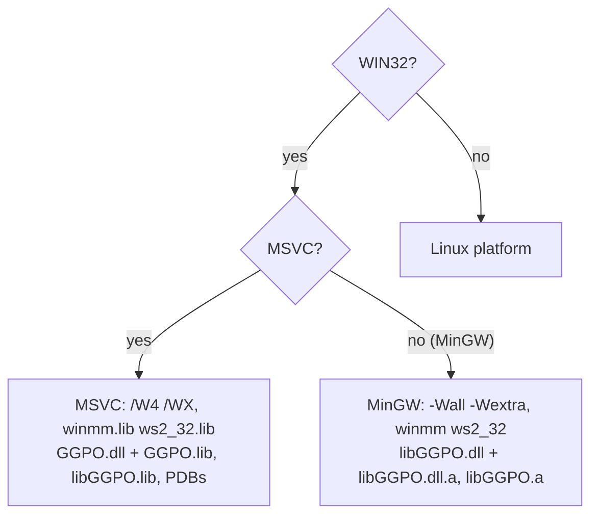

# TECH_PLAN — MinGW-w64 SDK support

Status: Planning only

Source: `02ac787240fe68dfe21ce60629fe6980f9885e3b`

[Product brief](PRD.md) · [Tracker](PROGRESS.md)

## Verified baseline

- [`src/platform/windows/Platform.cmake`](../../../src/platform/windows/Platform.cmake)
  adds `/W4 /WX` and links `winmm.lib ws2_32.lib` for every `WIN32` build.
- [`src/CMakeLists.txt`](../../../src/CMakeLists.txt) names the static library
  `libGGPO` and sets compile-PDB properties whenever `WIN32`; MinGW would
  produce `liblibGGPO.a`. PDB installation is already guarded by `MSVC`.
- [`helper_methods.cmake`](../../../src/cmake/helper_methods.cmake),
  [`tests/CMakeLists.txt`](../../../tests/CMakeLists.txt) and the Vector War
  build guard compiler flags with `MSVC`, but select Windows-only tests and
  the Win32 frontend with `WIN32`.
- [`platform_windows.cpp`](../../../src/lib/ggpo/platform_windows.cpp) uses
  `timeGetTime`, Winsock, and `_snprintf_s(..., _TRUNCATE, ...)`.
  [`types.h`](../../../src/lib/ggpo/types.h) and the bundled `zconf.h`
  already handle non-MSVC compilers.
- [`verify_consumers.py`](../../../tests/consumer/verify_consumers.py)
  treats Windows as MSVC: runtime checks assume `GGPO.dll` and a
  multi-config generator layout.
- The Windows compatibility scripts depend on `dumpbin` and a frozen MSVC
  baseline.

## Toolchains

| Architecture | MSYS2 environment | Compiler | C runtime | Exceptions |
|---|---|---|---|---|
| x64 | `UCRT64` | `x86_64-w64-mingw32-gcc` | UCRT | SEH |
| x86 | `MINGW32` | `i686-w64-mingw32-gcc` | MSVCRT | DWARF-2 |

Both use the Ninja generator, Release configuration, and
`msys2/setup-msys2` on `windows-2022` runners.

## Build changes



- `Platform.cmake` (Windows): compiler flags by `MSVC`, and system
  libraries as `winmm ws2_32` (valid for both toolchains).
- `src/CMakeLists.txt`: static `OUTPUT_NAME libGGPO` and compile-PDB
  properties only for `MSVC`; MinGW uses `OUTPUT_NAME GGPO` for both, giving
  `libGGPO.dll`, `libGGPO.dll.a` and `libGGPO.a`.
- Shared library: keep undecorated `ggpo_*` exports on x86 (check for
  `@N`/leading-underscore decoration; add `-Wl,--kill-at` only if needed).
  Link `-static-libgcc -static-libstdc++` so `libGGPO.dll` does not require
  MinGW runtime DLLs on the user's machine (decision to confirm in M1).
- `GGPO_BUILD_VECTORWAR` defaults to `OFF` under MinGW; explicitly enabling
  it fails with a clear message.
- `platform_windows.cpp`: replace `_snprintf_s` with portable `snprintf` and
  explicit termination, keeping the MSVC behavior identical.

## Tests

| Area | MinGW behavior |
|---|---|
| Portable core, API, protocol, fake platform | Unchanged; run as-is |
| Native platform conformance, SyncTest, peer loopback, static runtime smokes | Run with the Windows adapter |
| Public/packet layout fixtures | Run; values must equal the frozen MSVC values |
| Exports | New `mingw_exports` test: `objdump -p libGGPO.dll` export names must equal [`exports-x64.txt`](../../../tests/baseline/windows/exports-x64.txt) on both architectures |
| Win32 GUI host contract | Not built (no MinGW Vector War) |
| Frozen MSVC baseline, `dumpbin` evidence | MSVC lanes only |

`verify_consumers.py` learns MinGW: shared consumers must import
`libGGPO.dll` (`objdump -p` DLL Name), static consumers must not, and
programs run with the SDK `bin` on or off `PATH` as today.

### Cross-toolchain check

One consumer job links a MinGW-compiled C program against the **MSVC** release
`GGPO.dll` (via the DLL directly) and runs it. This documents the supported
mixing rule: the DLL's C interface crosses toolchains; static libraries do not.

## CI

| Workflow | Addition |
|---|---|
| New `mingw-compatibility.yml` | `MinGW x64` (UCRT64) and `MinGW x86` (MINGW32): both libraries, Release, full CTest, install, consumer cases, export manifest |
| Cross-platform E2E | Build a MinGW x64 static peer; add `mingw-windows` (MinGW↔MSVC) and `mingw-linux` scenarios for the generic peer fixture |
| Release | `Windows x64 MinGW SDK` and `Windows x86 MinGW SDK` jobs producing `ggpo-V-windows-{x64,x86}-mingw.zip`; dry-run validated |
| Ruleset | Add `MinGW x64` and `MinGW x86` as required checks at merge |

No MinGW Debug lane: MinGW has no debug-runtime equivalent of MSVC's, and the
sanitizer and MSVC Debug lanes already cover the shared sources.

## Packaging

```text
ggpo-V-windows-x64-mingw/
├── include/ggponet.h
├── bin/libGGPO.dll
├── lib/libGGPO.dll.a        # import library
├── lib/libGGPO.a            # static library
├── lib/cmake/GGPO/
└── share/GGPO/              # LICENSE, README (names the toolchain and runtime)
```

## Documentation

- Developer Guide: MinGW download rows, MSYS2 and Linux cross-compile build
  commands, linking with and without CMake (`-lGGPO` vs `libGGPO.a` +
  `-lws2_32 -lwinmm`), and deploying `libGGPO.dll`.
- A compatibility table: MSVC app + MSVC SDK (both flavors), MinGW app +
  MinGW SDK (both flavors), MinGW app + MSVC `GGPO.dll` (supported, C API
  only), anything else unsupported.
- Build.md and Testing.md: MinGW naming, toolchains, and lanes.

## Rollout

1. CMake split by `MSVC`, naming, and the `snprintf` change; MSVC/Linux CI unchanged.
2. MinGW CI for x64 and x86 with tests and the export manifest.
3. Consumer driver support and the cross-toolchain check.
4. E2E scenarios.
5. Release jobs, dry run, documentation, ruleset update.

## Open decisions

- Statically link libgcc/libstdc++ into `libGGPO.dll` (proposed) or ship
  the MinGW runtime DLLs alongside it.
- Whether the x86 MinGW download should wait for a 32-bit UCRT toolchain
  instead of using MSVCRT (proposed: ship MSVCRT now, documented).
